# 智能体开发(Coze)

## Coze 平台介绍及入门

### Coze 平台介绍

#### 智能体的基本概念

##### 智能体和Agent

在以 chatgpt 的大模型出现以后，模型具备了 “思考” 能力，能够帮助我们解决一些知识获取和推理等问题。但是因为大模型只能输出内容，能够帮助我们解决的业务问题有限，如果能让大模型具备使用工具的能力，将很大程度上拓宽大模型能力的边界。于是基于大模型 + 工具调用这种解决方案，“智能体” + “Agent” 这个概念在业界出现并大火。

**智能体，又称 Agent**。是指能够感知环境、分析信息、自主决策并采取行动以实现特定目标的软件实体或系统。它以大模型 (如 GPT 等) 为“大脑”，具备理解、规划、决策、记忆和行动的能力。AI Agent = LLM + 记忆 + 任务规划 + 工具使用。
传统的大模型就像一个“百科全书”，知识渊博，有问必答，但它不会主动去“做”什么事。而智能体则像一个“全能助理”，比如你告诉它“我下周三要去杭州出差，帮我安排好行程”，它就能自主完成查询航班、预订酒店、规划市内交通、提醒天气等一系列操作。它不仅“有脑”(能思考)，还“有手有脚”(能调用工具去执行)。

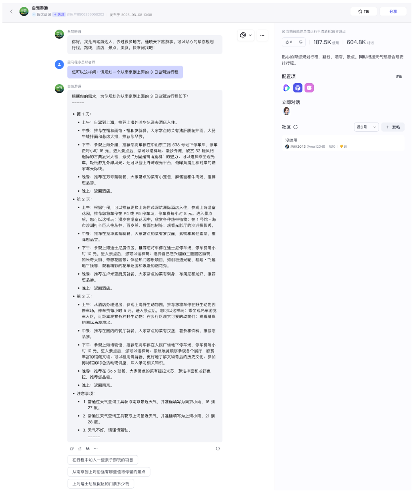

Agent 的目标和理念：让它成为一个能自主思考、能帮你办事的“智能大脑”或“数字员工”。现阶段，我们的Agent还处于过渡阶段，一般是以一个“流水线”的方式事先规定好业务流程，通过串联多个大模型负责处理不同的任务，从而解决一个复杂的业务场景。而Agent的终极形态是不需要开发这些流水线，Agent能够完全自主完成我们的各种需求，这依赖于大模型的能力，目前来看还需要一定的时间。

##### 智能体开发平台-GPTS

2023年11月，OpenAI为旗下的 ChatGPT 推出了一项名为 “GPTs” 的服务，允许用户无需写代码就可以根据特定需求创建“属于自己的 ChatGPT 版本”，也就是基于 ChatGPT 创建一个 Agent。

GPT Store 访问地址：https://chat.openai.com/gpts，注意需要科学上网，以及当前只针对 plus 用户开通了使用权限。

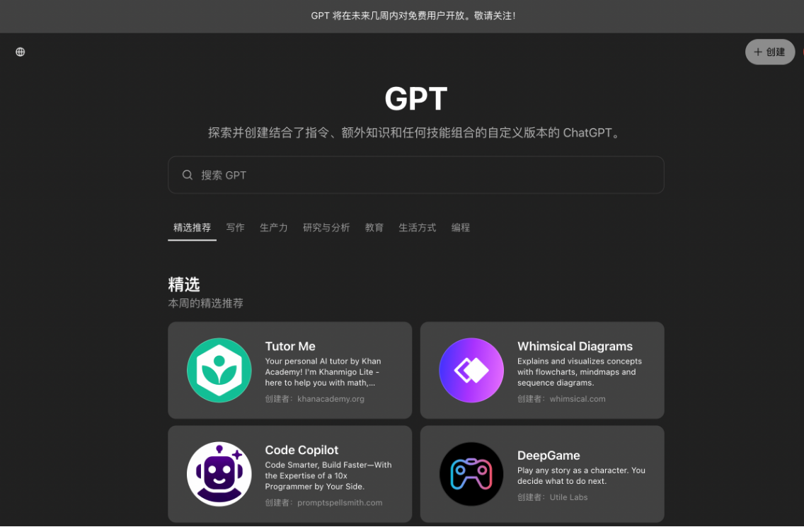

#### Coze 平台简介

##### Coze 平台介绍

###### 平台介绍

Coze 是由字节跳动推出的一个AI聊天机器人和应用程序编辑开放平台，可以理解为字节跳动版的GPTs。

Coze 还提供了多种插件、知识、工作流、长期记忆和定时任务等功能，来增强聊天机器人的能力和交互性。而且你可以将搭建的 Bot 发布到各类社交平台和通讯软件上，让更多的用户与你搭建的 Bot 聊天。

Coze 平台在线版的主页如下：


###### 智能体和应用

智能体和应用是Coze平台的Agent的两种不同的形式，都可以使用Coze平台自带的功能进行开发和完成部署。在“作品社区”中，我们可以看到其他用户或者企业上线的智能体和应用内。区分方式：是否有“应用”图标。智能体和应用的区别我们稍后再讲。

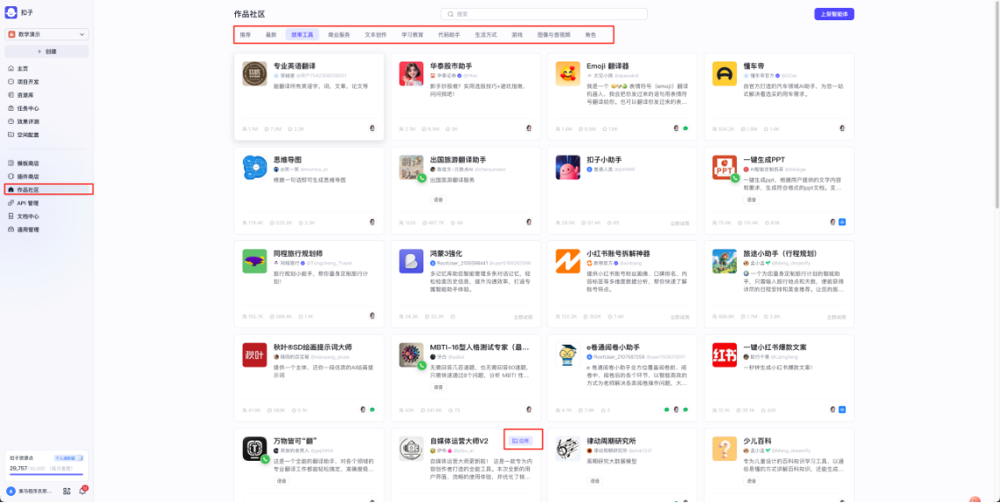

1. Coze 智能体

智能体是基于对话的AI项目，它通过对话方式接受用户的输入，由大模型自动调用插件或工作流等方式执行用户指定的业务流程，并生成最终的回复。智能客服、虚拟伴侣、个人助理、英语外教都是智能体的典型应用场景。

例如，使用华泰股市智能体。通过和它进行对话，实现我们的业务

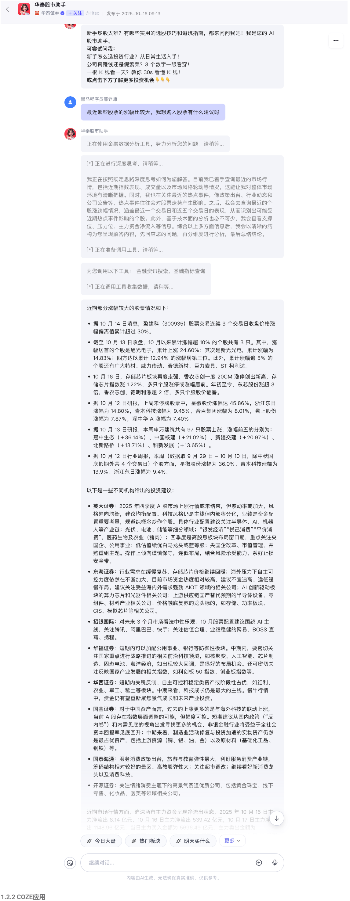

2. Coze 应用

应用是指利用大模型技术开发的应用程序。Coze 中搭建的应用具备完整业务逻辑和可视化用户界面，是一个独立的AI项目。通过Coze开发的应用由明确的输入和输出，可以根据既定的业务逻辑和流程完成一系列简单或负责的任务，例如AI搜索、翻译工具、饮食记录等。

智能体和应用并非互斥，他们可以协同工作，形成更强大的解决方案。一个常见的模式是：AI 应用负责收集结构化的用户输入并呈现最终结果，而在处理过程中，可以调用一个或多个智能体来完成特定的分析、推理或创意生成任务。

比如，自媒体运营大师 V2：


3. 智能体和应用的对比

从原理层面上讲，智能体和应用的区别不大，主要在于呈现和交互的方式不同，接下来我们做一个对比：

| 对比维度 | 智能体 (Agent) | AI 应用 (Application) |
|---|---|---|
| **核心交互形态** | **对话驱动**，以自然语言多轮对话为主 | **界面驱动**，提供图形化界面 (如表单、按钮) 进行交互 |
| **设计目标与心智** | **“跟我聊”**，像一个专家或助手，灵活响应 | **“帮我做”**，像一个标准化工具，完成固定流程 |
| **功能复杂度** | 相对轻量，适合 **单一或特定任务** | 相对复杂，整合 **多个智能体、工具和流程**，形成完整解决方案 |
| **典型发布渠道** | 对话框、Bot Store、集成到飞书/微信等即时通讯工具 | 独立的 Web App、H5 页面、小程序，或通过 SDK/API 集成 |

##### Coze 平台在线版

在线版本的Coze (SaaS版，这个概念参考后面拓展内容的介绍)，Coze(扣子) 分为国内版和国外版：

- 国内版访问地址：https://www.coze.cn/home，背后大模型应用的是字节自研的豆包大模型、通义千问和kimi大模型
- 国外版访问地址：https://www.coze.com/home，背后大模型应用的是 GPT-4、Gemini等，但是需要一些科学上网的方法。

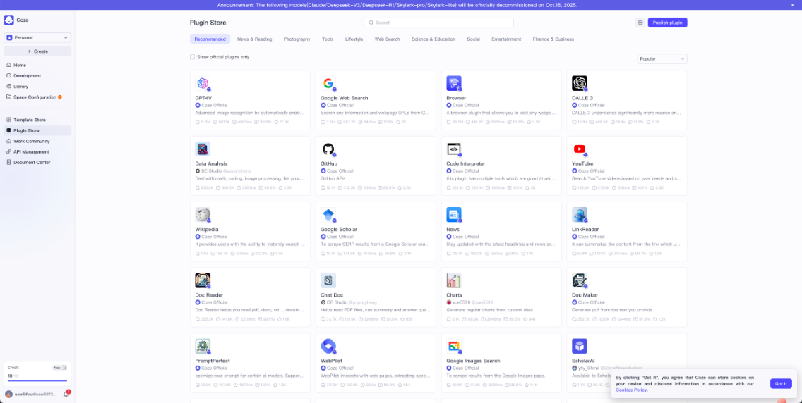

两个版本的对比：从模型的维度，当前国外版的Coze的确比国内版的要有优势，主要体现在模型上；从生态的维度国内版本的Coze对接的各类插件都是国内的各类平台的 (高德地图、企查查等) 的，更符合国内的生态。

**拓展：什么是 SaaS？**

简单来说，SaaS (Software as a Service，软件即服务) 就像软件的 “订阅制”。您无需购买软件光盘安装到电脑上，而是通过互联网直接使用软件服务，按需订阅，按使用付费。简单概括就是“可以在线使用的软件服务”。比如，腾讯文档、金蝶云、腾讯会议、钉钉、法大大等。需要注意的是这里的SaaS指的是商业软件，不包括爱奇艺、QQ会员这类面向用户的软件。

##### Coze 平台开源版

在介绍Coze平台之前，先给同学们介绍一下，什么是开源软件

开源软件 (Open Source Software) 是一种将其 **源代码** 向公众开放的软件，允许任何人处于任何目的 **自由地查看、使用、修改和分发** 其原始代码。比如我们使用地 Linux 操作系统、Mysql 数据库、甚至 Python 语言，都属于开源软件。全球最大的开源社区 

github: https://github.com/

仅仅公开源代码并足以称为“开源”。真正的开源软件通常具备以下几个关键特征：

- **自由再分发**：允许自由地销售和分发软件。
- **允许派生作品**：允许在原始软件基础上进行修改和创建新的衍生软件。
- **不歧视个人或领域**：不得限制任何个人、团体或将软件用于特定领域 (如商业用途)。

这些规则通过 **开源许可证** 这一法律文件来明确和保障，常见的开源许可证包括对使用者要求较为宽松的 **MIT许可证、Apache许可证**，以及要求衍生软件也必须以相同开源条款发布的 **GPL许可证** 等。常见的开源软件：

- 编程语言：Python、Java(Open JDK，不是所有的版本都是开源的)
- 操作系统：Linux
- 开发工具：Visual Studio Code、Git
- 数据库软件：Mysql
- 人工智能：Tensorflow、Pytorch

###### 什么是开源版Coze

因某些业务场景的数据安全要求较高，要求模型、数据不能暴露到公网。因此，私有化部署称为了部分业务场景的刚需。

Coze 针对私有化部署场景进行了开源，github 地址：https://github.com/coze-dev/coze-studio，在2025年7月26日正式开源，允许免费商用和本地化部署。

Coze 的官方介绍：

- Coze studio 是一站式 AI Agent 开发工具。提供各类最新大模型和工具、多种开发模式和框架，从开发到部署，为你提供最便捷的 AI Agent 开发环境。
- **提供 AI Agent 开发所需的全部核心技术**：Prompt、RAG、Plugin、Workflow，使得开发者可以聚焦创造 AI 核心价值。
- **开箱即用，用最低的成本开发最专业的 AI Agent**：Coze Studio 为开发者提供了健全的应用模板和编排框架，你可以基于它们快速构建各种 AI Agent，将创意变为现实。

**功能清单**：

| 功能模块 | 功能点 |
|---|---|
| 模型服务 | 管理模型列表，可接入 OpenAI、火山方舟 等在线或离线模型服务 |
| 搭建智能体 | **编排、发布、管理智能体** 支持配置工作流、知识库等资源 |
| 搭建应用 | **创建、发布应用** 通过工作流搭建业务逻辑 |
| 搭建工作流 | 创建、修改、发布、删除工作流 |
| 开发资源 | 支持创建并管理以下资源：**插件、知识库、数据库、提示词** |
| API 与 SDK | **创建会话、发起对话等 OpenAPI** 通过Chat SDK 将智能体或应用集成到自己的应用 

###### 开源版 Coze 和 SaaS 版的区别

**开源版Coze 与 SaaS版区别如下**：

| 功能模块 | SaaS 企业版/云端版 | 开源版 (Coze Studio) | 
|---|---|---|
| **核心写作功能** | 支持 **团队空间**、多人协作、权限管理、审批流 | 仅支持 **个人空间**，缺乏原生的团队协作功能 |
| **插件与工具** | 提供丰富的官方和第三方 **插件市场**，支持图像理解、音视频处理等 | 仅内置约 **19个官方插件**，不支持用户插件市场，部分高级节点 (如图像理解) 被移除。 |
| **智能体类型** | 支持 **对话型智能体** 和 **应用型智能体** (有 UI 界面) | 主要支持 **对话型智能体**，不支持开发应用型智能体 |
| **发布与集成** | 一件发布至 **飞书、微信公众号、Discord** 等多种平台 | 发布渠道有限，主要支持 **Web SDK 和 API 集成** |
| **多模态与高级功能** | 支持 **语音交互、图像生成** 等多模态能力 | 缺少官方支持的语音、图像生成等多模态功能 |
| **运维与数据分析** | 提供完善的 **运营仪表盘**，监控 Token 消耗、用户互动等 | 需要自行构建运维监控体系，缺乏开箱即用的数据分析面板 |

**私有化部署使用的话，一般使用 Dify，原因有以下几点**：

- dify 是一个更早开源的平台，与Coze 功能类似，且社区成熟、功能对比 Coze 更强大，已经占据了较大的市场
- Coze 对比 dify 的优势在于丰富的插件库、应用型智能体、以及对于多模态的支持，在开源版这些功能被阉割比交
- coze 是 golang 开发的，语言对比 dify 相对小众

因 Coze 开源版在企业中使用较少，且安装和使用需要依赖 Docker 作为前置知识，因此，Coze 开源版的部署和使用 我们放在 Dify 的课程中进行。

## Coze 平台入门实战

### Coze 平台的基本使用

#### 功能简介

##### 工作空间

空间是资源组织的基础单元，不同空间内的资源和数据相互隔离。一个空间内可创建多个 **智能体** 和 **AI 引用**，并包含一个 **资源库**。在资源库中创建的资源可以被相同空间内的智能体和AI 应用使用。

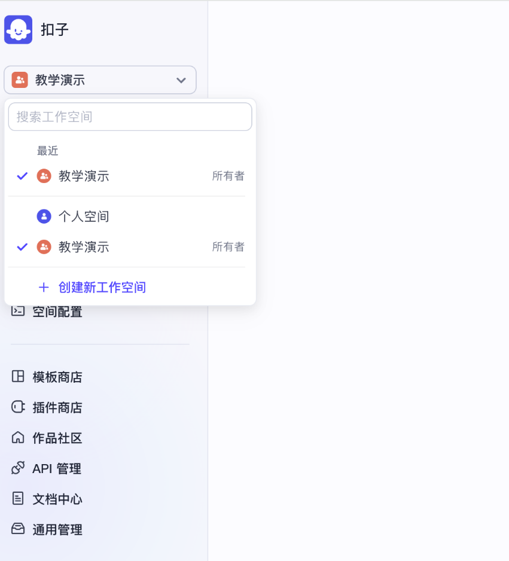

工作空间存在的意义是为了隔离不同的业务，比如某公司采购了一个企业版的Coze，公司有做打车业务的、有做金融业务的，这些业务团队之间只能访问自己业务团队的开发好的智能体和应用，团队之间应当互相隔离。

##### 项目

项目分为智能体和 AI 应用两种类型，AI 应用内可以创建多种应用专属资源，也可以和智能体共享空间资源库中的资源。当我们创建一个项目时，有智能体和应用两种选择：

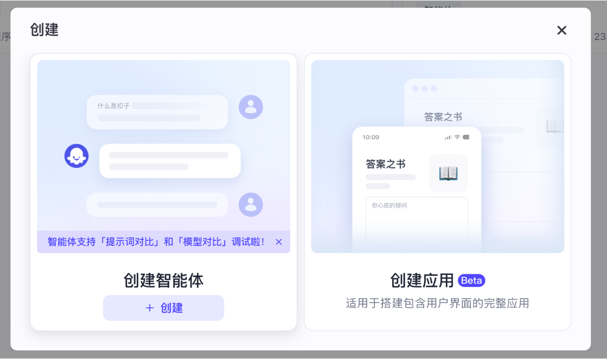

关于智能体和AI应用我们在上文已经给出大家解释，以下时官方文档中的原文：

- **智能体**：智能体 (Agent) 通常指的时一个能够独立执行任务、做出决策并进行学习的一种自动化程序。智能体可以根据用户输入的指令，自主调用模型、知识库、插件等技能并完成编排，最终完成用户的指令。
- **AI 应用**：AI 应用是指利用大模型技术开发的应用程序，这些应用程序能够使用大模型，执行复杂任务，分析数据，并作出决策。

空间和项目以及资源库的关系图如下，可以看到：

- 一个空间中可以包含多个项目，包括智能体、AI 应用两种类型
- 智能体和AI 应用的开发会引用资源库中的多种资源类型

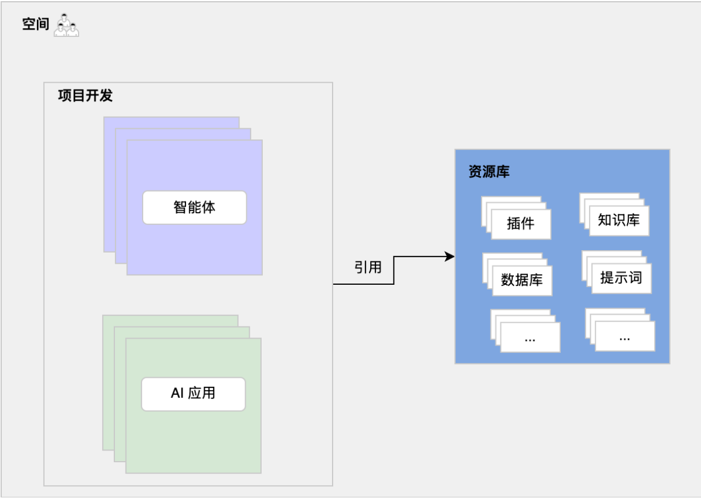

##### 资源库

- **资料库**：你可以在资源库内创建、发布、管理共享资源，例如插件、知识库、数据库、提示词等。这些资源可以被同一空间内的智能体和应用使用。

资源可以存在于两个实体内，一个是空间的资源库，一个是 AI 应用项目中的项目资源库。

- **空间资源库**：在空间资源库内创建的资源可以被空间内的AI应用项目和智能体项目使用，属于空间内的共享资源。
- **AI 应用项目**：在AI应用项目中也可以创建资源，但这些资源是项目自有的资源，默认不可以被其他项目使用也不会展示在空间资源库内。

当需要将 AI 应用项目中的资源转换成公共资源给其他AI应用或智能体使用时，可以将这些资源转移或复制到空间资源库内。

在资源库中添加一个资源，我们可以看到，Coze 平台支持如下几种资源类型。并非左右的资源类型都是常用的，在实际工作中，我们最常用的是 **插件、工作流、对话流、知识库、数据库**。

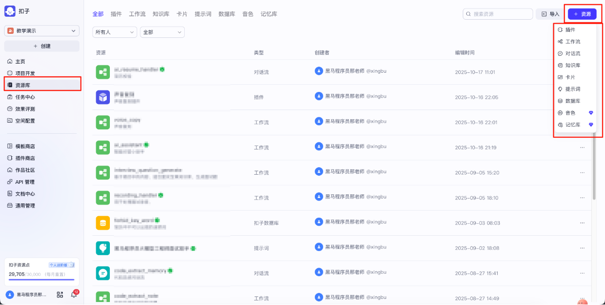

##### 插件

Coze 提供了一个多样化的插件库，这些插件涵盖了从基础的文本处理到高级的机器学习功能。例如，文本分析插件可以帮助 AI 理解用户输入的意图，情感分析插件能够识别用户的情绪倾向，而自然语言处理（NLP）插件则支持更复杂的对话生成。

此外，还有图像识别、语音识别、数据分析等插件，这些插件的数量和种类不断增加，以适应不断变化的技术趋势和市场需求。

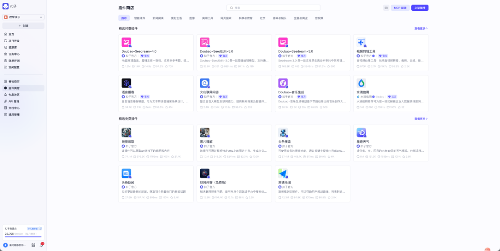

##### 工作流和对话流

Coze 平台 **提供了灵活的工作流设计工具，开发者可以通过拖拽式界面轻松搭建复杂的对话流程**。工作流本质是一个有向无环图，由边和节点构成，边代表执行顺序，节点则表示一个具体的执行步骤

工作流用于处理功能类的请求，可通过顺序执行一系列节点实现某个功能。适合数据的自动化处理场景，例如生成行业调用报告、生成一张海报、制作绘本等。

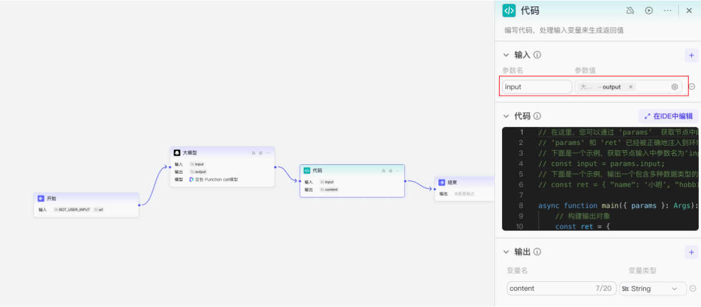

工作流是 Coze 平台最核心的功能，它是资源库中一种特殊的资源类型，我们在实际工作中，集合所有的功能都需要基于工作流实现。我们上文中提到的插件、知识库、数据库这些核心功能，在实际开发时，都是作为工作流中的节点使用。

对话流是基于对话场景的特殊工作流，更适合处理对话类请求。对话流通过对话的方式和用户交互，并完成复杂的业务逻辑。对话流使用于 Chatbot 等需要在响应请求是进行复杂逻辑处理的对话式应用程序，例如个人助手、只能客服、虚拟伴侣等。

工作流的具体使用方法，我们在后面将用一个较长的篇幅进行介绍。

##### 知识库和数据库

Coze 支持使用 Coze 官方知识库和火山数据库 (更加专业版的知识库)，两者均支持伤处和存储外部知识内容，并提供了多种检索能力。Coze 的知识能力可以解决大模型幻觉、专业领域知识不足的问题，替身大模型回复的准确率。

知识库中一般存放的是各类文档数据，比如专业书籍、说明书、产品价绍文档等文本类数据。

数据库存放的是各类业务记录，比如 订单、流水、操作记录等结构化数据。


#### 工作流的使用

智能体、AI应用和工作流的关系和前文中项目和资源库的关系类似，一个项目 (智能体、AI应用) 可以引用多个工作流。但是在这里我们强调的是，几乎所有的资源类型都是以智能体引入工作流的方式。

接下来，我们将使用一个“旅游规划小助手”作为案例，帮助同学理解工作流的使用

##### 创建一个工作流

进入资源库页面，点击右上角的“+ 资源”，即可完成工作流的创建

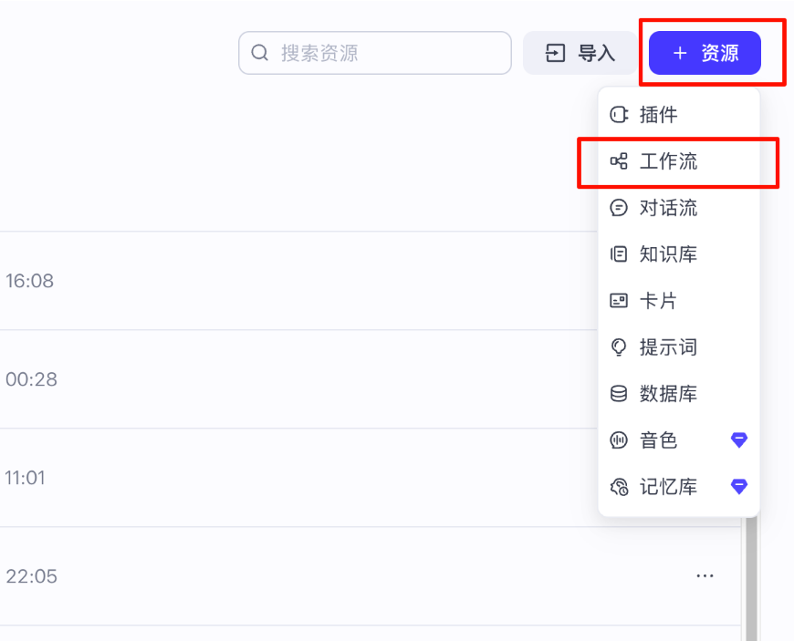

点击后，弹出如下页面：

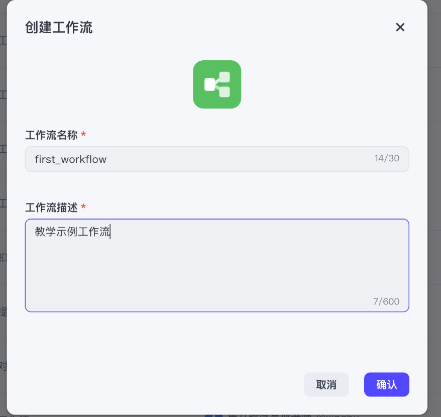

输入以下内容：

- 工作流名称：需要 全英文 + 数字 + 下划线 的方式输入，长度不可超过30
- 工作流的描述：需要告诉大模型什么时候调用工作流。**在一个智能体中添加多个工作流时，大模型可以通过工作流描述，自动取调用工作流**。在后续的项目中，我们将使用这种方式实现一个智能体根据业务场景不同调用多个工作流。

点击创建后，进入如下页面。这个页面是一个可以拖动控件进行操作的画布，初始包含：开始和两个节点

- 开始：工作流的入口，相当于一段程序中的主函数，接受变量并传递到后面的节点。开始节点支持配置 String、Number 等多种类型的输入参数。其中 Object 类型的参数最多支持 3 层嵌套。
- 返回变量模式下，工作流运行结束后会以 JSON 格式输出所有返回参数，使用与工作流绑定卡片或作为子工作流的场景。如果工作流直接绑定了智能体，对话中出发了工作流时，大模型会自动总结 JSON 格式的内容，并以自然语言回复用户。返回变量支持配置 String、Number、Object 等多种类型，其中 Object 类型的参数最多支持 3 层嵌套。
- 结束：工作流的出口，相当于一段程序中的最后一行代码，返回变量给工作流的调用方。结束节点支持两种返回方式，即返回变量和返回文本
- 返回文本模式下，工作流运行结束后，智能体中的模型将直接使用指定的内容回复对话。回答内容中支持引用输出参数，也可以设置流式输出。具体说明如下：

| 设置 | 说明 |
|---|---|
| 输出变量 | 输出节点中输出的参数。为工作流绑定卡片时可以使用这些参数。 |
| 回答内容 | 工作流的最终输出内容，不可设置为空。支持引用输出参数，引用方式为 {{变量名}} |

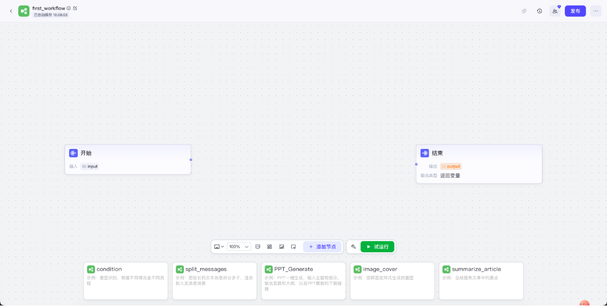

很明显，只有一个开始和一个结束节点时无法组成一个可执行的工作流的。接下来我们将继续学习工作流的常用节点。

##### 大模型节点

大模型节点可以调用大型语言模型，根据输入参数和提示词生成回复，通常用于执行文本生成任务，例如文案制作、文本总结、文章扩写等。

**创建一个大模型节点**：

在画布中点击 “+” 按钮，**添加大模型节点**：

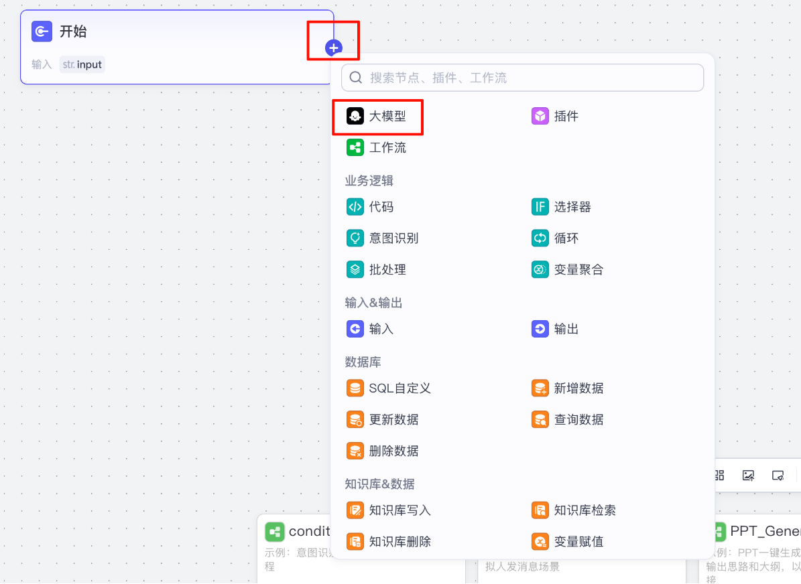

**选择模型**：选择要使用的模型。此节点的输出内容质量很大程度上受模型能力的影响，建议根据实际业务场景选择模型。可选的模型范围取决于当前的账号类型，个人免费版或个人进阶版用户可以使用默认的几类模型，且村咋i对话数量限制，团队版或企业版套餐用户可以使用火山引擎方舟平台的模型。

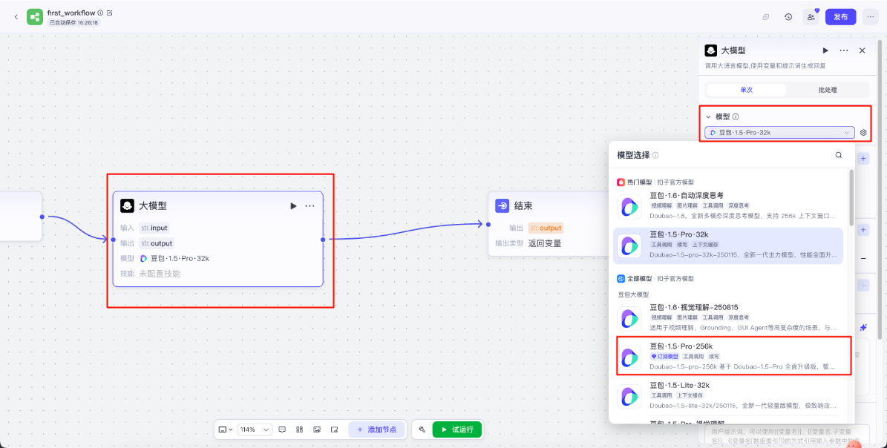

**这是模型的参数**：

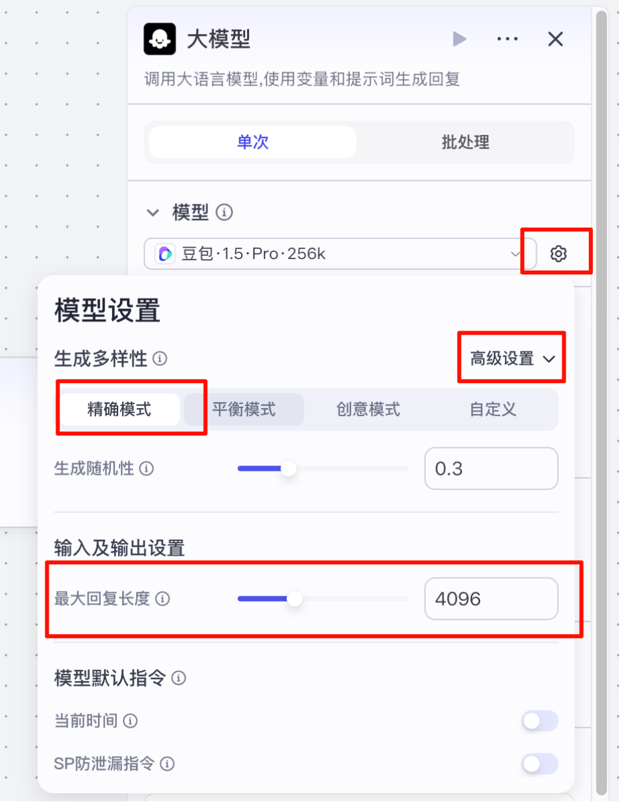

用于从多个维度调整不同模型在生成内容时的随机性。Coze 提供以下预置的模式供你选择，每个模式的模型参数取值不同。

- 精确模式：模型的输出内容严格遵循指令要求，可能会反复讨论某个主题，或频繁出现相同的此话
- 平衡模式：模型的输出内容更具随机性和准确性
- 创意模式：模型的输出内容更具多样性和创新型，某些场景下可能会偏离主旨。

你也可以根据需求，展开 **高级设置**。修改每个模式下的具体参数数值。参数随机性，即 temperature ，用于控制结果的随机性。

- 调高词参数值，会使模型的输出更具多样性和创新型
- 降低此参数值，会使输出内容更加严格遵循指要求，当该数值接近零时，模型将变得确定和重复。

在基于事实的问答场景，你可以使用较低的回复随机性数值，以获得更真实和简洁的答案，例如售后客服场景；在创造性的任务例如小说创作，你可以适当调高回复随机性数值。

最大长度：模型每次生成的内容长度受限于最大输出长度（max_token），过长的内容会被截断，试运行时大模型节点同时提示“输出内容因超出模型最大输出长度被截断。”

**给大模型添加技能**：

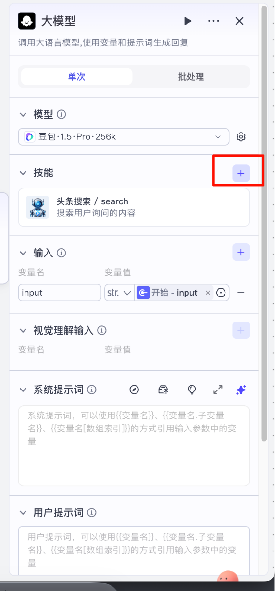

给大模型添加一个技能：头条搜索。 大模型在执行任务时，可以自动的把我们输入的提示词的一部分，调用技能中的“头条搜索”进行联网检索。技能可以拓宽大模型的能力边界， 但是也是因为这个调用是自动化的，所以我们不知道调用工具时到底检索了什么内容。

技能的本质实际上就是“插件”，插件是coze中非常核心且具有竞争力的功能，它可以完成各类工具的调用，我们在后续的内容中将详细介绍。

**给大模型输入 Prompt**：

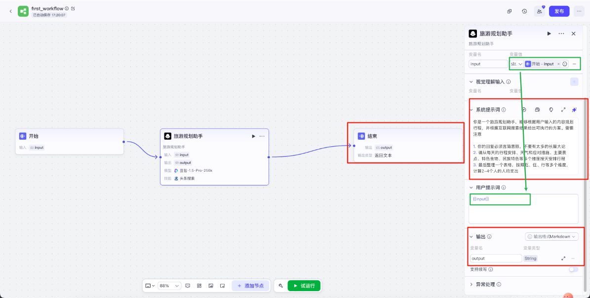

输入：点击“+”，把开始节点的输入传过来作为大模型的输入

在prompt引入变量： 使用 {{变量名}}的方式引入和使用变量，系统提示词和用户提示词都可以使用。

系统提示词：用于指定人设和回复风格。支持直接插入提示词库中的提示词模版、插入团队资源库下已创建的提示词，也可以自行编写提示词。

```
你是一个旅游规划助手，能够根据用户输入的内容规划行程，并根据互联网搜索结果给出可执行的方案。需要注意

1. 你的回复必须言简意赅，不要有太多的长篇大论
2. 请从每天的行程安排、天气和应对措施、主要景点、特色食物、民族特色等多个维度按天安排行程
3. 最后整理一个表格，按照吃、住、行等多个维度，计算2-4个人的人均支出
```

用户提示词：模型的用户提示词是用户在本轮对话中的输入，用于给模型下达最新的指令或问题。

```
{{input}}
```

指定输出：指定模型的输出格式，因为在结束的节点我们就直接输出了，所以这里我们使用markdown格式。

- 文本：纯文本格式。此时大模型节点只有一个输出参数，参数值为模型回复的文本内容。
- Markdown：Markdown 格式。此时大模型节点只有一个输出参数，参数值为模型回复的文本内容。
- JSON：标准 JSON 格式。你可以直接导入一段 JSON 样例，系统会根据样例格式自动设置输出参数的结构，也可以直接添加多个参数并设置参数类型。

**设置输出节点**：

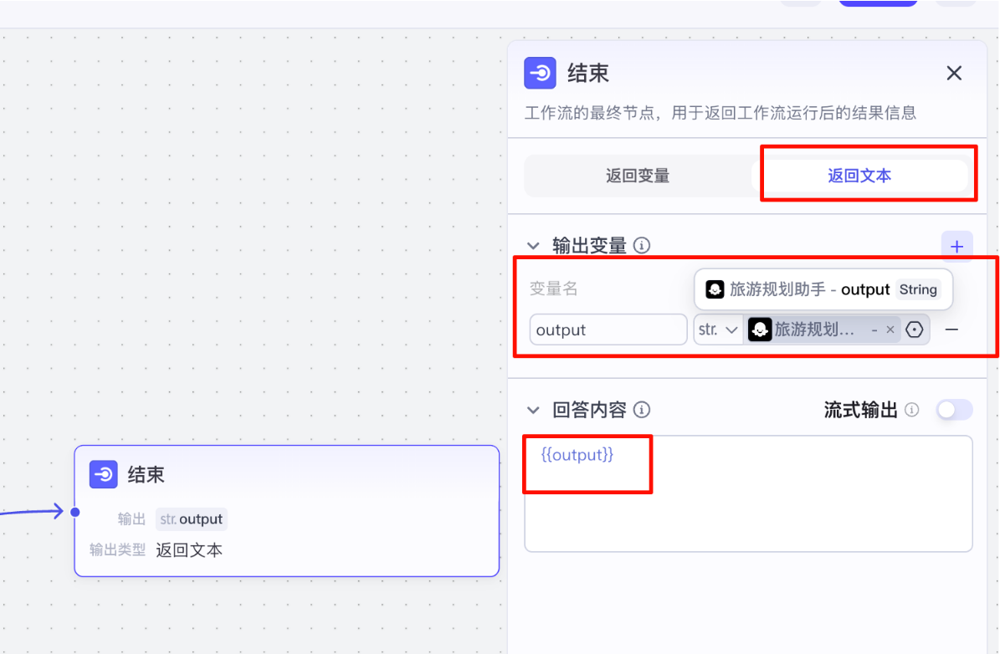

一般来讲，对于输出的内容是对话类型的，设置返回文本格式；需要格式化的输出（比如返回JSON的），设置返回变量。最后，使用{{变量名}}的方式，把上一步的输出返回给调用方。如果生成内容比较多，可以勾选“流式输出”，这样模型则会边生成内容，边返回

##### 试运行工作流

###### 调试工作流

点击试运行工作流，并给开始节点的所有输入变量赋值后，再点击右侧下方的试运行按钮，即可完成调试。

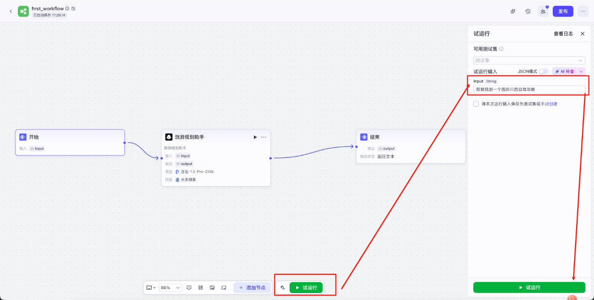

点击试运行后，效果如下：

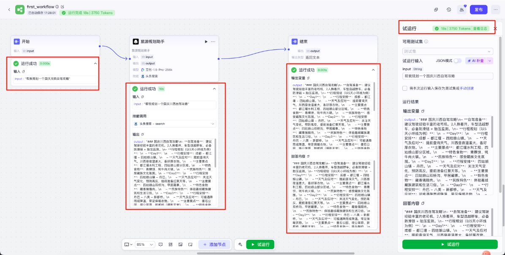

运行过程中，每个节点的执行结果都可以看到，方便我们进行调试。 也会展示整体的执行时间，以及token的消耗数。 可以看到，因为加入了头条搜索的功能，消费3750个token数，并不算少。

###### 查看工作流执行日志

如果想看到更加细节的信息，比如将具体每个节点的执行时间，输入/输出的token数分别是多少等信息，可以查看日志。

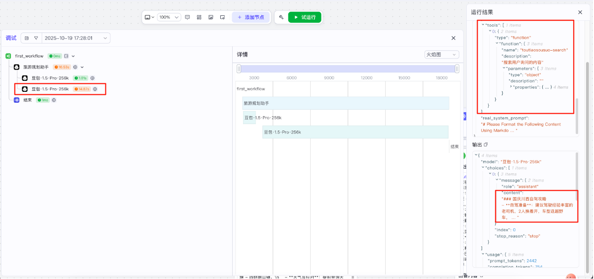

如上图，在“旅游规划助手”这个LLM节点，我们看到它分了两个阶段，第二个节点右侧可以看到这里调用了插件，并返回了对应的结果。同时也看到了这个阶段消耗的token数，包括输入/输出的token数细节。

同样的，工作流在修改之后如果效果不如预期，可能会需要去查看之前的调用日志，可以在下拉框中选择历史的执行记录，去查看历史版本的执行结果。

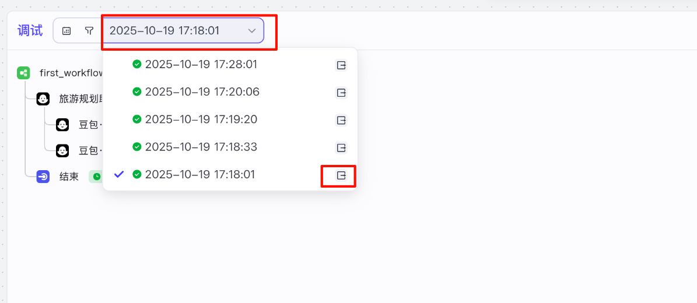

点击右侧的按钮，跳转到了历史的执行记录中，可以看到：**执行日志中不仅仅只是调用时的输入和返回值， 还有当时的整个工作流节点的各类信息**，比如当时的prompt是怎么写的。这对于工作流的调试起到非常重要的指导作用。

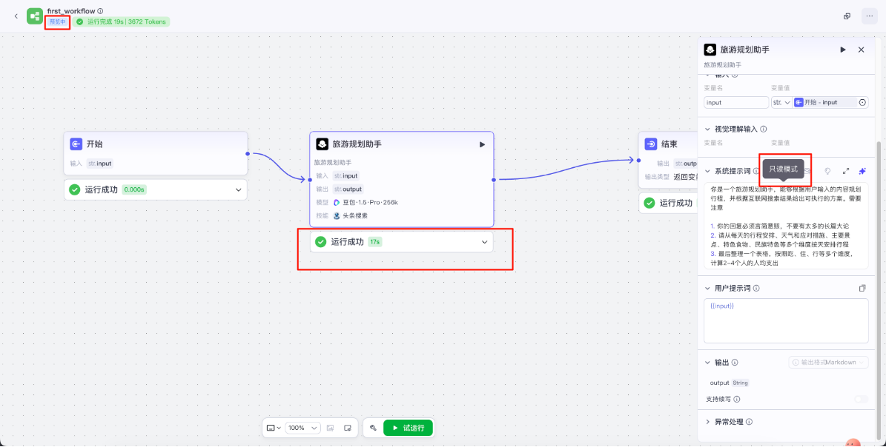

在实际工作中，往往一个工作流会复杂的多，学会调试工作流、查看日志，是coze应用开发的基本功。基本功的好与坏影响开发一个应用的时间，希望同学们认真对待。

##### 其他常用节点

###### 选择器节点

该节点是一个 if-else 节点，用于设计工作流内的分支流程。当向该节点输入参数时，节点会判断是否符合 **如果** 区域的条件，符合则执行 **如果** 对应的工作流分支，否则执行 **否则** 对应的工作流分支。

接下来，我们在这个demo中增加一个选择器节点，用来判断用户输如是否为空，如果为空直接结束不调用大模型。如果不为空则执行后续的逻辑。

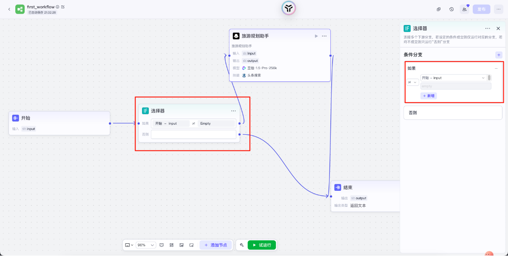

###### 意图识别节点

意图识别（Intent Recognition）指的是让智能体理解用户通过自然语言表达的意图或目的。意图识别是智能助手的典型能力，例如用户在对话中输入“我想查看今天的 AI 新闻”，其中“查看新闻”为用户意图，也就是用户希望智能体执行的操作。扣子工作流支持意图识别节点对用户意图进行归类，无需再通过大模型节点配合选择器节点实现意图识别，使工作流运行更加高效。

意图识别节点可用于以下场景：

- 客户服务：识别用户问题的类型，并转交各类知识库处理，对于知识库中未匹配的问题，转交人工客服处理。
- 医疗咨询：对用户咨询的医学问题进行归类，非医学问题的咨询则拒绝回复。
- 综合类智能体：对于功能多样的智能体，可以先由意图识别节点对用户咨询进行初步分类，转交各个 Agent 分支处理。

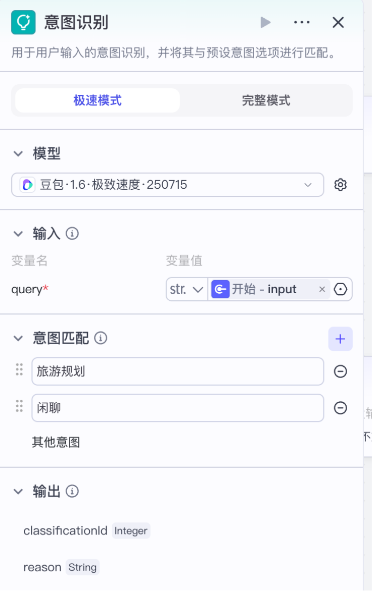

意图识别节点支持极速模式或完整模式运行。

- 极速模式：以较快的速度对用户意图进行分类，适用于关注工作流运行效率的场景。极速模式不支持设置 **系统提示词** 。
- 完整模式：意图识别效果优先，响应速度可能较长，适用于需要复杂逻辑判断的场景，例如剧情类游戏中根据情节发展切换剧情。完整模式往往需要选择意图识别能力较强的模型，并配合细致、严谨的提示词。

和选择器一样，意图识别节点也是一种分支选择节点，区别就是在于意图识别是基于大模型做场景分类，选择器是基于代码层面的逻辑判断。接下来，我们将结合意图识别、输入和输出节点，改造一下我们的旅游规划小助手。

**输入和输出节点**

**输入节点**：

在比较复杂的工作流场景中，某些节点的执行往往需要额外的用户输入。如果上游节点中没有获取到这些信息，你可以添加一个输入节点来主动收集信息。工作流执行到输入节点时会暂时中断，直到此节点收集到必要的用户输入。实际上，开始节点就是特殊的输入节点

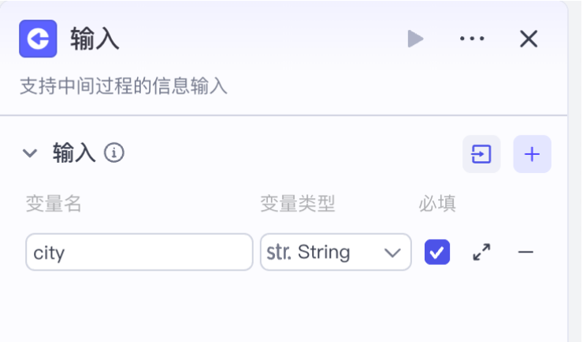

**输出节点**：

通常情况下，工作流会在执行完毕后通过结束节点输出最终的执行结果。当工作流处理流程较长、运行时间较久时，开发者可以在工作流中添加输出节点，临时输出一段消息，避免用户等待时间过长、放弃对话。例如提示用户任务正在执行中，建议用户耐心等待。

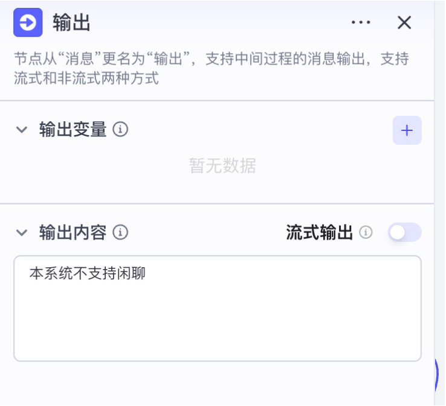

**改造小助手**：

接下来，结合意图识别、输入和输出节点，改造一下我们的旅游规划小助手。首先，增加一个意图识别节点：

把开始节点的input作为query，判断意图：

- 旅游规划：提示用户输入”城市“，然后把用户输入的城市作为旅游助手的输入。
- 其他意图：输出”本系统不支持闲聊“，然后退出

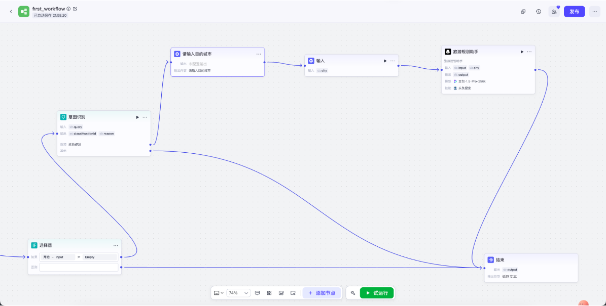

别忘了修改大模型中的变量：

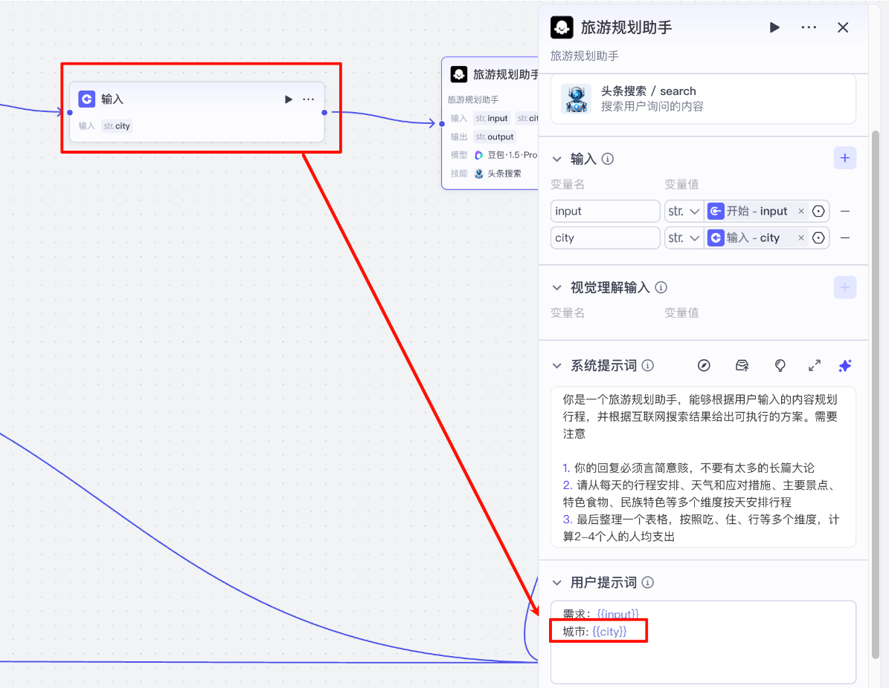

**编辑后，试运行模型**：

输入：

```
帮我规划一个7天的自驾游
```

点击执行后，如下图：

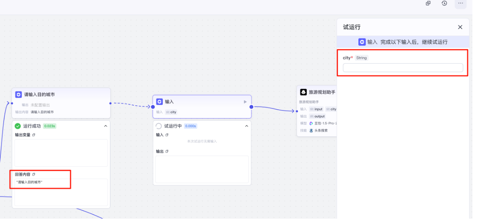

输入：

```
成都
```

然后继续执行，结果如下：

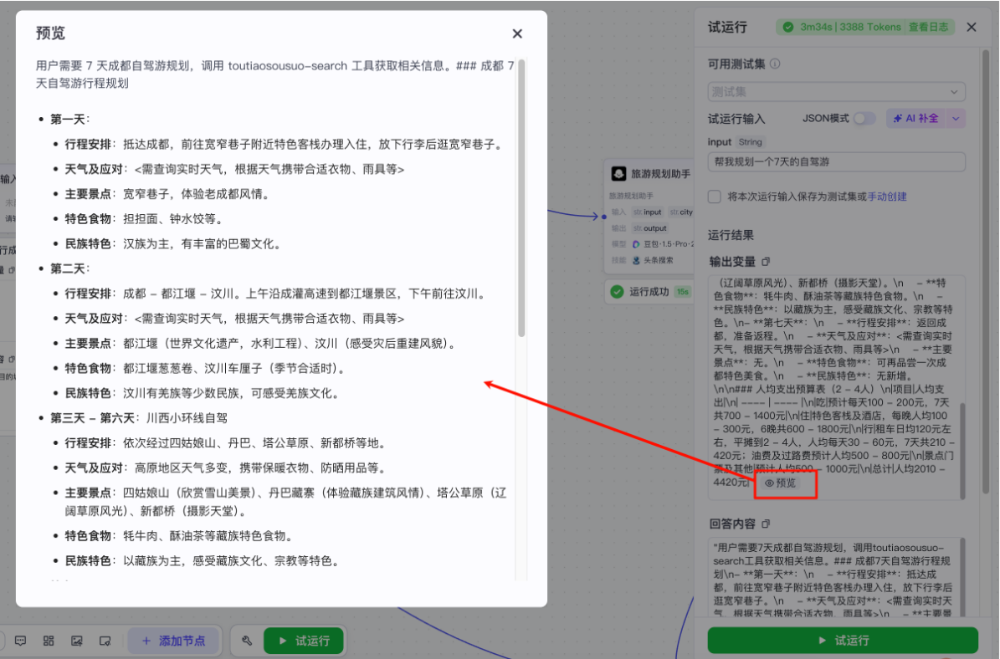

到这里，说明了意图识别、分支判断等功能都正确无误得到了执行。（因大模型产生的内容具有随机性，所以同学们执行后这里的内容很可能和教案中有一些出入，只要是7天+成都，就说明流程是没有问题的）

###### 代码节点

代码节点支持通过编写代码来生成返回值。扣子支持在代码节点内使用 IDE 工具，通过 AI 自动生成代码或编写自定义代码逻辑，来处理输入参数并返回响应结果。

代码节点支持 JavaScript 和 Python 两种语言。我们展开说一下python，官方介绍：

> 支持的模块包括 `curses、dbm、ensurepip、fcntl、grp、idlelib、lib2to3、msvcrt、pwd、resource、syslog、termios、tkinter、turtle.py、turtledemo、venv、winreg、winsound、multiprocessing、threading、sockets、pty 和 tty`。
>
> 在 Python 环境中，仅内置了两个第三方依赖库：`requests_async 和 numpy`。其中，`requests_async 与 requests` 类似，但在使用时需要搭配 `await`。
>
> 说明：
>
> - Python 运行时暂不支持 `Http.client` 方式的请求。
> - 不支持使用除 `requests_async 、numpy` 以外的第三方依赖库。
> - `time.sleep()` 方法由于是阻塞调用，会对代码执行性能产生影响，因此推荐使用异步版本的 `asyncio.sleep()` 来替代。

示例如下：

```python
import requests_async as requests

async def main(args: Args) -> Output:
    # args是调用这个节点传入的参数，通过args.params['url']这种方式获取。 通过requests方法，我们这里就可以通过代码实现一个服务接口的调用，从而实现复杂的逻辑。 
    url = args.params['url']
    response = await requests.get(url)
    ret = {
      'code': response.status_code,
      'res': response.text,
    }
    return ret
```

除此以外，还有一些常用的用法:

| 操作 | 说明 |
|---|---|
| 使用 AI 生成代码 | 你可以在 IDE 底部单击 **尝试 AI**，并输入自然语言设定代码逻辑，AI 将自动生成代码。你也可以选中代码片段，通过快捷键（macOS 为 Command + I、Windows 为 Ctrl + I）唤起 AI，并输入自然语言让 AI 帮助你修改代码。 |
| 补全代码 | 如果你已经为代码节点配置好了输入参数，编辑时支持自动补全参数。 |

接下来，我们继续改造小助手，给它增加一个代码块组件，让小助手知道我们运行工作流时的当前时间。

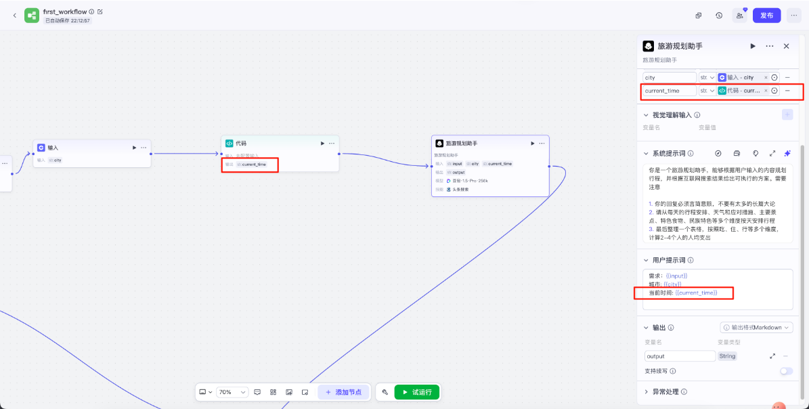

具体代码如下：

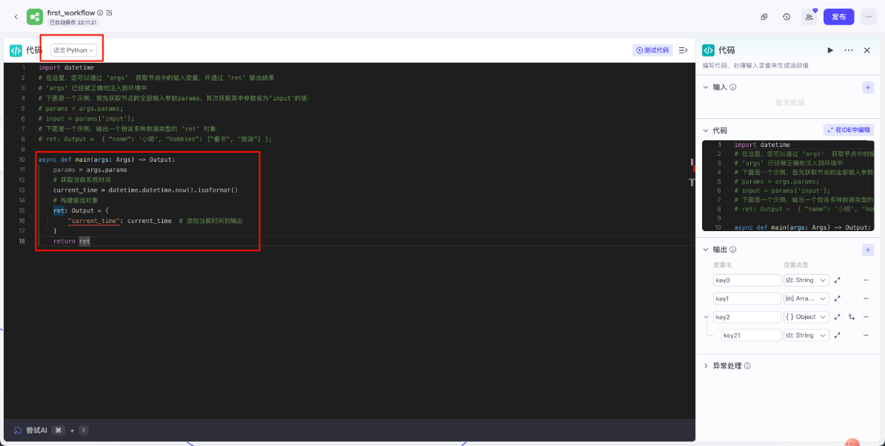

接下来，我们再次试运行工作流，输入：

```
请帮我规划以下周末2天的自驾游行程
```

弹出后续输入框时，输入:

```
河北
```

中间过程略， 最终输出可以看到，规划出来的行程是基于当前时间做出来的方案。

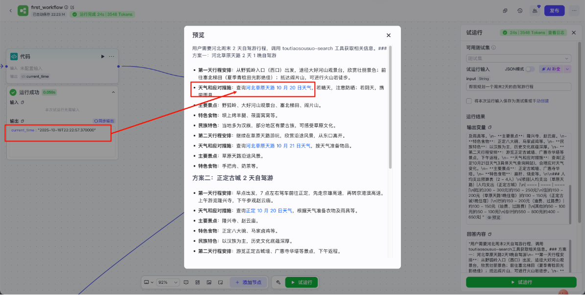

#### 在工作流中使用插件

插件节点用于在工作流中调用插件运行指定工具。

插件是一系列工具的集合，每个工具都是一个可调用的 API。商店中的上架插件或已创建的个人或团队插件支持以节点形式被集成到工作流中，拓展智能体的能力边界。

接下来我们介绍一些常见的插件。

##### 联网搜索插件

联网搜索插件包括头条、B站、懂车帝、百度、谷歌、豆瓣、微博、小红书等各种平台，具体使用哪个需要结合业务。

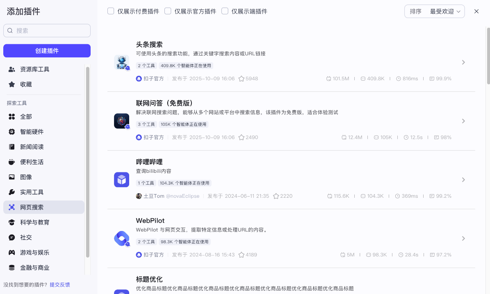

我们以头条搜索为例：

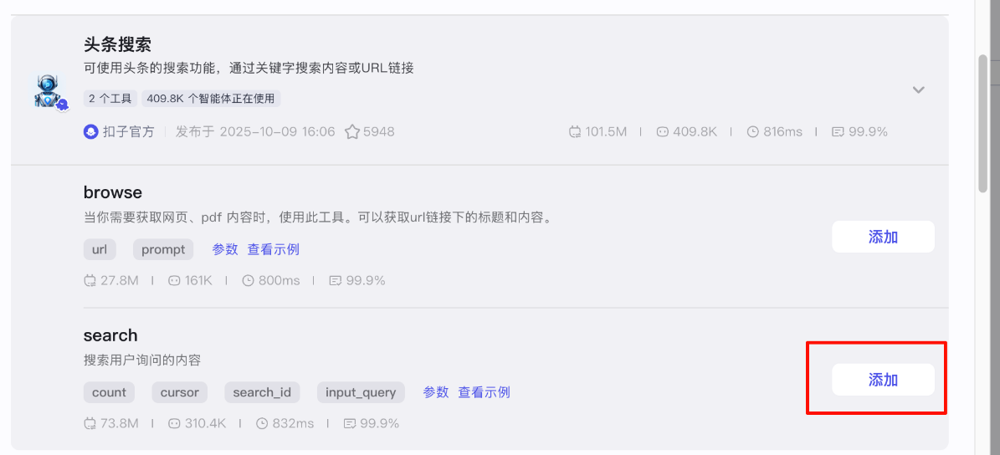

查看示例：

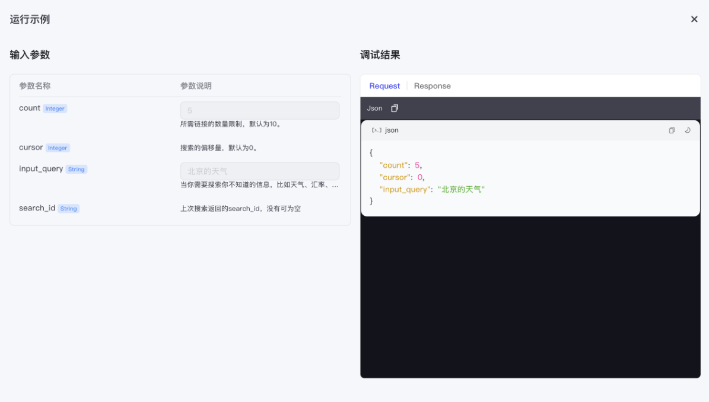

在search工具中输入上述内容，输出如下：

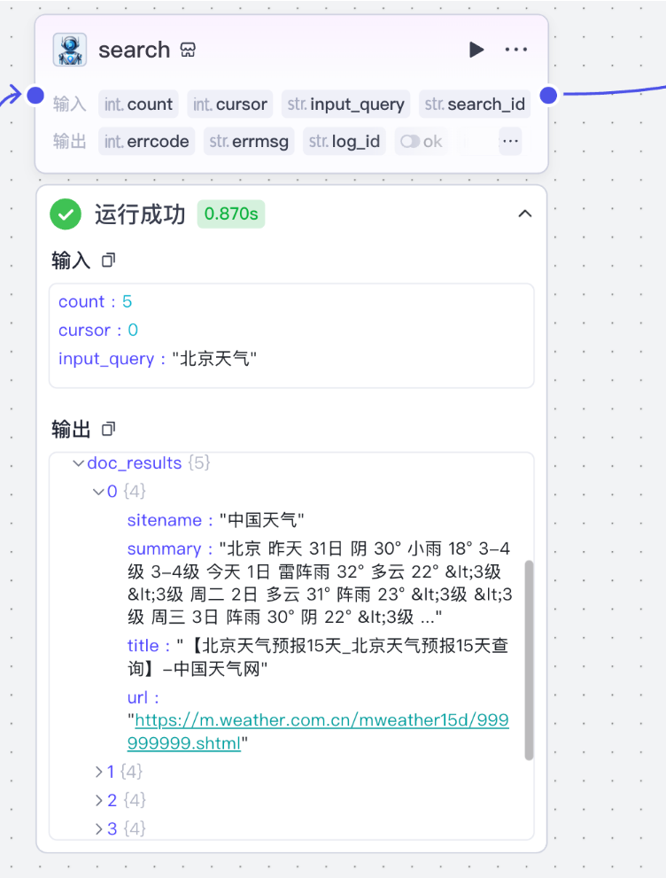

##### 图片理解插件

图片理解插件可以实现图片到文字的转化，需要依赖两部分的输入： 
- 图片
- 用户提示词

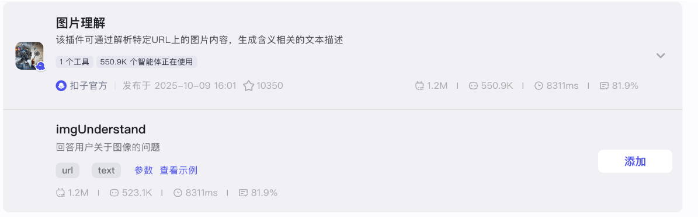

接下来我们使用一个案例帮助大家理解如何使用图片理解插件，首先，我们准备好一张图片：教案素材中的 01-编码器细节.jpg，然后搭建一个简单的工作流。如下图：

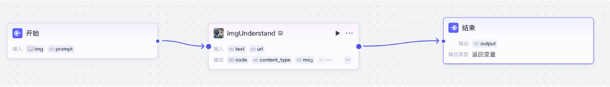

开始节点输入 
- img ：需要被理解的图片, image类型，支持常见的jpg、bmp、png等图片类型 
- prompt：用户提示词，str类型。就是用户要对图片问的问题

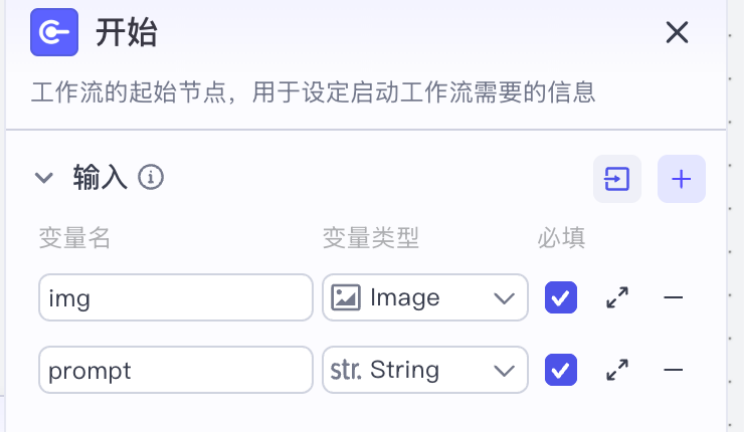

输入部分的参数赋值给图片理解插件 
- text：接收str类型，输入用户的提示词 
- url：接收str图片地址。 这里需要注意：**如果是从输入节点上传过来的图片类型，这里会报红，但是可以正常执行**

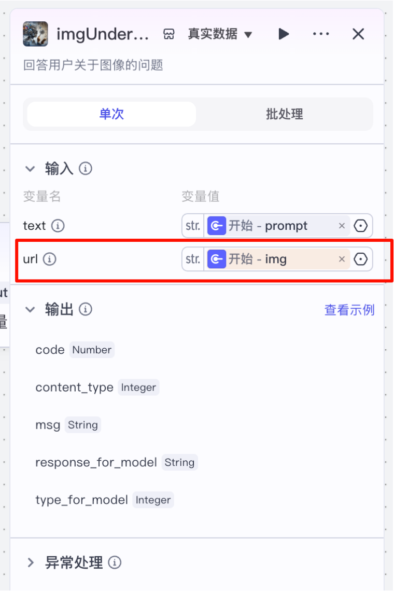

接下来，我们执行一下流水线：

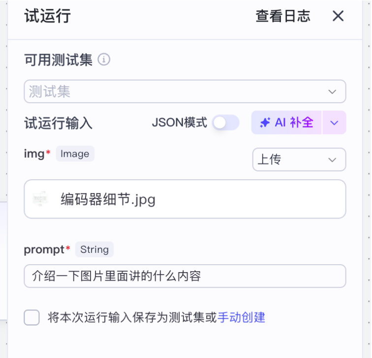

可以看到，输入的图片被转成了url，同时。在response_for_model字段中，返回了图片的内容，且内容是正确的。

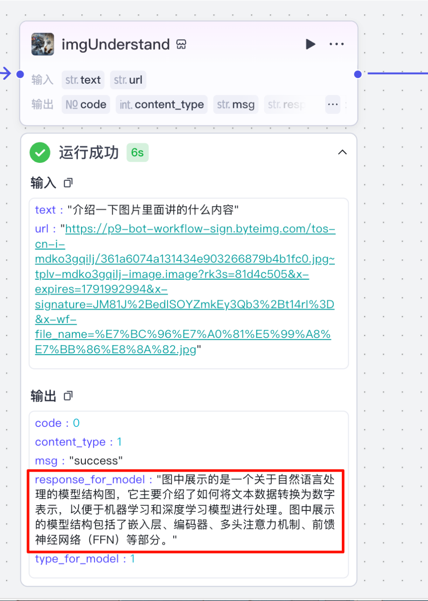

##### 链接读取插件

链接读取插件也是我们使用coze开发时常用的插件，不要被它的名称迷惑了，它实际上是一个”文件阅读器“而不是一个”链接阅读器“，它主要包含两个功能： 
- 链接内容获取：当传入给插件的输入是一个html页面时，获取html页面中的文本内容 
- 文档内容提取：当传入的内容是doc、pdf时，提取文档中的文本内容

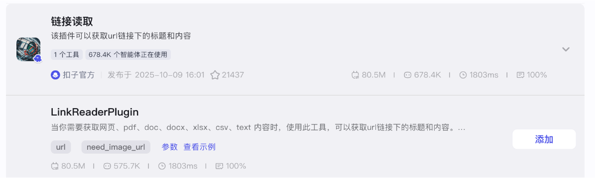

所以，这个插件我们经常会用来处理用户上传的各类文档，效果还算可以。除此以外，还有一些其他官方或者非官方的类似功能的插件，但是毫无疑问，链接读取插件这个插件的使用量要多的多。同时，除非业务有特殊需求以及通过多个case验证这些插件，否则还是建议使用官方提供的”链接读取“插件，大量的调用量已经说明这个插件已经被证明可以用到生产中。

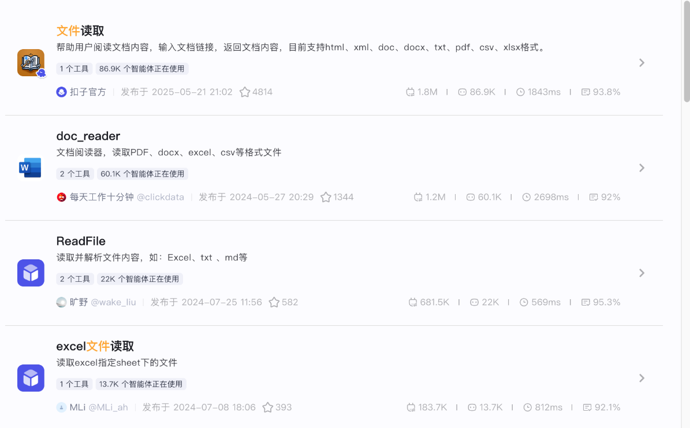

接下来，我们通过一个案例，让同学们理解这个插件如何使用。首先，我们先构建一个简单的流水线：

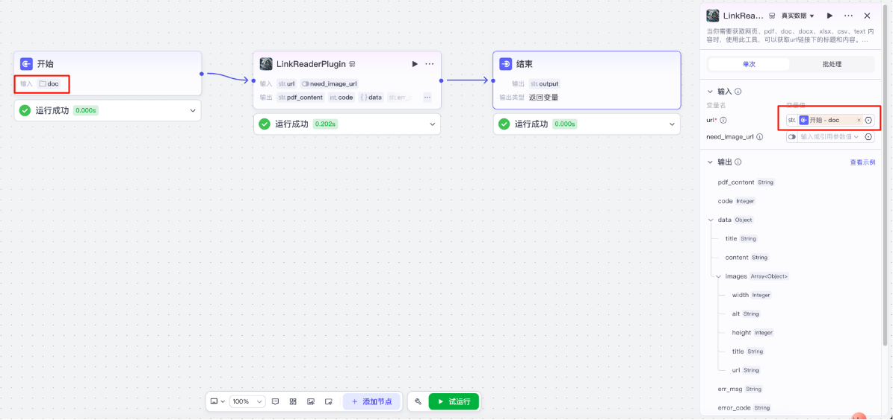

上传文件：素材 02-简历.docx，执行流水线。

查看日志，我们可以看到，在插件输出的字段中，pdf_content字段有内容，并且正确识别了素材文件中的文字，而其他字段都是空的。这是因为我们给的链接是docx的文件，而不是html。

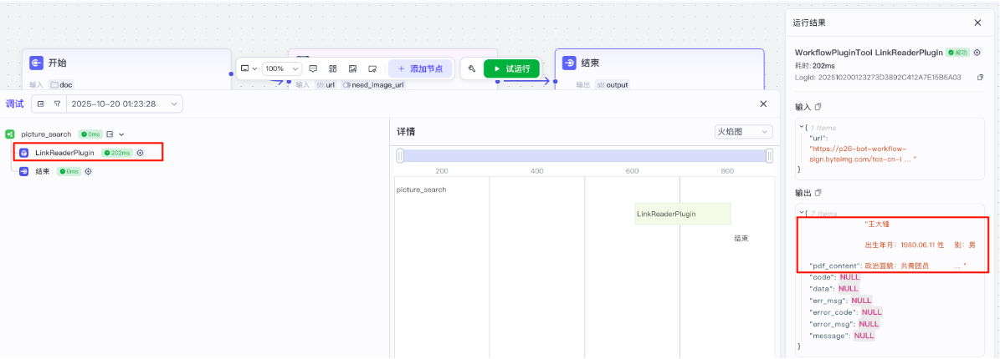

如果我们传入的是一个html的网页，比如:http://www.baidu.com。那执行结果则会如下（修改流水线过程略）：可以看到，数据出现在了data字段中。


因此我们可以总结到一个规律： 
- 如果给的docx、pdf文件地址，那么数据则会出现在pdf_content中 
- 如果我们传入的是html页面地址，那么数据则会出现在data中。并且在error_code和error_msg字段中还会有调用报错信息。

请记住以上规律，对使用这个插件开发一个支持文件、网页内容获取能力智能体很要。

##### 其他插件

- 新闻资讯
- 头条新闻
- 天气预报
- 墨迹天气
- 出行必备
- 飞常准
- 猫途鹰
- 生活便利
- 快递查询助手，国内快递查询
- 食物大师
- 懂车帝
- 幸福里
- 猎聘

### 搭建一个完整的智能体

接下来，我们将结合 **旅游规划工作流** 和 **文档内容读取工作流** 实现一个简单，但是功能完整的智能体，可以通过：

1. 创建一个智能体
2. 编写提示词
3. 添加工作流
4. 发布智能体

以上4个步骤完成。

#### 创建一个智能体

输入智能体名称和功能介绍，然后单击图标旁边的生成图标，自动生成一个头像。


#### 编写提示词

在左侧 **人设与回复逻辑** 面板中描述智能体的身份和任务。

在中间 **技能** 面板为智能体配置各种扩展能力。

在右侧 **预览与调试** 面板中，实时调试智能体。

提示词：

```
# 角色 
你是一个多功能机器人，能够根据用户输入的提示词选择使用不同的工作流完成对应的工作。


## 工作步骤 
- 如果用户上传了文档，则识别文档中的文本内容
- 如果用户输入的内容和旅行相关，则进行旅游规划
```

如下图：


在这里我们保持默认的“单Agent(自助规划模式)”不动，把工作流调用的选择权交给模型。

#### 添加和发布工作流

在添加工作流之前，我们要修改工作流的名称和描述，以便大模型去选择调用哪个

旅游助手工作流改为：


文档内容读取工作流改为：


编辑完成后，还需要发布工作流。 这里需要注意： **只有发布过的工作流才能被智能体使用** 。 因为我们之前已经调试过了，所以在这里发布时，点击”坚持发布“即可，实际工作中，如果工作流没有试运行过，不建议抱有侥幸心理直接发布。 这样会让BUG隐患带到智能体中，在实际生产中，我们建议尽量把风险前置，越早发现BUG，越早解决，这样最后整个工程的质量就越容易把控。


最后，我们把刚刚发布的两个工作流添加到编排内容中：


#### 调试智能体

给智能体添加开场白和预置问题：


预览和调试：


试运行机器人：


可以看到，工作流被正常调用。输出正常

#### 发布智能体

完成调试后，单击 **发布** 将智能体发布到各种渠道中，在终端应用中使用智能体。目前支持将智能体发布到飞书、微信、抖音、豆包等多个渠道中，你可以根据个人需求和业务场景选择合适的渠道。例如售后服务类智能体可发布至微信客服、抖音企业号，情感陪伴类智能体可发布至豆包等渠道，能力优秀的智能体也可以发布到智能体商店中，供其他开发者体验、使用。

- 在智能体的编排页面右上角，单击 **发布** 。
- 在发布页面输入发布记录，并选择发布渠道。
- 单击 **发布** 。


在这里我们只选择“扣子商店”这一种方法。API使用方法我们将在进阶课程中给大家讲解。 其他方法比如抖音小程序、微信等因流程比较繁杂且和coze本身关系不大，感兴趣的同学们可以自行按照官方文档操作，实现一个智能体的编排。

## Coze 平台进阶使用

### 私有数据访问

#### 概述

在前面的内容中，我们已经学习了如何使用工作流搭建一个功能复杂的agent，以及工作流调用插件，使工作流具备处理文件、联网搜索等能力。但是在某些业务场景下，我们还需要让agent具备访问私有数据库的能力：

- 比如，我们有一些医疗知识文档，想通过和agent对话的方式，直接去询问医疗知识文档中的知识，这需要让agent具备访问“知识库”的能力；再比如，我想让agent作为一个签到代理，能够记录和更新用户的签到信息，同时我还可以查询有哪些用户已经签到，这需要让agent具备读写“数据库”的能力。

什么时候使用知识库，什么时候使用数据库：

- 知识库：知识库可以理解为为是一个支持快速检索的文件夹，里面存放的都是一些文档，类比 word 文档、pdf文档等。适合存储文字内容。
- 数据库：数据库可以理解为是一张巨大的表格，里面存放的是一些结构化的数据，类别 excel 表格数据。

#### 在工作流中使用知识库

知识库功能包含两个能力，一是存储和管理外部数据的能力，二是增强检索的能力。

**数据管理与存储**：

- 扣子开发平台支持从多种数据源渠道上传文本和表格数据，例如本地文档、在线数据、Notion、飞书文档等。
- 上传后，扣子可将知识内容自动切分为一个个内容片段进行存储，同时支持用户自定义内容分片规则，例如通过分段标识符、字符长度等方式进行内容分割。

**增强检索**：

- 扣子开发平台的知识功能还提供了多种检索方式来对存储的内容片段进行检索，例如使用全文检索通过关键词进行内容片段检索和召回。
- 大模型会根据召回的内容片段生成最终的回复内容。

##### 创建一个知识库

###### 新建一个知识库资源

在资源库页面点击右上角的 “+ 资源”，选择知识库


然后，选择”创建扣子知识库“：


扣子支持使用扣子知识库和火山知识库，两者对应的分类方式不同。

使用知识库功能的第一步就是上传知识内容。上传知识内容又分为两步，首先选择要上传的知识类型和上传方式，然后对上传的内容进行切分。合理的内容分片可以提升召回内容的相关性，从而提升大模型回复问题的准确性。

在上传知识前，建议先了解不同的知识类型的使用场景和导入方式，以便更好地管理知识内容。

**扣子知识库**：

适用于轻量检索，低代码，轻量级应用的场景（以下内容来自官方文档。了解即可，涉及未学术语较多，不必深究）

| 对比项 | 文本类型 | 表格类型 | 照片知识库 |
|---|---|---|---|
| 使用场景 | 文本知识库支持基于内容片段进行检索和召回，大模型结合召回的内容生成最终内容回复，适用于知识问答等场景。 | 表格知识库支持基于索引列的匹配（表格按行进行划分），同时也支持基于 NL2SQL 的查询和计算。 | 照片知识库支持基于标注信息的匹配，适用于图像生成场景。 |
| 导入方式 | 本地文档：从本地文件中导入文本内容，支持.txt、.pdf、doc、.docx 文件格式。 在线数据：通过自动和手动方式采集指定网页的内容。 第三方渠道：从飞书文档和 Notion 文档中导入内容。 自定义：手动输入要导入的文本内容。 | 本地文档：从本地文件中导入表格内容，支持.csv和.xlsx文件格式。 在线数据：通过 API 导入数据。 第三方渠道：支持从飞书表格中导入数据。 自定义：手动输入要导入的表格数据。 | 本地图片：从本地文件中导入图片，支持JPG、JPEG和PNG图片格式。 |
| 内容分段 | 支持自动内容分段和手动分段方式。 | 对于表格内容，默认按行分片，一行就是一个内容片段，不需要再进行分段设置。 | 不涉及。 |
| 索引 | 不涉及。 | 扣子支持设置索引字段。 用户输入的问题会与设置的索引字段内容对比，根据相似度匹配最相关的内容给大模型用于内容生成。 | 扣子支持设置图片的标注信息。 用户输入的问题会与设置的标注信息对比，根据相似度匹配最相关的图片给大模型用于内容生成。 |

**火山知识库**：

适用于企业用户，以及大规模的查询场景。（以下内容来自官方文档。了解即可，涉及未学术语较多，不必深究）

| 对比项 | 结构化数据 | 非结构化数据 |
|---|---|---|
| 使用场景 | 文件内容为结构一致、字段明确的数据，无需平台额外分段处理。例如问答数据（问题与答案）、用户数据（姓名、年龄、偏好等）、商品数据（名称、价格、库存）等。 问答总结：在 Excel 文档中定义问题列和答案列，上传至知识库后，指定问题列用于知识库检索，答案列用于大模型回答参考。 商品数据整理：适用于电商平台商品信息管理，包括商品名称、描述、价格、库存等字段，方便商品搜索、分类、推荐。 | 文件内容丰富且版面复杂，如文章、报告、书籍等，通常结构不固定，需要平台进行解析和分段处理。 知识文档管理：存储和管理知识文档，通过知识库解析分段转化为可检索、可引用的知识资源，便于查阅和学习。 |
| 导入方式 | 本地上传 从 TOS 中导入 公开下载链接 | 本地上传 从 TOS 中导入 公开下载链接 |
| 切片方式 | 不涉及 | 支持如下切片规则： 默认切片规则：系统会自动保留完整语义进行切片。 自定义切片规则：通过 **指定切片最大长度、图片 OCR、合并短文本片** 等参数定义切片规则。 |
| 索引 | 支持设置索引字段，并提供 HNSW-Hybrid、HNSW、FLAT 等索引算法供用户选择。 | 不涉及 |

在这里使用火山知识库的场景会比较少，因为如果选型选择coze，大多数开发的都是一些轻量级的C端提效的应用。比较重量级的应用不太会使用coze进行，如果是想更好的和本地海量的知识库联动，可以考虑dify，或者更加企业级的langchain、langgraph等框架。但是对于少数用户来讲，还是可能会存在使用coze + 海量知识检索的场景。

最后，选择“文本格式”以及“本地文档”。


###### 解析文件和分段

将物料 03-大模型发展史.docx 上传到知识库：


点击下一步，进到“创建设置”页面：


支持精准解析和快速解析：

- **精准解析**：支持从文档中提取图片元素、扫描件（OCR）、表格元素；支持设置过滤策略，以文档页的粒度过滤掉当前文档中不需要导入的内容。精准解析需要耗时更长的时间。
- **快速解析**：不支持从文档中提取图像、表格等元素，适用于纯文本。

上传本地文档时，支持以自动分段与清洗、自定义分段和层级分段这三种方式对文本内容进行分段处理。


| 对比项 | 按层级分段 | 自动分段 | 自定义分段 |
|---|---|---|---|
| 分段原理 | 根据文档的目录结构、章节划分等层级信息，将内容划分为不同层级的文本单元。 | 扣子可对上传的内容进行自动分段，支持复杂布局的文件处理，例如： 可识别段落。 可识别页眉/页脚/脚注等非重点内容。 支持跨页跨栏的段落合并 支持解析表格中的图片信息。 支持解析文档中的表格内容（目前，仅支持解析带线框的表格内容）。 | 根据用户需求，灵活配置分段标识符、分段最大长度、分段重叠度等参数，同时还能通过设置文本预处理规则，在分段前对文本进行特定处理。 |
| 适用场景 | 适用于表示复杂、层次分明的知识体系，例如技术手册、法律条文、标准规范等。这些文档通常具有明确的结构层次，需要按照章节、小节等进行组织和检索。 | 适用于结构较为规范的文档，例如新闻文章、学术论文等，这些文档通常使用标准的标点符号进行分隔。 | 适用于对分段有特殊需求的场景，如需要根据特定的业务规则或语义关系进行分段，或者处理结构不规则的文本数据。 |

然后是配置存储，这里我们使用平台共享存储即可。如果应用对性能要求比较高，可以再火山引擎上购买独立的存储服务，使用云搜索服务。


最后需要给同学们强调的是：文档分段的好坏直接影响检索的效果，如何选择分段的策略非常重要。但因这部分内容原理比较复杂，不适宜在coze阶段给同学们深度讲解，所以这部分知识作为拓展内容，同学们可根据个人的情况自行学习，详见 **1.3 拓展：分段详细解读部分。 如觉得晦涩难懂，可在学习完RAG阶段后复习时再来学习**。

###### 分段预览和数据处理

**分段预览**：

在使用不同的解析方式时，会有分段预览这个阶段，让用户查看分段以后的效果大概是什么样的，以便确认分段是否符合预期。如果不符合预期，可以选择上一步，重新选择。需要注意的是，在这一步处理的时候，数据并没有存储到知识库中，当确认无误，点击下一步时，才会执行数据处理


**数据处理**：

点击下一步后，等待服务器处理完成数据。点击确认后，知识库就完成了数据写入。


将文档写到知识库以后，我们可以看到左侧的文档列表，代表已经有哪些文档被写到了里面，它和上传时的文件名保持一致。点击文档名以后，可以看到具体的分段的信息。 这里如何分段，


##### 在工作流中使用知识库

在前面的课程中，我们已经建好了知识库，并且把数据导入到了知识库中，接下来我们将在工作流中使用我们已经建好的知识库，完成一个知识库检索的demo。

###### 创建一个知识库检索节点

首先，我们创建一个新的工作流，并添加一个“知识库检索”节点：


给知识库检索节点赋值， 把开始节点的输入传如给知识库检索， 目标知识库选择我们前面刚建好的

- 输入：只有一个query字段，且必须是str类型。 就是要去知识库检索时的查询，执行检索时，这个query会被和知识库中已有的文档段落进行匹配，并返回给用户匹配度最高的（1-20条，默认1条）
- 输出：outputList，数组类型，匹配到几个文档，就返回几条数据


细心的同学可能会注意到检索策略下面会有一堆参数，如下图。这些参数是知识库检索的核心参数，除了分段的策略以外，这些参数同样影响着知识库检索的效果，这里我们先使用默认参数，稍后将给同学们介绍参数的原理和如何设置。


###### 使用大模型润色检索结果和兜底

有时候我们检索知识库的时候结果可能是空的，或者检索出来一些无关的段落，以及话术比较生硬等情况。所以我们在工作流中使用知识库时，不会直接把知识库检索出来的结果返回给用户，而是使用大模型做一些润色和兜底的工作，再把结果给到用户。结合知识库创建，到此位置，这就是一个简单的RAG的流程。如果是在做一个轻量级的agent，就可以考虑使用这种方式，快速实现。

接下来，我们在工作流中添加一个LLM节点，把query、查询结果都给到它，并赋予联网搜索能力


prompt如下：

```
你是一个知识库查询结果润色和兜底的助手，能够根据用户输入的问题对查询结果做润色。也可以在检索结果为空时，负责调用搜索插件，在互联网检索相关内容并返回给用户。  你的职责如下：
1.  如果检索结果不为空，根据用户输入的问题进行优化，并使用比较大方和专业的话术回复用户。这个过程不需要联网搜索。
2. 如果检索结果为空，则调用工具，在互联网检索对应的内容，并根据用户输入的问题进行优化，并使用比较大方和专业的话术回复用户
```

输入 query：

```
什么是深度学习
```

调用大模型过程略，结果如下：

知识库检索结果：


润色以后的结果：


可以看到，经过大模型的润色，结果的可读性更好，更专业。

##### 知识库的核心知识

###### 检索策略

从知识库中获取知识的检索方式，不同的检索策略可以更有效地找到正确的信息，提高其生成的答案的准确性和可用性。支持的检索策略包括：

**混合**：结合全文检索和语义检索的优势，并对结果进行综合排序召回相关的内容片段。

**语义**：像人类一样去理解词与词、句与句之间的关系。推荐在需要理解语义关联度和跨语言查询的场景使用。例如下面两组句子，第一组的语义关系更强。

```
"狼追小羊"和"豺狼追山羊"

"狼追小羊"和"我爱吃炸猪排"
```

**全文**：基于关键词进行全文检索。推荐当查询内容包含以下场景时使用：

- 特定名称或专有名词、术语等，例如比尔盖茨、 特斯拉 Model Y。
- 缩写词，例如 SFT。
- ID，例如 12s1w1s2 系列。

###### 召回数量与匹配度

**最大召回数量**：

从知识库中返回的最大段落数量。数值越大，返回的条目越多。默认召回 5 条检索结果。

**最小匹配度**：

匹配度指的query和段落的匹配程度。设置最小匹配度参数后，系统会根据设置的匹配度选取段落，低于指定匹配度的内容不会被召回。默认的最小匹配度为 0.5。

###### 查询改写

在多轮对话中，用户的 Query 和对话的上下文息息相关，仅凭借用户最新一条提问可能无法正确识别用户的真实检索意图。查询改写是指根据对话历史对用户输入的 Query 进行优化或重构，从而更准确地捕捉真实的用户意图，提升信息检索的效率。知识库检索节点默认开启查询改写。

> 例如用户对话的上下文为：
> 
> - 问题1：知识库检索节点可以用来做什么？
> - 回复1：知识库检索节点可以基于用户输入查询指定的知识库，召回最匹配的信息，并将匹配结果以列表形式返回。
> - 问题2：怎么用？
> 
> 对于问题2，不参考上下文的情况下无法判断用户的真实意图。开启查询改写后，问题2会被改写为“知识库检索节点怎么用？”

###### 结果重排

结果重排是指根据相关性或质量对检索到的文档切片进行重新排序，以提高生成答案的准确性和相关性，适用于追求回答高精度和高相关性的场景，例如智能客服、专业技术答疑等场景。未开启结果重排时，节点输出的是向量检索的结果，根据匹配度从大到小排序。

假设用户查询“如何制作意大利面？” ，首先会从知识库中检索得到以下几个文档片段，其中先按照ABCD先后顺序排列：

- 切片 A：介绍意大利面的历史。
- 切片 B：讨论了不同种类的意大利面和它们的搭配。
- 切片 C：详细描述了制作意大利面的步骤，包括所需材料和烹饪技巧。
- 切片 D：提供了一些意大利面食谱。

在结果重排的过程中，知识库检索节点会分析用户的真实意图，对切片重新排序，使得最相关的内容排在前面。最终的排序可能变为：

- 切片 C：详细描述了制作意大利面的步骤，包括所需材料和烹饪技巧。
- 切片 D：提供了一些意大利面食谱。
- 切片 B：讨论了不同种类的意大利面和它们的搭配。
- 切片 A：介绍意大利面的历史。

##### 拓展：分段详细解读

**自动分段与清洗**：选择该分段策略，会自动利用句号、分号、问号、感叹号等标点符号作为分段依据，将文档分割成一个个独立的句子或段落，无其他配置项。

**自定义**：选择该分段策略，完成以下配置。

- 分段标识符：分段标识符是用于识别和划分文本段落的特定字符或字符串。支持的分段标识符包括换行、2个换行、中文句号、中文叹号、英文句号、英文叹号、中文问号、英文问号、自定义分隔符（如"###"）等。例如，在英文文本中，句号通常作为自然语言句子的结束标志，可以作为分段标识符。
- 分段最大长度：分段最大长度是指每个文本段落允许的最大字符数。设置分段最大长度可以防止段落过长，导致后续处理（如检索、匹配）的效率降低。同时，也能够确保每个段落包含的信息量适中，便于理解和分析。
- 分段重叠度%：分段重叠度%是指相邻段落之间共享的字符数占分段最大长度的比例。设置分段重叠度可以在一定程度上保留段落之间的上下文信息，避免因分段导致信息的割裂。这对于需要考虑上下文关系的文本处理任务（例如语义理解、上下文推理）尤为重要。
- 文本预处理规则：文本预处理规则是指在进行分段之前，对原始文本进行的一系列处理操作的规则。通过文本预处理，可以去除文本中的噪声信息、统一文本格式、纠正错误等，从而提高分段的准确性和后续文本处理的效果。支持的文本预处理规则包括：
- 替换连续的空格、换行符和制表符
- 删除所有 URL 和电子邮箱地址

**按层级分段**：选择该分段策略，完成以下配置。

分段层级：分段层级是指在文档结构中，根据内容的重要性和逻辑关系设置为多个层级。例如在一个企业产品手册中，分段层级可以包括产品概述（一级标题）、产品特点（二级标题）、技术参数（三级标题）等。产品概述作为一级标题，其下的“产品特点”和“应用场景”可以是二级标题，进一步细分的“特点一”、“特点二”则是三级标题。设置分段层级为 2 时，系统会将知识库内容按照一级和二级标题进行划分，形成清晰的结构化信息。


检索切片保留层级信息：检索切片保留层级信息是指在进行检索时，是否保留文档段落的层级结构信息，以便在检索结果中展示段落之间的层次关系。保留层级信息有助于更好地理解检索结果的上下文和逻辑结构，便于快速定位到所需的具体信息，并把握文档的整体内容布局。默认切片检索不保留层级信息，勾选后切片检索会保留层级信息。


配置完按层级分段，在预览分段时，还支持以下操作：

- **拖拽调整层级结构**：通过拖拽操作，可以调整段落或章节之间的层级关系和顺序。例如，将一个二级标题拖拽到另一个一级标题下，使其成为新的子章节，或者调整两个同级标题的顺序。


- **按照层级合并为切片**：右击层级标题，选择 **合并为一个分段** ，将选定层级及其子层级的所有内容合并为一个分段。例如，选择一个二级标题，系统会将其下的所有三级标题和对应内容合并为一个完整的分段。


- **删除切片**：右击层级标题或分段内容，选择 **删除** ，从知识库中移除选定的分段及其所有内容。例如，如果某个章节不再需要，可以直接删除对应的分段，包括其下的所有子层级。


#### 在工作流中使用数据库

扣子的数据库功能适用于组织和管理结构化数据，例如客户信息、产品列表、订单记录等。目前，扣子支持使用扣子官方数据库和火山数据库。

接下来，我们将以一个“绩效录入和查询agent”的一个简单的demo，帮助同学们理解怎么在工作流中使用数据库。 这个agent支持绩效数据的查询、修改、增加、删除，我们将通过意图识别节点，实现这个agent的功能。

##### 创建一个数据库

在资源库中创建一个数据库，如下图：


对比如下：

- **扣子数据库**：扣子官方数据库，提供了类似传统软件开发中数据库的功能，允许用户以表格结构存储数据。
- **火山数据库**：火山数据库是指云数据库 MySQL 版，它是火山引擎基于开源数据库 MySQL 打造的弹性、可靠的在线关系型数据库服务。MySQL 实例使用云原生方式部署，结合本地 SSD 存储类型，提供高性能读写能力；完全兼容 MySQL 引擎，并提供实例管理、备份恢复、日志管理、监控告警、数据迁移等全套解决方案，帮助企业简化繁杂的数据库管理和运维任务，使企业有更多的时间与资源聚焦于自己的核心业务。

扣子数据库和火山数据库在功能上无明显差异，均能满足数据的存储与分析需求。扣子数据库免费且易于使用，适合轻量级数据存储与分析场景，你可以先通过扣子数据库体验数据库功能；而火山数据库作为企业级云数据库，提供高性能和高扩展性，但会产生成本，当涉及企业级大规模、复杂的数据处理和分析时，你可以选择火山数据库。以下是两者的主要区别：

| 对比维度 | 扣子数据库 | 火山数据库 |
|---|---|---|
| 产品定位 | 扣子官方数据库，适合轻量数据存储与分析场景。 | 火山引擎提供的企业级数据库服务，支持处理与分析大规模、复杂的数据，适合于企业客户场景。 | 
| 性能与扩展性 | 轻量级数据存储与分析操作。 | 高性能、高可用，支持海量数据存储和高效读写操作；可根据业务增长灵活扩展。 |
| 数据隔离 | 线上数据和测试数据隔离。 各个发布渠道数据隔离。 | 仅存储线上数据，无测试数据。 各个发布渠道数据互通，无隔离。 |
| 操作难度 | 操作流程简单便捷，用户可以轻松上手。 | 配置相对复杂、繁琐。 |

在这里我们使用扣子数据库。对于使用coze大部分场景来讲，扣子数据库足够应对。


###### 设置表结构

创建数据库表以后，选择单用户模式（默认选项），这里需要注意：

- 单用户模式：开发者和用户都可以添加记录，但仅能读/修改/删除自己创建的来自同渠道的数据。
- 多用户模式：开发者和用户都可读/写/修改/删除表中来自同渠道的任何数据，由业务逻辑控制读写权限。


新建一个数据表，结构如下图：


这里需要注意：id、sys_platform、uuid、bstudio_create_time 字段为系统内置。work_code、name、performance_level 字段为我们这个案例中所使用的字段，分别代表工号、人名、绩效等级。

点击保存按钮，就完成表的创建。

###### 导入数据

有了表结构以后，接下来我们导入数据。在 测试数据中，点击批量导入，并把我们的素材 04-绩效数据.xlsx 文件上传。这里需要注意，数据库分测试数据和线上数据两个环境，这两个环境相互隔离：

- 测试数据：用于在发布之前调试使用， 和线上数据互相不影响
- 线上数据：发布后，从应用商店、api等各种渠道调用时使用。和测试数据相互隔离


配置表结构，表头选择第1行、数据起始行选择第2行


对应原文件：


预览数据，无误后点击下一步即可。


确认数据已经完全写入：


##### 在工作流中使用数据库

接下来，我们新建工作流，然后新建一个意图识别节点，如下图：


分为以下几个意图：

- 查询数据
- 查询某个人的绩效数据
- 新增数据
- 新增某个人的绩效数据
- 更新数据
- 更新某个人的绩效数据
- 删除数据
- 删除某个人的绩效数据

整体业务流程如下图：


###### 使用 LLM 提取命名实体

在实现增删改查数据之前，我们需要先研究一下数据库节点的特性，首先数据库节点分为增删改查和自定义SQL5种类型。因为我们还没有学过SQL，所以这种使用方法我们先不关注，大家知道支持这种用法即可。


查看更新数据节点，如下图，在这里我们可以发现一个问题，我们查询数据需要根据： 字段名 = 某个值，这种方式去实现查询数据。但是实际用户和agent交互时往往说的是自然语言，比如：

> 用户输入：帮我查一下张三的绩效是多少
>
> 或者：帮我查一下绩效，张三的

这里就会涉及到一个问题， 帮我查一下张三的绩效是多少 -> name = '张三' 这一步怎么转化，也就是说，**我们需要把“帮我查一下张三的绩效是多少”这句话以及相同语义不同表达方式的语句中的人名提取出来**。 这一步如何完成？


这种场景在生活中其实非常常见，比如我们在快递程序中输入一串人名、地址、手机号的一段话，点击智能识别，快递程序就可以帮助我们把这些“实体”进行解析，并填到对应的表格中。 这里就涉及到了一种自然语言处理算法中常见的方法，叫做“命名实体识别”，也可以叫做“实体提取”，这里我们了解就行，后续会有其他课程进行深入讲解。

在这里，我们可以使用大模型的能力实现这个功能。比如我们要从用户输入的input中提取人名，执行以下两步：

- 编写提示词： 说明要抽取人名实体，当返回结果只有一个字段时，不需要指定变量名；多个字段时，需要说明哪个实体对应哪个变量名。
- 指定输出：在输出的变量中，指定变量名


单独试运行该节点，结果如下：


###### 查询数据

查询某个人的绩效数据，需要添加一个人名提取节点，和一个数据库查询节点 ， 这两个节点和上个知识点中的是一致的，不做赘述。为了结果可读性更好，还需增加一个结果整理的节点，整体如下图：


结果整理提示词：

```
查询结果整理助手，能够根据用输入的问题和数据库中查询到的结果进行整合，并给到用户一个专业、得体的答复。
```

输入提示词

```
查询王大锤的绩效
```

试运行后，结果如下：


###### 新增数据

对于新增数据，我们需要把用户输入的内容中人名、工号、绩效3个字段全部提取出来，然后再通过新增数据节点，把数据更新到数据库中。整体流程如下


如果我们要通过LLM同时提取多个实体，则需要这样操作：


对应的提示词如下：

```
你是一个人人名提取助手，能够根据用户输入的内容，提取出来里面的人名{name}、工号{work_code}、绩效{performance_level}，以json格式返回
```

设置新增数据节点中的变量，把3个字段需要新增的值填入


输入以下内容，试运行流水线：

```
新增绩效记录， 老邢，工号1050，绩效S
```

去数据库中查看数据是否成功写入：


###### 更新数据

更新数据和新增数据流程类似，区别在于更新数据需要先根据更新条件找到对应的数据，再更新这条数据中的内容。


试运行该工作流，输入提示词

```
更新绩效记录， 老邢，工号1050，绩效A
```

查看数据库中的数据，可以看到数据没有新增，而绩效字段确实是由S改为了A，说明了功能生效。


###### 删除数据

删除数据只需要删除条件定位到这条数据，即可完成。 对于我们当前的业务场景，一般是工号+人名确定唯一一条数据，所以这里我们需要提取出来name和work_code两个字段，并形成过滤条件，


试运行该工作流，输入提示词

```
删除老邢的记录，工号1050
```

查看数据库，发现“老邢”的数据已经被删除：


#### 总结

本章节介绍了两种访问私有数据的功能，知识库和数据库：

- 知识库：适用于知识检索，数据基本不写入，只做检索，且进行语义匹配的检索方式。
- 数据库：使用实现业务处理的Agent，对数据库进行增删改查，不支持基于语义的检索方式。

在实际工作中，需要基于不同的场景做不同的技术选型。

### 多模态和循环结构

#### 概述

实际在使用Coze解决业务问题的时候，除了文本以外，还有其他类型的数据（图像、音频、视频等）需要进行处理，也会有需要在工作流批量处理的需求。在本章节，我们学习如何处理不同类型的数据，以及如何使用循环进行批处理。

#### 多模态数据处理

在使用coze实现agent的时候，经常会处理一些文字以外的输入类型，比如图片、音频、视频。在coze中，图片、音频、视频处理的方式大是通过自带的音视频数据处理节点或插件完成，这些插件大多数都是由各个大模型供应商企业提供，通过调用其他大模型实现。接下来，我们将介绍一些常见的多模态数据的厂家处理方式，在实际工作中用到时，可以快速找到对应的解决方案。

除了处理输入的不同类型的数据以外，在实际工作中，还有一些场景会基于coze生产一些音视频等数据。比较典型的就是电商业务场景，会经常使用coze实现AIGC（基于人工智能生成内容），包括：

- 文案：基于产品介绍和LLM，生成风格化的文案（比如小红书文案）
- 商品图片：基于文生图、图生图等功能，生成商品图。还可以结合一些图像编辑类的模型，一件替换模特的衣服、首饰等，节省模特成本。
- 广告语音：基于文案生成广告配音
- 广告视频：基于文案，商品图片等生成广告视频，节省 广告拍摄成本

综上所述，接下来我们将通过一些案例介绍一些比较常用的多模态数据的处理工具。

##### 图像类型

在Coze平台基础使用章节中，我们已经学习过了图片理解功能，但是在Coze平台中，图片类型相关的处理能力不仅只有这一种。还包括：

###### 文生图

在流水线中添加图像生成节点，选择模型、设置好分辨率等信息：


输入提示词：

```
帮我生成一张宠物狗的图片，品种是金毛，背景是在雪地里，正在玩雪。
```

以下是生成结果，因为我们这里使用的是字节当前最强的图片生成模型Seedream 4.0。可以看到，图片生成的效果非常逼真，光影效果好，并且还有景深，就像使用微单相机拍摄的。


###### 图像画质提升

在工作流中添加一个图片清晰度提升节点，并把原图传入


图片提升前（素材 05-低分辨率图片.jpg）：


提升后（这里为节省页面空间，做了缩小，可以右键查看原图片）：


可以看到图像的分辨率得到了提升，但由于本身的素材就只能这样了。

除此以外，图像相关的还有其他的插件，比如：一键换脸、抠图等，可根据业务需求自行选择。有兴趣的同学也可以在插件商店中筛选”图像“相关的，尝试使用其他处理方式。

##### 音频类型

###### 语音识别 (ASR)

语音识别（ASR, Automatic Speech Recognition）就是把语音转化成文字的算法， 在coze中使用插件即可实现。 在插件商店中搜索 ”语音识别“，包含两个版本。一个是小模型的语音识别，一个是大模型的语音识别。 区别在于识别准确率和资费上。


在工作流中添加一个”语音识别“节点：


试运行，并上传我们的素材 06-音频片段.wav：


可以看到，这里输出了素材中的内容。文字识别都是对的，但是这里的问题在于没有标点符号，可以在语音识别节点后追加一个LLM节点，用于输出润色。过程略，同学们可自行优化。

###### 语音合成 (TTS)

语音合成（Text-to-Speech）是将文本信息转化为语音信息的人工智能技术，在coze中同样可通过插件实现。在插件中搜索”语音合成“。分为两个版本

- 语音合成：使用扣子的模型实现语音合成
- 语音合成火山版：使用火山引擎上的更加专业的模型实现语音合成


在工作流中创建一个语音合成节点：


除了文本是必填项以外，其他的都是可选项。具体可根据coze官方手册使用。可以指定情绪、语种、播报人、音色等。 接下来，我们试运行工作流，输入以下提示词：

```
广袤的草原上，晨曦微露，成群的斑马在悠闲地散步，非洲狮正趴在巨石上享受阳光的沐浴，万物复苏，又到了动物们活跃的季节
```


生成音频如下(词性解说男声)：

##### 视频类型

视频类型的处理这里我们主要介绍视频生成。视频生成是多模态大模型近期比较新型的场景，能够根据用户输入的文字、图片，以及各类设置（如分辨率、时长等），生成视频。

在工作流中增加一个”视频生成节点“，传入数据，设置使用的模型，并设置参数，如下图：


试运行工作流，传入提示词：

```
核心主题与风格​​：拍摄一个用于电商平台的、展现奢华与时尚感的足金手镯短视频。视频整体质感高级，凸显金手镯的精致工艺与佩戴时的优雅气质
。
​​场景与布景​​：
​​主场景​​：一个光线柔和、布置现代的室内空间，可能包含简约的梳妆台或铺有浅色丝绸的桌面
。背景简洁，以突出手镯本身。
​​细节​​：可有少量高端饰品（如香水瓶、珠宝盒）作为点缀，但遵循“少即是多”的原则，避免分散注意力
。
​​光线​​：利用从窗户透进的柔和自然光，或在影棚内使用扩散照明，确保手镯光泽得到最佳呈现，减少金属表面的强烈反光
。
​​主体与画面​​：
​​主角​​：一款设计精美的足金手镯。
​​关键画面​​：
​​开场特写​​：镜头对手镯进行极致特写，清晰展现其精细花纹、质感与璀璨光泽
。
​​佩戴展示​​：一只优雅的手缓缓拿起并佩戴上手镯，展示佩戴的便捷性与上手效果
。
​​动态光泽​​：手腕轻轻转动，展示手镯在不同角度下流动的光泽
。
​​组合搭配​​（可选）：可与其他简约手链或手表叠戴，展示其搭配可能性。
​​运镜与节奏​​：
​​镜头一（开场）​​：​​缓慢推近​​的特写镜头，聚焦于手镯最精美的雕刻或纹理部分，瞬间抓住眼球。
​​镜头二（展示）​​：​​平稳跟随​​镜头，从手镯被拿起至佩戴上手腕的过程，保持画面稳定。
​​镜头三（动态）​​：​​环绕运动​​或​​轻微旋转​​拍摄佩戴手镯的手腕，多角度展现手镯形态与光泽变化。
​​镜头四（收尾）​​：​​缓慢拉远​​，展示手镯作为整体造型一部分的完整效果，画面定格于优雅的姿势。
​​节奏​​：整体节奏舒缓，突出高级感和品质感。
​​情感与氛围​​：通过光影和运镜，传递金手镯所代表的“富贵象征”、“永恒承诺”或“圈住幸福”的美好寓意，营造轻奢、愉悦的情感氛围
。
```

点击运行，并等待。结果如下图。 这里在执行的时候时间会比较长，且消耗的token比较高。


生成的效果视频如下：


#### 循环结构

##### 什么是循环结构

循环是一种常见的控制机制，用于重复执行一系列任务，直到满足某个条件为止。扣子工作流提供循环节点，当需要重复执行一些操作，或循环处理一组数据时，可以使用循环节点实现。在实际开发中，一般用于相同任务的批量处理，比如批量生成内容、批量执行订单数据等场景。


循环节点的配置方式取决于循环类型。循环类型是循环节点的运行模式，支持设置为使用 **数组循环** 、 **指定循环次数** 和 **无限循环** 。

**使用数组循环**：

使用数组循环类似编程语言中的 for 语法结构。使用数组循环用于遍历一个已知的序列，对序列中的每个元素执行一系列相同的步骤。典型场景如下：

- 长文生成或长文总结：输入每个段落的主题，通过循环节点依次生成各个段落，将完整的文章打包输出。也可以通过输出节点实现每轮循环之后流式输出段落内容。长文总结的原理类似。
- 问卷调查：针对多个产品进行满意度、NPS 等问卷调查，每个产品的问卷题目相同，根据每一轮问题的用户评分算出各个产品的 NPS 得分。

在编程中，数组是一种数据结构，用于存储一系列元素。数组中的基础概念如下：

- item：元素，即数组中的单个数据。数组由多个元素组成，每个元素可以是数字、字符、字符串等数据类型。
- index：索引，指数组中元素的位置。索引从 0 开始计数，表示第一次循环，1 表示第二次循环，2 表示第三次循环，以此类推。最后一次循环的索引为 n-1，其中 n 为循环次数。

以下是官方文档的一个例子：


使用数组循环是最常用的处理方式之一，这里我们先不深入实现细节，在后续将给大家通过一个案例学习如何实现数组循环。

**指定循环次数：**

指定循环次数模式通常用于批量、顺序处理数据的场景，需要同时设置循环次数。循环次数默认为 10 次，支持设置为 1~1000 次，你也可以引用上游节点数值类型的输出参数。

**无限循环：**

无限循环类似编程语言中的 while等语法结构，需要通过终止循环节点停止循环。循环第一次运行之后，工作流对指定条件进行判断，满足一定条件时则结束循环，否则继续下一次循环。通常是基于循环节点的执行结果进行判断，例如循环调用插件获取数据，当插件执行失败时停止循环，否则持续执行循环只会得到同样的错误结果。

无限循环适用于以下场景：

- 批量处理数据：例如通过自定义插件调用 API，查看多个用户 ID 的数据，如果插件执行失败，则停止循环。
- 增强搜索：基于第一次检索内容询问用户，收到用户回答后，结合用户问题进行第二次检索，循环执行多次检索，直至符合用户要求。增强检索可提高检索结果的精准度、用户满意度。
- 回合制游戏：游戏通常包含多轮，直到满足胜利条件或游戏结束条件，否则游戏回合反复进行。

无限循环需要通过终止循环节点停止循环。终止循环节点通常和条件判断节点关联使用，条件判断节点判断某个条件成立时，流转到终止循环节点，自动跳出循环。

##### 循环结构的使用

接下来我们将通过一个“ **小红书电商营销文案批量生成工作流** ”案例，学习如何使用循环结构。业务流程如下图：


完整的工作流如下图


首先，用户输入一个自然语言语句，描述一下要生成哪些主体的营销文案。接下来，使用大模型提取出来主题，并生成数组格式返回


对应提示词如下：

```
你是一个小红书电商文案批量生成工作流主体提取助手，能够根据用户输入的内容提取出来里面包含的主体，并以数组格式返回
```

接下来，通过循环结构对每个主题进行逐个处理：基于LLM+联网搜索功能生成对应主体的文案。首先设置循环节点


循环体中设置大模型的输入与输出， 这里输入需要选择：item(in topics)。 类似python代码的for item in list中的iterm一样，这个iteam就是数据的每一条元素。


大模型的提示词如下

```
你是一个小红书文案生成专家，能够根据用输入的主题进行互联网检索，并生成小红书文风的爆款文案，作为软广内容，提升产品销售的转化率。请注意

1. 文案不少于500个字
2. 文案需要严格按照小红书的文风输出
```

接下来，试运行流水线，并输入内容：

```
请我帮我生成：始祖鸟Alpha SV冲锋衣、凯乐石Mont-X冲锋衣、拓路者雪鹰2.0冲锋衣的文案
```

调用过程略，我们查看循环体的执行结果，如下图。可以看到，这里根据输入的3个主题，生成了3个对应的内容


最终，我们预览一下生成的文案内容，可以看到，它的文案遵从了小红书常见的：


这里为什么不让大模型一次性处理输入的主体，而是通过循环一条一条处理？ 这是因为 **随着输入的内容变多，模型要处理的数据变得很多以后，效果就会有较大的下降** ，这就好比让一个人去写一个2万字的文章一定比2百字的质量会下降一个道理。所以我们在这里把一个处理3个主题的任务拆成了3个一次处理1个主题的任务机，减少了模型需要处理的数据量，从而保证效果。请同学们在实际工作中遵从该原则。

### Coze API 调用

#### Coze API 简介

##### 什么是 API

在讲解什么CozeAPI之前，需要先了解什么是API：API就是一组预先定义好的规则、标准和协议。软件或服务提供方通过开放API，允许其他程序在 **不触碰其底层核心代码和复杂内部逻辑** 的前提下，安全、规范地使用它的特定功能或数据。

API(Application Program Interface)：

- 编程语言的函数
- web api
- 其他特殊协议

这带来的巨大好处是 **极高的效率** 。开发者无需“重新发明轮子”，可以像拼乐高一样，专注于自己的核心业务，同时灵活集成全世界最专业的服务（如支付、地图、翻译等），快速构建出功能强大的应用。

##### Coze API

Coze API 是 Coze 平台对外开放的编程接口，允许开发者通过代码与在 Coze 上创建的 AI 机器人（Bot）或工作流进行交互。简单来说，它为你提供了一种方式，让你自己的应用程序（比如网站、手机App或企业内部系统）能够“调用”并使用你在 Coze 平台上打造的 AI 能力

通常，通过 API 调用 Coze 服务遵循一个清晰的流程，其核心环节如下图所示，它描绘了从你的应用发出请求到 Coze 工作流执行并返回结果的整个过程：


调用Coze API可以通过两种方式进行：

- Http API：直接通过Http协议调用Coze API
- SDK：Python、Java、JS等各类语言的SDK，本质上其实还是在Http API的基础上封装的。 使用起来比Http的更好用一些，因为不需要去记录繁杂的http地址。我们作为算法工程师，主要还是使用 Python SDK。

##### Coze API 的使用场景

目的：把coze上的智能体接入到自己的业务系统。

比如，有一个旅游APP期望接入AI功能，但是又并不想把底层调用了什么等技术细节展示给用户，就可以通过：旅游APP -> 后端 -> Coze平台这种方式实现。


#### 环境安装与鉴权

##### 注册一个令牌

在调用Coze API之前，我们需要注册一个令牌，用于身份验证。 过程类似于阿里云百炼的API-Key的获取，我们需要点击API管理-授权-点击添加：


修改名称，选择过期时间（个人令牌最多30天），选择指定工作空间：


点击确定，即可完成令牌的注册。

##### 拓展：Coze 的鉴权方式

扣子 API 通过访问令牌（Access Token）进行 API 请求的鉴权。所有的 API 请求都必须在请求头的 Authorization 参数中包含你的访问令牌（Access Token）。

```
Authorization: Bearer $Access_Token
```

鉴权方式如下：

| 鉴权方式 | 说明 |
|---|---|
| **个人访问令牌** | Personal Access Token，简称 PAT。扣子平台中生成的个人访问令牌。每个令牌可以关联多个空间，并开通指定的接口权限。生成方式可参考添加个人访问令牌。 虽然 PAT 生成和使用便捷，但其本质上是一种预授权的明文令牌。如果保管不当，极易导致令牌泄露，进而被黑灰产盗用，引发安全风险。 建议仅在测试环境、调试场景中使用 PAT，并严格限制其使用范围和有效期。 在生产环境中应谨慎使用 PAT，优先考虑更安全的认证方式 OAuth。 |
| **服务访问令牌** | Service Access Token（简称 SAT）是以服务身份创建的访问凭证，可长期有效访问扣子资源，通常用于服务/应用程序的身份验证和授权。SAT 与PAT鉴权方式相比，具有更长的有效期（可设置为永久有效），操作简单，能够有效简化授权流程。 |
| **OAuth 访问令牌** | OAuth Access Token，通过 OAuth 2.0 鉴权方式生成的 OAuth 访问令牌。该鉴权方式通常用于应用程序的身份验证和授权，和 SAT 鉴权方式相比，令牌有效期短，安全性更高，适用于线上生产环境。 扣子平台目前支持 **授权码（Authorization Code Grant）、JWT 模式（JSON Web Tokens）** 等多种 OAuth 授权类型，详细说明请参见下文中的OAuth 授权方式说明。 |

可以参考下图选择合适的鉴权方式：


在教学阶段，我们使用PAT进行API的调用。

##### 安装 Coze Python SDK

Coze API SDK for Python 是一个扣子官方提供的 SDK 工具包，你可以通过 Python SDK 将扣子的 OpenAPI 集成到你的应用程序中。

Coze Python SDK 支持所有扣子的官方鉴权方式，支持同步或异步函数调用，具备高度的灵活性和高可用性，显著提升 OpenAPI 的使用效率。你可以通过 pip 快速安装 Coze Python SDK，用你的访问密钥初始化 SDK，然后就可以开始安全、高效地通过 OpenAPI 访问你的 AI 智能体。

在安装SDK之前，我们需要准备一个新的conda环境：

```bash
conda create -n coze python==3.12.7
# 环境初始化以后，切换到新的环境
conda activate coze
```

```bask
pip install cozepy
```

##### 测试连通性

接下来我们将通过一个案例来测试是否能够成功调用：

**思路**：

```
"""
需求：测试使用Pyhon SDK调用Coze的连通性
思路步骤：

1. 设置令牌和API基础地址
2. 初始化Coze客户端：使用TokenAuth类构建认证对象并传入访问令牌，再将认证对象和API基础地址传入Coze类，建立同步coze客户端
3. 展示所有的工作空间
"""
```

**代码**：

```python
"""
需求：测试使用Pyhon SDK调用Coze的连通性
思路步骤：

1. 设置令牌和API基础地址
2. 初始化Coze客户端：使用TokenAuth类构建认证对象并传入访问令牌，再将认证对象和API基础地址传入Coze类，建立同步coze客户端
3. 展示所有的工作空间
"""

"""
如何使用个人访问令牌初始化Coze客户端。

首先，你需要访问https://www.coze.cn/open/oauth/pats（对于coze.com环境，访问https://www.coze.com/open/oauth/pats）。

点击添加新令牌。设置好合适的名称、过期时间和权限后，点击“确定”生成你的个人访问令牌。请将其存储在安全的环境中，防止此个人访问令牌泄露。
"""


# 从cozepy库中导入相关类和常量
from cozepy import COZE_CN_BASE_URL, Coze, TokenAuth

# 设置令牌
coze_api_token = '你的秘钥'

# 使用默认的COZE_CN_BASE_URL作为API基础地址
# 默认访问的是api.coze.cn，但如果你需要访问api.coze.com，请使用base_url配置要访问的API端点
coze_api_base = COZE_CN_BASE_URL

# Coze SDK提供了TokenAuth类，用于基于固定的访问令牌构建一个认证类。同时，Coze类允许传入一个认证类来构建一个coze客户端。
# 因此，你可以使用以下代码初始化一个coze客户端，或者一个异步coze客户端

# 使用TokenAuth类构建认证对象，并传入访问令牌，再将认证对象和API基础地址传入Coze类，建立一个同步coze客户端
coze = Coze(auth=TokenAuth(token=coze_api_token), base_url=coze_api_base)

user_id = '你的账户id'
account_id = '你的账户id'

workspaces = coze.workspaces.list(
    user_id=user_id,
    coze_account_id=account_id,
)

for workspace in workspaces:
    # workspaces is an iterator. Traversing workspaces will automatically turn pages and
    # get all workspace results.
    print(workspace.model_dump_json(indent=2))
print("logid", workspaces.response.logid)
```

**这里需要注意** ：不要去死记硬背代码（尤其是在cursor和trae等ai编码工具日渐成熟的情况下）和API，在实际工作中我们会接触很多平台和工具开放的SDK或者其他形式的API，每个厂家都有自己设计API的方式，参数比较多的情况下，全部记住用法是不可能的。所以我们更重要是记住 **思路** ，以及基于SDK的example和API文档提供的样例拓展和修改，来满足我们自己的业务需求。

这里我们可以总结一套方法，用来应对各类平台API的调用：

1. 查看官方文档，基于官方提供的demo代码，寻找相似场景的案例（比如你要上传文件，那就去找多模态的API案例）
2. 安装环境，在本地测试官方demo示例
3. 自己阅或把案例代码给到大模型辅助解读和分析
4. 根据案例的注释、官方文档、大模型的输出，修改代码，适配自己的业务

执行结果如下图：


说明coze被成功率调用，需要注意，这里只会展示在“Coze SDK”渠道发布过的机器人

#### 使用 API 实现对话调用

##### 对话 API 中的基本概念

在调用对话API之前，我们先要了解构成对话的4个对象：

| 名词 | 说明 |
|---|---|
| 会话（Conversation） | 智能体和用户之间的一段问答交互。一个会话包含一条或多条消息，并且能够自动处理截断，以适应模型的上下文内容。 |
| 消息（Message） | 一条由用户或智能体创建的消息，消息内容可以包括文本、图片或文件。消息以列表的形式储存在对话中。 |
| 对话（Chat） | 在会话中对智能体的一次调用。智能体收到请求后，结合用户输入、通过预设的一系列工作流等配置来调用模型或工具执行指定任务。每个对话都是会话的一部分，智能体会将对话中产生的消息添加到会话中。 你可以直接发起对话，与智能体进行一次交互；也可以创建会话和消息，并在指定会话中发起对话，会话中的其他消息会作为历史消息传递给大模型。 |
| 上下文段落（Section） | 在智能体对话管理中，Section 是一个独立的上下文段落，用于分隔不同的对话阶段或主题。创建会话时会生成一个 Section，Section 中包含上下文消息，当用户清除上下文时，系统会创建一个新的 Section，从而确保新的对话不受历史消息的影响。 会话、消息和上下文段落的关系如下图所示。 |


##### 代码示例

接下来，我们去调用在前面实现的 ”多功能机器人“，实现上传简历文件：素材 02-简历.docx到coze平台并实现内容提取的案例。

**思路**：

```python
"""
需求：调用在前面实现的 ”多功能机器人“，实现上传简历文件：素材 **02-简历.docx**到coze平台并实现内容提取
思路步骤：
1. 准备工作：
    1.1 导入必要的模块和类，如json、logging、os、Path、typing及cozepy中的相关类
    1.2 初始化Coze客户端，设置访问令牌和基础URL
    1.3 设定机器人ID和用户ID 
2. 实现文件上传功能：定义upload_file函数，接收文件路径作为参数
3. 上传文件并获取文件ID：
    3.1 指定要上传的文件路径
    3.2 调用upload_file函数上传文件，若上传失败则退出程序
    3.3 获取上传文件的ID
4. 构建多模态消息：构建包含文件的多模态消息
5. 进行流式聊天：
    5.1 调用coze.chat.stream方法创建聊天，传入机器人ID、用户ID、多模态消息列表和参数
    5.2 遍历聊天迭代器，根据不同的ChatEventType进行处理：
        5.2.1 若为CONVERSATION_MESSAGE_DELTA，打印推理内容或正常内容
        5.2.2 若为CONVERSATION_CHAT_COMPLETED，打印token使用情况
        5.2.3 若为CONVERSATION_CHAT_FAILED，打印聊天失败信息
    5.3 捕获聊天过程中的异常并打印错误信息
"""
```

**代码**：

```python
"""
需求：调用在前面实现的 ”多功能机器人“，实现上传简历文件：素材 **02-简历.docx**到coze平台并实现内容提取
思路步骤：
1. 准备工作：
    1.1 导入必要的模块和类，如json、logging、os、Path、typing及cozepy中的相关类
    1.2 初始化Coze客户端，设置访问令牌和基础URL
    1.3 设定机器人ID和用户ID 
2. 实现文件上传功能：定义upload_file函数，接收文件路径作为参数
3. 上传文件并获取文件ID：
    3.1 指定要上传的文件路径
    3.2 调用upload_file函数上传文件，若上传失败则退出程序
    3.3 获取上传文件的ID
4. 构建多模态消息：构建包含文件的多模态消息
5. 进行流式聊天：
    5.1 调用coze.chat.stream方法创建聊天，传入机器人ID、用户ID、多模态消息列表和参数
    5.2 遍历聊天迭代器，根据不同的ChatEventType进行处理：
        5.2.1 若为CONVERSATION_MESSAGE_DELTA，打印推理内容或正常内容
        5.2.2 若为CONVERSATION_CHAT_COMPLETED，打印token使用情况
        5.2.3 若为CONVERSATION_CHAT_FAILED，打印聊天失败信息
    5.3 捕获聊天过程中的异常并打印错误信息
"""

import json
import logging
import os
from pathlib import Path
from typing import Optional

from cozepy import COZE_CN_BASE_URL, ChatEventType, Coze, DeviceOAuthApp, Message, TokenAuth, \
    MessageObjectString  # noqa

coze_api_token = 'api token'

# 通过access_token初始化Coze客户端
coze = Coze(auth=TokenAuth(token=coze_api_token), base_url=COZE_CN_BASE_URL)

# 在Coze中创建机器人实例，复制网页链接中的最后一个数字作为机器人ID[1](@ref)
bot_id = "机器人id"  # 直接指定机器人ID
# 用户ID用于标识用户身份，开发者可以使用自定义业务ID或随机字符串
user_id = "用户id"

parameters = {}  # 直接指定空参数字典


# --- 新增：文件上传功能 ---
def upload_file(file_path: str):
    """
    上传文件到Coze并返回文件信息[1,5](@ref)
    """
    try:
        # 检查文件是否存在
        if not os.path.exists(file_path):
            raise FileNotFoundError(f"文件不存在: {file_path}")

        # 检查文件大小（Coze限制为512MB）[5](@ref)
        file_size = os.path.getsize(file_path)
        if file_size > 512 * 1024 * 1024:
            raise ValueError("文件大小超过512MB限制")

        # 使用cozepy的files.upload方法上传文件[1,4](@ref)
        file_response = coze.files.upload(file=Path(file_path))
        print(f"文件上传成功！文件ID: {file_response.id}")
        return file_response
    except Exception as e:
        print(f"文件上传失败: {str(e)}")
        return None


# --- 在调用聊天前，先上传文件 ---
# 指定要上传的文件路径（请替换为您的实际文件路径）
file_to_upload = "02-简历.docx"  # 支持图片、文档、音频等格式[1](@ref)

# 上传文件
uploaded_file = upload_file(file_to_upload)

if not uploaded_file:
    print("文件上传失败，程序退出。")
    exit(1)

# 获取上传文件的ID，后续消息会用到
file_id = uploaded_file.id

# --- 构建包含文件的多模态消息 ---
# 使用Message.build_user_question_objects构建多模态消息[1](@ref)
# 这里同时支持图片、音频、文本等多种文件类型
additional_messages = [
    Message.build_user_question_objects(
        [
            # 可以同时传入多种类型的文件[1](@ref)
            MessageObjectString.build_file(file_id=file_id),
            # 如果是音频文件，使用：MessageObjectString.build_audio(file_id=file_id)
            # 还可以添加文本描述
        ]
    )
]

# TODO或者使用多模态问答方式，同时包含文本和文件[1](@ref)
# additional_messages = [
#     Message.build_user_multimodal_question(
#         contents=[
#             {"type": "text", "text": "请分析一下这个文件的内容："},
#             {"type": "file", "file_id": file_id}  # 文件部分，使用上传得到的file_id
#         ]
#     )
# ]

print("----- 开始与机器人对话 -----")

# 调用coze.chat.stream方法创建聊天，此方法为流式聊天，返回聊天迭代器
is_first_reasoning_content = True
is_first_content = True

try:
    stream = coze.chat.stream(
        bot_id=bot_id,
        user_id=user_id,
        additional_messages=additional_messages,
        parameters=parameters,
    )

    print("日志ID:", stream.response.logid)

    for event in stream:
        if event.event == ChatEventType.CONVERSATION_MESSAGE_DELTA:
            if event.message.reasoning_content:
                if is_first_reasoning_content:
                    is_first_reasoning_content = not is_first_reasoning_content
                    print("----- 推理内容开始 -----\n> ", end="", flush=True)
                print(event.message.reasoning_content, end="", flush=True)
            else:
                if is_first_content and not is_first_reasoning_content:
                    is_first_content = not is_first_content
                    print("----- 推理内容结束 -----")
                print(event.message.content, end="", flush=True)

        if event.event == ChatEventType.CONVERSATION_CHAT_COMPLETED:
            print()
            print("token使用情况:", event.chat.usage.token_count)
            break

        if event.event == ChatEventType.CONVERSATION_CHAT_FAILED:
            print()
            print("聊天失败", event.chat.last_error)
            break

except Exception as e:
    print(f"聊天过程发生错误: {str(e)}")
```

#### 其他操作

支持的操作如下，如果在实际开发中需要用到什么功能。可访问：https://github.com/coze-dev/coze-py/tree/main/examples ，并根据文件名查找自己要使用的demo，然后在demo的基础上修改，并实现自己需要的业务逻辑。

以下内容来自官网，可能不是最新的：

| 模块 | 示例文件 | 说明 |
|---|---|---|
| 授权 | examples/auth_pat.py | 通过个人访问密钥实现 OpenAPI 鉴权。 |
| 授权 | examples/auth_oauth_web.py | 通过 OAuth 授权码方式实现授权与 OpenAPI 鉴权。 |
| 授权 | examples/auth_oauth_jwt.py | 通过 OAuth JWT 方式实现授权与 OpenAPI 鉴权。 |
| 授权 | examples/auth_oauth_pkce.py | 通过 OAuth PKCE 方式实现授权与 OpenAPI 鉴权。 |
| 授权 | examples/auth_oauth_device.py | 通过 OAuth 设备码方式实现授权与 OpenAPI 鉴权。 |
| 对话 | examples/chat_no_stream.py | 发起对话，响应方式为非流式响应。 |
| 对话 | examples/chat_stream.py | 发起对话，响应方式为流式响应。 |
| 对话 | examples/chat_multimodal_stream.py | 发起对话，对话中上传文件，并发送多模态内容。 |
| 对话 | examples/chat_simple_audio.py | 语音消息，对话时通过语音输入消息。 |
| 对话 | examples/chat_oneonone_audio.py | 实时语音通话。 |
| 对话 | examples/chat_local_plugin.py | 端插件。 |
| 会话 | examples/conversation.py | 创建对话、向对话中添加消息以及清除对话内容等。 |
| 会话 | examples/conversation_list.py | 查询对话列表。 |
| 工作流 | examples/workflow_no_stream.py | 运行工作流，响应方式为非流式响应。 |
| 工作流 | examples/workflow_stream.py | 运行工作流，响应方式为流式响应，且工作流中包含问答节点。 |
| 工作流 | examples/workflow_async.py | 异步运行工作流，并获取工作流运行结果。 |
| 工作流 | examples/workflow_chat_stream.py | 运行对话流。 |
| 工作流 | examples/workflow_chat_multimode_stream.py	 | 在对话流中上传图片，实现多模态交互。包括图片上传、流式响应处理及对话管理等操作。 |
| 智能体管理 | examples/bot_publish.py | 创建一个草稿状态的智能体，更新智能体，并发布智能体为 API 服务。 |
| 工作空间 | /examples/workspaces_list.py | 查询所有工作空间列表。 |
| 工作空间 | /examples/workspaces_members_create.py | 批量邀请用户加入指定的工作空间。 |
| 工作空间 | /examples/workspaces_members_delete.py | 批量移除工作空间中的成员。 |
| 知识库 | examples/dataset_create.py | 创建知识库、上传知识库文件。 |
| 语音合成 | examples/audio.py | 将文本转为语音，并将生成的语音保存为音频文件。 |
| 文件管理 | examples/files_upload.py | 文件上传。 |
| 复制模板 | examples/template_duplicate.py | 复制商店中的模板到指定工作空间。 |
| 用户 | examples/users_me.py | 获取当前用户信息，如用户 ID、用户名等。 |
| 变量 | examples/variable_retrieve.py | 获取用户变量的值。 |
| 变量 | examples/variable_update.py | 设置用户变量的值。 |
| 异常处理 | examples/exception.py | 处理 API 异常。 |
| 日志处理 | examples/log.py | 修改日志级别。 |
| 超时时间 | examples/timeout.py | 配置超时时间，确保 API 请求在规定时间内完成。 |

## Coze 平台项目案例 AI 面试助手

### 项目介绍

#### 项目背景

##### 立项背景

2025年年初国运级项目deepseek火热，很多企业尝试加入AI赛道，使用AI赋能业务产生价值，市场上涌现了大量的大模型相关就业机会，进而使得许多应聘者期望从事相关岗位。

在这个大背景下，某职业教育机构的人工智能学科学生短期内报名数激增，学生数量增长太快，给教学工作带来了较大的挑战。 基于多年积累的教学资源，在公司人员的共同努力下，学生们的课程学习的需求得以较好的满足。但是在就业的时间节点还是存在效率痛点，其中有一部分可以通过AI得以解决和提效：

- 简历修改问题：在课程后期阶段，学生们基于已经学习过的知识、项目，和简历指导课产出简历后，因同学编写简历的能力各有参差，且编写简历中需要注意的细节过多，初版质量较难把控。
- 面试录音分析问题：为提高学生的就业率，在就业阶段会有老师负责帮助学生分析面试情况。一般一场面试时间在30-60分钟时间，我们取40分钟，如果高峰期一个学生平均有3场面试，那么一个学生的录音就是120分钟，也就是2小时。 如果有3个学生正在面试中，那就是6小时。 如果逐个听，时间成本将会巨大， 如果不听，则会忽略掉一些重要的信息。
- 面试题背题问题：面试宝典中收录了绝大部分的常见面试问题，体量庞大，对于部分学生来讲抓不到重点，全部背下来显然也不现实。在模拟面试或者在实际面试时，总会出现一些简历相关的常见问题回答错误的，这些和面试题没有抓到重点存在关联。 在这个场景下，基于RAG + 大模型技术，结合学生的简历、面试宝典、企业实际的高频面试题，给学生圈出来重点和高频的面试题。
- 模拟面试问题： 虽然在教学的过程中每个阶段都有安排模拟面试，但是对于部分未工作过或者性格内向的同学来讲练习的次数依然不够，在实际面试的时候因为练习不足可能会导致浪费掉一些机会。这里可以结合前面的面试题生成 + 大模型，以及ASR + TTS技术，实现一个语音交互的面试官，达到面试练习的目的。

##### 项目规划

一般来讲，在公司基于内在的需求转化成项目实现时，往往会基于需求的紧急程度、现有人力、预算等各个因素，对要实现哪些需求，以及实现的质量和效果上做一个取舍。比如：

基于简历修改问题、面试录音分析问题、面试题背题问题、模拟面试问题这4个痛点，结合现有人力投入以及优先级来讲，最终决定按照两期落地该项目。

> 一期规划：
>
> - 计划投入人力：40人天 , 1~2人（大模型开发工程师）
> - 时长：3个月
>   - 功能集合：
>   - 简历修改模块
>   - 面试录音分析问题模块
>   - 面试题生成模块
>   - 批处理模块
> 
> - 落地节奏：
> 
>   - 立项后2周内，实现MVP(Minimum Viable Product，最小可行产品）)版本，验证可行性：搭建一个最基本的简历
>   - 立项后2个月时完成所有功能的开发
>   - 立项后2.5个月时完成所有功能的测试与BUG修复
>   - 立项后3个月时完成小流量测试

这里或许有同学注意到了，“模拟面试问题” 这个需求没有在一期规划中被接纳，这是因为考虑到实现难度，以及需求的迫切程度，进行的妥协：

- 模拟面试实现困难：模拟面试功能需要实现面试题生成，模拟面试官的语气，以及基于学生回答的问题进行再次提问，判断问题回答是否正确， 把控面试节奏等功能，实现起来比较复杂。
- 已有面试题生成功能：对于绝大部分学生来讲，模拟面试更多的问题是对于知识掌握程度的不足，而不是表达类问题。已有面试题生成的情况下，可以先把大部分同学的痛点解决，其余的我们留到下个版本。

一般来讲，一期的规划都是去开发优先级最高的需求。对于比较大型的项目，往往是研发团队和产品经理共同决定。 但是我们本文中的案例是相当于研发人员解决自己的问题， 这种情况下， 我们自己去决定项目的节奏。

二期规划： 实现前端页面，集成到教学后台。 实现第一期没有实现的模拟面试的功能，实现咨询和分析助手方便老师查询面试情况。具体规划需要等待一期落地后的解决，继续判断。

#### 技术设计

##### 业务流程


业务流程如下：

1. 简历评估：学生和面试助手对话，上传简历。面试助手判断需求，如果是简历评估需求，则通过简历评估Agent执行简历评估的执行。简历评估除了基于规则判断以外，还会根据简历模板进行查重，以及判断是否包含违禁词。
2. 面试录音分析：学生和面试助手对话，上传录音文件。面试助手判断需求，如果是面试录音分析场景，则通过面试录音Agent执行面试录音分析任务。面试录音分析除了基于规则以外， 也会基于面试宝典和互联网上的答案判断回答的结果是否准确，同时记录到真实的面试题题库中。也会返回原始对话文字，让讲师进行判断，对比音频，效率也会更高。
3. 面试题生成：学生和面试助手对话，上传简历。面试助手判断需求，如果用户要求生成面试题，这里则会基于用户的面试题，并参考真实面试题、面试宝典，生成对应的面试题。
4. 批量处理：老师在线下直接使用命令行操作，批处理学生简历和录音，用于工作提效。

##### 技术选型和架构设计

###### 技术选型

经调研，我们可以基于以下几套技术栈实现上述功能：

| 技术栈 | 优势 | 劣势 |
|---|---|---|
| Coze SaaS 版 | 快速实现需求，低代码 | 限制较多，无法实现比较定制化的功能 | 
| Dify 或 Coze 本地版 | 快速实现需求，地带吗，能够对接本地模型和服务 | 本地版插件太少，很多功能需要重新造轮子 |
| Langgraph 等框架 | 扩展性极高，基本上不受限制，可以对接本地模型，实现自定义复杂逻辑等 | 上手成本太高，开发周期长 | 

（Langgraph：代码版的工作流框架，因为可以在代码中调用这种库，对比coze等节点类型固定的框架，拓展性要强的多。并且支持高并发，复杂业务和高流量业务优选）

基于我们可投入的人力，以及项目周期，我们的技术选型结论如下：

- 使用Coze SaaS版实现该功能。如果在线上有一定的规模以后，考虑使用Langgraph框架重构实现，并集成到教学系统。

###### 架构设计

项目的架构如下：


#### 模块介绍

##### 简历修改模块

简历评估除了基于规则判断以外，还会根据简历模板进行查重，以及判断是否包含违禁词。 如下图：


##### 面试录音分析模块

面试录音分析场景，则通过面试录音Agent执行面试录音分析任务。面试录音分析除了基于规则以外， 也会基于面试宝典和互联网上的答案判断回答的结果是否准确，同时记录到真实的面试题题库中。 如下图：


##### 面试题生成模块

基于用户的面试题，并参考真实面试题、面试宝典，生成对应的面试题。


##### 批处理模块

用于直接使用命令行操作，批处理学生简历和录音，工作提效使用。

因为是纯python代码，这里就不做展示了。

### 简历评估模块

#### 工作流介绍

功能：简历评估模块的功能就是接收学生的文件，并基于讲师总结的面试的各类规则，给学生输出简历中存在的问题


具体步骤如下：

- 输入：简历文档(pdf/doc格式)
- 执行流程：
  - 数据准备：基于ORC插件读取简历中的文字内容，同时还需要准备：当前时间，在评估毕业时间等信息的时候结合当前时间；违禁词数据，用于在项目判断中判断是否存在不该出现的词语
  - 简历内容分块：把上一步提取出来的简历文字内容进行拆分，分为个人信息、技能、学历、工作经历、项目经历、个人评价几个部分，在后续的处理中分别单独处理
  - 简历内容处理：对个人信息、技能、学历、工作经历、项目经历、个人评价部分的简历内容分别单独进行处理，输出各个部分的评估结果
  - 内容整合：把每个部分召回的问题进行整合，并输出给学生对应的内容
- 输出：简历中存在的问题对应的Markdown

#### 实现数据准备

该部分内容如下：


开始节点：我们这个流水线整体是围绕着简历修改进行的，所以对于开始节点，我们只需要接收简历即可。剩下的内容工作流自行判断和完成。


##### 使用插件实现文字提取

简历文字提取节点接收resume作为输入，输出即可。从前面的学习，我们了解到，这里url需要的是str类型的数据，而我们传入的是doc类型。这里coze会把我们上传的doc文件存到一个临时存储中并返回一个url，所以这里的兼容、可执行的。


对于上传的pdf文件，最终以OCR解析出来后，数据会被存到pdf_content中，我们后面要用的就是这个字段的内容。但是有时候doc的可能会出现在content里，所以这里我们也需要会用到content字段。 这里两个字段只会有一个是有内容的。

##### 使用数据库实现违禁词功能

这里违禁词为什么使用数据库实现的优势：

- 便于管理：课程内容和经验一直是迭代的，所以违禁词的词库会一直不断地写入新的数据，数据库对增删改查非常擅长。对比修改提示词每次都还要发布流水线，发布智能体，更新数据库直接更新即可，操作便利。
- 支持API操作：违禁词的更新支持API进行，目前我们做的项目是一个coze的智能体，如果后续我们要把简历修改功能集成到内部教学系统中时，在前端操作->调用API会成为一个必然的操作。
- 方便多处使用：违禁词除了在当前流水线中使用，未来也可能会用到一些别的业务中，一份数据库的数据可以被多条流水线引入，且数据都访问到的是同一份，我们只需要维护这一份数据就行。

###### 创建数据表并录入违禁词

表结构如下，非常简单，我们只需要知道违禁词的时候有哪些就行了。


把输入导入到测试环境：素材 07-违禁词数据.xlsx ，过程略


至此我们就完成了创建数据库查询节点的工作，这里我们导入的数据是测试环境的，在业务上线时同样的操作，生产环境也需要做一次。

###### 创建数据库查询节点

创建违禁词查询节点，如下图：

数据表选择刚才创建的即可
查询字段：只需要违禁词即可，其他字段在后续用不上。
查询条件：uuid不为空， 因为uuid由系统且不会为空，所以这里相当于是查询出来所有的数据。


最后，输出内容如下图。我们实际用到是outputList，包含所有的违禁词


##### 获取当前日期

添加插件，在插件商店中搜索“日期”，如下图，使用“现在时间”这个插件即可实现。 除此之外也有一些别的插件也有类似功能，可自行替换使用。


可以看到，使用这个插件获取当前时间不需要任何输入，我们只需要接收它的输出message即可。格式是常见的YYYY-MM-DD HH:MM:SS格式， 其实在这里格式不是特别重要，因为后面我们是给大模型来使用的， 只要输出结果没有错误即可。


#### 实现简历内容分块

简历内容分块仅需一个LLM模块即可实现， 虽然流程比较简单，但是这里的提示词的编写非常重要。对后面的任务影响较大。


##### 简历内容分块 LLM 节点

添加一个LLM节点，首先这里我们选择模型，不再使用默认的豆包1.5Pro32K，而是使用豆包1.5Pro256K。这里是因为32K的上下文能够处理的问题数量有限， 我们需要使用具备使用更大的上下文窗口的能力。确保能处理内容比较多的简历。

接下来是模型的输入，因为使用文字提取插件两个字段都有可能输出内容，所以这里我们把两个字段的内容都输入进来进行处理。


接下来我们给模型输入提示词，首先是系统提示词：

```
你是一个大模型和算法工程师简历内容提取助手，能够根据简历中的内容提取出来对应的实体。你将接受简历内容作为输入，并按照下列要求进行拆分，并输出为json格式:

姓名：字段名{{name}}

基本信息: 字段名 {base_info}}, 包含个人姓名、求职岗位、期望薪资、工作年限、手机号、邮箱号等基本信息，不包含学历、技能、爱好

个人技能：字段名 {{skill}}, 个人掌握的IT相关的技能

教育经历：字段名 {{education}}， 包含学历、在校时间、专业、是否为计算机专业、以及在简历内容的第几部分

工作经历：字段名 {{work_exp}},  包括公司、时间、角色，在公司里面从事哪些内容、以及在简历内容的第几部分

项目经验：字段名 {{project_exp}} , 包含简历上所有项目相关的、以及在简历内容的第几部分，每个项目作为数组中的一个元素返回，最后返回一个字符串数组，数组长度和项目数一致

个人爱好、评价：字段名 {{self}}, 包含所有的个人爱好以及软素质评价等部分、以及在简历内容的第几部分

上下文：字段名{{context}}，包含以上所有内容的概括，后续用于分块检验（比如单独校验基本信息、单独校验教育经历）作为参考使用。

注意，以上的要求需要严格遵循，除了上下文以外，其他的内容不要省略和总结，直接拆出来原文即可，不要出现错误的划分
```

- 首先我们给大模型指定了一个角色，说明它的能力和要做的事情，让模型输出结果更可控和更聚焦。
- 接下来，因为我们要让大模型识别多个部分的内容，为了提高识别的准确度，需要使用few-shot的方式，让模型在提示词中学习如何识别。
- 因为我们要输出的结果是多个字段，所以这里我们字段名要在提示词中指定， 并以{{字段名}}的方式，可以不是{{}}，但一定是需要加符号来分割，强调字段名，减少被误判的可能性。
- 最后，要把注意事项告诉模型，不要擅自该内容， 保证原始内容到分割后的内容的一致性。

用户提示词：

```
输入的内容为:
{{input}}
如果为空，则：
{{content}}
```

输出部分：


##### 拓展：LLM 模型的上下文窗口

模型的上下文大小（Context Length）直接决定了模型能同时处理多少信息，这就像给AI一个工作台，32K的工作台和256K的工作台，其能同时展开处理的“材料”量是天差地别的。

下面的表格可以让你快速了解两者的核心区别。

如何选择合适的上下文大小：

- 优先考虑32K的情况：对于绝大多数日常应用，如客服机器人、简单的写作辅助、代码补全、分析单篇文档等，32K已经完全足够。它的响应速度通常更快，资源消耗也更低。
- 需要256K的情况：当你需要处理超长文档或进行深度、复杂的多轮交互时，256K就成为必需品。例如，作为研究人员需要让AI模型理解并关联一篇数百页的学术专著中的各个论点；或者作为开发者，希望AI能基于一个完整的大型项目代码库进行代码分析和生成

| 对比维度 | 32K上下文窗口 | 256K上下文窗口 |
|---|---|---|
| 信息处理量 | 相当于几十页的书或一次中等长度的对话。 | 相当于一本数百页的厚书（如《三体》）、长篇研究报告或极长的对话历史。 |
| 典型应用场景 | 日常问答、短文翻译、简短代码编写、总结单篇文章。 | 深度分析整本书、处理超长技术文档（如完整代码库）、撰写长篇论文、进行极其复杂的多轮对话（如全程记住数小时聊天内容）。 |
| 技术需求与成本 | 相对较低，对计算资源和内存的要求更友好。 | 非常高，需要更优化的模型架构（如MoE）和KV缓存技术来控制显存占用，推理速度也可能更慢。 |
| 举例 | 分析一篇新闻社论的论点和论据。 | 读完一本《百年孤独》，然后让你和它讨论布恩迪亚家族七代人的命运关联和魔幻现实主义手法。 |

#### 实现简历内容处理

简历内容处理是简历修改模块的核心，所有的评估的逻辑都是在这里实现， 学生拿到的报告也是这里生产。 因此，这个环节的质量对结果有直接影响。

在实现上，每个部分的评估都是并行的，除了项目评估以外，其他都是各通过一个LLM节点实现。 这里对比串行和并行的效率差：

- 串行：一个部分评估结束了，才执行下一个部分的评估。 一共有6个部分的评估，假设每个评估节点都是n秒完成，最后总的执行时间就是6n
- 并行：所有部分评估并行执行，总时间取决于最长的那个评估节点。 如果每个节点都是n秒完成，总时间就是n， 少了5倍的时间。

因为我们每个部分的评估都是互相独立互不干扰的，所以我们这里使用并行加快执行速度。


##### 拓展：上下文腐烂

在学习简历内容的处理之前，我们先抛出一个问题： 为什么要拆分成不同部分进行并行执行？ 原因可以有以下几个：

- 提示词好维护：拆分以后，每个提示词只需要写对应的部分，互不干扰，方便维护
- 并行加快计算时间：每个部分并行执行，比一个大任务执行时间更短。

以上都对，但并不是核心点，核心是因为为了防止“上下文腐烂”：

上下文腐烂（Context Rot）是一个描述大语言模型（LLM）在处理长文本时出现的性能下降现象的专业术语。简单来说，**给模型的上下文信息不是越多越好，当输入长度超过某个限度，模型的理解和回答质量反而会变差**

**以下内容了解即可**：

理解了问题所在，我们就可以采取更聪明的策略来与大模型协作，而不是盲目地将所有信息都塞给它。

- **对于普通用户**：在与AI进行长对话或分析长文档时，可以有意识地帮助模型聚焦。
- **关键指令重述**：在长对话的中后段，适时地重复最核心的要求和约束条件。
- **分步处理**：将复杂的长任务拆解成几个步骤，一步一步地让模型处理，而不是要求它一次性消化所有信息。
- **先行摘要**：如果有一篇很长的文章，可以先让模型或自己先对文章进行分段摘要，然后基于摘要进行提问。
- **对于开发者/AI应用构建者**：需要通过系统设计来根本性地解决问题。
- **检索增强生成（RAG）**：这是最核心的解决方案。不要将整个知识库塞进上下文，而是先将资料存入向量数据库。当用户提问时，系统先 **自动检索** 出与问题最相关的几个信息片段，再将 **这一小段精准的信息** 连同问题一起交给模型生成答案。这能极大降低上下文中的噪声36。
- **上下文总结与剪枝**：在RAG的基础上，可以先用一个小模型对检索到的内容进行摘要或删除无关部分，再将精华提交给主模型，进一步压缩上下文。 **赋予模型“外部记忆”** ：可以为AI设计像“笔记本”一样的工具，让它把重要的信息（如多轮对话的摘要、关键决策）记录在外部的存储空间中，需要时再读取，从而解放上下文窗口。

总而言之，面对上下文腐烂，最有效的策略是转变思维：将大模型视为一个强大的信息处理器，而非一个无限容量的记忆库。我们的目标不是一味地扩展上下文窗口，而是通过精心的“上下文工程”，持续为模型提供一份“少而精”的工作指南

##### 个人信息评估

个人信息评估接收输入： 

- base_info: 内容分块以后的个人信息部分 
- context: 内容分块后的上下文，用于判断和个人信息是否有冲突 
- date: 当前时间，用于工作年限等时间相关的信息判断


系统提示词：

```
你是一个大模型和算法工程师简历审核大师，专门负责个人基本信息部分，能够根据输入的个人信息内容基于规则，参考上下文，并判断是否有需要修改的部分。

规则如下：
1. 个人信息中不要包含具体的期望薪资
2. 求职意向不明确：如果上下文里面的项目大部分都是大模型的，求职意向就不要写“算法工程师”
3. 不要使用QQ邮箱，显得不专业
4. 学历非优秀本科不建议意向是算法工程师
5. 需要有手机号、邮箱、年龄，城市，信息完整
6. 工作年限和毕业时间需要对得上， 比如2023年毕业，现在是2025年，最多写3年（1年实习+2年实际工作）

如果违反规则，则需要给用户列出需要修改的部分， 你也可以提出一些建议，但是为了减少，最终返回的格式：

需要修改：需要修改的部分以及怎么修改，需要附带简历原文

参考建议：其他参考建议，这里只能是给个人信息相关的修改建议，控制在3条以内，不得超过需要修改的部分。
```

用户提示词：

```
个人信息部分：
{{base_info}}
上下文:
{{context}}

当前时间：{{date}}
```

输出：直接输出纯文本即可


##### 技能评估

技能评估接收输入：

- skill: 内容分块中的技能部分
- context: 内容分块后的上下文，用于判断和个人信息是否有冲突
- project_exp: 项目经验。 技能应当和项目经验挂钩

因项目评估属于比较复杂的逻辑，需要结合项目经验中的大量文本内容做对比，为提升效果，我们这里使用 **豆包1.6深度思考** 模型代替 **豆包1.5pro**


系统提示词：

```
你是一个大模型和算法工程师简历审核大师，专门负责个人技能部分，能够根据输入的个人技能基于规则，参考上下文，并判断是否有需要修改的部分。

规则，具有最高优先级，需要保证执行到位：
1. 个人技能不要超过12条
2. 个人技能中需要有至少2-3条专门描述大模型技术的，比如RAG、微调（可选，不写也行）、大模型使用相关
3. 每一条中的内容之间需要是相关的，比如： 掌握深度学习的原理，如RNN、LSTM、GRU、Transformer等， 不要一条里面混入多个不相关的
4. 不要写精通，但凡遇到精通的，统统需要去掉。掌握和熟练等不要干涉，候选者自己写就行
5. 如果是转行的，需要注意，还是要体现AI的技术栈，其他方向的少些， 篇幅不超过1/3
6. 技能点要多体现一些技能点，不要概括，因为HR看不懂，把关键词抛出来
7. 项目中出现的技能点，在技能中需要体现关键词。比如milvus出现在了项目中，那么个人技能也得有。项目中没有用到的技术点，需要给用户指出来
8. 技能点里面但凡是熟练、掌握的，在项目内容中要有联系
9. 个人技能所在的位置需要在工作经历和项目经历前面

注意：
1. 只输出技能相关的，不要输出项目相关
2. 技术栈的表述不要过多介入，有关键词即可
3. 没有违反以上规则的内容的部分，不要建议用户删除数据

如果违反规则，则需要给用户列出需要修改的部分，并指出犯了什么错误
```

用户提示词：

```
个人技能：
{{skill}}
上下文：
{{context}}
项目：
{{project_exp}}
```

##### 学历信息评估

学历评估接收输入：

- education: 教育经历
- context：简历总结，作为学历信息评估时的参考
- date：当前日期

为减少大模型的幻觉问题，我们给LLM节点赋予头条搜索的技能，让它能够自动取查询学校相应的信息，并根据系统提示词中的内容对学历信息进行评估。


系统提示词：

```
你是一个大模型和算法工程师简历审核大师，专门负责教育部分，具备联网搜索学生给出的学校的信息的能力，能够根据输入的学历内容基于规则，参考上下文，并判断是否有需要修改的部分。

规则，具有最高优先级，需要保证执行到位：
1. 学历不可造假或者包装，这一条直接在返回的内容中提醒用户： 需要保证学历的真实性，造假会有严重后果

2. 避短，参考上下文工作经历和项目经历的位置， 如果学校是三本甚至专科，建议调整位置，放到后面

3. 扬长，如果学校是计算机专业，且毕业时间在4年以内，可以把相关课程展开写一下，尤其是毕业2年以内的，建议这么做。 如果学校是211或者985，最好标记出来

4. 教育经历和上下文内容不要有冲突


如果违反规则，则需要给用户列出需要修改的部分， 你也可以提出一些建议，但是为了减少，最终返回的格式：

需要修改：需要修改的部分以及怎么修改，需要附带简历原文
参考建议：其他参考建议，这里只能是给学历信息相关的修改建议，控制在3条以内，不得超过需要修改的部分。
```

用户提示词：

```
学历信息：
{{education}}

上下文：
{{context}}

当前时间：{{date}}
```

##### 工作经历评估

工作经历部分接收输入：

- context：简历总结，作为工作经历评估时的参考
- work_exp：工作经历
- date：当前日期

因工作经历评估属于比较复杂的逻辑，我们这里使用 **豆包1.6深度思考** 模型代替 **豆包1.5pro**


系统提示词：

```
你是一个大模型和算法工程师简历审核大师，专门负责工作经历部分，能够根据输入的工作经历内容基于规则，参考上下文，并判断是否有需要修改的部分。

规则，具有最高优先级，需要保证执行到位：
1.  每段经历的公司名、工作年限、以及角色必须是完整的
2. 工作经历和项目经历需要分开来写， 工作经历是工作经历，项目是项目
3. 每份工作中的工作内容需要列出来
4. 如果工作经验特别长的， 和AI、大模型无关的篇幅不要太多，控制在一半以内
5. 如果毕业3年以内的，如果实习和实际工作不在一个公司的，建议改成一家公司
6. 工作经历和上下文里面的项目相关的内容不要有冲突
7. 工作经历内容的位置需要在项目经验前面


对于没有内容的，可以简单给一些提示。

如果违反规则，则需要给用户列出需要修改的部分， 你也可以提出一些建议，但是为了减少，最终返回的格式：

需要修改：需要修改的部分以及怎么修改，需要附带简历原文
参考建议：其他参考建议，这里只能是给工作经历信息相关的修改建议，控制在3条以内，不得超过需要修改的部分。
```

用户提示词：

```
工作经历:
{{work_exp}}

上下文:
{{context}}

当前时间：
{{date}}
```

##### 项目经历评估

项目部分作为IT行业找工作时最容易提现区分度，也是最需要控制内容的部分，但是实际上做起来并不容易：

1. 内容多：项目的文字都是非常多的，并且每个同学写的项目数也不同，有的10年+经验的同学甚至能写5个+项目，对模型的能力有比较高的考验。
2. 容易雷同：因为同学们参考的模板都是类似的，且部分同学没有要修改内容的意识或修改不到位，导致雷同率较高。有的同学甚至项目名直接和课程中的项目名保持一致，在用人公司筛选简历时，容易被淘汰。
3. 校验项多：对比其他部分的内容，项目中的需要校验的内容更多，实际上也对模型有着比较高的考验

该部分的内容基于一个循环体实现 


循环体的循环内容如下：


- 循环体接收项目经验数组作为循环条件，遍历数组，并依次处理每个项目的内容评估
- 循环体结束后把处理结果进行汇总，并输出

对于循环体中处理每个项目的内容，主要有两部分逻辑：

- 项目经历评估：基于LLM + prompt ，实现简历内容评估
- 项目重复度评估：基于RAG，和简历内容进行匹配，并评估简历重复度

###### 项目经历评估

项目经历作为循环体中的一部分，每次处理的内容是一个项目的内容，接收输入如下：

- project_exp：循环中一个项目的内容
- context：简历的上下文
- date：当前日期
- forbid_list：违禁词

因项目评估属于比较复杂的逻辑，我们这里使用 **豆包1.6深度思考** 模型代替 **豆包1.5pro** 。


系统提示词：

```
你是一个大模型和算法工程师简历审核大师，专门负责项目经历部分，能够根据输入的项目经历内容基于规则，参考上下文，并判断是否有需要修改的部分。


规则：
1. 项目数量部分，刚毕业写2个项目即可。， 工作2年（含实习）不能低于3个，3年不要低于4个，无论几年，最好不要超过5个。
2. 工作经历和项目经历需要分开来写， 工作经历是工作经历，项目是项目
3. 每个项目的结构至少需要包含项目介绍（或者背景）、个人负责部分、成果数据，需要分开写
4. 建议在每个项目前面加上技术栈
5. 项目的内容需要强调算法、大模型这些技术，如果是之前做java的等其他方向的，需要缩减篇幅
6. 项目的背景需要合理， 需要是实时在在的需求，描述需要让人觉得这个项目做出来是有价值的而不是编造的
7. 项目中用到的技术点需要合理
8. 实习阶段避免写：精通、主导、负责等字眼，写参与、设计部分小的功能都可以
9. 项目周期需要合理，一般来讲一个小项目的开发需要控制在半年以内，如果超过半年，自己需要想清楚这么久的周期时间上是怎么安排的
10. 禁止出现: {{forbid_list}} 中的单词
11. 对于项目中的个人职责，除了实现项目以外，一般在公司还有技术调研、上线后的维护、迭代、优化等工作
12. 对于每个面试者，都提醒需要准备话术文档（逐字稿）
13. 对于项目中的成果数据，尤其是指标类的，如果有一些不好解释的，需要给用户提醒
14. 项目经历和上下文的内容不要有冲突
15. 技术栈的描述不要写太多


如果违反规则，则需要给用户列出需要修改的部分，以及违反了哪条规则。
```

这里需要注意，**10. 禁止出现: {{forbid_list}} 中的单词** ，这里作为违禁词判断的内容

用户提示词：

```
项目经历:
{{project_exp}}
上下文：
{{context}}

当前时间：
{{date}}
```

最终输出：


需要注意：这里最终输出内容为json格式，以便循环后合成list后节省字符数（markdown会有很多格式部分）

###### 项目重复度评估

项目重复评估分为3个节点：

1. 简历内容query优化：基于简历内容进行优化，不使用整个项目的文本直接去查询知识库。（这里也可以使用大模型按句子进行拆分，然后再后面增加一个循环结构，按句子循环去查询知识库）
2. 简历模板检索：去简历模板库中匹配相似的内容
3. 简历重复度评估：基于简历模板检索出的结果，结合用户的项目内容进行对比，输出重复的部分的评估结果


项目内容query优化：


系统提示词：

```
你是一个大模型和算法工程师简历审核大师，专门负责项目经历部分，能够根据输入的项目内容整合成更易查询的结构。

需要严格执行：
1. 基于输入的内容进行总结或者优化，不可以添加不存在、杜撰的内容。
2. 项目内容根据项目背景、技术点、业务流程、个人职责、优化点、成果数据进行排序，不存在的部分跳过即可。
```

用户提示词：

```
项目内容：{{project_exp}}
```

简历模板库检索：


这里需要注意：

- 召回数量给到20，让检索出来的内容更多，增加重复内容部分的召回率
- 最小匹配度的阈值给到0.85，防止检索出来只是小部分内容相同的文档
- 开启查询改写、结果重排，近一步提升检索效果

简历重复度评估：


系统提示词：

```
你是一个大模型和算法工程师简历审核大师，专门负责项目经历部分，能够根据用户输入的项目内容和知识库中检索出来的内容进行对比，并提示用户重合的情况如何。

需要严格执行：
1. 对于雷同的表述，包括技术点、业务流程、个人职责、优化点、成果数据一致或基本相似的，认为是雷同部分
2. 输出内容的时候，需要做对比的部分需要给出哪些部分雷同
```

用户提示词：

```
项目内容：
{{query}}
检索出来的内容：
{{context}}
```

最后，把简历重复度评估和项目经历评估的结果做一个整合：


###### 拓展：分治策略

分治策略是一种通过将大规模问题分解为相互独立、结构相同的子问题进行求解的数学方法，其核心思想为“分而治之”。分为以下3个步骤：

1. **分解**：将原始复杂问题拆分成若干个规模较小、更易解决的子问题。
2. **解决**：递归地或独立地解决这些子问题。
3. **合并**：将子问题的解综合起来，得到原始问题的解。

首先，对于我们简历修改模块整体来讲，就是分治策略的一种应用：

| 步骤 | 在简历评估工作流中的体现 | 
|---|---|
| **分解** | 将一份完整的简历分解为多个部分 (如 **基本信息、工作经历、项目经验、技能清单、教育背景** 等)。 |
| **解决** | 针对每个部分，设计专门的提示词或评估模块，交由大模型进行 **独立、精准的分析和提取** 。例如，专门用一个模块来深度挖掘工作经历中的职责和成果。 |
| **合并** | 将各个模块的分析结果（如提取出的技能点、项目亮点、工作年限等） **汇总、综合** ，最终形成对这份简历的全面评估和打分。 |

其次，对于“项目经历评估”这个部分，因为大模型一次性处理每个项目的评估，效果会大打折扣，在这里我们同样使用分治策略解决了这个问题。就是把项目整体拆分成多个项目，逐个评估后再把结果汇总。

分治策略不仅体现在软件工程的落地上，也体现在生活中的各行各业中，比如公司的管理就是分治思想的体现：

| 分治思想环节 | 在公司部门管理中的具体体现 |
|---|---|
| **分 (Divide)** | 将公司整体战略目标分解为各部门/团队的子目标；按职能（如研发、市场、销售）、产品线、地区等划分组织架构；根据员工专业能力分配任务。 |
| **治 (Conquer)** | 各部门/团队在授权范围内，专注于解决自己的核心任务（如市场部负责品牌建设，技术部负责产品开发）；管理者得以深耕专业领域，提升效率。 |
| **合 (Integrate)** | 通过管理层会议、跨部门协作机制、统一的财务和信息系统等，确保各部门目标与公司整体战略对齐；将各部门的成果整合为公司的最终产品或服务。 |

我们回到软件行业，除了我们这个章节的工作流以外，常见的算法比如：归并排序、快速排序、二分查找，以及大数据存储、大数据计算都是基于分治思想解决问题的思路。

最后我们说一下，在这里给同学们拓展分治策略的目的，是为了告诉同学们，在搭建工作流解决一个业务问题的时候，要有”分解问题“和”逐个击破”的思想，因为目前的大模型的能力有限，让一个大模型实现一个超出自己能力范围的问题，就容易引发幻觉问题的产生。但是工作流可以添加无数个LLM节点，所以当幻觉出现时，我们第一时间可以去思考，是否可以通过分治策略解决。

##### 个人评价评估

最后是个人评价评估，这个部分的内容是可选项，有很多应试者没有这部分的内容。接收变量：

- context：简历总结内容，作为参考
- self：个人评价


系统提示词：

```
你是一个大模型和算法工程师简历审核大师，专门负责个人评价和爱好部分，能够根据输入的个人评价和爱好部分基于规则，参考上下文，并判断是否有需要修改的部分。

注意：
1. 如果输入内容没有个人爱好和个人评价，这部分为空的，最后返回空就可以。不需要输出任何内容

规则，具有最高优先级，需要保证执行到位：
1. 个人爱好和评价篇幅不要过多，控制在4行以及以内
2. 个人爱好如果要写的话，写健身等能体现个人优秀品质，比如坚持、身体好等，不要写王者荣耀这类容易留下坏印象的
3. 不要和上下文有冲突


如果违反规则，则需要给用户列出需要修改的部分， 你也可以提出一些建议，但是为了减少，最终返回的格式：

需要修改：需要修改的部分以及怎么修改，需要附带简历原文


参考建议：其他参考建议，这里只能是给项个人评价和爱好部分的修改建议，控制在3条以内，不得超过需要修改的部分。
```

用户提示词：

```
个人评价和爱好：
{{self}}
上下文：
{{context}}
```

#### 实现评估结果整合

这个节点需要接收以下内容作为输入：

- 工作经历评估结果
- 个人信息评估结果
- 项目经验评估结果
- 自我评价评估结果
- 技能苹果结果
- 学历信息评估结果

同时，为了追求整合的效果更优，我们这里使用豆包1.6深度思考模型


#### 工作流调试

工作流搭建好后，我们上传一份简历文件，并试运行工作流，最终节点输出如下(输出结果因简历不同以及模型的随机性， 我们这里只截取开头和结尾的部分，中间略)：


在调试的过程中，运行日志如下：


#### 总结

在实际工作中，开发一个项目往往需要考虑项目收益，以及基于当前实现的不足的优化方向等。

- 收益：项目的收益的衡量一定是来自于开发项目时的需求， 我们这个模块的需求是为了解决面试辅导中的人效问题，那么这个项目衡量收益，一定是围绕着人效的提升。 其他项目也是类似的，比如电商推荐项目是为了提升用户成交，可以使用GMV提升、渠道转化数等指标来衡量； 短视频推荐是为了提升用户的粘性，可以通过用户在线时长增加量等指标来衡量。
- 这里有同学可能会纠结：推荐场景准确率是不是也是收益？ 这里需要跟同学们区分一下， 项目收益和你项目中最终达到的效果是两码事，我们这里提到的项目收益是指的项目在业务层面的收益， 而准确率这类指标是属于技术类的收益，它只能作为一个中间过程的指标。
- 但是在一些纯技术类的项目中，准确率这类指标也是衡量项目收益的指标，比如项目本身就是做一个图片分类算法，客户要求准确率必须达到0.95以上才付费，这个时候准确率就是项目收益完全相关了。准确率就等价于项目的业务收益。
- 优化方向：软件工程的开发往往需要基于目标在 时间、成本、质量上做一个取舍，投入成本和时间越高， 质量往往越好，但是成本和时间不是无限的，在实际工作中，我们需要基于可投入的成本和时间妥协。
- 比如要求两周内实现一个聊天APP，成本3000元，这样的约束下，只能牺牲质量。
- 对于我们本次的项目也是一样，其实有很多优化点在开发的时候是可以做的，但是考虑到时间和成本，最终选择按照本次文档中的实现方式实现。
- 但是一个项目往往不是开发一个版本以后就再也不会迭代了，在项目上线后如果收益是正向的，往往后续还会继续迭代，所以我们在这里列出一些可优化项，如果有有人力（时间）和其他成本投入时，可以进行迭代。具体可参考下面的2 优化方向 部分。


本章节的内容是因为第一次学习项目，让同学们了解项目的收益衡量以及质量和成本之间的平衡等内容，后续模块将不再对这个部分的内容进行过多介绍。原理都是一致的。

##### 项目收益

- 本模块作为面试助手智能体的第一个模块，也是最重要的功能，基于coze工作流实现了简历评估的功能，效果良好。在一定程度上提升了简历修改的效率，比如：
- 提升学生修改简历的效率：在简历提交之前，学生可通过该功能解决简历中的小错误，减少提交至老师
- 提高老师的效率：班主任和老师在批量收简历的时候可以批量运行，做一次卡点，问题较多的简历打回（批量运行模块我们后续课程会讲到），然后再进行人工审核，可聚焦于发现“高级错误”而非“低级错误”
- 项目的收益可以从以下几个指标进行衡量：
- 调用量：试点班级中，超过70%学生有过调用，平均每个学生调用1.7次。
- 问题召回数：共召回问题240+，平均每个学生4个问题
- 人力节省比：查看一遍简历的时间约20分钟，每次调用可节省老师20分钟时间，共节省老师人力4.25人/天。

##### 优化方向

- 替换性能更优的模型：目前我们使用的都是豆包模型，可以选择使用qwen-max以及效果更好的其他模型。 （因为模型排名一直是动态变化的，我们在这里无法给一个最好的模型的选择，需要根据当下模型的排名以及经济性和业务需求选择一个合适的）
- 简历查重优化：比如增加存储每个学生的简历，对比其他学生简历和当前学生简历查重等类似功能。 这个可以提升简历查重的效果，但是实现成本会比较高
- 记录调用信息：存储调用过程中的各类信息，比如：项目背景、学历等各类信息，可以帮助教学人员看清楚简历各类信息的分布，有助于分析招聘市场和简历内容之间的gap、课程研发等
- 替换OCR插件：豆包自带的OCR插件效果并没有那么好，对排版比较差或者表格数据的识别能力不足，在实际使用时，可能会导致一些简历识别错误。可以考虑替换更优的付费模型实现内容识别。

### 录音分析模块

#### 工作流介绍

功能：接收学生面试时的录音，并分析面试表现。


具体步骤如下：

- 输入：面试语音（Mp3、Wav等格式，不支持m4m）
- 执行流程：
  - 面试语音转文字：基于ASR技术将面试对话语音转为文字，为追求效果，我们这里选择使用大模型ASR插件
  - 角色划分和概要提取：基于面试语音转完的文字，通过大模型拆分面试官和应试者的角色部分，并将自我介绍部分以及面试提问的问题和面试者的回答进行拆分和提取，并总结面试问题粗略的分布。同时也判断如果不是面试对话录音，则进行拦截。
  - 面试表现评估：分别对自我介绍、面试提问的问题和面试者的回答进行评估。 面试题回答情况基于面试宝典+互联网答案综合判断，同时把面试题记录在数据库中，以便后续建设新的面试题库。
  - 报告内容生成：结合总结面试问题粗略的分布、自我介绍评估、面试问题回答评估的结果，拼接面试题文字原文，生成最终的报告。
- 输出：面试结果概要、面试表现评估、面试对话原文

#### 实现面试语音转文字

流程如下：


在前面的章节中，我们已经学习过了ASR是什么，这里我们使用coze自带的语音识别插件实现语音转文字，选择“大模型版本”，需要注意：

- 为了保证识别效果，我们这里选择使用参数量更大的大模型。能够基于上下文等信息获取优的效果。
- 因为使用的是大模型，以及面试录音时长较长，通常需要处理3min以上，这里我们需要把超时时间调到600秒的最大值。
- audio_url需要接收的是str的链接字符串，我们输入的部分是Audio。这里也和图片类似，自动做了类型兼容


#### 实现角色划分与概要提取

角色划分与概要提取阶段如下：


分为以下几个步骤：

- 角色划分：基于ASR识别的语音划分面试官和应试者
- 其他信息提取：基于角色划分总结面试的基本内容， 提取自我介绍部分
- 面试题问答对提取：纠结角色划分的结果，提取问题和对应的回答

##### 角色划分

角色划分通过提示词结合ASR识别后的文字实现角色的划分：

- 输入内容到这里已经只剩下文本对话了，已经没有了语音中声纹、语气等各种信息，准确划分角色对推理能力有一定的要求，最好选择能力更强的模型
- 划分角色是基于这是一个面试录音内容，如果模型判读就按部是面试对话，直接输出空字符串，并结束整个流程的执行。


系统提示词：

```
你是一个语音转文字内容总结助手，专门负责处理大模型和算法工程师的面试内容的总结。 你能够根据给定的输入对话的进行内容的提取，你需要做的事情如下
1.  提取出来对话内容，以面试官和应试者进行区分，存放到字段{{result}}面试原文 ，按照原内容就行，不要省略，注意每次说话需要换行。

需要注意：
1. 以上内容以文本形式返回，如果中间有卡顿或者表现不好的情况，用[]括起来，在里面注明是什么异常情况
2. 在内容的开头注明是面试官还是应试者，以“面试官：内容” 换行 “应试者：内容”这样的方式组织文本
3. 如果你认为本次的内容不是面试的对话，直接输出空字符
```

用户提示词：

```
语音转文字内容：
{{input}}
```

##### 其他信息提取

提取两部分内容，输入为角色划分的结果：

- 个人简介部分：个人简介说了什么，从我是谁到最后，包括自我介绍中的项目部分
- 其他内容总结：主要问了哪些知识点，哪些技术问题，哪些项目问题，人事问题 ，有哪些不好回答的问题。各自占比怎么样，用户回答怎么样


系统提示词：

```
你是一个面试过程概要总结助手，能够根据用户的面试内容总结出来概要信息，包括以下内容：
1. 个人简介部分：个人简介说了什么，从我是谁到最后，包括自我介绍中的项目部分，要求直接返回原文，以{self_introduce}变量返回。 如果是面试官问的介绍一下项目，不作为个人简介部分。
2. 其他内容总结：主要问了哪些知识点，哪些技术问题，哪些项目问题，人事问题 ，有哪些不好回答的问题。各自占比怎么样，用户回答怎么样，以{summarize}变量返回
```

用户提示词：

```
面试内容：
{{qa}}
```

输出有两部分：


##### 面试题问答对提取

面试题问答对提取节点的作用，是为了提取出问题和回答两部分内容两部分。我们在这个几点首先并把问题由一个大字符串拆成若干个问答对，每个元素是一个问答对。因为LLM节点只能转成Array[str]数据类型，Array[object]实测效果并不稳定， 所以在后面的过程中还得对每一个问答对（str格式）再进行拆分。


系统提示词：

```
你是一个面试内容提取助手，能够根据面试官和面试者的对话提取出问题和回答两部分内容，格式：“问题：” + 换行 + “回答”， 并以数组形式返回。

需要注意：
1. 每个问题和答案只保留问题和对应的回答，中间的一些无关的连接词什么的省略
2. 保留回答中的【停顿】等信息，以便后续评估
3. 不需要提取自我介绍和项目介绍
4. 问题需要结合上文进行补充，比如面试官先问了transformer的编码器是什么，然后又问了“解码器呢”， 这里需要把第二个问题“解码器呢”改写成 “transformer的解码器是什么”
```

用户提示词：

```
问题和回答：
{{qa}}
```

输出：


#### 实现面试表现评估

面试表现评估整体图：


主要分为两部分：

1. 自我介绍评估：基于知识库+prompt实现自我介绍的评估
2. 面试回答结果评估： 基于RAG+prompt实现回答结果的判断，查询不到答案的通过互联网搜索获取答案；同时把提取出来的问题进行入库，以便统计使用

##### 自我介绍评估

接收自我介绍的文本作为输入


系统提示词如下：

```
你是一个大模型算法工程师的面试官，能够基于给出的规则对用户的自我介绍和项目介绍做一个评价，规则如下：

自我介绍：
1. 自我介绍应当包含姓名、学历、工作经历、做过哪些项目等，不可以有缺失
2. 工作经历的介绍主要介绍自己做过什么，担任过什么角色，突出自己的能力。篇幅长短要合适
3. 如果提到了自己的技能有哪些，不要直接说太多的技能点，比如擅长pytorch、擅长mysql这种，如果太多会比较啰嗦
4. 自我介绍中如果包含自己讲了项目经历，需要计算一下项目的篇幅。正确的方式应该是全部的自我介绍加起来3-5分钟，介绍一下最有价值的3个项目，并说一下3各项目都做了什么。不要直接一个项目说半天
5. 自我介绍中不要包含太多软素质的篇幅，靠说无法打动面试官，意义不大。需要以事实说服面试官
6. 以上违反了哪条，需要在评估结果中指出，并引用面试回答中的原文
```

用户提示词如下：

```
自我介绍：
{{self_introduce}}
```

##### 面试回答结果评估

对于面试回答结果的评估，我们这里使用循环结构进行处理：


循环的内容就是上一步拆解出来的问答对数组：


接下来我们进入循环内部，在循环内部，首先要做的事情就是把问题和回答进行分离，并对问题的内容做一些简单的处理。接收循环中的每个问答对作为处理对象，同时，接收qa作为面试中的全部问答内容，因为处理的内容比较多


系统提示词：

```
你是一个数据格式处理专家，能够基于用输入的问题和回答拆分成两部分， 问题以{query}变量返回，答案以{answer}格式返回。

需要注意：
1. 答案保留原文即可
2. 问题要用来落库和查询，尽量书面化一些
```

用户提示词：

```
问答对：
{{input}}
```

最后，我们把问答对进行输出：


接下来，我们分两个链路执行：

1. 知识库检索：把问题在面试题题库中进行检索，并获取到对应的答案
2. 面试题入库：收集所有的面试题，并存入面试题题库，以便后续使用

首先是知识库检索，这里需要注意两个参数的设置：

1. 最大召回数量：2个
2. 最小匹配度：0.85或更高

这么设置的 原因是为了让检索出来的结果和问题更加接近，否则则会给后面的判断造成负面的影响。


同时，我们把面试题进行入库，和知识库检索并行执行，这里我们写入两个字段：

- question: 面试问题
- company：公司，这里我们写unknow。比如后续迭代中，我们可以增加记录当前面试题属于哪个公司的逻辑


最后，对查询到的结果进行判断：

- 如果知识库中有对应的问题和答案，并且大模型可以作为参考的，基于知识库中的答案判断用户回答是否正确，以及和问题是否匹配
- 如果知识库查不到对应的内容，大模型通过查询互联网，基于互联网上的回答，验证和问题是否匹配

因为这里需要判断答案和用户的回答是否一致，对逻辑推理的要求比较高，我们使用深度思考模型。该部分的输入有3个：

- input：知识库检索出的结果
- query：问答对分离后的问题
- anwser：面试者的回答


系统提示词:

```
你是一个大模型算法工程师的面试官，能够根据面试的问题、 用户的回答、 题目库中查询出来的结果，以及互联网上搜索到的答案对用户的问题进行综合的评估。

步骤如下：
1. 请根据知识库查询出来的结果先判断检查出来的是否是问题的答案，如果查询出来的内容和答案无关，则进行互联网查询；如果就是答案，请以这个答案为准
2. 对比问题和答案，判断用户回答的结果怎么样

需要注意：
1. 需要给本题的回答进行评价，ABCD 4个级别， D是完全不会，C是只能回答一小部分，或者卡壳太厉害，B是能够回答对大部分但是不够深入，A是回答的非常好甚至超越面试题库或者接近互联网上的答案
2. 回答的不好的问题，需要告诉用户正确答案
3. 回答复杂问题的方式需要易懂，言简意赅，先回答整体，再回答细节。 如果回答的不易懂或者逻辑比较乱，需要告诉面试者要培养更好的表达方式
4. 如果面试官问的是项目介绍（不是项目架构这类具体问题），要从项目的业务背景、项目架构、自己做了哪些、优化项表达，并参考3的判断条件当做一个复杂问题评判
5. 回答的问题如果和题目不太相干，或者说理解错了。需要指出面试者需要先理解问题再回答
```

用户提示词：

```
问题：
{{input}}
用户回答：
{{answer}}
题库检索结果：
{{input}}
```

#### 实现报告内容生成

报告内容生成节点接收自我介绍评估、面试表现评估两个部分的结果作为输入和整合，这个部分的目的主要是为了把面试整体的情况做一个整合，再输入给结束节点


报告内容生成仅需一个LLM节点即可完成，接收3个输入：

- summarize：面试整体描述
- self_introduce_result：自我介绍的评估结果
- qa_result：回答结果评估的结果，数组格式


系统提示词：

```
你是一个面试助手，服务于大模型算法工程师的面试官。能够根据输入的面试整体概述、自我介绍内容评估、问答结果评估进行整合，需要注意，面试整体描述在前、然后是自我介绍评估、最后是问答结果评估。

需要注意：
1. 把问答结果的整体情况，比如问了多少个题，多少个回答不错，多少个没有回答上来，结合问题的难易程度，评估面试者的技术如何，如果回答不对的有一些，需要提醒面试者有针对性的复习。如果回答不对的比较多，提醒面试者需要投入更多的时间复习技术，并联系老师寻求帮助。这部分内容加到整体描述部分
2. 问答结果部分在整合时只保留回答的不好的部分，并在返回结果中说明哪些回答的不好，应该怎么回答更好。把评估结果中的原文直接返回就行
3. 如果问答结果中或者自我介绍评估结果中提到的表述方面的问题比较多， 需要在整体概述中进行强调，要求将面试者加强
```

#### 工作流调试

工作流搭建好后，我们上传一份录音文件，并试运行工作流，最终节点输出如下：


在调试的过程中，运行日志如下：


消耗的token数增多，同时，运行时长很明显比较长

### 面试题生成模块

#### 工作流介绍

功能：接收用户的简历，结合面试题宝典的数据和录入到面试题记录中的面试题数据，生成面试题


具体步骤如下：

- 输入：简历文件
- 执行流程：
  - 数据预处理：准备最近100个面试问题， 解析简历文件中的技能和项目部分的内容
  - 面试题生成：基于技能点生成技术类问题， 基于项目部分的内容生成项目类问题
  - 面试题整合：把最近的100道面试题
- 输出：面试题集合

#### 实现数据预处理

数据预处理部分如下图，主要是两部分：

- 解析简历文件中的技能和项目部分的内容：从简历中提取出来对应的部分的文字，并进行分块
- 准备最近100个面试问题：从数据库中查询最近100道面试题


##### 解析简历文件中的技能和项目部分

有些细心的同学或许已经注意到，这里的简历文字提取和内容分块部分的内容和“简历评估模块”基本类似，所以我们可以直接复用这一部分的内容。coze的工作流的画布上，我们通过鼠标框选 + 复制的， 再在新的画布中进行粘贴，即可复用。

粘贴过来以后，我们需要做的就是基于业务再进行修改：

- 简历文字提取部分：这部分完全一致，目标都是要把pdf和doc的文档转化为文本格式，不需要修改
- 内容分块部分：我们生成面试题的时候只需要依赖技能和项目两个部分即可，所以在原版内容分块结果的基础上要做一次减法，只保留技能和项目部分即可。同时对于技能部分，要拆分成更细的技术点，以便更好的生成对应的面试题。


简历问题提取部分略， 内容分块部分我们这里使用豆包1.6深度思考模型，同时修改提示词，如下：


系统提示词：

```
你是一个大模型和算法工程师简历内容提取助手，能够根据简历中的内容提取出来对应的实体。你将接受简历内容作为输入，并按照下列要求进行拆分，并输出为json格式:

个人技能：字段名 {{skill}}, 个人掌握的IT相关的技能，按行按内容拆分，拆分成尽可能多的单独的技术点，并最终以字符串数组返回


项目经验：字段名 {{project_exp}} , 包含简历上所有项目相关的、以及在简历内容的第几部分，每个项目作为数组中的一个元素返回，最后返回一个字符串数组，数组长度和项目数一致


注意，以上的要求需要严格遵循，除了上下文以外，其他的内容不要省略和总结，直接拆出来原文即可，不要出现错误的划分
```

这里需要注意，拆分技能点的目的是为了让生成问题更加精准。 一般按照大部分简历的编写方式，一行技能介绍里面往往包含多个技能点：

- 比如：“熟悉深度学习原理，对RNN、LSTM、Transformer的原理有深入的研究，熟练使用pytorch搭建神经网络”。 这句话中涉及到多个技术点， 如果我们直接基于这句话生成一个面试题，是比较困难的。所以这里我们要“换位思考”，站在业务的角度，也就是简历的使用者（面试官）的角度去思考，怎么使用。
- 一般来讲，面试官拿到简历后，会针对简历上的内容结合岗位的需求，针对性提问，比如岗位对于深度学习算法基础要求比较高，那么会针这条内容中的每个点进行详细的提问。所以我们在这个阶段，需要把技能点拆分到最细。

用户提示词：

```
输入的内容为:
{{input}}
如果为空，则：
{{content}}
```

输出：


##### 获取最近的真实面试题

首先，我们获取“最近100道面试题”的来源，是来自于我们在“录音分析模块”工作流中创建的面试题，数据库结构如下：


这里的面试题主要来自于学生面试录音中获取到的各类面试题，也可以手动导入一部分数据，这里我们可以选择的策略比较多，比如：

- 取最近100条
- 随机无放回抽样100条
- 按照某种分布，比如：大模型50条，其他的加起来50条等
- ......

这里抽样的策略可以有很多，我们上面列举的方式实现难度从上到下对应着由易到难，同时效果也会由好到坏。但是鉴于我们是出于项目初期：

- 面试题的记录没有很多，最好的抽样方式和最简单的效果上查不了多少
- 基于coze这个框架，实现无放回抽样100条和按照某种分布进行抽样会把这个问题复杂化，投入更多的人力成本

因此，我们这里选择使用：取最近100条，如下图：


这里我们看一下：

- 查询字段：除了question以外，我们还需要查询出来bs_studio_create_time字段，这个字段是在数据插入数据库时取的当时时间，也就是数据写入时的时间，用于排序
- 查询条件：question不为空，因为我们存入的时候就不存入空的数据，相当于查询所有的数据
- 排序方式：使用bs_studio_create_time作为排序字段，并选择倒序排列的方式

最后返回100条，就是最近的100道面试题。

#### 实现面试题生成

生成面试题分两个部分：基于技能生成面试题、基于项目经验生成面试题，都是基于内容分块的结果，拿到各自需要的信息，并进行循环处理。


##### 基于技能点生成面试题

基于技能点生成的问题功能接受数组类型的技能点信息，并循环遍历，检索面试题面试宝典题库，并进行分润色和补齐


循环体的输入输出如下：

- 输入：拆分后的技能点数组
- 输出：每个技能点对应的面试题


接下来我们看一下面试题题库检索部分：


这里需要注意：

- 最大召回数量：设置5，同一个知识点可以有多个问题
- 最小匹配度：设置0.9，这里查询出来的结果后续要给到大模型进行处理。这里需要对检索出来的内容的相关性要求更加严格，防止检索出不相干的问题

开启查询改写和结果重排，以便提升查询效果。

接下来是问题润色和补齐部分，接收查询到的面试题和对应的知识点，对面试题进行生成：

- 因为查询到的内容往往是一个段落，有的可能是面试题题目+答案，这里我们只需要答案。需要依赖大模型进行问题的精简
- 面试宝典无法涵盖所有的技能点，会存在查询不出来结果的情况，这里我们需要做个兜底，从互联网上获取

因为问题的润色和联网获取对模型的推理能力要求不高，所以在这里我们选择豆包1.5Pro的32K即可满足需求。


系统提示词：

```
你是一个大模型算法的面试题生成专家，能够根据输入的技能点和面试题题库中相关的内容，生成对应的面试题。如果没有检索出来的内容，请查询互联网并生成对应的面试题

注意：
1. 问题难易适中，不要故意刁难，也不要简单到三言两语就能说清楚
2. 从面试题中总结出来的问题要完整，具有良好的可读性。如果查询出来的结果中有问题原文，直接保留原文即可。
```

用户提示词：

```
技能点：
{{skill}}
面试题题库查询结果：
{{input}}
```

##### 基于项目经验生成面试题

基于项目生成面试题部分，因为项目中的内容对比技能不属于通用知识，所以这里我们不进行检索类的操作，而是根据每个项目中的内容，基于提示词生成对应的面试题。所以在这个部分，提示词的质量直接影响着面试题生成的效果。


循环体基于简历内容拆分出来的项目经验部分字符串数组作为输入：


循环体中，每次循环处理的是一个项目的全部内容，涉及到推理，所以在这里我们需要使用效果最好的模型，也就是豆包1.6深度思考模型。


系统提示词：

```
你是一个大模型算法专家，能够根据用户的项目内容提问高质量问题

注意：
1. 对于项目的业务背景部分，找到可疑的点，提问用户。尤其是是质疑背景的真实性，如果觉得项目的立项有一些牵强，可以直接问到对应的点上。至少提问一个问题

2. 对于项目的技术栈部分，结合项目个人职责的具体的内容，对于比较难实现的部分，

3. 对于项目中所有的成果指标类的数据，比如效率提升多少，提问分子和分母是什么。对于性能类指标比如f1分数大于0.9，如果分数比较难实现，提问怎么实现的。这里提问2-3个问题，其他指标比如训练数据集多少，结合业务背景，提问用户怎么分布的

4. 如果项目中谈到了优化，针对优化项里面的内容，询问实现细节，以及是否有别的方案。

5. 直接提问：在落地这个项目中，你觉得你做的最有难度的一件事是什么，你是怎么克服的

6. 对于项目中的技术选型问题，比如某个文本分类项目使用的bert-base-chinese作为核心技术点。询问用户为什么要使用它，而不使用其他方案

7. 对于项目中用到的核心技术点，提问用户对于这个核心技术点的理解。问至少2个问题

8. 针对项目中个人职责部分，问至少2个怎么实现的，之类的问题。

除了以上必须要提的问题以外，根据你的理解，基于当前项目的特点，发挥几个问题。 提问的问题以问号分割 ，每个问题之前加一个项目名的前缀， 比如： 对于xxx项目：你的数据预处理部分怎么实现的？
```

用户提示词：

```
项目内容:
{{project_exp}}
```

#### 实现面试题整合

面试题整合阶段需要实现以下几个功能：

- 把三个来源的面试题进行整合，并去重
- 基于和大模型算法岗位的关联程度，对面试题进行删减
- 去除口语化表达
- 补充一些人事问题


该节点接收3个输入：

- project_gen：基于项目提出的问题
- skill_gen：基于技能点提出的问题
- last_100：最近的100条面试题


系统提示词：

```
你是一个面试题整理整合专家，能够根据输入的多个来源的面试题进行整合：

1. 如果是基础比如java、python、mysql之类的，对于每个技术点保留2个就可以了。 如果是对于比较核心的比如RAG、agent的技术，数量则需要进行增加， 至少4个以上；其他的比如transformer的，2个核心问题即可
2. 项目面试题可以直接保留
3. 面试题不可出现重复
4. 整合的结果以字符串数组数据格式返回，一个问题一个元素
5. 问题要进行书面化表达，不要出现“你好”，“那你们是怎么做的”之类的过于口语化的表达，如果有类似的表达，提来出来问题本身。
6. 提问几个常见的人事问题，比如：为什么从上家公司离职，如果你的领导当面说你能力不行你该怎么办等问题，这部分问题需要有适当难度。
```

用户提示词：

```
项目面试题：
{{project_gen}}
技能点面试：
{{skill_gen}}
近期的100道面试题：
{{last_100}}
```

输出：


#### 工作流调试

工作流搭建好后，我们上传一份简历文件，并试运行工作流，最终节点输出如下：


在调试的过程中，运行日志如下：


我们可以看到，循环执行的次数较多，同时，这个工作流消耗的token数也是非常高，且最终消耗token数也是10万级别的。

### 智能体编排

#### 整体说明

在前面我们讲过，使用Multi-Agent的方式实现面试助手。由于我们的场景不多，且场景比较容易辨别，所以在这里，我们使用单Agent(自助规划模式)来实现多个功能的合并，在这里，我们把每个工作流当做一个只完成某项固定任务的流水线式的Agent，最终由一个父Agent进统一管理。

因此在实现3个工作流以后，我们需要一个统一的入口。接下来，我们创建一个智能体，并融合3个工作流。选择”Agent(自助规划模式)“模式：


#### 人设与细节编排

##### 人设与回复逻辑

人设与回复逻辑部分我们可以使用coze官方提供的模板，在基础上进行修改，

提示词的核心逻辑主要在于交代智能体什么情况下调用什么工作流，以及处理不了的场景怎么回复。

提示词：

```
# 角色：
大模型算法工程师面试助手

## 目标：
帮助求职者解决面试中的问题，比如简历修改、面试录音分析、模拟面试题生成等
## 技能：
1. 简历评估，调用工作流实现简历的评估
2. 面试录音判断，调用工作流处理上传的录音文件
3. 简历校验，通过调用工作流实现简历内容的验证
4. 如果是闲聊或者不是以上3种场景，不要搭理。返回固定话术： 目前只支持简历修改、面试录音分析、模拟面试题，请上传简历或者面试录音，有问题请联系老师

## 工作流：
1. 如果用户上传简历，没有做说明或者表达帮我看看简历之类的内容，先调用简历校验工作流ai_resume_handler
2. 如果用户上传了语音文件，不管说什么，执行recording_handler
3. 如果用户上传了简历，说明要生成面试题，执行面试题生成工作流，resume_question_generate。如果用户没有上传简历，不要执行任何工作流，并提示用户上传简历。

## 输出格式：
无特定格式

## 限制：
- 多给用户鼓励而不是打击
- 对用户屏蔽调用工作流等细节
```

##### 编排

在编排部分，我们需要设置以下内容：

- 模型：为了能更好的理解用户的意思，对大模型的调用
- 工作流：3个工作流需要全部添加进来，以便coze进行调用

开场白：给使用者对功能进行简介，要求言简意赅
如下图：


开场具体内容：

```
同学你好，我是黑马程序员面试助手，服务于AI学科，请上传你的简历并耐心等待。 目前面试助手支持简历校验、面试录音分析、基于简历生成面试题三个功能， 基于公司面试宝典、高频面试题等知识库生成和判断。
操作流程： 
上传简历(pdf/word均可，最好pdf) / MP3格式的录音
在聊天框中输入要做的事情，目前支持三类： 帮我看看简历/ 帮我分析录音/帮我生成面试题

 等待模型返回最终结果即可
```

在开场白下方，预留问题：

```
帮我看看简历（上传文件后点击）
```

```
帮我分析以下面试录音（上传文件后点击）
```

```
帮我生成面试题（上传文件后点击）
```

得到如下效果：


开启长期记忆，让面试助手记录用户的技能：


#### 智能体调试

接下来我们对智能体进行调试，在这里我们先上传一份简历，执行简历评估逻辑。得到结果如下：


其他场景调试略。

#### 智能体发布

点击右上角发布，在发布页面，我们直接点击生成按钮，生成发布记录。

需要注意，除了扣子商店以外，还需要发布API和SDK，以便进行批量调用。


### 批处理模块

#### 模块介绍

批处理模块用于批量处理大量的面试简历或者面试语音等场景， 基于已经发布的智能助手，通过Chat SDK调用并实现，如下图：


在这里我们需要做其实就是通过python代码循环遍历所有的文件，构造对应场景的Message，并实现内容生成。

#### 批量查看简历

思路如下：

```
"""
需求：使用CozeSDK实现简历评估批量处理功能
思路步骤：
1. 准备: 导入必要库，设置Coze API密钥、创建Coze客户端实例、指定机器人ID和用户ID
2. 定义`upload_file`函数用于上传文件到Coze:
    2.1 检查文件是否存在及文件大小是否符合限制
    2.2 使用`cozepy`的`files.upload`方法上传文件，打印成功信息并返回文件响应对象，失败时返回None
3. 定义`handle_resume`函数处理简历文件:
    3.1 调用`upload_file`上传简历文件，若上传失败则返回
    3.2 获取上传文件ID，构建发送给机器人的消息列表
    3.3 流式调用Coze聊天API，处理流式响应事件，累积结果文本
    3.4 将结果文本写入Markdown文件并返回
4. 定义`handle_dir`函数批量处理文件夹中的简历文件:
    4.1 验证输入目录是否存在且为目录
    4.2 定义需要处理的文件扩展名列表
    4.3 遍历目录中的所有文件，筛选出符合条件的文件格式
    4.4 对每个符合条件的文件调用`handle_resume`函数处理
    4.5 统计处理成功和失败的文件信息并返回
"""
```

代码实现：

```python
"""
需求：使用CozeSDK实现简历评估批量处理功能
思路步骤：
1. 准备: 导入必要库，设置Coze API密钥、创建Coze客户端实例、指定机器人ID和用户ID
2. 定义`upload_file`函数用于上传文件到Coze:
    2.1 检查文件是否存在及文件大小是否符合限制
    2.2 使用`cozepy`的`files.upload`方法上传文件，打印成功信息并返回文件响应对象，失败时返回None
3. 定义`handle_resume`函数处理简历文件:
    3.1 调用`upload_file`上传简历文件，若上传失败则返回
    3.2 获取上传文件ID，构建发送给机器人的消息列表
    3.3 流式调用Coze聊天API，处理流式响应事件，累积结果文本
    3.4 将结果文本写入Markdown文件并返回
4. 定义`handle_dir`函数批量处理文件夹中的简历文件:
    4.1 验证输入目录是否存在且为目录
    4.2 定义需要处理的文件扩展名列表
    4.3 遍历目录中的所有文件，筛选出符合条件的文件格式
    4.4 对每个符合条件的文件调用`handle_resume`函数处理
    4.5 统计处理成功和失败的文件信息并返回
"""

# 导入必要的库和模块
import json  
import logging  
import os  
from pathlib import Path  
from typing import Optional 

from cozepy import COZE_CN_BASE_URL, ChatStatus, Coze, DeviceOAuthApp, Message, MessageContentType, TokenAuth, \
    MessageObjectString, ChatEventType  # noqa 忽略未使用的导入警告

# Coze API密钥，用于身份验证
coze_api_token = 'token'

# 创建Coze客户端实例，使用TokenAuth进行身份验证，并指定中文API地址
coze = Coze(auth=TokenAuth(token=coze_api_token), base_url=COZE_CN_BASE_URL)

# 在Coze中创建机器人实例，复制网页链接中的最后一个数字作为机器人ID[1](@ref)
bot_id = "botid"  # 直接指定机器人ID

# 用户ID用于标识用户身份，开发者可以使用自定义业务ID或随机字符串
user_id = "userid"


def upload_file(file_path: str):
    """
    上传文件到Coze并返回文件信息[1,5](@ref)
    """
    # 检查文件是否存在
    if not os.path.exists(file_path):
        raise FileNotFoundError(f"文件不存在: {file_path}")

    # 检查文件大小（Coze限制为512MB）[5](@ref)
    file_size = os.path.getsize(file_path)  # 获取文件大小（字节）
    if file_size > 512 * 1024 * 1024:  # 512MB限制检查
        raise ValueError("文件大小超过512MB限制")

    # 使用cozepy的files.upload方法上传文件[1,4](@ref)
    file_response = coze.files.upload(file=Path(file_path))  # 上传文件并获取响应
    print(f"文件上传成功！文件ID: {file_response.id}")  # 打印上传成功信息和文件ID
    return file_response  # 返回文件响应对象


def handle_resume(path: str):
    """
    处理简历文件，上传到Coze并获取分析结果
    参数:
        path: 简历文件的路径
    返回:
        分析结果文本
    """
    # 调用upload_file函数上传简历文件
    uploaded_file = upload_file(path)
    # 检查上传是否成功
    if not uploaded_file:
        print(f"文件上传失败:{path}。")  # 打印上传失败信息
        return  # 失败时直接返回

    # 获取上传文件的ID，后续消息会用到
    file_id = uploaded_file.id

    # 构建发送给机器人的消息列表
    additional_messages = [
        # 构建用户问题消息
        Message.build_user_question_objects(
            [
                # 可以同时传入多种类型的文件[1](@ref)
                MessageObjectString.build_file(file_id=file_id),  # 添加文件到消息
                MessageObjectString.build_text('帮我看看简历')  # 添加文本请求
                # 如果是音频文件，使用：MessageObjectString.build_audio(file_id=file_id)
                # 还可以添加文本描述
            ]
        )
    ]
    # 初始化结果文本变量
    result_text = ''

    # 设置机器人参数（当前为空）
    parameters = {}

    # 初始化标志变量，用于跟踪首次内容和推理内容
    is_first_reasoning_content = True
    is_first_content = True

    # 流式调用Coze聊天API
    stream = coze.chat.stream(
        bot_id=bot_id,  # 指定机器人ID
        user_id=user_id,  # 指定用户ID
        additional_messages=additional_messages,  # 添加用户消息
        parameters=parameters,  # 设置参数
    )

    # 打印日志ID，用于后续调试或跟踪
    print("日志ID:", stream.response.logid)

    # 处理流式响应事件
    for event in stream:
        # 检查是否为消息增量事件
        if event.event == ChatEventType.CONVERSATION_MESSAGE_DELTA:
            # 检查是否包含推理内容
            if event.message.reasoning_content:
                pass  # 忽略推理内容
            else:
                # 处理普通内容
                if is_first_content and not is_first_reasoning_content:
                    is_first_content = not is_first_content
                result_text += event.message.content  # 累积结果文本

        # 检查是否完成聊天
        if event.event == ChatEventType.CONVERSATION_CHAT_COMPLETED:
            print()  # 打印空行
            print("token使用情况:", event.chat.usage.token_count)  # 打印token使用统计
            break  # 跳出循环

        # 检查是否聊天失败
        if event.event == ChatEventType.CONVERSATION_CHAT_FAILED:
            print()  # 打印空行
            print("聊天失败", event.chat.last_error)  # 打印失败原因
            break  # 跳出循环

    # 获取输入文件的目录路径
    parent = os.path.dirname(path)
    # 提取文件名（不含扩展名）
    file_name = path.split('/')[-1].split('.')[0]

    # 构建结果保存目录
    result_dir = parent + '/resume_evaluated'

    # 创建结果目录（如果不存在）
    os.makedirs(result_dir, exist_ok=True)

    # 构建结果文件的完整路径
    result_file = result_dir + '/' + file_name + '.md'

    # 将结果文本写入Markdown文件
    with open(result_file, 'w', encoding='utf-8') as f:
        f.write(result_text)

    # 返回结果文本
    return result_text


def handle_dir(dir_path: str):
    """
    批量处理文件夹中的所有简历文件

    需求：遍历文件夹中所有指定格式的简历文件并处理
    思路步骤：
    1. 验证输入目录是否存在
    2. 定义需要处理的文件扩展名列表
    3. 遍历目录中的所有文件
    4. 筛选出符合条件的文件格式
    5. 对每个符合条件的文件调用handle_resume函数处理
    6. 统计处理结果并返回

    参数:
        dir_path: 包含简历文件的目录路径
    返回:
        字典，包含处理成功和失败的文件信息
    """
    #

if __name__ == '__main__':
    # 测试批量处理文件夹
    dir_path = '文件目录'
    result = handle_dir(dir_path)
    print(f"\n批量处理结果: {result}")
```

#### 批量处理录音

思路如下：

```
"""
需求：使用CozeSDK实现面试音频文件处批量处理功能
思路步骤：
1. 准备工作：
    1.1 导入所需的库和模块
    1.2 设置Coze API密钥、创建Coze客户端实例、指定机器人ID和用户ID
2. 定义`upload_file`函数：
    2.1 检查文件是否存在，若不存在则抛出异常
    2.2 检查文件大小是否超过512MB，若超过则抛出异常
    2.3 使用`cozepy`的`files.upload`方法上传文件，打印成功信息并返回文件响应对象，上传失败返回None
3. 定义`handle_audio`函数：
    3.1 调用`upload_file`上传音频文件，若上传失败则返回
    3.2 获取上传文件ID，构建发送给机器人的消息列表，包含音频文件和文本请求
    3.3 流式调用Coze聊天API，处理流式响应事件，累积结果文本
    3.4 创建结果保存目录，将结果文本写入Markdown文件并返回
4. 定义`handle_dir`函数：
    4.1 验证输入目录是否存在且为目录
    4.2 定义需要处理的音频文件扩展名列表
    4.3 遍历目录中的所有文件，筛选出符合条件的音频文件格式
    4.4 对每个符合条件的文件调用`handle_audio`函数处理
    4.5 统计处理成功和失败的文件信息并返回
"""
```

代码实现：

```python
"""
需求：使用CozeSDK实现面试音频文件处批量处理功能
思路步骤：
1. 准备工作：
    1.1 导入所需的库和模块
    1.2 设置Coze API密钥、创建Coze客户端实例、指定机器人ID和用户ID
2. 定义`upload_file`函数：
    2.1 检查文件是否存在，若不存在则抛出异常
    2.2 检查文件大小是否超过512MB，若超过则抛出异常
    2.3 使用`cozepy`的`files.upload`方法上传文件，打印成功信息并返回文件响应对象，上传失败返回None
3. 定义`handle_audio`函数：
    3.1 调用`upload_file`上传音频文件，若上传失败则返回
    3.2 获取上传文件ID，构建发送给机器人的消息列表，包含音频文件和文本请求
    3.3 流式调用Coze聊天API，处理流式响应事件，累积结果文本
    3.4 创建结果保存目录，将结果文本写入Markdown文件并返回
4. 定义`handle_dir`函数：
    4.1 验证输入目录是否存在且为目录
    4.2 定义需要处理的音频文件扩展名列表
    4.3 遍历目录中的所有文件，筛选出符合条件的音频文件格式
    4.4 对每个符合条件的文件调用`handle_audio`函数处理
    4.5 统计处理成功和失败的文件信息并返回
"""

# 导入必要的库和模块
import json
import logging
import os
from pathlib import Path
from typing import Optional

from cozepy import COZE_CN_BASE_URL, ChatStatus, Coze, DeviceOAuthApp, Message, MessageContentType, TokenAuth, \
    MessageObjectString, ChatEventType  # noqa 忽略未使用的导入警告

# Coze API密钥，用于身份验证
coze_api_token = 'token'

# 创建Coze客户端实例，使用TokenAuth进行身份验证，并指定中文API地址
coze = Coze(auth=TokenAuth(token=coze_api_token), base_url=COZE_CN_BASE_URL)

# 在Coze中创建机器人实例，复制网页链接中的最后一个数字作为机器人ID[1](@ref)
bot_id = "botid"  # 直接指定机器人ID

# 用户ID用于标识用户身份，开发者可以使用自定义业务ID或随机字符串
user_id = "userid"


def upload_file(file_path: str):
    """
    上传文件到Coze并返回文件信息[1,5](@ref)
    """
    # 检查文件是否存在
    if not os.path.exists(file_path):
        raise FileNotFoundError(f"文件不存在: {file_path}")

    # 检查文件大小（Coze限制为512MB）[5](@ref)
    file_size = os.path.getsize(file_path)  # 获取文件大小（字节）
    if file_size > 512 * 1024 * 1024:  # 512MB限制检查
        raise ValueError("文件大小超过512MB限制")

    # 使用cozepy的files.upload方法上传文件[1,4](@ref)
    file_response = coze.files.upload(file=Path(file_path))  # 上传文件并获取响应
    print(f"文件上传成功！文件ID: {file_response.id}")  # 打印上传成功信息和文件ID
    return file_response  # 返回文件响应对象


def handle_audio(path: str):
    """
    处理简历文件，上传到Coze并获取分析结果
    参数:
        path: 简历文件的路径
    返回:
        分析结果文本
    """
    # 调用upload_file函数上传简历文件
    uploaded_file = upload_file(path)
    # 检查上传是否成功
    if not uploaded_file:
        print(f"文件上传失败:{path}。")  # 打印上传失败信息
        return  # 失败时直接返回

    # 获取上传文件的ID，后续消息会用到
    file_id = uploaded_file.id

    # 构建发送给机器人的消息列表
    additional_messages = [
        # 构建用户问题消息
        Message.build_user_question_objects(
            [
                # 可以同时传入多种类型的文件[1](@ref)
                MessageObjectString.build_audio(file_id=file_id),  # 添加文件到消息
                MessageObjectString.build_text('帮我分析一下面试录音')  # 添加文本请求
                # 如果是音频文件，使用：MessageObjectString.build_audio(file_id=file_id)
                # 还可以添加文本描述
            ]
        )
    ]
    # 初始化结果文本变量
    result_text = ''

    # 设置机器人参数（当前为空）
    parameters = {}

    try:
        # 初始化标志变量，用于跟踪首次内容和推理内容
        is_first_reasoning_content = True
        is_first_content = True

        # 流式调用Coze聊天API
        stream = coze.chat.stream(
            bot_id=bot_id,  # 指定机器人ID
            user_id=user_id,  # 指定用户ID
            additional_messages=additional_messages,  # 添加用户消息
            parameters=parameters,  # 设置参数
        )

        # 打印日志ID，用于后续调试或跟踪
        print("日志ID:", stream.response.logid)

        # 处理流式响应事件
        for event in stream:
            # 检查是否为消息增量事件
            if event.event == ChatEventType.CONVERSATION_MESSAGE_DELTA:
                # 检查是否包含推理内容
                if event.message.reasoning_content:
                    pass  # 忽略推理内容
                else:
                    # 处理普通内容
                    if is_first_content and not is_first_reasoning_content:
                        is_first_content = not is_first_content
                    result_text += event.message.content  # 累积结果文本

            # 检查是否完成聊天
            if event.event == ChatEventType.CONVERSATION_CHAT_COMPLETED:
                print()  # 打印空行
                print("token使用情况:", event.chat.usage.token_count)  # 打印token使用统计
                break  # 跳出循环

            # 检查是否聊天失败
            if event.event == ChatEventType.CONVERSATION_CHAT_FAILED:
                print()  # 打印空行
                print("聊天失败", event.chat.last_error)  # 打印失败原因
                break  # 跳出循环

    except Exception as e:
        print(f"聊天过程发生错误: {str(e)}")  # 捕获并打印聊天过程中的异常

    # 获取输入文件的目录路径
    parent = os.path.dirname(path)
    # 提取文件名（不含扩展名）
    file_name = path.split('/')[-1].split('.')[0]

    # 构建结果保存目录
    result_dir = parent + '/audio_evaluated'

    # 创建结果目录（如果不存在）
    os.makedirs(result_dir, exist_ok=True)

    # 构建结果文件的完整路径
    result_file = result_dir + '/' + file_name + '.md'

    # 将结果文本写入Markdown文件
    with open(result_file, 'w', encoding='utf-8') as f:
        f.write(result_text)

    # 返回结果文本
    return result_text


def handle_dir(dir_path: str):
    # 检查目录是否存在
    if not os.path.exists(dir_path):
        print(f"目录不存在: {dir_path}")
        return None

    # 检查是否为目录
    if not os.path.isdir(dir_path):
        print(f"路径不是一个目录: {dir_path}")
        return None

    # 定义需要处理的文件扩展名（小写）
    supported_extensions = ['.mp3', '.wav', '.ogg']

    # 初始化统计变量
    total_files = 0
    processed_files = 0
    failed_files = []

    print(f"开始处理目录: {dir_path}")
    print(f"支持的文件格式: {', '.join(supported_extensions)}")

    # 遍历目录中的所有文件
    for root, dirs, files in os.walk(dir_path):
        for file in files:
            # 获取文件扩展名（转为小写以便匹配）
            _, ext = os.path.splitext(file.lower())

            # 检查是否为支持的文件格式
            if ext in supported_extensions:
                total_files += 1
                # 构建完整的文件路径
                file_path = os.path.join(root, file)

                print(f"\n[{total_files}] 开始处理文件: {file_path}")
                try:
                    # 调用handle_resume函数处理文件
                    result = handle_audio(file_path)
                    if result:
                        processed_files += 1
                        print(f"文件处理成功: {file}")
                    else:
                        failed_files.append(file_path)
                        print(f"文件处理失败: {file}")
                except Exception as e:
                    failed_files.append(file_path)
                    print(f"处理文件时发生异常: {file}, 错误信息: {str(e)}")

    # 打印处理总结
    print("\n" + "=" * 50)
    print(f"处理完成!")
    print(f"总文件数: {total_files}")
    print(f"成功处理: {processed_files}")
    print(f"处理失败: {len(failed_files)}")
    if failed_files:
        print("\n失败的文件列表:")
        for file in failed_files:
            print(f"- {file}")
    print("=" * 50)

    # 返回处理结果统计
    return {
        'total_files': total_files,
        'processed_files': processed_files,
        'failed_files': failed_files
    }


if __name__ == '__main__':

    # 测试批量处理文件夹
    dir_path = '文件目录'
    result = handle_dir(dir_path)
    print(f"\n批量处理结果: {result}")
```

#### 批量生成面试题

思路如下：

```
"""
需求：借助CozeSDK实现批量基于简历文件生成面试题
思路步骤：
1. 准备部分：
    1.1 导入相关库和模块
    1.2 设置Coze API密钥，创建Coze客户端实例，并指定机器人ID与用户ID
2. 定义`upload_file`函数：
    2.1 检查文件是否存在，若不存在则抛出`FileNotFoundError`异常
    2.2 检查文件大小是否超过512MB，若超过则抛出`ValueError`异常
    2.3 使用`cozepy`库的`files.upload`方法上传文件，打印成功信息并返回文件响应对象，若失败则返回`None`
3. 定义`generate_questions`函数：
    3.1 调用`upload_file`函数上传简历文件，若上传失败则打印信息并返回
    3.2 获取上传文件的ID，构建包含文件和文本请求（生成面试题）的消息列表发送给机器人
    3.3 流式调用Coze聊天API，处理响应事件，累积结果文本
    3.4 创建结果保存目录，将结果文本写入Markdown文件并返回
4. 定义`handle_dir`函数：
    4.1 检查目录是否存在且是否为目录，若不满足则打印信息并返回
    4.2 定义支持处理的文件扩展名列表
    4.3 遍历目录下所有文件，筛选出符合扩展名要求的文件
    4.4 对每个符合条件的文件调用`generate_questions`函数进行处理
    4.5 统计处理成功和失败的文件数量并返回结果
"""
```

代码实现：

```python
"""
需求：借助CozeSDK实现批量基于简历文件生成面试题
思路步骤：
1. 准备部分：
    1.1 导入相关库和模块
    1.2 设置Coze API密钥，创建Coze客户端实例，并指定机器人ID与用户ID
2. 定义`upload_file`函数：
    2.1 检查文件是否存在，若不存在则抛出`FileNotFoundError`异常
    2.2 检查文件大小是否超过512MB，若超过则抛出`ValueError`异常
    2.3 使用`cozepy`库的`files.upload`方法上传文件，打印成功信息并返回文件响应对象，若失败则返回`None`
3. 定义`generate_questions`函数：
    3.1 调用`upload_file`函数上传简历文件，若上传失败则打印信息并返回
    3.2 获取上传文件的ID，构建包含文件和文本请求（生成面试题）的消息列表发送给机器人
    3.3 流式调用Coze聊天API，处理响应事件，累积结果文本
    3.4 创建结果保存目录，将结果文本写入Markdown文件并返回
4. 定义`handle_dir`函数：
    4.1 检查目录是否存在且是否为目录，若不满足则打印信息并返回
    4.2 定义支持处理的文件扩展名列表
    4.3 遍历目录下所有文件，筛选出符合扩展名要求的文件
    4.4 对每个符合条件的文件调用`generate_questions`函数进行处理
    4.5 统计处理成功和失败的文件数量并返回结果
"""

# 导入必要的库和模块
import json
import logging
import os
from pathlib import Path
from typing import Optional

from cozepy import COZE_CN_BASE_URL, ChatStatus, Coze, DeviceOAuthApp, Message, MessageContentType, TokenAuth, \
    MessageObjectString, ChatEventType  # noqa 忽略未使用的导入警告

# Coze API密钥，用于身份验证
coze_api_token = 'token'

# 创建Coze客户端实例，使用TokenAuth进行身份验证，并指定中文API地址
coze = Coze(auth=TokenAuth(token=coze_api_token), base_url=COZE_CN_BASE_URL)

# 在Coze中创建机器人实例，复制网页链接中的最后一个数字作为机器人ID[1](@ref)
bot_id = "botid"  # 直接指定机器人ID

# 用户ID用于标识用户身份，开发者可以使用自定义业务ID或随机字符串
user_id = "userid"


def upload_file(file_path: str):
    """
    上传文件到Coze并返回文件信息[1,5](@ref)
    """
    # 检查文件是否存在
    if not os.path.exists(file_path):
        raise FileNotFoundError(f"文件不存在: {file_path}")

    # 检查文件大小（Coze限制为512MB）[5](@ref)
    file_size = os.path.getsize(file_path)  # 获取文件大小（字节）
    if file_size > 512 * 1024 * 1024:  # 512MB限制检查
        raise ValueError("文件大小超过512MB限制")

    # 使用cozepy的files.upload方法上传文件[1,4](@ref)
    file_response = coze.files.upload(file=Path(file_path))  # 上传文件并获取响应
    print(f"文件上传成功！文件ID: {file_response.id}")  # 打印上传成功信息和文件ID
    return file_response  # 返回文件响应对象


def generate_questions(path: str):
    """
    处理简历文件，上传到Coze并获取分析结果
    参数:
        path: 简历文件的路径
    返回:
        分析结果文本
    """
    # 调用upload_file函数上传简历文件
    uploaded_file = upload_file(path)
    # 检查上传是否成功
    if not uploaded_file:
        print(f"文件上传失败:{path}。")  # 打印上传失败信息
        return  # 失败时直接返回

    # 获取上传文件的ID，后续消息会用到
    file_id = uploaded_file.id

    # 构建发送给机器人的消息列表
    additional_messages = [
        # 构建用户问题消息
        Message.build_user_question_objects(
            [
                # 可以同时传入多种类型的文件[1](@ref)
                MessageObjectString.build_file(file_id=file_id),  # 添加文件到消息
                MessageObjectString.build_text('帮我生成一下面试题')  # 添加文本请求
                # 如果是音频文件，使用：MessageObjectString.build_audio(file_id=file_id)
                # 还可以添加文本描述
            ]
        )
    ]
    # 初始化结果文本变量
    result_text = ''

    # 设置机器人参数（当前为空）
    parameters = {}

    try:
        # 初始化标志变量，用于跟踪首次内容和推理内容
        is_first_reasoning_content = True
        is_first_content = True

        # 流式调用Coze聊天API
        stream = coze.chat.stream(
            bot_id=bot_id,  # 指定机器人ID
            user_id=user_id,  # 指定用户ID
            additional_messages=additional_messages,  # 添加用户消息
            parameters=parameters,  # 设置参数
        )

        # 打印日志ID，用于后续调试或跟踪
        print("日志ID:", stream.response.logid)

        # 处理流式响应事件
        for event in stream:
            # 检查是否为消息增量事件
            if event.event == ChatEventType.CONVERSATION_MESSAGE_DELTA:
                # 检查是否包含推理内容
                if event.message.reasoning_content:
                    pass  # 忽略推理内容
                else:
                    # 处理普通内容
                    if is_first_content and not is_first_reasoning_content:
                        is_first_content = not is_first_content
                    result_text += event.message.content  # 累积结果文本

            # 检查是否完成聊天
            if event.event == ChatEventType.CONVERSATION_CHAT_COMPLETED:
                print()  # 打印空行
                print("token使用情况:", event.chat.usage.token_count)  # 打印token使用统计
                break  # 跳出循环

            # 检查是否聊天失败
            if event.event == ChatEventType.CONVERSATION_CHAT_FAILED:
                print()  # 打印空行
                print("聊天失败", event.chat.last_error)  # 打印失败原因
                break  # 跳出循环

    except Exception as e:
        print(f"聊天过程发生错误: {str(e)}")  # 捕获并打印聊天过程中的异常

    # 获取输入文件的目录路径
    parent = os.path.dirname(path)
    # 提取文件名（不含扩展名）
    file_name = path.split('/')[-1].split('.')[0]

    # 构建结果保存目录
    result_dir = parent + '/question_generated'

    # 创建结果目录（如果不存在）
    os.makedirs(result_dir, exist_ok=True)

    # 构建结果文件的完整路径
    result_file = result_dir + '/' + file_name + '.md'

    # 将结果文本写入Markdown文件
    with open(result_file, 'w', encoding='utf-8') as f:
        f.write(result_text)

    # 返回结果文本
    return result_text


def handle_dir(dir_path: str):
    # 检查目录是否存在
    if not os.path.exists(dir_path):
        print(f"目录不存在: {dir_path}")
        return None

    # 检查是否为目录
    if not os.path.isdir(dir_path):
        print(f"路径不是一个目录: {dir_path}")
        return None

    # 定义需要处理的文件扩展名（小写）
    supported_extensions = ['.docx', '.pdf', '.doc']

    # 初始化统计变量
    total_files = 0
    processed_files = 0
    failed_files = []

    print(f"开始处理目录: {dir_path}")
    print(f"支持的文件格式: {', '.join(supported_extensions)}")

    # 遍历目录中的所有文件
    for root, dirs, files in os.walk(dir_path):
        for file in files:
            # 获取文件扩展名（转为小写以便匹配）
            _, ext = os.path.splitext(file.lower())

            # 检查是否为支持的文件格式
            if ext in supported_extensions:
                total_files += 1
                # 构建完整的文件路径
                file_path = os.path.join(root, file)

                print(f"\n[{total_files}] 开始处理文件: {file_path}")
                try:
                    # 调用handle_resume函数处理文件
                    result = generate_questions(file_path)
                    if result:
                        processed_files += 1
                        print(f"文件处理成功: {file}")
                    else:
                        failed_files.append(file_path)
                        print(f"文件处理失败: {file}")
                except Exception as e:
                    failed_files.append(file_path)
                    print(f"处理文件时发生异常: {file}, 错误信息: {str(e)}")

    # 打印处理总结
    print("\n" + "=" * 50)
    print(f"处理完成!")
    print(f"总文件数: {total_files}")
    print(f"成功处理: {processed_files}")
    print(f"处理失败: {len(failed_files)}")
    if failed_files:
        print("\n失败的文件列表:")
        for file in failed_files:
            print(f"- {file}")
    print("=" * 50)

    # 返回处理结果统计
    return {
        'total_files': total_files,
        'processed_files': processed_files,
        'failed_files': failed_files
    }


if __name__ == '__main__':

    # 测试批量处理文件夹
    dir_path = '文件目录'
    result = handle_dir(dir_path)
    print(f"\n批量处理结果: {result}")
```

## 拓展：Coze 平台实战案例

### 案例说明

本章的5个案例主要是围绕着教学业务场景开发的相关助手，每个案例都是一个独立的智能体。

本章属于拓展内容，该部分的案例根据教学的情况作为日常作业或实战项目，非必修。

### 智能问答小助手

大家可以通过链接：https://www.coze.cn/s/zomzIsRb0hs/ 访问：


智能问答小助手智能体主要功能是根据用户输入，结合不同数据源（如文件、图像），通过大语言模型和插件进行问题解析、答案生成，并对用户回答进行引导和判断，具体如下：

1. **数据输入与检查** ：接收用户输入，包括文本、文件链接（doc）和图像链接（image）。通过 “判断是否上传文件” 和 “判断是否上传图片” 节点，分别检查是否有文件和图片上传。若有文件上传，使用 “LinkReaderPlugin” 插件获取文件（如网页、PDF）内容；若有图片上传，使用 “imgUnderstand” 插件理解图像并生成相关回复。
2. **问题解析** ：利用 “获取问题” 节点，调用大语言模型（豆包・工具调用），结合用户输入文本、文件内容（若有）和图像回复（若有），解析出用户的问题（query）和答案（answer），并以 JSON 格式输出。
3. **知识库检索** ：将解析出的问题（query）输入 “知识库检索” 节点，在指定的知识数据集中检索最匹配的信息，并以列表形式返回。
4. **答案处理** ：通过 “判断知识库输出” 节点，检查知识库检索结果。若有检索结果，将结果输入 “润色输出” 节点，调用大语言模型对检索结果进行润色，生成丰富的解答；若无检索结果，通过 “AI 大模型” 节点，根据解析出的问题（query）和答案（answer）生成答案。最后，通过 “回答整合” 节点，将 “润色输出” 和 “AI 大模型” 节点生成的答案进行整合。
5. **用户交互** ：向用户提问 “你希望我如何帮助你？”，提供 “引导我独立解决” 和 “直接给我答案” 两个选项。根据用户选择，进入循环流程。
6. **循环引导与判断** ：在循环中，首先通过 “生成引导” 节点，调用大语言模型生成引导问题，结合用户之前的回答，引导用户得出问题的完整回答。然后通过 “引导问答” 节点向用户展示引导问题，接收用户回答。接着，利用 “答案是否正确” 节点，调用大语言模型判断用户回答是否正确，返回判断结果（1 表示正确，2 表示错误，3 表示用户想直接知道答案）。根据判断结果，若回答正确，输出 “恭喜你回答正确”；若回答错误，终止循环；若用户想直接知道答案（未在当前分支明确体现），可能有相应处理路径。每次循环结束前，通过 “设置变量” 节点，更新循环变量（引导问题和用户回答），为下一次循环提供新的初始条件。


#### 工作流设计

##### 简单构建

直接输入问题使用，使用大模型进行回答。


**开始节点** ：工作流的起始节点，用于设定启动工作流需要的输入信息。


**大模型节点** ：直接生成问题答案


```
你是一位专业的问题解析专家，具备敏锐的洞察力和精准的分析能力。在从多种数据源（如文档 {{doc}}、图像 {{image}}、文本 {{text}}）解析问题和答案方面经验丰富。性格沉稳细致，对待工作一丝不苟，确保解析的准确性。沟通风格简洁明了，能够清晰地将解析结果呈现出来。
解析出用户的问题{query}和答案{answer},用JSON格式输出。
注意，query一定有值，answer可能没值，如果answer没值，该字段输出空即可。
```

**结束节点** ：是工作流的最终节点，用于返回工作流运行后的结果。结束节点支持两种返回方式，即返回变量和返回文本。


##### 判断节点

添加新的节点判断是否上传文件和图片,整个工具流如下所示：


**判断是否上传文件** ：检查用户输入中是否包含文档（doc）信息，通过判断文档信息是否存在（使用运算符判断其是否为空或有值），将流程导向不同分支。若存在文档信息，则进入处理文档的分支；若不存在，则进入其他分支（当前设置为直接进入 “获取问题” 节点）。这一步骤是为了根据用户是否上传文件来决定后续的处理方式。


**LinkReaderPlugin（链接读取插件）** ：当用户上传了文档（即 “判断是否上传文件” 节点判断为存在文档信息）时，该节点被触发。它接收用户输入的文档链接（url）作为参数，调用链接读取插件，从链接中获取文档内容（如 pdf 内容）、标题等信息。如果是 PDF 文件，会提取出 PDF 的内容并输出。此节点的作用是获取文档的具体内容，为后续解析问题和答案提供数据来源。


**判断是否上传图片** ：检查用户输入中是否包含图像（image）信息，通过判断图像信息是否存在（使用运算符判断其是否为空或有值），将流程导向不同分支。若存在图像信息，则进入处理图像的分支；若不存在，则进入其他分支（当前设置为直接进入 “获取问题” 节点）。这一步骤是为了根据用户是否上传图片来决定后续的处理方式。


**imgUnderstand（图片理解插件）** ：当用户上传了图片（即 “判断是否上传图片” 节点判断为存在图像信息）时，该节点被触发。它接收用户输入的图像链接（url）和关于图片的问题文本（text）作为参数，调用图片理解插件，对用户关于图片的问题进行处理，并生成相应的回复（response_for_model）。此节点的作用是理解用户关于图片的问题，并从图片中获取相关信息来生成回答，为后续解析问题和答案提供与图片相关的数据。


**获取问题** ：该节点是整个流程的核心处理节点。它接收用户输入的文本（text）、从文档中获取的内容（doc）以及从图片理解插件生成的回复（image）作为输入参数。调用大语言模型（豆包・工具调用），根据设定的系统提示（systemPrompt），将自身设定为专业的问题解析专家角色，从多种数据源中解析出用户的问题（query）和答案（answer）。如果答案不存在，则输出空值。最终以 JSON 格式输出解析得到的问题和答案。该节点整合了不同数据源的信息，通过模型分析和处理，实现了对用户问题和答案的提取与整理。


##### 知识库检索

添加知识库检索节点


###### 创建知识库


###### 知识库导入

上传知识库文档


设置文档解析策略


结果预览


完成以上处理即可在工作流中使用数据库。

###### 知识库检索节点

接收 “获取问题” 节点输出的问题（quary）作为输入参数。在指定的知识数据集中，根据输入的问题召回最匹配的信息，并以列表形式返回。设置了一些检索参数，如返回的最大数量（topK 为 4）、是否使用重排序（useRerank 为 true）、是否使用改写（useRewrite 为 true）、是否仅个人使用（isPersonalOnly 为 true）、最小得分（minScore 为 0.5）以及检索策略（strategy 为 1）。该节点的作用是从知识库中检索与问题相关的信息，为后续可能的回答提供知识支持 。


当我们提问大模型是什么时，运行结果如下所示：


##### 判断知识库输出

根据知识库的输出生成结果


**判断知识库输出** ：检查 “知识库检索” 节点输出的信息列表（outputList）是否存在内容（使用运算符判断列表是否为空或有值），根据判断结果将流程导向不同分支。若存在内容，则进入 “润色输出” 分支；若不存在内容，则进入 “AI 大模型” 分支。此节点用于决定后续是对知识库检索到的信息进行润色处理，还是直接通过 AI 大模型生成答案。


**润色输出** ：当 “判断知识库输出” 节点判断为知识库检索结果存在内容时，该节点被执行。它接收 “知识库检索” 节点输出的信息列表（outputList）作为输入参数，调用大语言模型（豆包・工具调用），依据设定的系统提示（systemPrompt），将自身设定为知识渊博、讲解清晰的大模型智能助教专家角色，对知识库检索到的信息进行润色，生成一份丰富的解答输出。该节点的作用是对知识库检索到的信息进行优化处理，使其更适合作为最终的回答。


```
你是一位知识渊博、讲解清晰的大模型智能助教专家，能够用通俗易懂且专业的语言，向不同受众介绍大模型相关知识。请依据“{{input[0]}}”的结果，润色一份非常丰富的解答输出。
```

**AI 大模型** ：当 “判断知识库输出” 节点判断为知识库检索结果不存在内容时，该节点被触发。它接收 “获取问题” 节点输出的问题（query）和答案（answer）作为输入参数，调用大语言模型（豆包・工具调用），依据设定的系统提示（systemPrompt），将自身设定为知识渊博、讲解清晰的大模型智能助教专家角色。若答案（answer）不为空，则根据其内容生成答案；若为空，则直接生成问题（query）的答案。该节点的作用是在知识库未检索到相关信息时，直接通过大语言模型生成问题的答案。


```
你是一位知识渊博、讲解清晰的大模型智能助教专家，能够用通俗易懂且专业的语言，向不同受众介绍大模型相关知识。请生成{{input}}的答案
```

**回答整合** ：接收 “润色输出” 节点输出的内容（若有）和 “AI 大模型” 节点输出的内容（若有）作为输入参数，通过设定的方法（这里是 concat，即拼接），将两个输出内容进行整合，生成最终的回答输出。该节点的作用是将不同来源生成的回答内容进行合并，形成一个完整的回答提供给用户。


##### 问答模式

为了增加了交互的灵活性和用户的参与度，添加问答节点，该节点的作用是与用户进行交互，根据用户的选择进一步决定后续的帮助方式。


该节点向用户展示问题 “你希望我如何帮助你？” 以及两个预置选项 “引导我独立解决” 和 “直接给我答案”，实现与用户的交互。用户进行选择后，该节点会输出用户所选选项的 ID（optionId）和选项内容（optionContent），为后续的流程提供用户的选择信息，以便系统根据用户的选择进一步处理，进入不同的流程分支。


- **optionId** ：用于输出用户所选选项的唯一标识，类型为字符串，该参数为非必填（required: false）。
- **optionContent** ：用于输出用户所选选项的具体内容，类型为字符串，该参数也为非必填（required: false）。

##### 引导回答模式

引导回答的模式如下所示：


为实现相关功能，我们需要实现一个循环体：


**循环** ：该节点是整个循环流程的控制中心。它设置了循环类型为 “infinite”（无限循环），但同时设定了循环次数为 10 次。定义了两个变量参数，分别是 “question”（初始值为 “您的问题是关于大模型的吗？”）和 “uesr_answer”（初始值为 “用户尚未回答”）。其作用是按照设定的次数，重复执行循环内部的一系列任务，并管理循环变量的值，为每次循环提供初始条件和变量状态。


**生成引导** ：此节点调用大语言模型（豆包・工具调用）。接收循环节点传递的 “question” 变量，以及其他相关节点传递的 “answer”（来自回答整合节点的输出）、“query”（来自获取问题节点的输出）和 “user_answer”（来自循环节点的 “uesr_answer” 变量）作为输入参数。根据设定的系统提示，将自身设定为擅长引导的专家角色，结合用户上一轮的回答，生成新的引导问题，目的是通过循循善诱的方式让用户做出回答，且生成的引导问题不与之前的重合，并倾向让用户做出完整回答、不跑题。该节点的输出将作为下一次循环中引导问答节点的输入问题。


```
你是擅长引导问的专家，请生成引导问题，通过循循善诱的方式让用户做出回答。
你的目标是结合用户上一轮的回答，引导用户得出这个问题的完整回答。

最初的问题：{{query}}
这个问题的解析：{{answer}}
上一轮的引导问：{{input}}
用户上一轮的回答：{{user_answer}}

注意，你生成的引导问题，不要与之前的引导问重合。
你要倾向让用户做出完整的回答，不要跑题。
```

**引导问答** ：向用户展示由 “生成引导” 节点生成的引导问题（通过 “{{query}}” 占位符获取问题内容）。支持中间向用户提问问题，回答类型设置为 “text”（文本回答），选项类型为 “static”（静态），但选项内容为空（可能意味着是开放式问题）。用户进行回答后，该节点会输出用户本轮对话的输入内容（USER_RESPONSE），为后续节点判断用户回答的正确性提供依据。


**答案是否正确** ：调用大语言模型（豆包・工具调用）。接收 “引导问答” 节点输出的用户回答（input，即 USER_RESPONSE）和 “回答整合” 节点输出的标准答案（answer）作为输入参数。根据设定的系统提示，将自身设定为决策专家角色，判断用户的回答是否为正确答案。按照三种可能的回复情况（用户回答正确、用户回答错误、用户表示想直接知道答案），仅输出对应的数字 “1、2、3”，不输出其他无关内容，为后续的流程分支提供判断依据。


```
你是决策专家，你需要判断用户的回答是否为正确答案，并返回{is_right}变量对应的int值。
标准答案：{{answer}}
用户回答：{{input}}

3种用户可能的回复情况：
1: 用户的回答是正确答案
2: 用户的回答不是正确答案
3: 用户不知道如何回答，表示想直接知道答案

注意，仅输出数字“1、2、3”，不要输出其他无关内容
```

**选择器** ：根据 “答案是否正确” 节点输出的判断结果（is_right 变量的值）进行条件判断。设置了两个分支条件，分别判断 is_right 的值是否等于 1（用户回答正确）和是否等于 2（用户回答错误）。根据判断结果将流程导向不同的分支，若用户回答正确，导向 “消息” 节点；若用户回答错误，导向 “终止循环” 节点；若用户表示想直接知道答案（未在当前分支条件中明确体现，可能在其他逻辑中处理），可能有相应的处理路径。该节点起到流程决策的作用，根据用户回答的正确性决定后续流程走向。


**设置变量** ：在每次循环结束前（当用户回答正确或其他需要更新变量的情况时），该节点被触发。它接收循环节点传递的 “question” 变量（来自上一次循环的引导问题）和 “uesr_answer” 变量（来自用户在引导问答节点的回答），以及 “生成引导” 节点输出的新引导问题（作为更新后的 “question”）和 “引导问答” 节点输出的用户回答（作为更新后的 “uesr_answer”）。通过这些输入，重置循环变量的值，使得下次循环使用更新后的变量值，为下一次循环提供新的初始条件。


**消息** ：当 “选择器” 节点判断用户回答正确时，将流程导向此节点。该节点输出固定的消息内容 “恭喜你回答正确”，用于向用户反馈回答正确的信息，是整个流程中对用户正确回答的一种反馈机制。


**终止循环** ：当 “选择器” 节点判断用户回答错误时，将流程导向此节点。该节点的作用是立即终止当前所在的循环，跳出循环体，结束循环流程。


##### 工作流发布

试运行成功后，单击 “发布” 按钮，即可将工作流发布到 Coze 的工作流商店中。此后，在个人空间即可看到创建的工作流，并添加到智能体中使用。


#### 智能体设置

##### 提示词设置

根据当前智能体的作用，设置相关提示词：


##### 工作流

添加构建好的大模型知识问答的工作流：


##### 开场白设置

设置开场白文案和预置问题：


#### 智能体测试与发布

完成后，就可以测试智能体效果并发布。

在右侧调试区域，输入问题进行测试


完成测试后可单击 **发布** ，将智能体发布到你需要的任何渠道中使用。