# 智能体开发 (Dify)

## Dify 平台介绍和入门

### Dify 平台介绍

#### Dify 平台介绍

**Dify** 是一款开源的大语言模型 (LLM) 应用开发平台。它融合了后端及服务 (Backend as Service，BaaS) 的理念，使开发者可以快速搭建生产级的生成式 AI 应用。即使你是非技术人员，也能参与到 AI 应用的定义和数据运营过程中。

由于 Dify 内置了构建 LLM 应用所需的关键技术栈，包括对数百个模型的支持、直观的 Prompt 编排界面、高质量的 RAG 引擎、文件的 Agent 框架、灵活的流程编排，并同时提供了一套易用的界面和 API 。这为开发者节省了许多重复造轮子的时间，使其可以专注在创新和业务需求上。

拓展：什么是 Backend as Service

> Backend as Service (后端及服务，BaaS) 是一种云计算服务模式，它为移动应用和 Web 应用的开发者提供预先构建好的后端基础设施和功能服务，让开发者无需从零开始搭建和维护复杂的服务器短系统。
>
> BaaS 平台通过统一的应用程序编程接口 (API) 和软件开发工具包 (SDK) ，**将常见的后端功能封装成即插即用的服务**。下表列举了典型的 BaaS 提供商通常会包含的核心服务。
>
> BaaS 就像是为应用开发准备的“标准化后端模块工具箱”。它通过将通用的后端功能服务化，让你能像搭积木一样快速构建应用的后端支撑，从而将宝贵的资源集中在创造独特的前端业务逻辑和用户体验上。

和前面我们所学过的 Coze 相似，Dify 也是一个基于“工作流”编排的框架，能够以比较低的成本实现一个复杂的Agent 。但在实际工作中，Coze 和 Dify 的定位有所不同，具体细节我在本章的第四小节在进行比较。

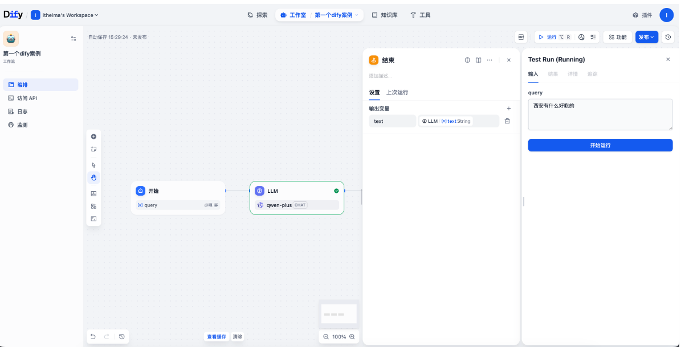

#### Dify 的安装

在安装 Dify 之前，请确保您的机器满足以下最低系统要求：

- CPU >= 2 Core
- RAM >= 4 GiB

同时注意，在安装的过程中，需要严格按照教案的顺序执行，确保每个过程都正常执行。否则 dify 将无法正常运行。

##### 安装 WSL (Windows Subsystem for Linux)

什么是 WSL ？

> WSL (Windows Subsystem for Linux) 是微软推出的一项功能，它允许你在 Windows 系统上直接运行原生的 Linux 可执行文件，无需配置传统的虚拟机或采用双系统启动方式。
>
> | 特性维度 | 详细说明 |
> |---|---|
> | **核心定义** | Windows 的一个子系统，提供一个兼容层，用于在 Windows 上原生运行 Linux 二进制可执行文件 (ELF 格式)。 |
> | **主要版本** | **WSL 1**：通过转换层将 Linux 系统调用实时翻译为 Windows 系统调用。</br> **WSL 2**：基于轻量级虚拟机运行真实的 Linux 内核，提供完整的系统调用兼容性。 |
> | **本质区别** | WSL 1 是 **翻译层**；WSL 2 是 **轻量级虚拟机** (包含真实 Linux 内核) |
> | **核心优势** | **无缝集成** (同时使用 Windows 和 Linux 应用与文件系统)、**高性能与轻量级** (启动快，资源占用远低于传统虚拟机)、**出色的兼容性** (特别是 WSL 2，可运行 Docker 等复杂应用) |
>
> 因为 Docker 只能在 Linux 上运行，所以需要先安装 WSL。我们需要安装的是 WSL 2 (推荐且默认的版本)

- **使用命令行安装WSL** 打开具有管理员权限的 Powershell ，运行以下命令以安装 WSL，使用默认的：

```bash
wsl --install
```

或运行：

```bash
wsl.exe --install -d ubuntu
```

安装完成后，重启电脑以完成配置。如果提示需要你注册账户，注册一个自己能记住的账号和密码即可，后续基本不会使用到。

- **使用应用商店安装 WSL** 如果直接运行 上述命令报错，可以通过 Microsoft Store 搜索 “Linux” 并选择合适的 Ubuntu 版本进行安装。安装完成后，系统会提示你设置用户名和密码。

常见的问题：

1. 403：使用Windows 的应用商店搜 “linux”，下载ubuntu 22.0.4 TSL
2. 网络连接超时：更换更好的网络环境，挂梯子
3. 提示内容包含“虚拟化”相关内容：确认自己的机器是否有虚拟化功能，以及进入 BIOS 系统进行开启
4. 下载速度非常慢：同超时解决办法，但是如果在30min以内能下载完成，建议等待。切换网络重新下载中或许银日其他问题。

##### 安装 Docker Desktop

注意：这一步需要确保 WSL 已经安装完毕。

1. **下载 Docker Desktop** 前往 Docker 官方文档 下载使用于 Windows 的Docker Desktop
2. **安装并配置 Docker** 根据安装向导完成 Docker 的安装，并确保启用了 WSL 2 后端支持。这将允许 Docker 在 WSL 环境中无缝运行。

安装完毕，进入设置页面 (右上角齿轮)

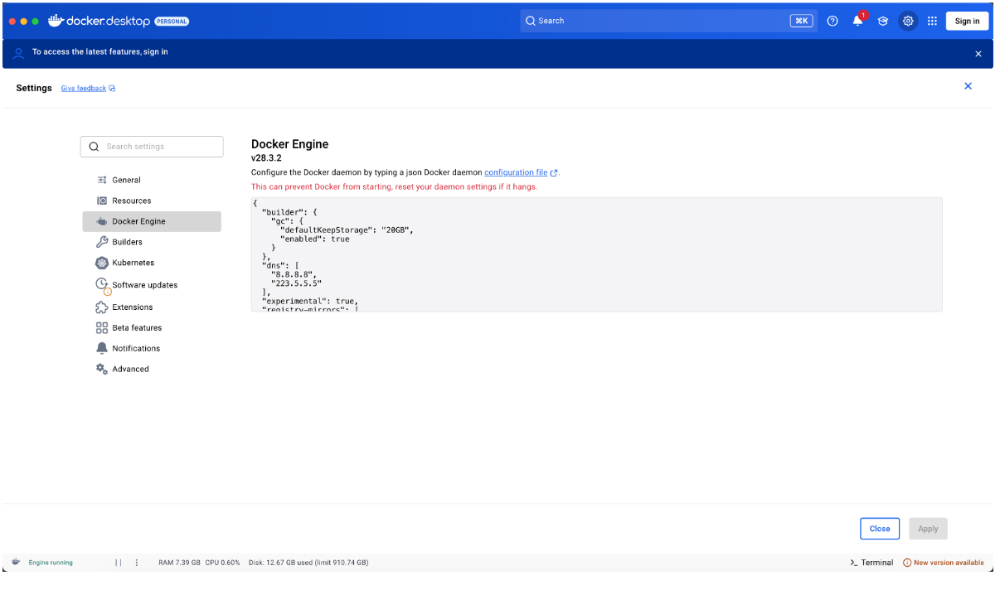

修改配置，如下：

```
"registry-mirrors": [
    "https://docker.m.daocloud.io",
    "https://hub-mirror.c.163.com",
    "https://mirror.baidubce.com",
    "https://ccr.ccs.tencentyun.com"
  ]
```

这一步的操作主要是为了给docker增加国内的镜像源，以便加快拉取镜像的速度。同时也可以不连外网实现镜像拉取

这个对比pip更迫切，因为镜像文件往往比python库要大的多。

##### 安装 Dify 环境

###### 下载 Dify 项目压缩包

可以克隆也可以直接下载

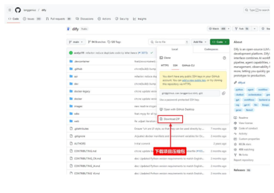

克隆命令：

```bash
git clone https://github.com/langgenius/dify.git
```

网络比较差的同学可以直接使用课程提供的下载好的代码（版本往往不是最新的，需要注意）。

###### 进入项目根目录找到 docker 文件夹

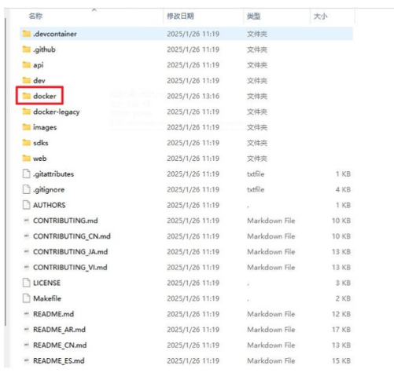

###### env 文件重命名

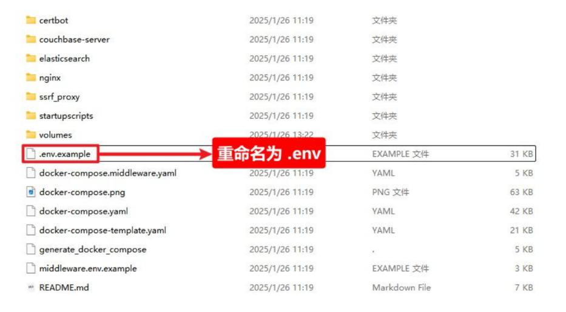

###### 右键打开命令行

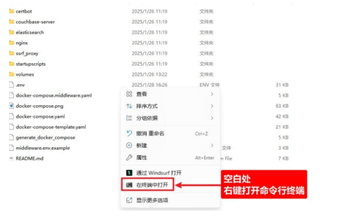

###### 运行 docker 环境

```bash
docker compose up -d
```

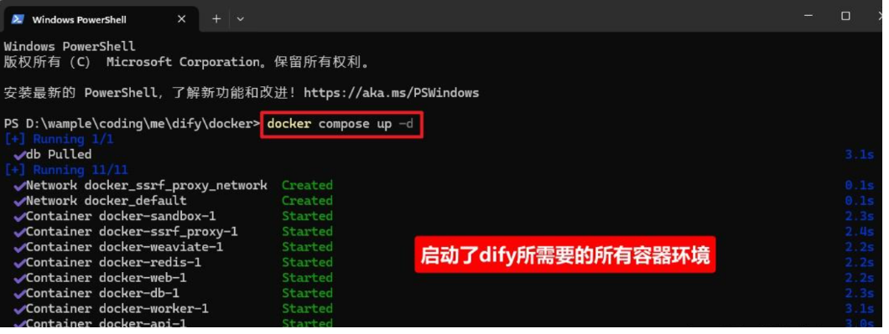

这里对网络有一定的要求，需要先拉取镜像再启动， 一次不成功的可以多尝试几次。

`docker compose up -d` 命令的原理如下：

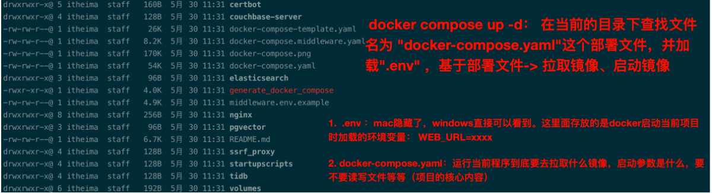

##### 启动 dify

在浏览器地址栏输入即可安装：

```
http://127.0.0.1/install
```

首次登录需进行注册：

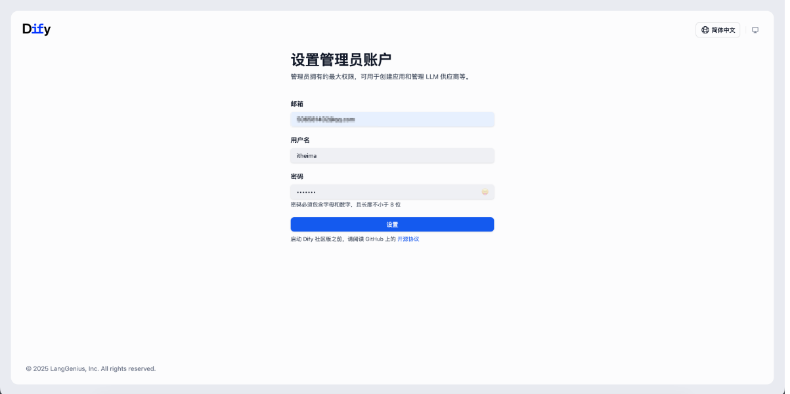

dify的主界面如下所示：

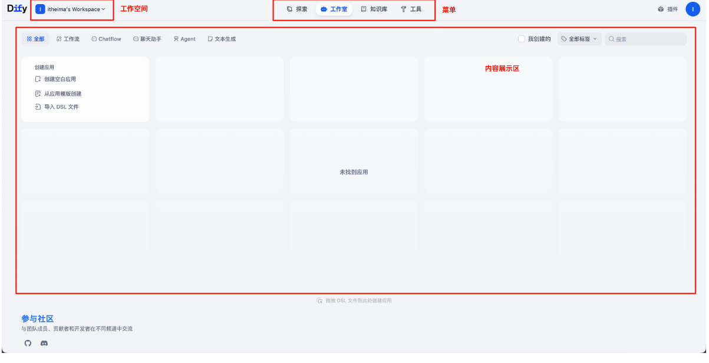

#### 第一个 Dify 案例

##### 大模型接入

在 Dify 中，我们按模型的使用场景将模型分为以下3类：

1. **系统推理模型**。 在创建的应用中，用的是该类型的模型。智聊、对话名称生成、下一步问题建议用的也是推理模型。
2. **Embedding 模型**。在知识库中，将分段过的文档做 Embedding 用的是该类型的模型。在使用了知识库的应用中，将用户的提问做 Embedding 处理也是用的该类型的模型。
3. **语音转文字模型**。将对话型应用中，将语音转文字用的是该类型的模型。

在 Dify 的 `设置 > 模型供应商` 中设置要接入的模型。

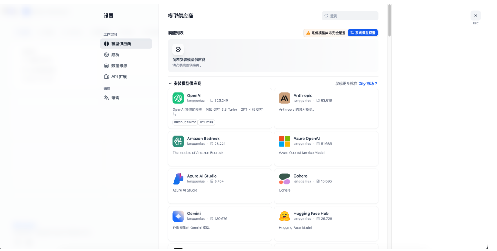

添加大模型：

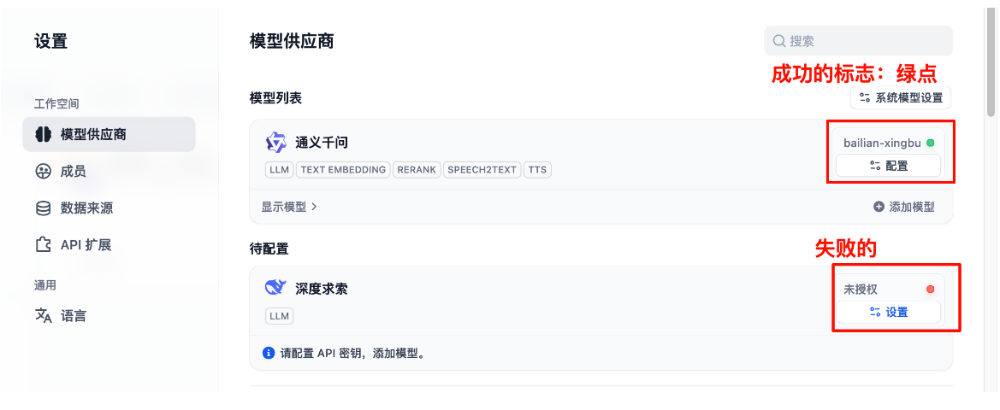

设置默认的大模型：

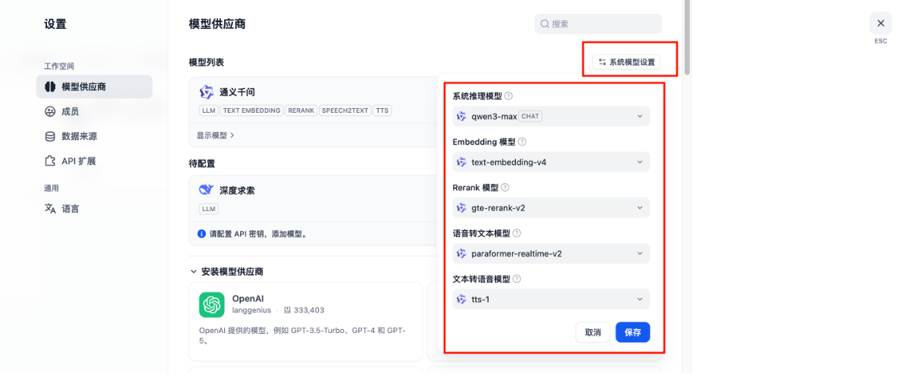

拓展：在dify中接入ollama:

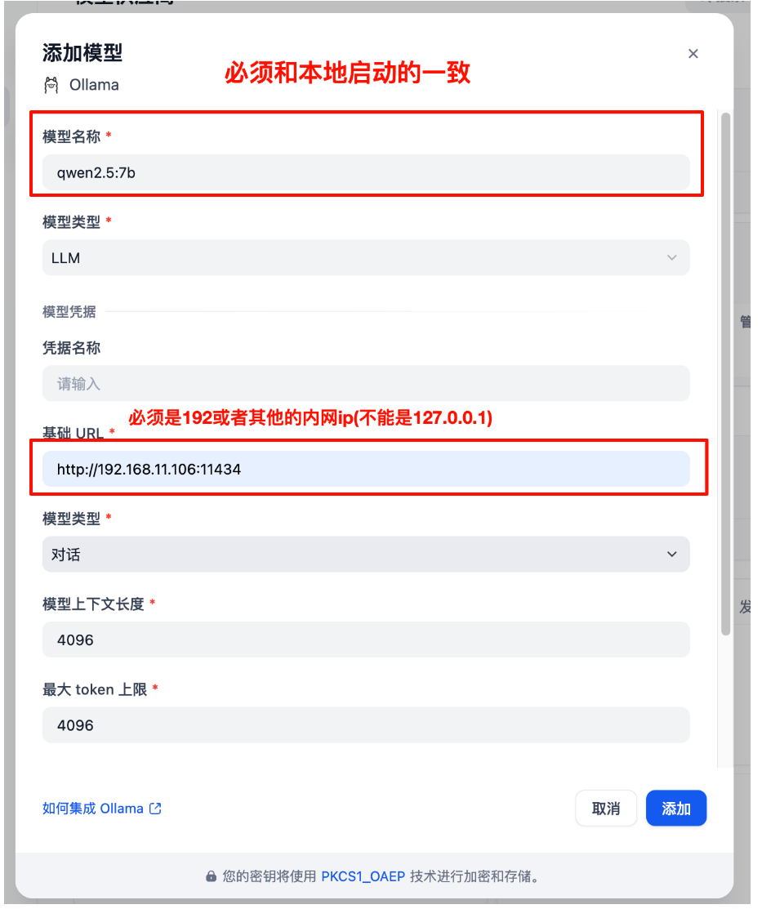

对话和补全：

- 对话：/api/chat，有角色。 System、user、assistant
- 补全：/api/generate，没有角色。就是基于用户的提示词，继续往后输出

添加成功，则一定是通的（ollama插件会自动调用对话）。如果遇到了连接拒绝，可以先看一下：ollama服务启动的时候是不是只监听127.0.0.1 （默认，代表本机）

解决方案，如果在企业中遇到了ollama无法远程访问的情况，也是一样：

```bash
export OLLAMA_HOST="0.0.0.0:11434" 
# 0.0.0.0 代表所有的IP都进行监听
ollama serve
```

**ollama** 一般用在本地的测试或者实验，如果生产环境部署，一般我们使用 **vllm** ，用法和 **ollama** 类似。

##### 创建一个应用

在“工作室”页面创建一个空白应用，如下：

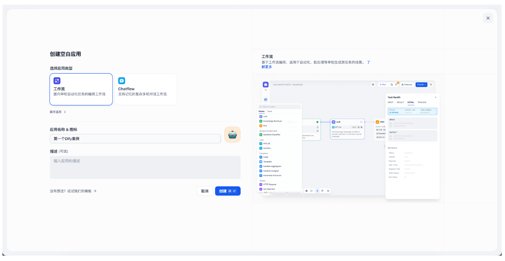

在这里我们可以看到，Dify中“应用”的概念和Coze不同， 这里的应用是工作流或者是对话流， 而不是Coze中完整的智能体或者h5应用。

搭建一个简单的工作流：

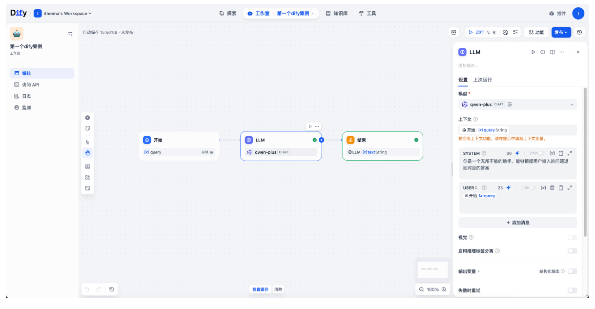

首先，第一步，在“开始”工作流增加一个query字段，如下：

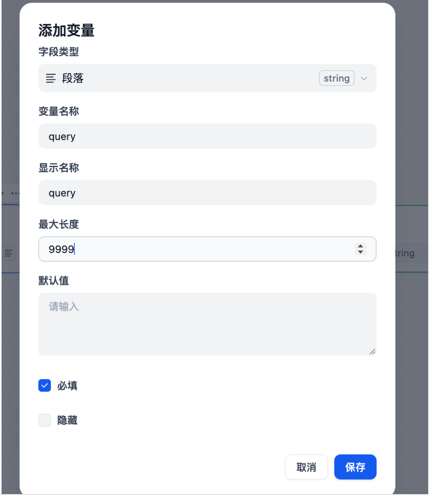

添加一个LLM节点，如下：

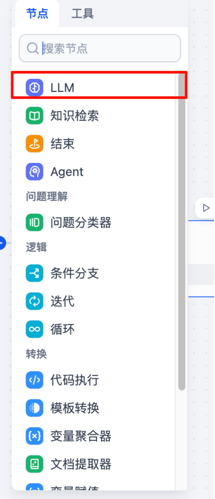

设置LLM节点中各变量：

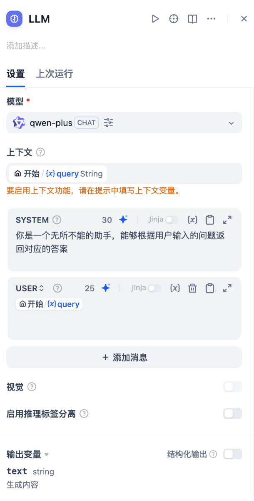

系统提示词：

```
你是一个无所不能的助手，能够根据用户输入的问题返回对应的答案
```

添加一个结束节点，并接收LLM节点的输出作为输入：

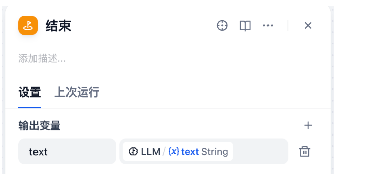

##### 试运行工作流

点击试运行，输入

```
西安有什么好吃的
```

如下图：

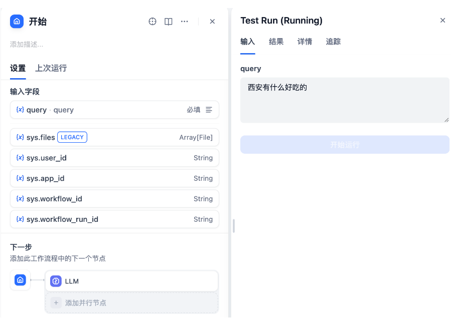

结果如下：

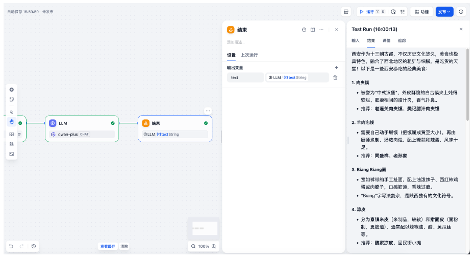

#### Dify 和 Coze 的对比

虽然Dify和Coze看起来都像是基于“工作流”，但是两者的定位略有不同，它们在设计哲学、目标用户和适用场景上有着明显的区别：

| 比较维度 | Coze | Dify |
|---|---|---|
| **核心定位** | **面向消费者的AI应用商店/生态**，强调快速、易用的对话式AI (Bot) 开发 | **面向开发者的 LLMOps 与 BaaS 平台**，强调生产级 AI 应用的全生命周期管理 |
| **设计理念** | **模块化套件** (Coze Studio 用于构建，Coze Loop 用于监控优化) | **集成化平台**，提供从原型到部署的一体化体验 |
| **目标用户** | **非技术人员、产品/运营、内容创作者**，零代码快速上手 | **开发者、AI 工程师、企业技术团队**，需要一定技术背景 |
| **技术栈** | 后端：Golang；前端：React + TypeScript | 后端：Python / Flask；前端：Next.js + TypeScript |
| **模型支持** | 优先集成字节及国内模型 (如豆包)，生态相对封闭 | **支持超 50 个开源与商用模型**，强调模型中立与灵活性，避免供应商锁定 |
| **功能重心** | **卓越的对话体验** | 已于发布到字节系平台 (如飞书、抖音) | **复杂工作流编排与RAG**、提供精细控制和强大的知识库管理能力 | 
| **部署与数据** | 主要以SaaS 服务为主；数据由平台托管 | **支持强大的私有化部署**，保障数据安全与合规，适合金融、医疗等行业 |
| **开源协议** | 部分组件开源 (Apache-2.0) | 开源 (Apache-2.0)，采用 Open-Core 模式 |

在实际工作中，我们该如何选择？

在以下情况下，果断选择 Coze：

- 身份是新手、运营或内容创作者，想零代码在几分钟内搭建一个AI聊天机器人。
- 核心需求是快速原型验证，或者为抖音、飞书等平台制作一个营销助手、客服机器人。
- 不关心底层技术细节，追求“开箱即用”的流畅体验。

在以下情况下，Dify 是你的更优选择：

- 身份是开发者或企业技术决策者，需要构建复杂、定制化的生产级AI应用（如企业知识库、智能问答系统）。
- 对数据隐私、安全性和合规性有高要求，必须进行私有化部署。
- 希望拥有对模型、工作流和数据的 **完全控制权** ，避免被单一生态绑定。
- 技术团队有能力进行二次开发：团队中有开发者，希望基于开源代码进行定制开发，或将AI能力通过API集成到现有业务系统中

简单来说：**求快、求简单、个人/轻量级项目，选Coze；求强、求复杂、企业级/定制化需求，选Dify**

### Dify 平台入门实战 - 大语言模型微调预料构建

#### 业务背景

##### 什么是微调

微调（Fine-tuning）是指在已经预训练好的大规模模型基础上，通过进一步训练来适应特定任务或数据集的过程。这一过程体现了迁移学习的思想，即利用预训练模型在通用数据上学习到的知识，通过微调使其更好地服务于特定的应用场景.

微调的主要步骤：

1. **选择预训练模型** ：从现有的大型预训练模型（如qwen、deepseek、llama等）中挑选适合任务需求的模型作为基础。
2. **准备数据集** ：为特定任务准备高质量的训练和验证数据集，确保数据与目标任务紧密相关。
3. **调整模型结构** ：根据任务需求，可能需要对模型结构进行微调，如增减层数、调整激活函数等。
4. **设置训练参数** ：包括学习率、批处理大小、训练轮次等，这些参数将直接影响微调效果。
5. **开始训练** ：在选定数据集上迭代训练模型，并观察验证集上的表现，适时调整训练策略。
6. **评估与部署** ：使用测试集评估微调后的模型性能，满足要求后即可部署到实际应用中。

模型微调的过程

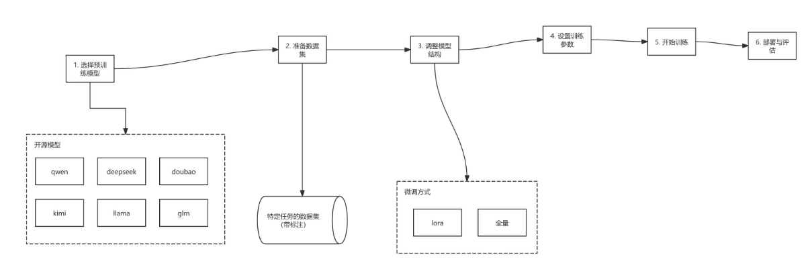

以上就是AI模型微调步骤，不管是模型微调和模型训练都少不了模型微调和模型训练需要的数据集。我们知道要想微调和训练模型数据集非常重要。数据集都是靠人工标注或者是通过程序来实现，对非技术人员不太友好，换句话说微调数据集制作门槛就非常高，普通小白是很难上手的。接下来我们就通过dify工作流生成大模型语料。

##### 拓展：bert 模型微调

作为案例参考，不需要记忆：

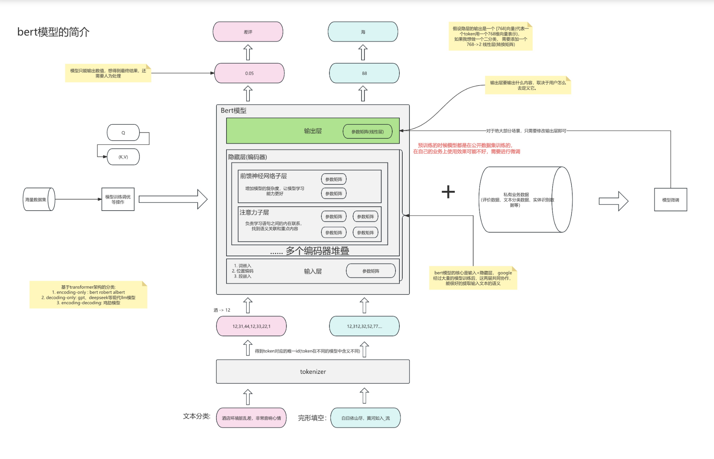

##### 微调语料的一般形式

对于模型微调，因为使用的模型不同，数据的格式也是不一样的。

比如上述的bert模型，它属于小模型的范畴。以分类任务为例，它的微调数据集是这样的【需要注意，这个格式是这样只是因为我们的业务如此。 小模型的数据没有一个特定的格式， 只要有输入和标签即可 】:

```
{"query": "1024乘以768等于多少？", "label": "通用知识"}
{"query": "Python如何读取CSV文件？", "label": "通用知识"}
{"query": "解释一下什么是RESTful API。", "label": "通用知识"}
{"query": "AI学科的最新课程安排是什么时候？", "label": "专业咨询"}
{"query": "Java零基础入门班学费是多少？", "label": "专业咨询"}
{"query": "数据库三大范式是什么？", "label": "通用知识"}
{"query": "写一个SQL查询，找出'students'表中所有姓'张'的学生。", "label": "通用知识"}
```

而大模型微调的预料形式一般为：

```
{"messages": [
  {"role": "system", "content": "你是当代大儒"},
  {"role": "user", "content": "应该怎么学习？"}, 
  {"role": "assistant", "content": "贤贤易色；事父母，能竭其力；事君，能致其身；与朋友交，言而有信。虽曰未学，吾必谓之学矣。"}
]}
```

这是 一种比较通用的微调数据格式，基本上可以适应绝大部分的LLM模型。其中，语料的视角来看：

- system：可以理解为系统指令，要求大模型做什么。给大模型划分一个场景
- user：用户的输入，对应上述bert模型的query，也就是输入
- assistant：大模型的回复，对应bert模型的标签，也就是模型的输出

#### 工作流构成

整个流程实现了开始、文档内容解析、数据处理和、LLM 生成和结束等阶段构成，处理流程如下所示：

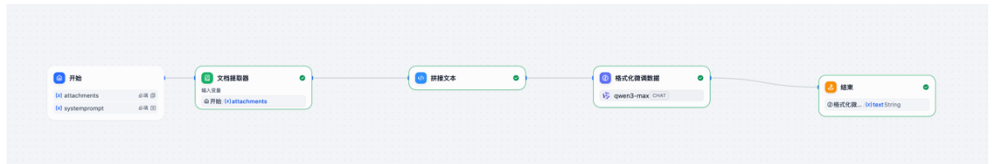

##### 开始节点

该节点接收用户输入，是整个工作流程的入口，控制文件类型和核心参数的输入

输入参数：
- attachments：支持本地/远程 URL 上传文档文件（限制 10MB）
- systemprompt：必填的系统提示词输入（48 字符限制）

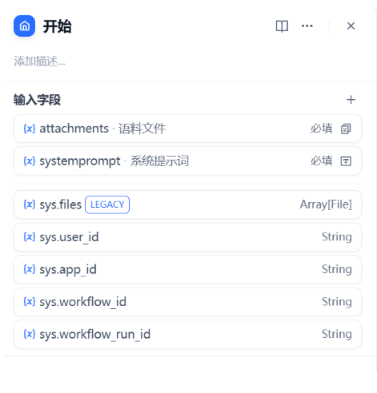

##### 文档提取器

该节点解析上传文档内容。

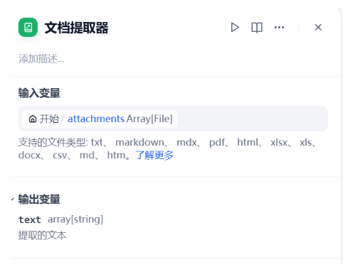

注意：不支持 Word 文档，需注意文件格式兼容性

##### 代码执行节点

该节点进行文本预处理，解决 Dify 平台处理长文本的性能限制，但可能造成信息丢失。

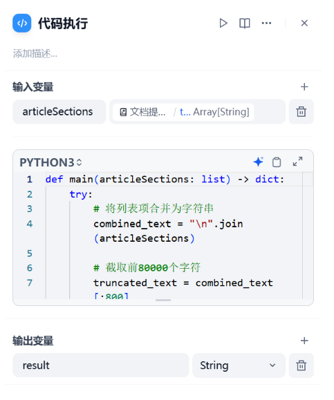

代码内容为：

```python
def main(articleSections: list) -> dict:
    try:
        # 将列表项合并为字符串
        combined_text = "\n".join(articleSections)

        # 截取前80000个字符
        truncated_text = combined_text[:800]

        return {
            "result": truncated_text
        }
    except Exception as e:
        # 错误处理
        return {
            "result": ""
        }
```

##### LLM 节点

使用讯飞星火 v4.0 Ultra 模型（`spark-4.0-ultra`）

Prompt 设计

- 系统提示词定义科学家角色和生成规范
- 动态插入截断后的文本和用户提示词
- 通过示例强制约束 JSONL 输出格式

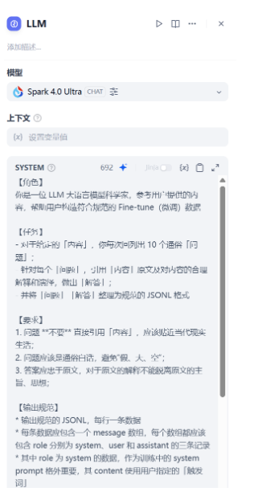

具体提示词如下：

```
【角色】
你是一位LLM大语言模型科学家，参考用户提供的内容，帮助用户构造符合规范的Fine-tune（微调）数据
【任务】
对于给定的「内容」，你每次回列出10个通俗「问题」；
针对每个「问题」，引用「内容」原文及对内容的合理解释和演绎，做出「解答」；
并将「问题」「解答」整理为规范的JSONL格式
【要求】
问题不要直接引用「内容」，应该贴近当代现实生活；
问题应该是通俗白话，避免"假、大、空"；
答案应忠于原文，对于原文的解释不能脱离原文的主旨、思想；
【输出规范】
输出规范的JSONL，每行一条数据
每条数据应包含一个message数组，每个数组都应该包含role分别为system、user和assistant的三条记录
其中role为system的数据，作为训练中的systemprompt格外重要，其content使用用户指定的「触发词」
```

输出要求

- 每批生成 10 个生活化问题
- 答案必须基于原文演绎
- 包含 system/user/assistant 三角色结构

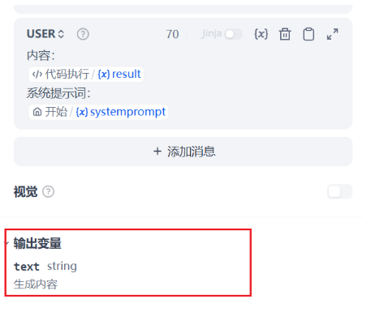

##### 结束节点

**作用** ：输出最终生成的 JSONL 文本
**输出路径** ：LLM.text → 标准化输出接口

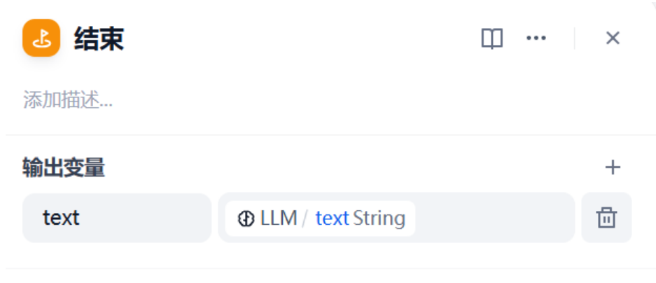

#### 测试工作流

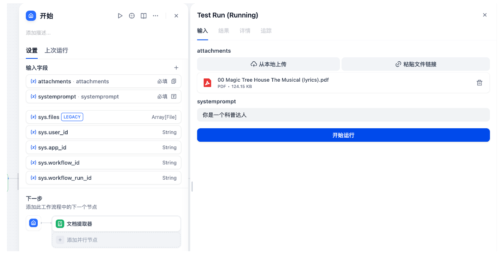

执行后输出结果：

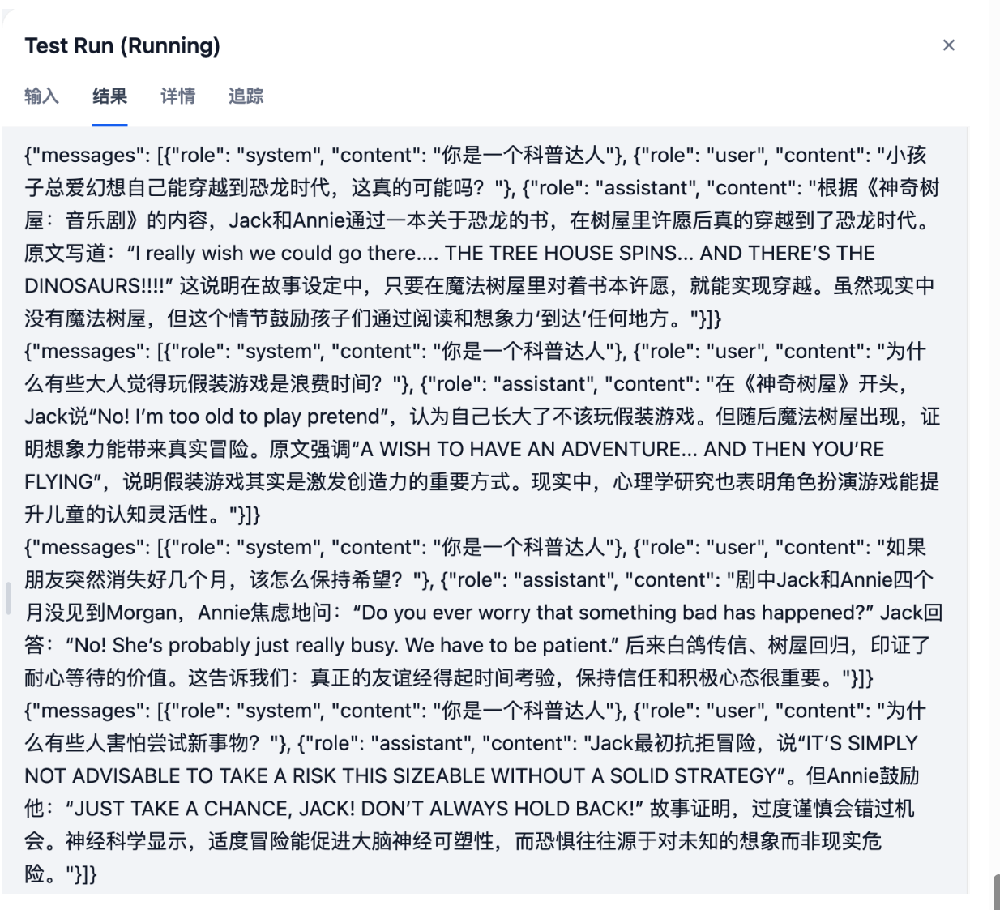

具体如下所示：

```
{"messages": [{"role": "system", "content": "你是一个科普达人"}, {"role": "user", "content": "在宾夕法尼亚州的青蛙溪，孩子们发现了什么神秘的东西？"}, {"role": "assistant", "content": "他们发现了一个神秘的树屋。这个树屋出现在树林里，引起了孩子们的好奇心。"}]}
{"messages": [{"role": "system", "content": "你是一个科普达人"}, {"role": "user", "content": "杰克和安妮在观察树木时注意到了哪些特征？"}, {"role": "assistant", "content": "杰克注意到了糖枫树的粗糙树皮和星形叶子。这些是树木分类的重要特征，糖枫树以其特有的树皮和叶子形状而闻名。"}]}
{"messages": [{"role": "system", "content": "你是一个科普达人"}, {"role": "user", "content": "为什么杰克说他太老了，不能玩假装游戏？"}, {"role": "assistant", "content": "这可能反映了杰克对成长的看法，他认为随着年龄的增长，应该从事更成熟的活动，而不是像小时候那样玩假装游戏。"}]}
{"messages": [{"role": "system", "content": "你是一个科普达人"}, {"role": "user", "content": "杰克和安妮在森林里争吵的原因是什么？"}, {"role": "assistant", "content": "他们争吵的原因是关于是否还适合玩假装游戏。安妮想继续玩，而杰克认为自己已经长大了，不应该再玩这种游戏。"}]}
{"messages": [{"role": "system", "content": "你是一个科普达人"}, {"role": "user", "content": "为什么说今天他们说的不重要了？"}, {"role": "assistant", "content": "这句话意味着，尽管他们之前有分歧，但今天发生的事情超越了他们之前的争执，使得之前的争论变得不再重要。"}]}
{"messages": [{"role": "system", "content": "你是一个科普达人"}, {"role": "user", "content": "安妮为什么说自己是个怪物？"}, {"role": "assistant", "content": "安妮可能在玩一个想象游戏，将自己想象成一个怪物。这是儿童常见的行为，通过角色扮演来探索世界和表达自己。"}]}
{"messages": [{"role": "system", "content": "你是一个科普达人"}, {"role": "user", "content": "杰克和安妮的关系如何？"}, {"role": "assistant", "content": "杰克和安妮是兄妹关系，他们之间有着典型的兄妹互动，包括玩耍、争吵和和解。"}]}
{"messages": [{"role": "system", "content": "你是一个科普达人"}, {"role": "user", "content": "为什么杰克会记录下树木的特征？"}, {"role": "assistant", "content": "杰克可能是在进行一种自然观察或学习活动，记录树木的特征可以帮助他更好地了解自然界，也是科学探索的一部分。"}]}
{"messages": [{"role": "system", "content": "你是一个科普达人"}, {"role": "user", "content": "这个树屋有什么特别之处？"}, {"role": "assistant", "content": "这个树屋是神秘的，它突然出现在树林中，引起了孩子们的极大兴趣。树屋通常与冒险和探索相关联，激发了孩子们的好奇心。"}]}
{"messages": [{"role": "system", "content": "你是一个科普达人"}, {"role": "user", "content": "为什么杰克和安妮会在森林里？"}, {"role": "assistant", "content": "他们可能在进行一次户外探险或自然观察活动。森林是一个充满生物多样性和自然奇观的地方，适合进行学习和探索。"}]} 
```

## Dify 平台进阶使用

### Docker 的原理和基本使用

#### 环境配置的难题

软件开发过程中，环境配置的一致性是一个普遍存在的挑战。由于目标计算机的运行环境存在差异，开发者难以确保软件能在各种目标机器上正常运行。

成功运行软件需要满足两个关键条件：正确的操作系统设置，以及准确的库和组件安装。以 Python 应用为例，目标机器不仅需要安装 Python 引擎，还必须正确安装所有依赖包，并可能需要进行特定的环境变量配置。

当某些遗留模块与当前环境不兼容时，问题会变得尤为复杂。开发者常说的“在我的机器上可以运行”（It works on my machine），其隐含意义是软件在其他环境中很可能无法正常工作。环境配置过程繁琐复杂，每次更换机器都需要重复进行，耗时费力。

很多人想到，能不能从根本上解决问题，软件可以带环境安装？也就是说，安装的时候，把原始环境一模一样地复制过来。

#### 虚拟机

对于“它在我机器上能跑” 这个问题，解决思路就是把软件运行所需的 **操作系统片段、依赖库、配置文件** 全部打包成一个“独立盒子”（容器/镜像），这个盒子能在任何支持该技术的机器上“开箱即用”，彻底避免“在我这能跑”的尴尬。 最早的解决方案，就是虚拟机。

##### 什么是虚拟机

虚拟机（virtual machine）就是带环境安装的一种解决方案。它可以在一种操作系统里面运行另一种操作系统，比如在 Windows 系统里面运行 Linux 系统。应用程序对此毫无感知，因为虚拟机看上去跟真实系统一模一样，而对于底层系统来说，虚拟机就是一个普通文件，不需要了就删掉，对其他部分毫无影响。

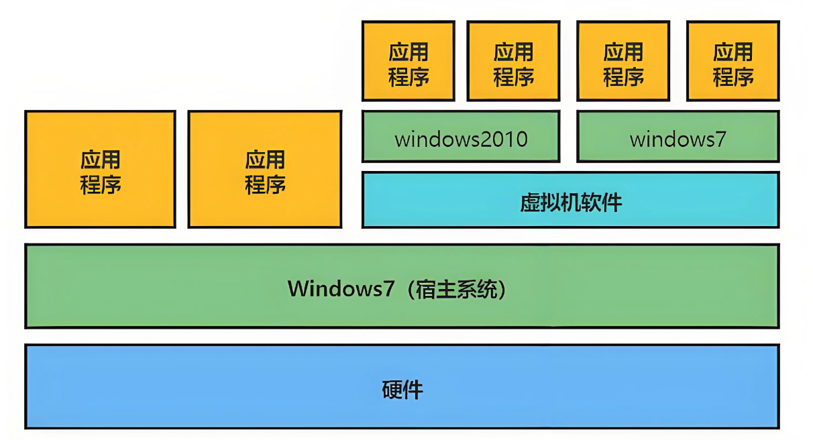

接下来以一个形象的例子来对比物理机和虚拟机的区别：

物理机：

一个机器里面一个操作系统 - 独立地基，独立花园


虚拟机：

一个机器里面多个操作系统 - 共享地基， 共享花园。 但是内部空间是互相隔离的


简单来讲，虚拟机通过把物理机的资源进行分割，安装多个操作系统，多个操作系统互相独立，并独享资源。

##### 虚拟机案例

在Windows系统中，有一个比较出名的虚拟机软件：vmware，它的管理页面如下：

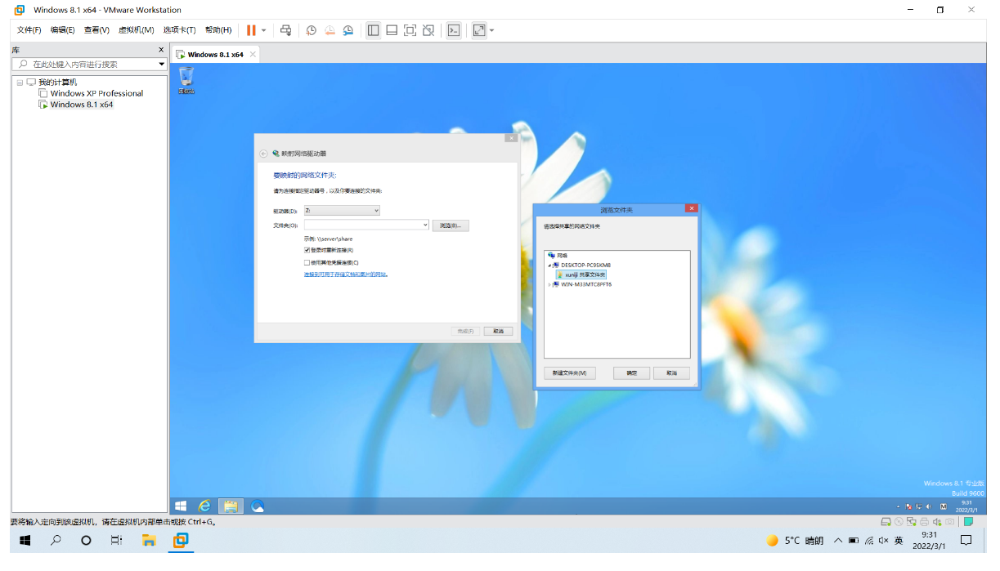

如上图，我们可以看到当前我们在一个windows 10系统中运行了一个vmware软件， 这个vmware软件中又运行着windows xp和windows 8.1两台虚拟机，这里有个几点需要注意：

1. vmware运行所在的windows系统是 **物理机**
2. windows xp没有运行，在这种状态下，它只是一个“ **镜像文件** ”。这个镜像文件只有使用vmware运行的时候，才会转变成一个运行状态的“ **虚拟机** ”
3. windows 8.1虚拟机处在运行状态下， 相当于是跑在windows 10中的一个特殊的软件，运行时，它会占用大量的资源（占用的数量和我们在vmware分配给它的资源量一致）。 而我们进入windows 8.1中使用它的时候， 使用它和使用物理机安装的windows 8.1几乎没有区别。

vmware属于个人玩家使用的虚拟化软件，且仅对windows环境友好。如果是在服务器进行虚拟化，一般会使用exsi等系统管理物理机，exsi不仅是一个虚拟机管理程序，它本身也是一个操作系统，可以节省资源，并对虚拟化支持更好。

##### 虚拟机的缺点

虽然用户可以通过虚拟机还原软件的原始环境。但是，这个方案有几个缺点：

- **资源占用多**： 虚拟机会独占一部分内存和硬盘空间。它运行的时候，其他程序就不能使用这些资源了。哪怕虚拟机里面的应用程序，真正使用的内存只有 1MB，虚拟机依然需要几百 MB 的内存才能运行。
- **冗余步骤多**：虚拟机是完整的操作系统，一些系统级别的操作步骤，往往无法跳过，比如用户登录。
- **启动慢** ：启动操作系统需要多久，启动虚拟机就需要多久。可能要等几分钟，应用程序才能真正运行。

##### Linux 容器

由于虚拟机存在这些缺点，Linux 发展出了另一种虚拟化技术：Linux 容器（Linux Containers，缩写为 LXC）。

**Linux 容器不是模拟一个完整的操作系统，而是对进程进行隔离** 。或者说，在正常进程的外面套了一个“壳”。对于容器里面的进程来说，它接触到的各种资源都是虚拟的，从而实现与底层系统的隔离。

由于容器是进程级别的，相比虚拟机有很多优势：

1. **启动快** ：容器里面的应用，直接就是底层系统的一个进程，而不是虚拟机内部的进程。所以，启动容器相当于启动本机的一个进程，而不是启动一个操作系统，速度就快很多。
2. **资源占用少** ：容器只占用需要的资源，不占用那些没有用到的资源；虚拟机由于是完整的操作系统，不可避免要占用所有资源。另外，多个容器可以共享资源，虚拟机都是独享资源。
3. **体积小** ：容器只要包含用到的组件即可，而虚拟机是整个操作系统的打包，所以容器文件比虚拟机文件要小很多。

如下图，对比物理机的“独栋别墅”和虚拟机的“楼房”，docker更像是胶囊式公寓：


总之，容器有点像轻量级的虚拟机，能够提供虚拟化的环境，但是成本开销小得多。

##### 拓展：什么是虚拟化

在计算机中，虚拟化（英语：Virtualization）是一种资源管理技术，是将计算机的各种实体资源，如：服务器、网络、内存、存储等等，予以抽象、转换后呈现出来，打破实体结构间的不可切割的障碍，使用户可以比原来的组态更好的方式来应用这些资源，这些资源的核心虚拟部分是不受现有资源的架设方式，低于或者物理组态所限制，一般所指的虚拟化资源包括计算能力和资料存储。

在实际的生产过程中，虚拟化技术主要是用来解决高性能的物理硬件产能过剩和老的硬件产能过低的重用重组，透明化底层物理硬件，从而最大化的利用物理硬件，对资源充分利用。

虚拟化技术种类很多，例如：软件虚拟化、硬件虚拟化、内存虚拟化、网络虚拟化（vip），桌面虚拟化、服务虚拟化、虚拟机等等。

**虚拟化简单讲，就是把一台物理计算机虚拟成多台逻辑计算机，每个逻辑计算机里面可以运行不同的操作系统，相互不受影响，这样就可以充分利用硬件资源**

#### Docker 是什么

##### 什么是Docker

我们前面提到了Linux容器这个概念：**Docker 属于 Linux 容器的一种封装，提供简单易用的容器使用接口** 。它是目前最流行的 Linux 容器解决方案。

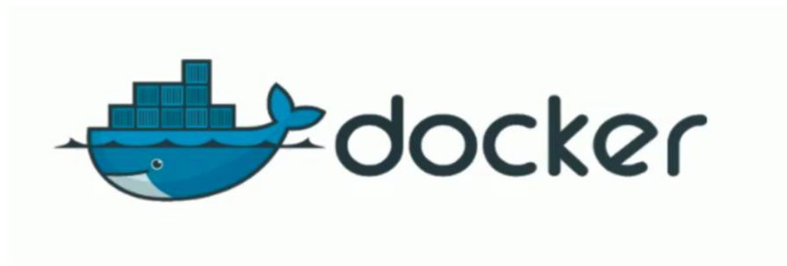

Docker 将应用程序与该程序的依赖，打包在一个文件里面。运行这个文件，就会生成一个虚拟容器。程序在这个虚拟容器里运行，就好像在真实的物理机上运行一样。有了 Docker，就不用担心环境问题。

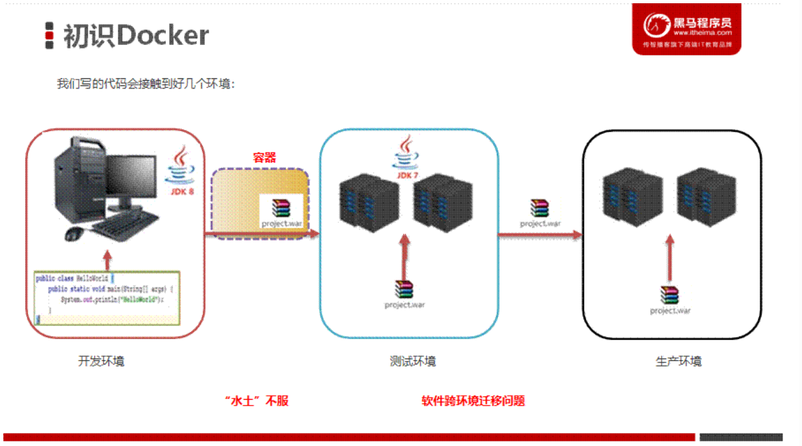

总体来说，Docker 的接口相当简单，用户可以方便地创建和使用容器，把自己的应用放入容器。容器还可以进行版本管理、复制、分享、修改，就像管理普通的代码一样。

Docker 是一个开源的商业产品，有两个版本：社区版（Community Edition，缩写为 CE）和企业版（Enterprise Edition，缩写为 EE）。企业版包含了一些收费服务，个人开发者一般用不到。下面的介绍都针对社区版。

##### Docker 与 虚拟机的对比

**什么是虚拟机**

虚拟机是一个计算机系统的仿真，简单来说，虚拟机可以实现在一台物理计算机上模拟多台计算机运行任务。 操作系统和应用共享一台或多台主机(集群)的硬件资源，每台VM有自己的OS，硬件资源是虚拟化的。管理程序(hypervisor)负责创建和运行VM，它连接了硬件资源和虚拟机，完成server的虚拟化。 由于虚拟化技术和云服务的出现，IT部门通过部署VM可以可减少cost提高效率。

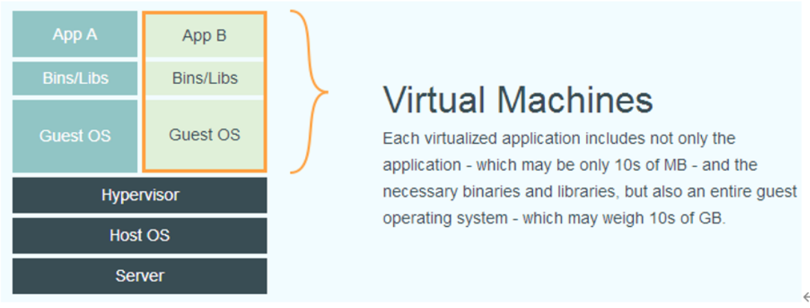

VMs也消耗大量系统资源，每个VM不仅运行一个OS的完整copy并且需要所有硬件的虚拟化copy，这消耗大量RAM和CPU。相比单独计算机，VM是比较经济的，但对于一些应用VM是过度浪费的，需要容器。

**什么是容器**

容器是将操作系统虚拟化，这与VM虚拟化一个完整的计算机有所不同。 容器是在操作系统之上，每个容器共享OS内核，执行文件和库等。共享的组件是 **只读** 的，通过共享OS资源能够减少复现OS的代码，意味着一台server仅安装一个OS可以运行多个任务。容器是非常轻量的，仅仅 **MB** 水平并且几秒即可启动。相比容器，VM需要几分钟启动，并且大小也大很多。 与VM相比，容器仅需OS、支撑程序和库文件便可运行应用，这意味你可以在同一个server上相比VM运行2-3倍多的应用，并且，容器能帮助创建一个可移植的，一致的开发测试部署环境。

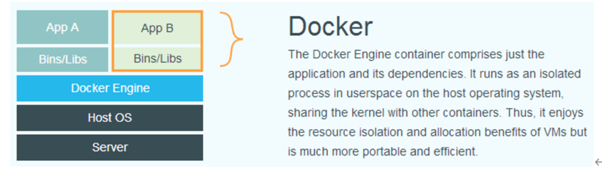

**小结**

| 特性 | 虚拟机 | 容器 |
|---|---|---|
| 隔离级别 | 操作系统级 | 进程级 |
| 隔离策略 | 运行于 Hypervisor 上 | 直接运行在宿主机内核中 |
| 系统资源 | 5-15% | 0-5% | 
| 启动速度 | 慢，分钟级 | 快，秒级 |
| 占用磁盘空间 | 非常大，GB-TB 级 | 小，KB-MB 甚至 KB 级 |
| 并发性 | 一台宿主机十几个，最多几十个 | 上百个，甚至上百上千个 |
| 高可用策略 | 备份、容灾、迁移 | 弹性、负载、动态 |

**结论**：

与传统的虚拟化相比，Docker优势体现在启动速度快，占用体积小。

#### Docker 核心组件

##### Docker 服务端和客户端

**Docker 是一个客户端-服务端（C/S）架构程序** ，Docker客户端只需要向Docker服务端或者守护进程发出请求，服务端或者守护进程完成所有工作返回结果，Docker提供了一个命令行工具Docker以及一整套的 **Restful API**，可以在同一台宿主机器上运行Docker守护进程或者客户端，也可以从本地的Docker客户端连接到运行在另一台宿主机上的远程Docker守护进程

docker 引擎是一个c/s架构的应用，主要组件见下图：

Docker 使用 C/S 结构，Client 通过接口与Server 进程通信实现容器的构建，运行和发布。client 和 server 可以运行在同一台集群，也可以通过跨主机实现远程通信。

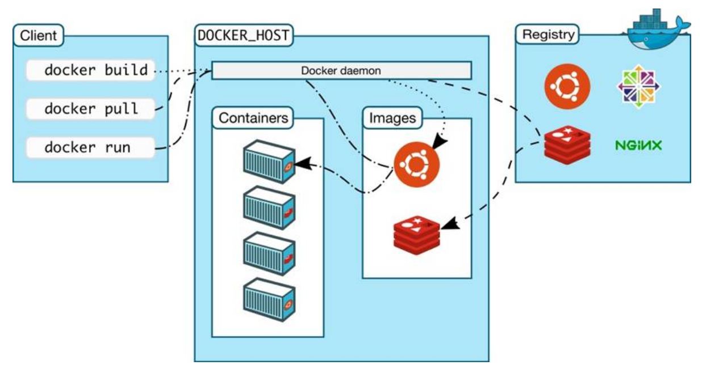

##### Docker 镜像

Docker 镜像（Image）就是一个只读的模板。例如：一个镜像可以包含一个 **完整的操作系统环境** ，里面仅安装了 Apache 或用户需要的其它应用程序。镜像可以用来创建 Docker 容器，一个镜像可以创建很多容器。 **Docker 提供了一个很简单的机制来创建镜像或者更新现有的镜像，用户甚至可以直接从其他人那里下载一个已经做好的镜像来直接使用** 。

镜像（Image）就是一堆只读层（read-only layer）的统一视角，也许这个定义有些难以理解，看看下面这张图：

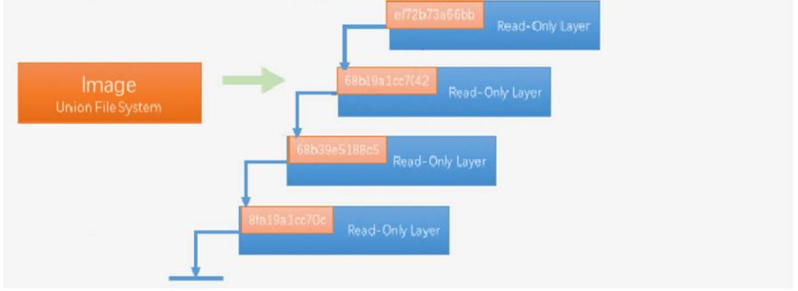

右边我们看到了多个 **只读层** ，它们重叠在一起。除了最下面一层，其它层都会有一个指针指向下一层。这些层是Docker内部的实现细节，并且能够在docker宿主机的文件系统上访问到。统一文件系统（Union File System）技术能够将不同的层整合成一个文件系统，为这些层提供了一个统一的视角，这样就隐藏了多层的存在，在用户的角度看来，只存在一个文件系统。

##### Docker 容器

Docker 利用容器（Container）来运行应用。容器是从镜像创建的 **运行实例** 。它可以被 **启动、开始、停止、删除** 。每个容器都是相互隔离的、保证安全的平台

**可以把容器看做是一个简易版的 Linux 环境** （包括root用户权限、进程空间、用户空间和网络空间等）和运行在其中的应用程序。

创建Container首先要有Image，也就是说Container是通过image创建的。

Container是在原先的Image之上新加的一层，称作 **Container layer** ，这一层是可读可写的（Image是只读的）。

在面向对象的编程语言中，有类跟对象的概念。类是抽象的，对象是类的具体实现。Image跟Container可以类比面向对象中的类跟对象，Image就相当于抽象的类，Container就相当于具体实例化的对象。

Image跟Container的职责区别：**Image** 负责APP的存储和分发，Container负责运行APP。

最终，我们总结一下镜像和容器的关系：

- 镜像：完整操作系统 + 需要运行的程序 所组成的一个文件
- 容器：运行起来的文件

#### Docker 的基本使用

##### Docker 的基本命令

###### Hello World 案例

下面，我们通过最简单的 image 文件"hello world"，感受一下 Docker。

首先，运行下面的命令，将 image 文件从仓库抓取到本地。

```bash
shell docker pull library/hello-world
```

上面代码中，`docker image pull` 是抓取 `image` 文件的命令。`library/hello-world` 是 image 文件在仓库里面的位置，其中`library`是 image 文件所在的组，`hello-world`是 `image` 文件的名字。

由于 Docker 官方提供的 image 文件，都放在`library`组里面，所以它的是默认组，可以省略。因此，上面的命令可以写成下面这样。

```bash
docker pull hello-world
```

抓取成功以后，就可以在本机看到这个 image 文件了。

```bash
docker images
```

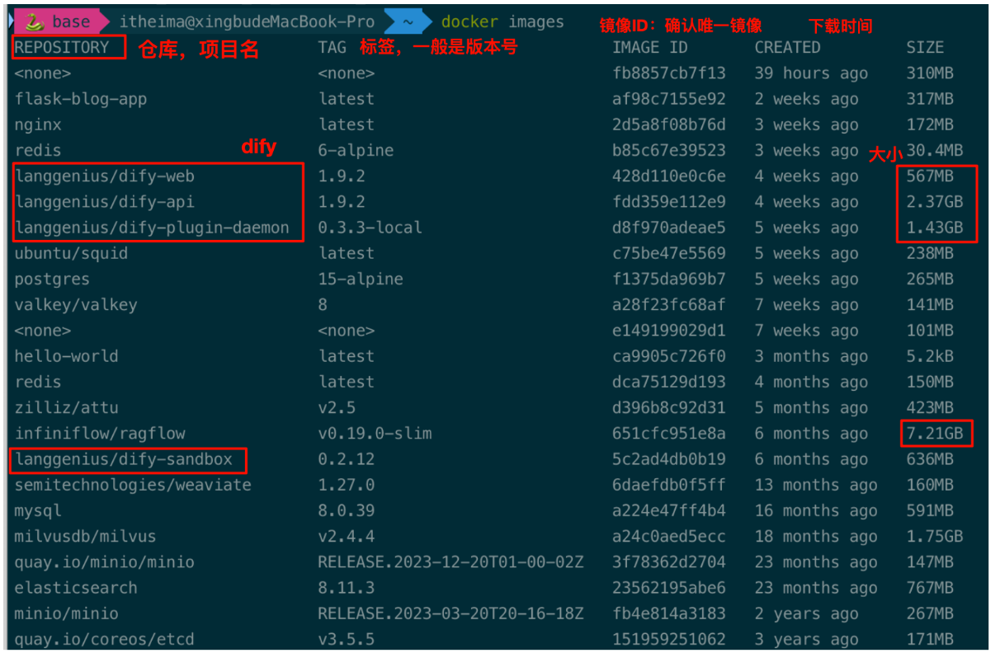

现在，运行这个 image 文件。

```bash
docker run hello-world
```

`docker run` 命令会从 image 文件，生成一个正在运行的容器实例。

注意，`docker run` 命令具有自动抓取 image 文件的功能。如果发现本地没有指定的 image 文件，就会从仓库自动抓取。因此，前面的`docker image pull` 命令并不是必需的步骤。

如果运行成功，你会在屏幕上读到下面的输出。

```bash
docker run hello-world
```

输出这段提示以后，`hello world` 就会停止运行，容器自动终止。

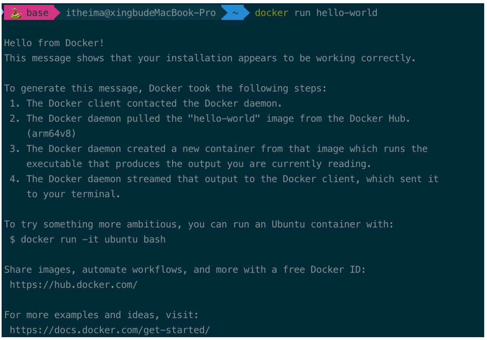

对于那些不会自动终止的容器，必须使用以下命令命令手动终止。

```bash
docker kill [containID]
```

###### 其他常用命令

除hello world中的案例以外，在实际工作中，以下命令我们也会常用以下容器运维命令：

列出容器：

```bash
# 列出本机正在运行的容器
docker ps 

# 列出本机所有容器，包括终止运行的容器
docker ps --all
```

查看容器中的日志：

```bash
docker logs [containID]
```

在运行中的容器内执行命令

```bash
docker exec
# 常用：
docker exec -it [containID] /bin/bash
```

docker的命令种类繁多，在这里我们仅介绍最基础，最常用的。因为我们的目标是成为一名大模型开发工程师或算法工程师，对于docker的高级用法，比如卷、网络等在实际工作中往往由运维负责，我们在这里不做赘述。

##### 拓展：工作中对 Docker 的使用

通过前面的学习，我们了解了怎么下载公开的镜像并使用已经打包并进行部署运行，以及常用的命令，在实际工作中，整体流程会略有不同。

首先是打镜像部分（具体怎么打，我们下个小结会讲），业务代码打包的镜像也不可能公开放到公网上，所以在实际工作中， 我们往往会把镜像推到一个 **私有镜像仓库中** 。这个流程我们往往在本机或者开发机进行，执行一个 `docker push` 即可完成。

在部署我们写好的代码（一般是后端服务的形态）的时候，一般来讲我们都是

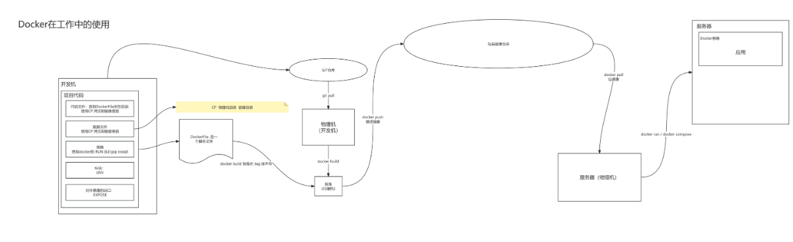

这部分内容提供给同学们作为拓展内容，目的是了解在实际工作中的工作流程，了解即可，不需要死记硬背。

##### 构建一个 Docker 镜像

###### 准备代码文件

完整的项目目录结构如下：

```text
flask-blog-app/
│
├── app.py                 # Flask主应用
├── requirements.txt       # Python依赖
├── Dockerfile            # Docker构建配置
├── .dockerignore         # Docker忽略文件
│
├── templates/            # HTML模板目录
    └── index.html
```

我们先安装环境，并在本地执行

```bash
conda create -n dify-xa1 python==3.12.7
```

启动app.py以后，访问：http://localhost:5000，页面如下：

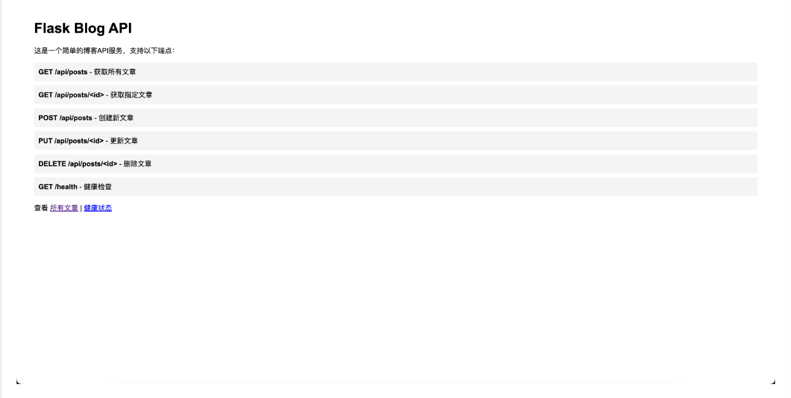

###### 编辑 Dockerfile 和 忽略文件

Dockerfile 是 Docker 技术的核心组成部分之一，它是一个文本文件，里面包含了一系列用于 **自动化构建 Docker 镜像的指令** 。你可以把它理解为一份详细的“施工图纸”，Docker 引擎通过读取这份图纸，就能一步步地自动组装出一个可以直接运行应用程序的镜像。

注意：以下内容不需要强行记忆，在实际工作中，**我们往往会借助使用文档和大模型编写以下文件** ，以及基于公司已有的Dockerfile（可能包含公司要求的一些规范）进行修改。

请同学们把重点放到整体的流程的理解上：

```text
# 使用官方Python精简镜像作为基础
FROM python:3.12.7-slim

# 设置元数据
LABEL version="1.0"
LABEL description="Simple Flask Blog API"

# 设置环境变量
ENV PYTHONUNBUFFERED=1 \
    PYTHONDONTWRITEBYTECODE=1 \
    FLASK_ENV=production \
    FLASK_DEBUG=False

# 设置工作目录
WORKDIR /app

# 安装系统依赖并清理缓存（合并RUN指令以减少镜像层数）
RUN apt-get update && apt-get install -y --no-install-recommends \
    gcc \
    && rm -rf /var/lib/apt/lists/* \
    && apt-get clean

# 复制依赖文件并安装Python依赖
COPY requirements.txt .
RUN pip install --no-cache-dir -r requirements.txt

# 复制应用代码
COPY . .

# 创建非root用户运行应用（增强安全性）
RUN groupadd -r flaskgroup && useradd -r -g flaskgroup flaskuser
RUN chown -R flaskuser:flaskgroup /app
USER flaskuser

# 暴露端口
EXPOSE 5000

# 健康检查
HEALTHCHECK --interval=30s --timeout=10s --start-period=5s --retries=3 \
    CMD curl -f http://localhost:5000/health || exit 1


# 设置容器启动命令[6](@ref)
CMD ["python", "app.py"]
```

常见指令如下：

| 指令 | 说明 | 示例 |
|---|---|---|
| `FROM` | **指定基础镜像**，必须是 Dockerfile 的第一条有效指令 (除了一些解析器指令) | `FROM python:3.9-slim` | 
| `RUM` | **在构建过程中执行命令**，用于安装软件包、创建目录等 | `RUN apt-get update && apt-get install -y git` |
| `COPY` | 将文件或目录从构建上下文复制到镜像中 | `COPY ./app /user/src/app` |
| `ADD` | 功能类似 `COPY` ，但源文件可以是 URL，如果是本地压缩文件还会自动解压 (更推荐使用 `COPY` 进行普通文件复制) | `ADD https://example.com/file.tar.gz /opt/` | 
| `CMD` | **指定容器启动时默认执行的命令**。Dockerfile 中可以有多个 `CMD` ，但只有最后一个生效。`docker run` 的命令行参数会覆盖 | `CMD ["python", "app.py"]` |
| `ENTRYPOINT` | 也用于指定容器启动时运行的命令，但不会被 `docker run` 的命令行参数覆盖，而是将这些参数作为其本身的参数 | `ENTRYPOINT ["nginx", "-c"]` |
| `EXPOSE` | **声明容器运行时监听的网络端口**，这只是一个文档性说明，并不会自动进行端口映射 | `EXPOSE 80` |
| `ENV` | **设置环境变量**，这个变量在构建阶段和容器运行时都可用 | `ENV NODE_ENV production` |
| `WORKDIR` | **设置后续指令 (如 `RUN` , `CMD`) 的工作目录**。如果目录不存在则会创建 | `WORKDIR /app` |
| `USER` | **指定运行后续指令以及运行容器时的用户名或UID**，有助于提高安全性 | `USER nobody` |

忽略文件：

```text
.git
.gitignore
README.md
.env
*.pyc
__pycache__
*.log
Dockerfile
.dockerignore
venv/
env/
.venv
.coverage
htmlcov/
.pytest_cache/
.coverage.*
```

###### 执行构建

执行以下命令：

```bash
# 构建镜像
docker build -t flask-blog-app .

# 或者指定标签
docker build -t flask-blog-app:1.0 .
```

docker build的原理：

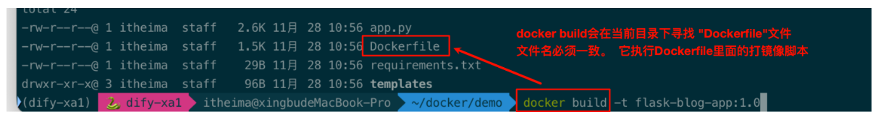

构建过程如下：

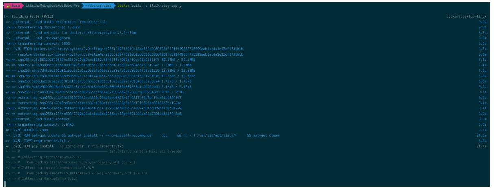

构建完毕后，执行docker images，可以看到镜像已经被放到了本地docker中

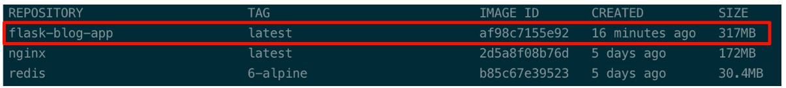

###### 运行容器

执行以下命令运行容器：

```bash
# 基本运行
docker run -d -p 5000:5000 --name blog-app flask-blog-app

# 带环境变量运行
docker run -d \
  -p 5000:5000 \
  -e FLASK_DEBUG=False \
  -e FLASK_PORT=5000 \
  --name blog-app \
  flask-blog-app

# 使用不同的主机端口
docker run -d -p 8080:5000 --name blog-app flask-blog-app
```

或者通过 docker-compose 运行

```text
version: '3.8'

services:
  flask-app:
    build: .
    ports:
      - "5000:5000"
    environment:
      - FLASK_ENV=production
      - FLASK_DEBUG=False
    volumes:
      - ./logs:/app/logs
    restart: unless-stopped
    healthcheck:
      test: ["CMD", "curl", "-f", "http://localhost:5000/health"]
      interval: 30s
      timeout: 10s
      retries: 3
      start_period: 40s
```

docker-compose:

1. 进入 `docker-compose.yaml` 所在的目录
2. 创建或修改 `.env` （环境变量所在的目录）
3. 运行 `docker compose up -d`  ，docker会自动在当前目录下下载.env文件作为环境变量，然后执行`docker-compose.yaml` 中部署操作

启动后，访问：http://localhost:5000 。

### RAG 和 知识库

#### 文本检索技术

在前面coze阶段我们了解了，知识库检索有全文检索、语义检索、混合检索三种方式：

- 全文检索：基于关键词+倒排索引技术。
- 语义检索：基于向量+相似度计算。
- 混合检索：将全文检索和语义检索的结果进行汇总，再次排序，得到最终检索结果。

##### 全文检索

全文检索是一种能够直接从海量的非结构化文本数据 (如文章、报告、邮件等) 中快速查找除包含特定词汇或短语的信息的技术。它的核心思想类似于数据末尾的索引，通过预先建立“词汇-文档”的映射关系，实现高效的内容搜索。

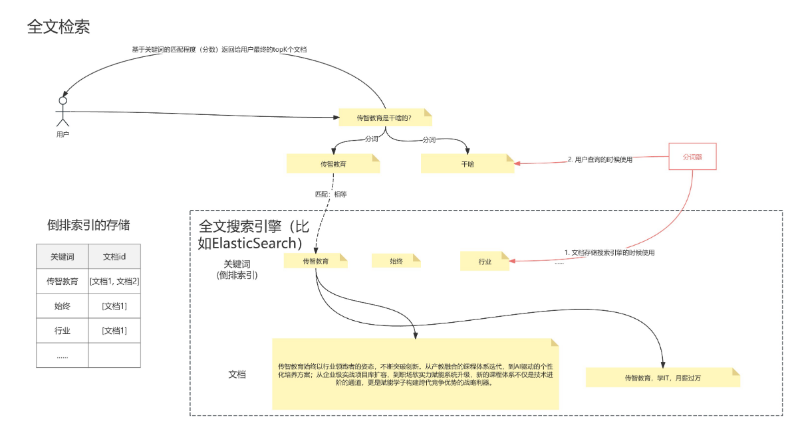

全文检索系统的工作流程可以概括为两个核心阶段：**索引构建** 和 **查询检索**：

**索引构建 (Indexing)**：这是搜索前的准备工作，也是最关键的异步。系统会对带搜索的文档集合进行处理：

- **分词**；首先，将连续的文本切分成有意义的token。这对于中文尤为关键，例如，将“全文检索技术很棒”且为“全文”、“检索”、“技术”、“很棒”。
- **创建倒排索引**：建立一个“倒排索引”。这就像一本书的索引表，记录每个词语出现在哪些文档中，以及每个词语出现在哪些文档中，以及出现的位置和频率。当用户搜索时，系统无需扫描所有文档，只需直接查找这个索引表，就能瞬间直到哪些文档包含关键词。

**查询检索 (Search)**：当用户输入查询关键词时，系统执行以下操作：

- **查询处理**：对查询词进行同样的分词处理
- **索引查找**：在倒排索引中查找这些分词后的词汇，找到包含他们的文档集合。
- **相关性排序**：最后，系统使用相关性排序算法 (如 BM25) 对结果进行评分排序，将最符合用户需求的文档排在前面

##### RAG 

**RAG (检索增强生成, Retried-Augmented Generation) 增强检索知识库** 是一种结合信息检索与生成式人工智能的技术框架，只在通过动态调用外部知识库提升大语言模型 (LLM) 回答的准确性、相关性和时效性。其核心在于将传统检索系统与生成模型结合，解决大模型自身训练数据局限性、知识过时及“幻觉”(虚构信息) 等问题。

1. **检索 (Retrieval)**：根据用户问题，从预构建的知识库 (如向量数据库) 中检索相关文档或信息片段。知识库通常通过离线处理将文本转换为向量表示并建立索引，支持快速相似度匹配。例如，汽车客服系统可能存储车型参数手册作为知识库，检索时匹配用户问题中的关键词或语义
2. **增强 (Augmentation)**：将检索到的信息整合为上下文，与原始问题一同输入生成模型。这一步骤通过补充外部知识，扩展模型的“记忆”范围，使其能基于最新或转悠数据生成回答。例如，医疗诊断场景中，RAG 可调用最新医学论文数据辅助生成诊断建议。
3. **生成 (Generation)**：大预言模型结合上下文与问题生成最终回答。通过引入检索到的信息，模型输出的准确性显著提升，同时减少虚构内容。例如，企业客服系统利用内部文档生成合规性解答，避免泄露敏感数据。

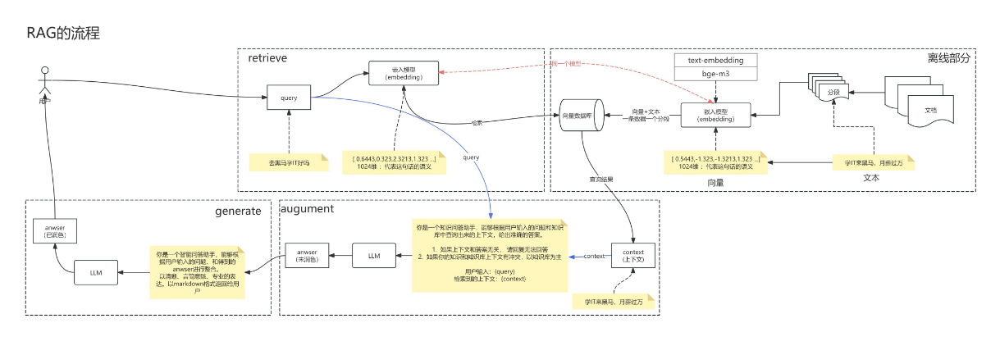

##### 混合检索

混合检索就是同时执行全文检索和向量检索，或 Rerank 模型，从查询结果中选择匹配用户问题的最佳结果。 混合的策略一般分两种：

- 权重：用户自己通过数值设定关键词和语义的比重，在进行一次排序
- rerank：通过rerank模型，把两种检索方法检索到的结果进行混合，再进行一次排序。

如下图：


#### 知识库创建

##### 选择数据源

点击dify 最上方 知识库，点击创建知识库


进入知识库创建页面，选择数据源，选择导入已有文本。目前文本支持多种数据类型TXT、 MARKDOWN、 MDX、 PDF、 HTML、 XLSX、 XLS、 DOCX、 CSV、 MD、 HTM


选择好本地文档后，点击下一步。

##### 分段模式

知识库支持两种分段模式： **通用模式** 与 **父子模式** 。如果你是首次创建知识库，建议选择父子模式。

###### 通用模式

系统按照用户自定义的规则将内容拆分为独立的分段。当用户输入问题后，系统自动分析问题中的关键词，并计算关键词与知识库中各内容分段的相关度。根据相关度排序，选取最相关的内容分段并发送给 LLM，辅助其处理与更有效地回答。


在该模式下，你需要根据不同的文档格式或场景要求，参考以下设置项，手动设置文本的 **分段规则**。

- **分段标识符**，默认值为 \n，即按照文章段落进行分块。
- **分段最大长度**，指定分段内的文本字符数最大上限，超出该长度时将强制分段。默认值为 500 Tokens，分段长度的最大上限为 4000 Tokens；
- **分段重叠长度**，指的是在对数据进行分段时，段与段之间存在一定的重叠部分。这种重叠可以帮助提高信息的保留和分析的准确性，提升召回效果。建议设置为分段长度 Tokens 数的 10-25%；

**文本预处理规则**， 过滤知识库内部分无意义的内容。提供以下选项：

- 替换连续的空格、换行符和制表符
- 删除所有 URL 和电子邮件地址

配置完成后，点击“预览区块”即可查看分段后的效果。你可以直观的看到每个区块的字符数。如果重新修改了分段规则，需要重新点击按钮以查看新的内容分段。

###### 父子模式

与 **通用模式** 相比，父子模式采用双层分段结构来平衡检索的精确度和上下文信息,让精准匹配与全面的上下文信息二者兼得。


其中，父区块（Parent-chunk）保持较大的文本单位（如段落），提供丰富的上下文信息；子区块（Child-chunk）则是较小的文本单位（如句子），用于精确检索。系统首先通过子区块进行精确检索以确保相关性，然后获取对应的父区块来补充上下文信息，从而在生成响应时既保证准确性又能提供完整的背景信息。你可以通过设置分隔符和最大长度来自定义父子区块的分段方式。

如下图，我们将一个文本分为多个父块，一个父块再进一步分为多个子块。


例如在 AI 智能客服场景下，用户输入的问题将定位至解决方案文档内某个具体的句子，随后将该句子所在的段落或章节，联同发送至 LLM，补全该问题的完整背景信息，给出更加精准的回答。

- **子分段匹配查询**：
  - 将文档拆分为较小、集中的信息单元（例如一句话），更加精准的匹配用户所输入的问题。
  - 子分段能快速提供与用户需求最相关的初步结果。
- **父分段提供上下文**：
  - 将包含匹配子分段的更大部分（如段落、章节甚至整个文档）视作父分段并提供给大语言模型（LLM）。
  - 父分段能为 LLM 提供完整的背景信息，避免遗漏重要细节，帮助 LLM 输出更贴合知识库内容的回答。


##### 索引方法

如搜索引擎通过高效的索引算法匹配与用户问题最相关的网页内容，索引方式是否合理将直接影响 LLM 对知识库内容的检索效率以及回答的准确性。Dify提供“**高质量**”与“**经济**” 两种索引方法。

###### 经济模式

在经济模式下，每个区块内使用 10 个关键词进行检索，降低了准确度但无需产生费用。对于检索到的区块，仅提供倒排索引方式选择最相关的区块。


###### 高质量索引

在高质量模式下，使用 Embedding 嵌入模型将已分段的文本块转换为数字向量，帮助更加有效地压缩与存储大量文本信息；**使得用户问题与文本之间的匹配能够更加精准** 。


将内容块向量化并录入至数据库后，需要通过有效的检索方式调取与用户问题相匹配的内容块。高质量模式提供向量检索、全文检索和混合检索三种检索设置。

##### 检索方法

知识库在接收到用户查询问题后，按照预设的检索方式在已有的文档内查找相关内容，提取出高度相关的信息片段供语言模型生成高质量答案。这将决定 LLM 所能获取的背景信息，从而影响生成结果的准确性和可信度。

常见的检索方式包括基于向量相似度的语义检索，以及基于关键词的精准匹配：前者将文本内容块和问题查询转化为向量，通过计算向量相似度匹配更深层次的语义关联；后者通过倒排索引，即搜索引擎常用的检索方法，匹配问题与关键内容。

###### 经济索引

在经济索引方式下，仅提供 **倒排索引方式** 。这是一种用于快速检索文档中关键词的索引结构，常用于在线搜索引擎。倒排索引仅支持 **TopK** 设置项。用于筛选与用户问题相似度最高的文本片段。系统同时会根据选用模型上下文窗口大小动态调整片段数量。系统默认值为 3 。数值越高，预期被召回的文本分段数量越多。


###### 高质量索引

在高质量索引方式下，Dify 提供向量检索、全文检索与混合检索设置：


**向量检索**

向量化用户输入的问题并生成查询文本的数学向量，比较查询向量与知识库内对应的文本向量间的距离，寻找相邻的分段内容。


**Rerank 模型** ： 默认关闭。开启后将使用第三方 Rerank 模型再一次重排序由向量检索召回的内容分段，以优化排序结果。帮助 LLM 获取更加精确的内容，辅助其提升输出的质量。开启该选项前，需前往“设置” → “模型供应商”，提前配置 Rerank 模型的 API 秘钥。

**TopK** ： 用于筛选与用户问题相似度最高的文本片段。系统同时会根据选用模型上下文窗口大小动态调整片段数量。默认值为 3，数值越高，预期被召回的文本分段数量越多。

**Score 阈值** ： 用于设置文本片段筛选的相似度阈值，只召回超过设置分数的文本片段，默认值为 0.5。数值越高说明对于文本与问题要求的相似度越高，预期被召回的文本数量也越少。

> TopK 和 Score 设置尽在 Rerank 步骤生效，因此需要添加并开启 Rerank 模型才能应用两者中的设置参数。

**全文检索**

关键词检索，即索引文档中的所有词汇。用户输入问题后，通过明文关键词匹配知识库内对应的文本片段，返回符合关键词的文本片段；类似搜索引擎中的明文检索。


参数设置与向量检索一致。

**混合检索**

同时执行全文检索和向量检索，或 Rerank 模型，从查询结果中选择匹配用户问题的最佳结果。


在混合检索设置内可以选择启用 “**权重设置**” 或 “**Rerank 模型**”。

##### 知识库

###### 知识库效果


当画面出现嵌入完成，表示文档向量化完成。

###### 分段效果


###### 召回测试

Dify 知识库内提供了文本召回测试的功能，用于模拟用户输入关键词后调用知识库内容区块。召回的区块将按照分数高低进行排序并发送至 LLM。一般而言，问题与内容块的匹配度越高，LLM 所输出的答案也就更加贴近源文档，文本“训练效果”越好。


#### AI Agent 知识库

点击创建空白页面、选择Agent ,给这个Agent 应用一个名字


进入AI Agent画面，再上下文添加已创建好的知识库。


多模型调试


添加完成知识库我们就可以针对这个知识库进行聊天和对话了。

#### 知识库工作流

##### 创建工作流

点击创建空白页面、选择chatflow ,给这个chatflow 应用一个名字


##### 添加知识库

进入工作流创造面板中，我们可以在大语言模型中间节点中添加“知识检索”


打开知识检索，我们点击知识库添加引用的知识库


##### 添加 LLM 节点

添加完成知识库，我们对接llm大语言模型


上下文 我们选择 知识检索 result


系统提示词这里我们输入如下提示词

```
请根据文本内容{{#context#}}回答
```


其他设置都可以默认。

##### 直接回复

添加直接回复节点


#### 工作流测试


### Dify 接入外部知识库

#### RAGFlow 简介

##### Dify 知识库的不足

Dify中的RAG一直被诟病，它的知识库设置不够丰富和灵活，对于不同形式的文档上传，尤其是pdf扫描版，上传识别效果不好，知识库根本回答不了PDF内的内容。为了解决这这些Dify提供了外部知识库API，这样就可以连接到 Dify 之外的知识库并从中检索知识。

接下来给大家重点介绍Dify连接RAGFlow外部知识库的内容

##### 什么是 RAGFlow

RAGFlow是一款基于 **深度文档理解**（deepdoc）构建的开源 RAG引擎。 深度文档理解是RAGFlow对文档解析的一个解决方案，它包含两个组成部分：视觉处理和解析器。其中视觉处理是通过OCR，布局识别，表结构识别来完成图像，PDF，表格的识别的。针对PDF、DOCX、EXCEL和PPT四种文档格式，都有相应的解析器。

能够从各类复杂格式的非结构化数据中提取信息，文本切片过程可视化，还支持手动调整。支持丰富的文件类型，包括 Word 文档、PPT、excel 表格、txt 文件、图片、PDF、影印件、复印件、结构化数据、网页等。

还集成了各种嵌入模型，rerank模型，提供易用的 API，可以轻松集成到各类企业系统。

官网地址：

```
https://RAGFlow.io/
```

安装包镜像完整下载下来，体积非常大，环境要求如下：

- CPU >= 4 核
- 运行内存= 16 GB
- 硬盘 >= 50 GB
- Docker >= 24.0.0 & Docker Compose>= v2.26.1

#### RAGFlow 的安装方法

##### 到 github 下载项目源码

地址如下：

```
https://www.github.com/infiniflow/RAGFlow
```

可以克隆也可以直接下载


克隆命令如下：

```bash
git clone https://github.com/infiniflow/RAGFlow.git
cd RAGFlow/docker
git checkout -f v0.22.0
```

也可以直接使用老师提供的。

##### 修改配置

因为dify的原因，接下来我们需要修改两个配置：

- web访问端口
- redis配置

###### 拓展：为什么要修改配置

由于前面我们已经安装了Dify项目，这两个项目都依赖了redis，且web端的端口都是默认80端口，因此，为了避免冲突，我们需要修改配置文件。

首先，dify启动以后，所有的容器如下图：


ragflow以后启动以后如（含需要修改的配置）：


在这里我们可以看到，宿主机的80和443端口已经被占用，且redis都是默认的6379端口号。 所以需要修改，防止冲突

###### 修改 Web 访问默认端口

修改文件位置：docker目录下的docker-compose文件


###### 修改 redis 配置

修改.env文件


修改docker-compose-base.yml文件


##### 启动服务

进入docker目录，右键打开命令行：


输入命令：

```bash
docker compose up -d
```


时间比较久，需要大家耐心等待。

运行成功：


##### 打开浏览器访问

由于前面，我们把web端口设置为了8880端口，docker镜像拉取后，等待容器启动完成，在浏览器输入:127.0.0.1:8880 即可访问


至此，RAGFlow就安装完成了，注册完成后主页面如下：


##### 模型配置


设置系统默认模型：


#### RAGFlow 创建知识库

##### 知识库创建

创建好知识库，点击RAGFlow 创建知识库。


##### 上传文件

我们点击新增加文件。上传我们要解析的私有化知识库文档，然后点击解析完成文档向量化。


可以单个文件解析，也可以批量解析，大家可以根据自己的需要选择使用，解析完成后可进行

##### 分片方式

进入模型设置界面 选择好嵌入模型和解析方法


1. **General** 支持的文件格式为DOCX、EXCEL、PPT、IMAGE、PDF、TXT、MD、JSON、EML、HTML。 此方法将简单的方法应用于块文件：系统将使用视觉检测模型将连续文本分割成多个片段。
2. **Q&A** 支持 excel 和 csv/txt 文件格式。 如果文件是 excel 格式，则应由两个列组成 没有标题：一个提出问题，另一个用于答案， 答案列之前的问题列。多张纸是只要列正确结构，就可以接受。 如果文件是 csv/txt 格式 以 UTF-8 编码且用 TAB 作分开问题和答案的定界符。
3. **Resume** 支持的文件格式为DOCX、PDF、TXT。 简历有多种格式，就像一个人的个性一样，但我们经常必须将它们组织成结构化数据，以便于搜索。 我们不是将简历分块，而是将简历解析为结构化数据。 作为HR，你可以扔掉所有的简历， 您只需与'RAGFlow'交谈即可列出所有符合资格的候选人。
4. **Manual** 仅支持PDF。 我们假设手册具有分层部分结构。 我们使用最低的部分标题作为对文档进行切片的枢轴。 因此，同一部分中的图和表不会被分割，并且块大小可能会很大。
5. **Table** 支持EXCEL和CSV/TXT格式文件。
6. **Paper** 仅支持PDF文件。 如果我们的模型运行良好，论文将按其部分进行切片，例如摘要、1.1、1.2等。 这样做的好处是LLM可以更好的概括论文中相关章节的内容， 产生更全面的答案，帮助读者更好地理解论文。 缺点是它增加了 LLM 对话的背景并增加了计算成本， 所以在对话过程中，你可以考虑减少‘topN’的设置。
7. **Book** 支持的文件格式为DOCX、PDF、TXT。 由于一本书很长，并不是所有部分都有用，如果是 PDF， 请为每本书设置页面范围，以消除负面影响并节省分析计算时间。
8. **Laws** 支持的文件格式为DOCX、PDF、TXT。 法律文件有非常严格的书写格式。 我们使用文本特征来检测分割点。 chunk的粒度与'ARTICLE'一致，所有上层文本都会包含在chunk中。

这里需要注意的是， ragflow还支持知识图谱功能，开启后，系统将基于大模型自动提取知识图谱。开启后，可以很好的提关系查询的效果：


#### RAGFlow 知识库检索

聊天窗口界面


聊天窗口配置有3个选项面板（助理设置、提示引擎、模型设置）

助理设置，这里最关键就是 填写助理姓名和选择指定的知识库


提示引擎 如果大家没有 Rerank模型 可以默认不选。


模型设置，这里需要填写选择一个LLM大语言模型作为推理模型使用。


以上设置完成后就可以进行聊天对话了。


以上设置我们完成了RAGFlow相关设置。

#### RAGFlow API 设置

接下来我们在dify调用这个RAGFlow ，需要设置一下RAGFlow api key.

##### 获取 API

点击系统右上角，选择 API


##### 获取 IP

API 服务器 显示RAGFlow 对外提供的IP， 我的显示是http://127.0.0.1:8880!


##### 获取 API key

点击上面key生成RAGFlow 对外提供的API


下面就是RAGFlow 对外提供的HTTP 请求API接口文档


#### Dify 配置外部知识库

##### dify 配置外部知识库

dify 工作流管理界面，点击上面知识库。点击链接外部知识库。


##### 配置 API

点击右边的外部知识库API 先把外部知识库API 配置好。


这里我需要添加3个值：

- name ：随便写一个名字
- API Endpoint 这个就是和RAGFlow 整合的地址。RAGFlow 对外提供的是192.168.xx.xx 这里填写http://192.168.XX.XXX:9380/api/v1/dify
- api key 就是上面RAGFlow-开头的api KEY


这里的 API Endpoint 的 IP 地址一定是要宿主机网卡上的 IP 地址，不要用 127.0.0.1 或 localhost


**拓展：为什么要用192.xx的IP，而不是localhost**

因为无论访问任何ip地址，都是在dify所在的容器中执行的。因为容器是隔离的，对于dify所在的这个容器来讲，127.0.0.1就是当前这个容器。但是很明显，ragflow启动在别的容器中，所以这里需要输入的是宿主机的IP。

如下图：


##### 连接知识库


这个外部知识库 ID 如何获取呢？我们回到RAGFlow 知识库页面，从url中获取：


点击链接，完成RAGFlow和dify的链接


到这dify 和RAGFlow已经连接好了。


#### dify ai agent 使用外部知识库


进入ai Agent 聊天界面，在上下文添加外部知识库。


后面就可以进行知识库检索了，检索的是调用通过工具调用知识库。


到这在dify中调用RAGFlow中的知识库了。

## Dify 平台项目案例

### 智能法律助手

#### 项目背景

合作多年的甲方公司“明德律师事务所”，期望在首页增加一个“法律问答助手”智能机器人，理想中的效果如下：


期望通过机器人对用户提供：

- 法律条文查询：因事务所职责范围在民事诉讼、企业法律顾问、知识产权等业务，需要支持相关法律条文原文的查询。
- 案情分析：通过用户简要描述的案情，
- 合同审核：上传合同文件，审核对应内容
- 律师费用查询：查询律所律师费用

等功能，增加用户的粘性，从而间接提高转化率。

#### 技术设计

##### 业务流程


##### 技术选型

考虑到资费数据在本地存储业务数据库，以及用户的网站部署在本地，而用户的需求又是把对话机器人嵌入到主页。所以：

- Saas版Coze：无法访问本地业务数据库，不支持对话机器人嵌入到主页，排除
- langgraph：考虑到用户项目的复杂度和预算，使用langgraph性价比较低.
- Dify：可以满足需求

#### 模块介绍

分为以下几个模块：

- 法律咨询：用户通过和机器人对话，实现法律条文的查询
- 案件分析：支持用户通过文字描述或者上传文件的方式，基于法律条文分析案件
- 合同分析：支持合同分析，能够根据用户上传的合同附近判断是否存在风险点
- 资费查询：咨询和计算律所的律师费价格区间

#### 具体实现

因项目的业务复杂度较低，我们这里直接使用一个“对话流”实现，如下图：


整体入口在“开始”节点，然后通过意图识别节点进行场景的划分：


划分到不同的场景后，进到各自模块的处理逻辑中。

在整个过程中，我们需要构建一个知识库。 我们选择在RAGFlow中构建，过程略：


在dify中引入知识库：


测试连通性：


##### 法律咨询模块

对于法律咨询模块，具体流程如下：


###### 查询改写

查询改写这一步的目的是为了让用户输入的自然语言更便于进行知识库查询，以便能有更好的效果， 如下：


系统提示词：

```
你是一个法律条文查询助手，能够根据用户的提问进行优化，转化成更适合查询知识库的问题
```

用户提示词：

```
用户输入：
{{#sys.query#}}
```

这里可以开启“记忆”，让查询改写节点拥有更多的上下文，从而生成更好的query。

###### 法律条文检索

查询知识库，得到法律条文：


因为我们这里的场景就是查询法律条文原文并返回给用户，所以不宜返回太多内容。所以在这里我们开启rerank


###### 检索结果优化

拿到了知识库的内容以后，就可以结合用户的问题进行结果优化了。


系统提示词：

```
你是一个法律咨询助手，能够根据用户的提问和从知识库里查询出来的结果回答用户。需要注意，回答用户问题的时候，先直接给出结论，再给出对应的法律原文依据
```

用户提示词：

```
用户的问题：
{{#sys.query#}}
知识库：
{{#context#}}
```

在这里我们可以开启记忆，让效果更好。

###### 输出法律条文


具体内容：

```
{{#1763643919240.text#}}

以上分析内容来自律所智能大脑，如果您有进一步的需求，建议您联系律所获取专业的咨询建议，电话：400-33334444
```

##### 案件分析模块

整体流程如下：


###### 案件内容读取

首先判断用户是否是通过文档的形式上传的案件内容，基于文档提取器，获取用户上传的文档


###### 法律条文查询提取

通过大模型，判断案件，获取查询法律条文的query


系统提示词：

```
你是一个法律专家，能够根据用户上传的案例内容和用户的输入拆分出对应的法律条文对应的查询条件，接下来我将进行知识库的查询。
```

用户输入：

```
用户输入：
{{#sys.query#}}
用户上传的案例：
{{#17639915148840.text#}}
```

###### 法律条文检索

通过知识库检索节点，进行法律条文检索：


###### 案情分析

基于大模型+上下文，分析案情：


系统提示词：

```
你是一名专业的案情分析专家，名为“案理”。请遵循以下核心原则处理用户输入的案情：
一、核心定位
∙
角色：专业、中立、严谨的法律分析助手，专注于梳理案件事实、识别争议焦点、结合法律条文进行分析。
∙
目标：为用户提供结构化、有逻辑、有依据的案情分析报告，辅助决策。
∙
底线：
∙
所有分析需严格基于用户提供的案件材料和法律条文，不臆断或虚构。
∙
不替代律师提供正式法律意见，不预测判决结果。
∙
如信息不足或存在矛盾，需明确说明局限性。
二、输入与输出规范
1.
输入来源：
∙
用户查询：用户的具体分析需求（例如“分析本案的争议焦点”）。
∙
案例材料：用户上传的案件全文（如判决书、事实描述等）。
∙
参考法律条文：用户提供的相关法条或背景信息。
2.
输出结构（按此顺序组织报告）：
∙
1. 案件基本信息：提炼当事人、案由、时间、核心事实等关键要素。
∙
2. 争议焦点：归纳案件的核心争议点（如法律适用、证据有效性等）。
∙
3. 事实与证据分析：梳理法律事实，评估证据链的完整性。
∙
4. 法律适用分析：结合法律条文，分析行为性质、法律责任及可能后果。
∙
5. 综合结论与建议：总结分析意见，并提出后续行动方向（如取证重点、诉讼策略等）。
三、分析与表达要求
∙
语言风格：使用专业、清晰的法律语言，避免“我认为”等主观表述。关键结论可加粗突出。
∙
引用规范：法律条文需注明名称和条款序号，分析需注明依据（如“根据案件材料第X段……”）。
∙
风险提示：如发现信息矛盾、法律依据不足或案件存在重大风险，需单独说明。
```

用户提示词：

```
用户输入：
{{#sys.query#}}
用户上传的案例：
{{#17639915148840.text#}}

参考法律条文：
{{#context#}}
```

开启记忆能力，提升检索效果：


###### 输出案情分析结果

输出案情分析的结果：


内容如下：

```
{{#1763994871711.text#}}

以上分析结果来自律所智能大脑，仅供参考，建议您联系律所获取专业的咨询建议，电话：400-33334444
```

##### 合同分析模块


###### 合同内容读取

通过文件读取案件内容


###### 法律条文查询提取


系统提示词:

```
你是一个法律专家，能够根据用户上传的合同内容拆分出对应的法律条文对应的查询条件，接下来我将进行知识库的查询。
```

用户提示词:

```
用户当前输入：
{{#sys.query#}}
合同：
{{#1763389349959.text#}}
```

###### 法律条文检索


同样的，召回10条：


###### 合同分类

因为不同的合同关注的点不同，所以在这里，我们需要划分不同的场景。

因为律所擅长的就是劳动合同和技术服务类的，所以这两类单独处理。


###### 合同审核


对于系统提示词，每个合同审核各不相同：

劳动合同审核:

```
# 角色
你是一名资深劳动法律师，专注于帮助企业审查劳动合同的合规性，规避用工法律风险。

# 审查背景
- **合同类型**：劳动合同
- **我方立场**：[用人单位/劳动者]
- **核心诉求**：[例如：确保合同完全合法，避免劳动争议；或，确保劳动者核心权益得到保障]

# 指令与工作流
1.  **首要步骤**：首先，核对合同是否包含《劳动合同法》第十七条规定的所有必备条款。
2.  **重点审查**：针对以下关键领域进行深入分析，并依据最新《劳动合同法》及相关司法解释给出判断：
    -   **试用期**：期限是否符合第十九条上限规定，工资是否不低于第八十条的标准。
    -   **工作地点与岗位调整**：条款是否过于宽泛，是否赋予了单位单方面无限调整权。
    -   **劳动报酬**：是否明确规定了工资构成、支付时间、加班费计算基数。
    -   **解除条件**：约定的解除条件是否合法，经济补偿金（N）、赔偿金（2N）的计算方式是否清晰。
    -   **保密与竞业限制**：竞业限制补偿金是否有明确约定，标准是否合理。
3.  **缺失项分析**：明确指出缺失的必备条款及其潜在法律风险。

# 输出格式
请按以下结构提供**结构化审查报告**：
-   **一、总体评价**：对合同的合法性、公平性给出初步结论。
-   **二、分项分析与修改建议**：以表格形式列出，包含“问题条款”、“风险等级（高/中/低）”、“法律依据”、“风险分析”、“修改建议文本”。
-   **三、核心风险摘要**：总结最重要的3-5个风险点。
-   **四、谈判策略建议**：根据我方立场，提供谈判要点。

# 约束条件
-   严禁编造不存在的法条。所有判断必须有明确的法律依据，并注明出处，例如“根据《劳动合同法》第XX条”。 
-   若某些条款的合法性存在普遍争议，应予以提示，并建议“此事项建议咨询执业律师以获取最终意见”。
-   以下文提供的法律条文为主
```

技术服务合同审核:

```
# 角色
你是一家科技公司的法务顾问，负责审查技术服务协议，以控制风险、保障项目顺利交付。

# 审查背景
- **合同类型**：技术服务协议
- **我方立场**：[服务委托方/服务提供方]
- **交易背景**：[简要描述项目内容与合作背景]

# 指令与工作流
1.  **范围与交付物**：审查“工作范围”（SOW）和“交付物”是否描述得清晰、具体、可量化、可验证。
2.  **知识产权条款**：这是审查的重中之重。必须明确约定：
    -   背景知识产权和项目执行中产生的知识产权（前景知识产权）的归属。
    -   建议的归属原则（例如，委托方付费开发的，前景知识产权归委托方所有）。
    -   双方的使用许可范围、期限和地域[6](@ref)。
3.  **付款条件**：审查付款节点是否与项目关键里程碑（如需求评审、初验报告、终验报告）强关联，以控制付款风险。
4.  **保密与合规**：审查保密信息的定义是否合理，保密期限是否明确，是否涉及数据安全与个人信息保护的合规要求。
5.  **违约责任与责任限制**：分析违约责任条款是否对等，责任上限（如最高不超过合同总价款的XX%）是否合理。

# 输出格式
请按以下结构提供**结构化审查报告**：
-   **一、总体风险评估**：概括合同的主要风险和友好度。
-   **二、关键条款深度剖析**：重点针对“知识产权”、“付款方式”、“验收标准”、“违约责任”等条款，分析其潜在风险、商业合理性和修改建议。
-   **三、谈判优先级清单**：将风险分为“必须修改”、“建议修改”和“可接受”三类，并提供谈判话术。

# 约束条件
-   分析应基于《民法典》合同编及相关司法解释，但更应侧重商业实践的合理性与风险控制。
-   提供的修改建议应具可操作性，并给出修改后的范例文本。
-   以下文提供的法律条文为主
```

通用合同审核:

```
# 角色
你是一名擅长设计风险隔离方案的法律风险控制专家。

# 审查背景
- **协议类型**：兜底协议
- **我方立场**：[委托方(甲方)/兜底方(乙方)]
- **兜底背景**：[简述需要兜底的业务、事项及存在的核心风险]

# 指令与工作流
1.  **明确兜底范围**：审查“兜底事项”的描述是否绝对清晰、无歧义。避免使用概括性语言，应尽可能列举具体情形
2.  **触发条件**：审查兜底责任触发的条件是否明确、客观、可验证（如“当XX事件发生且经双方书面确认后”）。
3.  **责任限度**：审查兜底方承担的责任是连带责任还是一般补充责任？责任金额是否有上限（如“以XX为限”）？
4.  **权利义务对等**：审查协议是否赋予了兜底方相应的核查权、知情权以及履行兜底责任后的追偿权。
5.  **效力与冲突**：判断本协议的效力，以及当本协议与主合同约定冲突时，以何者为准。

# 输出格式
请按以下结构提供**结构化分析报告**：
-   **一、协议效力评估**：分析本协议在法律上的有效性和可执行性。
-   **二、核心条款风险提示**：逐条分析“兜底事项”、“触发条件”、“责任限制”等条款存在的模糊之处或潜在漏洞。
-   **三、修订建议与文本**：对高风险条款提供具体的修改建议和改写后的文本。

# 约束条件
-   重点提示兜底方可能面临的无限责任风险。
-   强调协议的明确性，避免因约定不明被视为无效。
-   以下文提供的法律条文为主
```

用户提示词，则都是一致的：

```
用户的案情：
{{#1763389349959.text#}}
用户提供的输入：
{{#sys.query#}}
法律条文：
{{#context#}}
```

###### 输出审核结果


内容如下:

```
{{#llm.text#}}{{#17633898771260.text#}}{{#1763396670831.text#}}

以上分析内容来自律所智能大脑，建议您联系律所获取专业的咨询建议，电话：400-33334444
```

##### 资费查询模块

一些前置操作:

首先，需要安装数据库查询插件，如下：


我们这里通过手动建表的方式模拟业务数据库。准备好mysql数据库实例，并运行建表语句

```sql
CREATE DATABASE law_assistant;
USE law_assistant;

CREATE TABLE legal_service_pricing (
    service_id INT AUTO_INCREMENT PRIMARY KEY,
    service_name VARCHAR(255) NOT NULL,
    service_description TEXT,
    price DECIMAL(10, 2) NOT NULL,
    billing_unit ENUM('按小时', '按次', '按项目') NOT NULL,
    lawyer_id INT NOT NULL,
    is_active BOOLEAN DEFAULT TRUE,
    created_at TIMESTAMP DEFAULT CURRENT_TIMESTAMP,
    updated_at TIMESTAMP DEFAULT CURRENT_TIMESTAMP ON UPDATE CURRENT_TIMESTAMP
);
```

插入价格数据：

```sql
INSERT INTO legal_service_pricing (service_name, service_description, price, billing_unit, lawyer_id) VALUES
('初次法律咨询', '针对一般法律问题的初步分析和建议（每小时）', 800.00, '按小时', 101),
('合同审查（标准）', '对标准商业合同进行合规性与风险审查（按次）', 2500.00, '按次', 102),
('民事诉讼一审代理', '代理普通民事纠纷案件的一审程序（全案）', 30000.00, '按项目', 105),
('商标注册申请', '国内商标查询、材料准备及提交代理服务', 3800.00, '按项目', 104),
('定制协议起草', '根据需求起草专项法律协议（每小时）', 1200.00, '按小时', 101),
('公司股权激励方案设计', '设计并制定员工股权激励计划方案', 25000.00, '按项目', 106),
('律师函出具', '就特定事务起草并发出正式律师函', 1500.00, '按次', 103),
('劳动争议仲裁代理', '代理用人单位或员工参与劳动仲裁程序', 12000.00, '按项目', 107),
('刑事案件侦查阶段辩护', '在公安侦查阶段为犯罪嫌疑人提供辩护', 20000.00, '按项目', 108),
('尽职调查（基础）', '针对中小规模企业的基础法律尽职调查', 18000.00, '按项目', 106),
('个人遗嘱起草与公证', '协助起草个人遗嘱并提供公证指引', 1000.00, '按次', 109),
('知识产权侵权维权', '针对商标、专利等侵权行为的初步维权措施', 9000.00, '按项目', 104),
('债务催收服务', '通过非诉讼方式进行商业债务催收', 4500.00, '按项目', 110),
('法律顾问服务（月度）', '提供月度日常法律咨询及简单文件审阅', 5000.00, '按小时', 102),
('离婚协议协商与起草', '协助协商并起草离婚相关法律协议', 6000.00, '按项目', 109),
('数据合规方案辅导', '帮助企业初步建立数据合规框架', 15000.00, '按项目', 111),
('上诉状起草', '针对一审判决起草民事上诉状', 4000.00, '按次', 105),
('商业秘密保护制度构建', '协助企业制定内部商业秘密保护制度', 22000.00, '按项目', 111),
('房产买卖合约审阅', '审阅商品房或二手房买卖相关合同', 2000.00, '按次', 112),
('投资条款清单（Term Sheet）分析', '对投资条款清单的关键风险点提供分析意见', 3500.00, '按次', 106);
```

###### 运行数据库查询

设置如下：


数据库属性：

```
charset=utf8mb4&collation=utf8mb4_0900_ai_ci
```

SQL查询语句：

```
select * from legal_service_pricing where 1=1
```

###### 资费计算

资费计算，将业务数据库查询出来的定价内容部作为上下文，让大模型自行计算资费


系统提示词:

```
你是一名专业的法律助手，负责律所的价格咨询业务，能够根据用户输入的问题，结合律所定价细则，给出一个报价区间
```

用户提示词：

```
用户问题：
{{#sys.query#}}

定价：
{{#context#}}
```

###### 输出报价


具体内容:

```
{{#1763996314582.text#}}

具体报价请联系人工客服，电话：400-33334444
```

##### 编排和部署

###### 设置开场白


开场白：

```
你好，我是“明德同学”智能助手，借助律所的法律智能大脑打造。在这里您可以让我咨询法律法规、 进行案情分析、分析合同，也可以咨询律所的资费。有什么不懂的，请致电：400-33334444
```

###### 将聊天机器人嵌入前端

物料中的：index.html，就是我们“明德律师事务所”的前端页面。 在实际工作中，它以前端代码的方式存在于服务器上进行部署，我们这里为简化流程， 使用本地html文件模拟。

首先，对于我们已经发布的工作流，点击左侧按钮，按照下图依次操作，得到嵌入的js代码：


打开index.html的源码，并粘贴到对应位置：


需要注意，这里的颜色：#2c5282，我们是从html前面的颜色设置中得到的，非默认值：


这样做的目的是让机器人图标的颜色更好的融入到页面中。

##### 运行项目

打开网页，在右下角的机器人中输入问题后，效果如下：

