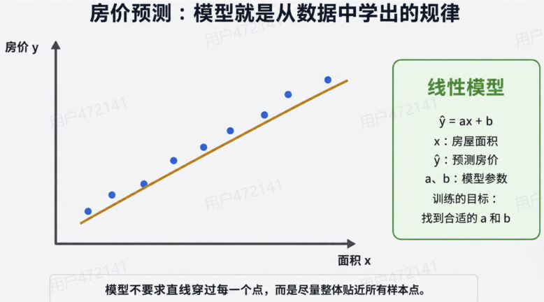
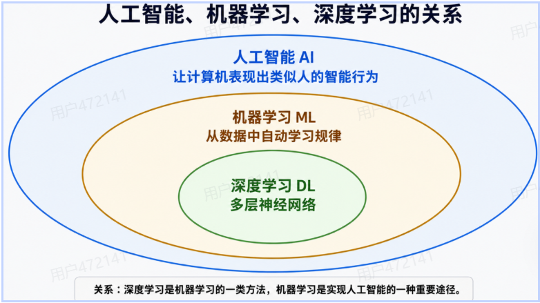
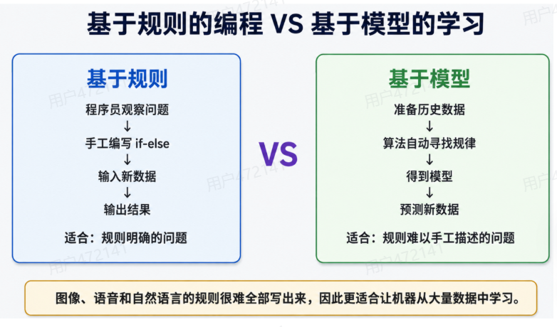
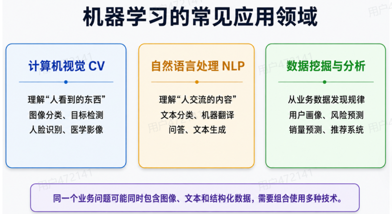
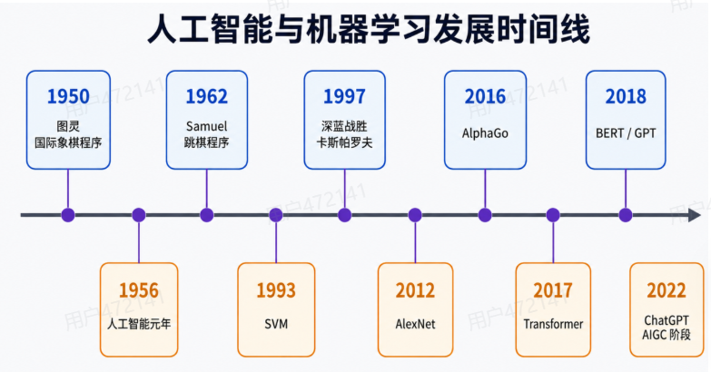
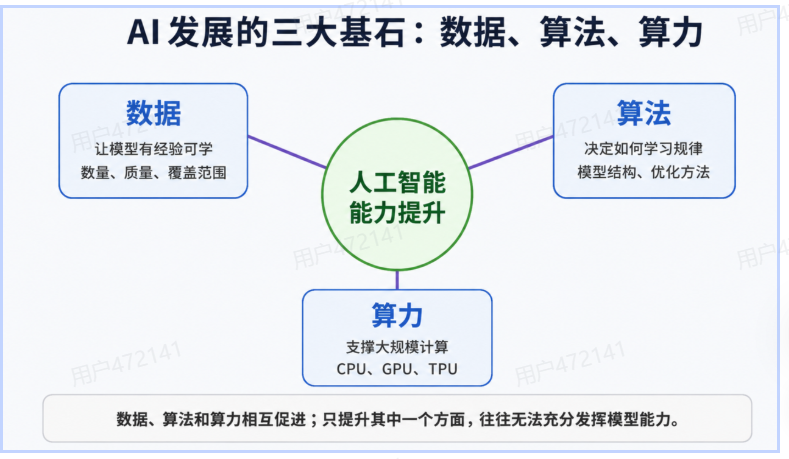
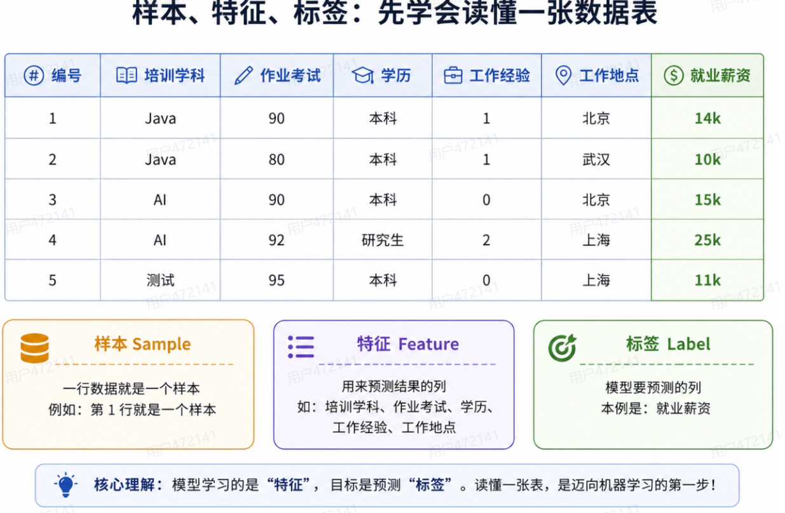
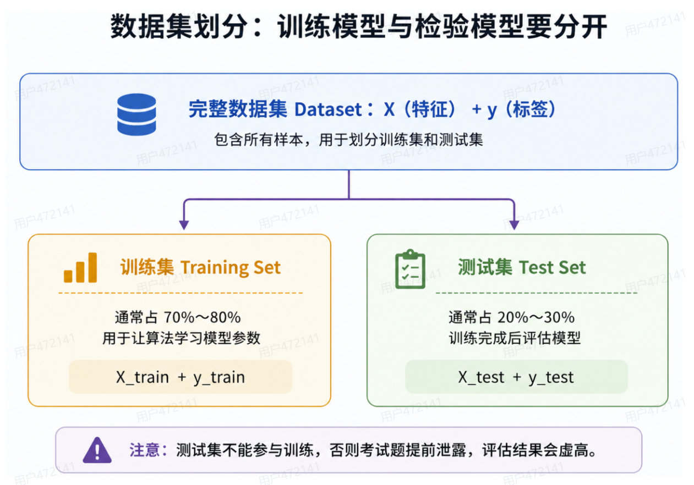

# 机器学习概述

## 人工智能、机器学习和深度学习

### 什么是人工智能

人工智能英文：`Artificial Intelligence`

简称：`AI`

#### 专业理解

人工智能是研究如何让计算系统表现出智能行为的领域。

它希望计算机可以：

- 像人一样思考
- 像人一样行动
- 进行理性思考
- 做出合理行动

#### 通俗理解

人工智能的目标是：

> 使用计算机模拟或代替人类完成需要智能的工作

例如：

- 识别人脸
- 理解语言
- 驾驶汽车
- 下围棋
- 推荐商品
- 生成文章

人工智能是一个很大的研究领域。

它不是某一个具体算法，也不等于某一个软件。

### 什么是机器学习

机器学习的英文：`Machine Learning`

简称：`ML`

经典定义强调：

> 让计算机在没有被明确写出全部规则的情况下，获得学习能力。

#### 机器怎样学习

机器学习的基本过程:

1. 历史数据
2. 算法寻找规律
3. 得到模型
4. 输入新数据
5. 输出预测结果

例如：

1. 历史房屋面积 + 历史房价
2. 学习面积与房价的关系
3. 得到房价预测模型

#### 什么是模型

模型可以理解成：

```
从数据中学出来的一套计算规律
```

最简单的模型可能是一个数学公式：$\hat{y} = ax + b$

其中：

| 符号 | 含义 |
|---|---|
| $x$ | 输入特征，例如面积 |
| $\hat{y}$ | 模型预测值，例如预测房价 |
| $a, b$ | 模型要学习的参数 |



训练模型，就是从历史数据中找到合适的：`a` 和 `b`

### 什么是深度学习

深度学习的英文是：`Deep Learning`

简称：`DL`

深度学习也叫：**深度神经网络**

它通过多层神经网络模拟信息逐层处理的过程。

例如在图像识别中，模型可能逐层学习：

1. 第 1 层：边缘
2. 第 2 层：纹理
3. 第 3 层：局部形状
4. 第 4 层：完整物体

深度学习特别适合：

- 图像
- 语音
- 文本
- 视频
- 复杂感知任务

### AI、ML、DL三者的关系



可以记成：

```text
人工智能 AI
      └─ 机器学习 ML
         └─ 深度学习 DL
```

关系是：

- 人工智能是一种思想
- 机器学习是实现人工智能的一种重要途径
- 深度学习是机器学习中的一类方法

#### 为什么不能把它们当成同一个概念

因为人工智能还可以通过其他方式实现，例如：

- 专家系统
- 搜索算法
- 规划算法
- 规则系统

机器学习也不知有深度学习，例如：

- 线性回归
- 决策树
- KNN
- 聚类算法

### 基于规则与基于模型



#### 基于规则的学习

程序员根据经验手工编写规则：

```python
if 条件1:
    执行结果1
elif 条件2:
    执行结果2
else:
    执行结果3
```

适合：

- 规则清楚
- 场景稳定
- 判断条件可以明确写出

例如：

- 年龄小于 18 岁属于未成年人
- 考试分数大于等于 60 分表示及格

#### 基于模型的学习

将数据交给算法，让算法自动寻找规律。

适合：

- 规则很难人工写完
- 影响因素很多
- 数据中存在复杂关系

例如：

- 图象识别
- 语音识别
- 自然语言处理
- 用户行为预测

#### 两者最核心的区别

规则编程：规则由程序员提供
机器学习：规则由算法从数据中学习

## 机器学习的应用与发展

### 机器学习的应用领域



#### 计算机视觉 CV

计算机视觉的目标是：**让计算机理解人眼看到的内容**

常见的任务：

- 图像分类
- 目标检测
- 人脸是被
- 车牌识别
- 医学影像分析

#### 自然语言处理 NLP

自然语言处理的目标是：**让计算机理解和生成人类语言**

常见任务：

- 文本分类
- 情感分析
- 机器翻译
- 阅读理解
- 文本生成
- 智能问答

#### 数据挖掘和数据分析

目标是：**从大量业务数据中发现规律**

常见任务：

- 销量预测
- 用户画像
- 风险预测
- 异常检测
- 商品推荐
- 客户流失预测

### 人工智能发展简史



按找不同技术流派，梳理了一下发展过程

#### 符号主义阶段

大致时间：**20 世纪 50~70 年代**

主要特点：

- 专家系统
- 人工规则
- 逻辑推理

重要事件：

- **1950年，图灵设计国际象棋程序**
- **1956年，人工智能元年**
- 1962年，Arthur Samuel 的跳棋程序

#### 统计学习阶段

大致时间：**20 世纪 80 年代到 2000 年前后**

主要特点：

- 使用统计模型解决问题

重要事件：

- 1993年，Vapnik 提出 SVM
- 1997年，IBM 深蓝战胜卡斯帕罗夫

#### 深度学习阶段

大致时间：**21 世纪初期**

重要事件：

- **2012年，AlexNet 推动计算机视觉深度学习发展**
- 2016年，AlphaGo 战胜李世石

#### 大规模预训练模型阶段

重要事件：

- **2017年，Transformer 出现**
- **2018年，Bert 和 GPT 出现**
- **2022年 ChatGPT 推动大模型和 AIGC 快速发展**

## AI 发展的三大要素



### 数据

数据相当于模型的学习经验。

需要关注：

- 数据数量
- 数据质量
- 标签质量
- 数据覆盖范围

### 算法

算法决定：

- 怎样从数据中寻找规律
- 怎样表示模型
- 怎样更新参数

### 算力

算力决定模型能否高效完成大量计算。

硬件介绍：

- CPU：适合较多 I/O 和通用计算任务
- GPU：适合大规模并行的计算密集型任务
- TPU：面向大型神经网络计算设计

### 三者为什么缺一不可

- 只有数据，没有好算法：模型不知道怎样有效学习
- 只有算法，没有数据：模型没有足够经验
- 只有数据、算法，没有算力：训练可能需要非常长的时间

## 机器学习常用术语

### 样本、特征和标签



以就业薪资数据为例。

#### 样本 Sample

一行数据就是一个样本。

例如：

```text
AI、考试 92 分、研究生、2 年经验、上海、薪资 25k
```

这是一个学生的完整记录。

多个样本组成 **数据集 Dataset**

#### 特征 Feature

用来预测结果的信息叫特征。

例如预测就业薪资时，可以使用：

- 培训学科
- 作业考试成绩
- 学历
- 工作经验
- 工作地点

特征也常被叫作：

- 属性
- 输入变量
- 自变量

最重要的理解：

> 特征是从数据中抽取出来的、对预测结果有用的信息。

#### 标签 Label / Target

模型要预测的那一列叫：

- 标签
- 目标值

就业案例中 就业薪资 就是标签。

#### `X` 和 `y`

机器学习中通常写成：

- `X`：所有输入特征
- `y`：模型要预测的标签

数学表示：$X \rightarrow \text{模型} \rightarrow \hat{y}$ ，其中：$y$ : 真实标签，$\hat{y}$ : 模型预测结果

### 数据集划分



完整数据及通常划分为：

- Training Set
- Test Set

#### 训练集

作用：**让算法学习模型参数**，对应变量 `X_train, y_train`

#### 验证集

作用：**调整超参数、选择模型**，对应变量 `X_val, y_val`

#### 测试集

作用：**训练结束后，检查模型对新数据的效果**，对应变量 `x_test, y_test`

训练集：平时做练习题，让模型学习知识。
验证集：做模拟考试，帮助调整学习方法。
测试集：参加最终考试，检测模型真实水平。

#### 常见比例

常见比例：

- `8 : 1 : 1` : 80% 训练，10% 验证， 10% 测试
- `7 : 1.5 : 1.5` : 70% 训练，15% 验证， 15% 测试

#### 命名规则

#### 为什么测试集不能参与训练

## 机器学习算法分类

### 四种学习方式

#### 监督学习

##### 分类与回归

##### 分类问题

##### 回归问题

##### 判断口诀

#### 无监督学习

##### 聚类例子

#### 半监督学习

#### 强化学习

##### 四个关键要素

##### 基本过程

#### 常见应用

##### 无人驾驶例子

#### 四种学习方式对比

## 机器学习建模流程

### 第一步：获取数据

### 第二步：数据基本处理

### 第三步：特征工程

### 第四步：模型训练

### 第五步：模型预测 (测试集)

#### 为什么训练之后要先预测

#### 此时的预测不是最终业务预测

#### 为什么模型预测必须在模型评估之前

### 第六步：模型评估

### 第七步：模型优化

#### 模型为什么可能效果不好

#### 数据问题

#### 特征问题

#### 模型问题

#### 常见优化方式

#### 一个重要概念：调参

#### 总结

### 第八步：上线预测和部署

#### 最终预测

#### 测试集预测和最终预测的区别

##### 测试阶段

##### 实际应用阶段

#### 模型部署

## 特征工程

### 什么是特征工程

### 特征提取

### 特征预处理

### 特征降维

### 特征选择

### 特征组合

### 五种特征工程方法对比

## 拟合、欠拟合、过拟合与泛化

### 什么是拟合

### 什么是欠拟合

### 什么是过拟合

### 使用天鹅例子理解

#### 欠拟合

#### 过拟合

### 什么是泛化能力

### 奥卡姆剃刀原则

### 改善欠拟合合过拟合

#### 欠拟合的改善思路

#### 过拟合的改善思路

## scikit-learn 开发环境