# 机器学习概述

## 人工智能、机器学习和深度学习

### 什么是人工智能

人工智能英文：`Artificial Intelligence`

简称：`AI`

#### 专业理解

人工智能是研究如何让计算系统表现出智能行为的领域。

它希望计算机可以：

- 像人一样思考
- 像人一样行动
- 进行理性思考
- 做出合理行动

#### 通俗理解

人工智能的目标是：

> 使用计算机模拟或代替人类完成需要智能的工作

例如：

- 识别人脸
- 理解语言
- 驾驶汽车
- 下围棋
- 推荐商品
- 生成文章

人工智能是一个很大的研究领域。

它不是某一个具体算法，也不等于某一个软件。

### 什么是机器学习

机器学习的英文：`Machine Learning`

简称：`ML`

经典定义强调：

> 让计算机在没有被明确写出全部规则的情况下，获得学习能力。

#### 机器怎样学习

机器学习的基本过程:

1. 历史数据
2. 算法寻找规律
3. 得到模型
4. 输入新数据
5. 输出预测结果

例如：

1. 历史房屋面积 + 历史房价
2. 学习面积与房价的关系
3. 得到房价预测模型

#### 什么是模型

模型可以理解成：

```
从数据中学出来的一套计算规律
```

最简单的模型可能是一个数学公式：$\hat{y} = ax + b$

其中：

| 符号 | 含义 |
|---|---|
| $x$ | 输入特征，例如面积 |
| $\hat{y}$ | 模型预测值，例如预测房价 |
| $a, b$ | 模型要学习的参数 |


训练模型，就是从历史数据中找到合适的：`a` 和 `b`

### 什么是深度学习

深度学习的英文是：`Deep Learning`

简称：`DL`

深度学习也叫：**深度神经网络**

它通过多层神经网络模拟信息逐层处理的过程。

例如在图像识别中，模型可能逐层学习：

1. 第 1 层：边缘
2. 第 2 层：纹理
3. 第 3 层：局部形状
4. 第 4 层：完整物体

深度学习特别适合：

- 图像
- 语音
- 文本
- 视频
- 复杂感知任务

### AI、ML、DL三者的关系


可以记成：

```text
人工智能 AI
      └─ 机器学习 ML
         └─ 深度学习 DL
```

关系是：

- 人工智能是一种思想
- 机器学习是实现人工智能的一种重要途径
- 深度学习是机器学习中的一类方法

#### 为什么不能把它们当成同一个概念

因为人工智能还可以通过其他方式实现，例如：

- 专家系统
- 搜索算法
- 规划算法
- 规则系统

机器学习也不知有深度学习，例如：

- 线性回归
- 决策树
- KNN
- 聚类算法

### 基于规则与基于模型


#### 基于规则的学习

程序员根据经验手工编写规则：

```python
if 条件1:
    执行结果1
elif 条件2:
    执行结果2
else:
    执行结果3
```

适合：

- 规则清楚
- 场景稳定
- 判断条件可以明确写出

例如：

- 年龄小于 18 岁属于未成年人
- 考试分数大于等于 60 分表示及格

#### 基于模型的学习

将数据交给算法，让算法自动寻找规律。

适合：

- 规则很难人工写完
- 影响因素很多
- 数据中存在复杂关系

例如：

- 图象识别
- 语音识别
- 自然语言处理
- 用户行为预测

#### 两者最核心的区别

规则编程：规则由程序员提供
机器学习：规则由算法从数据中学习

## 机器学习的应用与发展

### 机器学习的应用领域


#### 计算机视觉 CV

计算机视觉的目标是：**让计算机理解人眼看到的内容**

常见的任务：

- 图像分类
- 目标检测
- 人脸是被
- 车牌识别
- 医学影像分析

#### 自然语言处理 NLP

自然语言处理的目标是：**让计算机理解和生成人类语言**

常见任务：

- 文本分类
- 情感分析
- 机器翻译
- 阅读理解
- 文本生成
- 智能问答

#### 数据挖掘和数据分析

目标是：**从大量业务数据中发现规律**

常见任务：

- 销量预测
- 用户画像
- 风险预测
- 异常检测
- 商品推荐
- 客户流失预测

### 人工智能发展简史


按找不同技术流派，梳理了一下发展过程

#### 符号主义阶段

大致时间：**20 世纪 50~70 年代**

主要特点：

- 专家系统
- 人工规则
- 逻辑推理

重要事件：

- **1950年，图灵设计国际象棋程序**
- **1956年，人工智能元年**
- 1962年，Arthur Samuel 的跳棋程序

#### 统计学习阶段

大致时间：**20 世纪 80 年代到 2000 年前后**

主要特点：

- 使用统计模型解决问题

重要事件：

- 1993年，Vapnik 提出 SVM
- 1997年，IBM 深蓝战胜卡斯帕罗夫

#### 深度学习阶段

大致时间：**21 世纪初期**

重要事件：

- **2012年，AlexNet 推动计算机视觉深度学习发展**
- 2016年，AlphaGo 战胜李世石

#### 大规模预训练模型阶段

重要事件：

- **2017年，Transformer 出现**
- **2018年，Bert 和 GPT 出现**
- **2022年 ChatGPT 推动大模型和 AIGC 快速发展**

## AI 发展的三大要素


### 数据

数据相当于模型的学习经验。

需要关注：

- 数据数量
- 数据质量
- 标签质量
- 数据覆盖范围

### 算法

算法决定：

- 怎样从数据中寻找规律
- 怎样表示模型
- 怎样更新参数

### 算力

算力决定模型能否高效完成大量计算。

硬件介绍：

- CPU：适合较多 I/O 和通用计算任务
- GPU：适合大规模并行的计算密集型任务
- TPU：面向大型神经网络计算设计

### 三者为什么缺一不可

- 只有数据，没有好算法：模型不知道怎样有效学习
- 只有算法，没有数据：模型没有足够经验
- 只有数据、算法，没有算力：训练可能需要非常长的时间

## 机器学习常用术语

### 样本、特征和标签


以就业薪资数据为例。

#### 样本 Sample

一行数据就是一个样本。

例如：

```text
AI、考试 92 分、研究生、2 年经验、上海、薪资 25k
```

这是一个学生的完整记录。

多个样本组成 **数据集 Dataset**

#### 特征 Feature

用来预测结果的信息叫特征。

例如预测就业薪资时，可以使用：

- 培训学科
- 作业考试成绩
- 学历
- 工作经验
- 工作地点

特征也常被叫作：

- 属性
- 输入变量
- 自变量

最重要的理解：

> 特征是从数据中抽取出来的、对预测结果有用的信息。

#### 标签 Label / Target

模型要预测的那一列叫：

- 标签
- 目标值

就业案例中 就业薪资 就是标签。

#### `X` 和 `y`

机器学习中通常写成：

- `X`：所有输入特征
- `y`：模型要预测的标签

数学表示：$X \rightarrow \text{模型} \rightarrow \hat{y}$ ，其中：$y$ : 真实标签，$\hat{y}$ : 模型预测结果

### 数据集划分


完整数据及通常划分为：

- Training Set
- Test Set

#### 训练集

作用：**让算法学习模型参数**，对应变量 `X_train, y_train`

#### 验证集

作用：**调整超参数、选择模型**，对应变量 `X_val, y_val`

#### 测试集

作用：**训练结束后，检查模型对新数据的效果**，对应变量 `x_test, y_test`

训练集：平时做练习题，让模型学习知识。
验证集：做模拟考试，帮助调整学习方法。
测试集：参加最终考试，检测模型真实水平。

#### 常见比例

常见比例：

- `8 : 1 : 1` : 80% 训练，10% 验证， 10% 测试
- `7 : 1.5 : 1.5` : 70% 训练，15% 验证， 15% 测试

#### 命名规则

- `X_train`：训练集特征
- `y_train`：训练集标签
- `X_val`：验证集特征
- `y_val`：验证集标签
- `X_test`：测试集特征
- `y_test`：测试集标签

#### 为什么测试集不能参与训练

可以把它理解成考试。

训练集 = 平时练习题
测试集 = 期末考试题

考试题提前泄露，分数就不能反映真实能力。

## 机器学习算法分类

### 四种学习方式

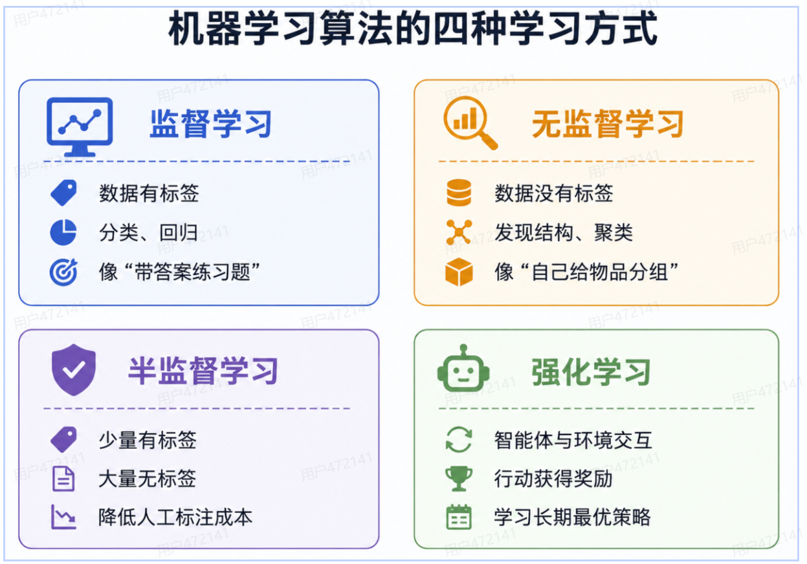

机器学习按学习方式可以分为：

- 监督学习
- 无监督学习
- 半监督学习
- 强化学习

#### 监督学习

监督学习的数据包含输入特征 `X` 和目标值 `y` ，训练数据有答案，向学生做带答案的练习题，题目 + 标准答案。

模型通过对比：自己的预测和真实答案，不断调整参数。

##### 分类与回归

监督学习主要包含分类和回归：

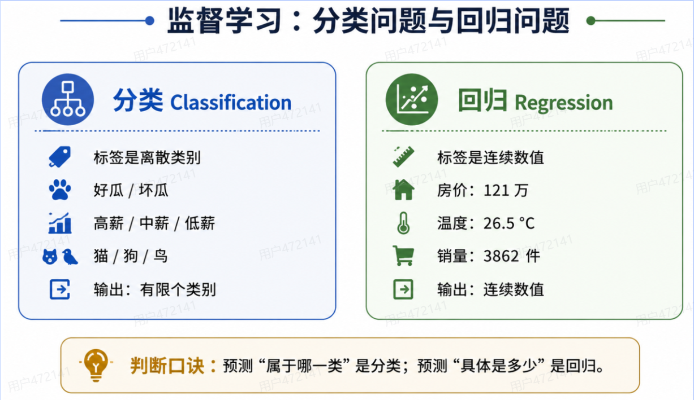

##### 分类问题

标签是：**离散类别**

例如：

- 好瓜 / 坏瓜
- 高薪 / 中薪 / 低薪
- 垃圾邮件 / 正常邮件
- 猫 / 狗 / 鸟

分类可以继续分为：

- 二分类
- 多分类

##### 回归问题

标签是：**连续数值**

例如：

- 房屋价格
- 商品销量
- 温度
- 薪资

##### 判断口诀

- 预测“是哪一类” -> 分类
- 预测“具体是多少” -> 回归

#### 无监督学习

无监督学习的数据只有输入特征 `X` ，没有标签 `y` ，模型要根据样本间的相似性，发现数据内部结构。

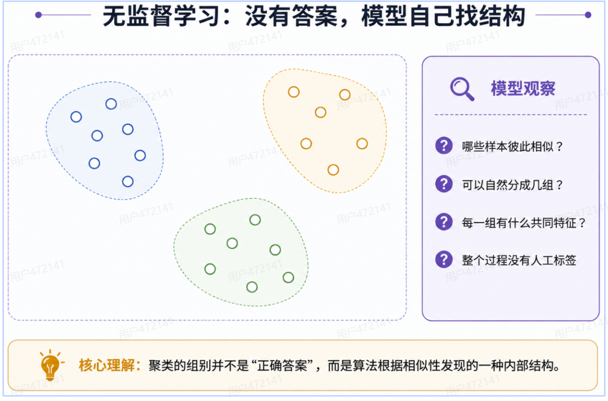

常见任务：

- 聚类
- 降维
- 异常检测

##### 聚类例子

商场有很多客户数据：

- 年龄
- 消费金额
- 购买频率

没有人提前告诉模型客户属于哪一类。

模型可以根据相似性自动分组：

- 高价值客户
- 价值敏感客户
- 低频客户

这些名称通常需要业务人员在聚类完成后解释。

#### 半监督学习

半监督学习的数据包含少量有标签数据，大量无标签数据：

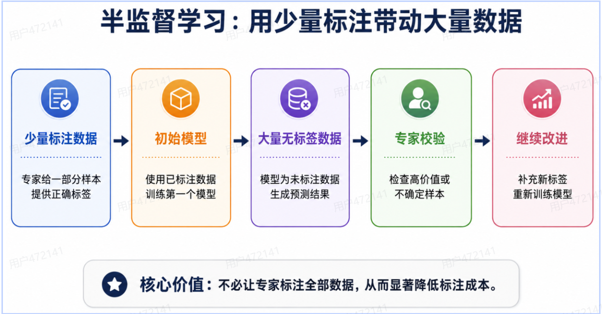

基本过程：

1. 专家标注少量数据
2. 使用标注数据训练初始模型
3. 模型预测大量无标签数据
4. 专家检查部分结果
5. 加入新标签，继续改进模型

主要价值：

- 显著降低人工标注成本

适合：

- 数据很多
- 人工标注昂贵
- 只有少量专家可以标注

#### 强化学习

强化学习英文：**Reinforcement Learning**

它的核心是：**智能体通过与环境不断交互，使用试错方式学习能够获得最大累计奖励的策略**。

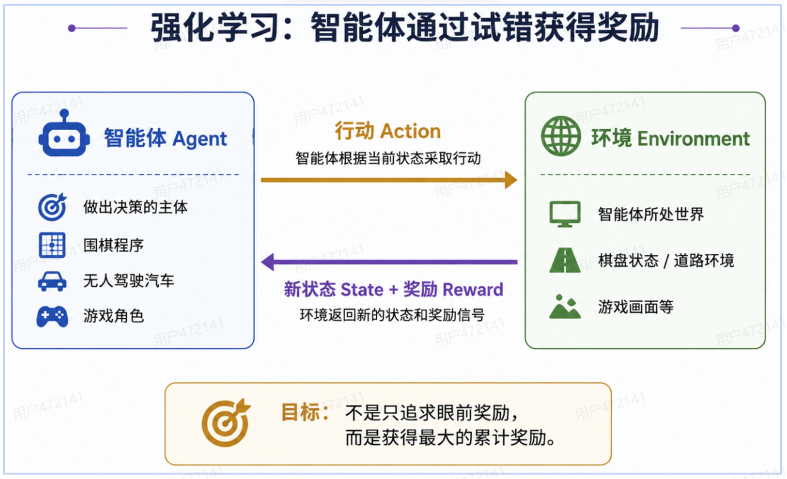

##### 四个关键要素

- Agent：智能体
- Environment：环境
- State：环境状态
- Action：行动
- Reward：奖励

重点强调：

- 智能体
- 环境状态
- 行动
- 奖励

##### 基本过程

1. 智能体观察环境状态
2. 选择一个行动
3. 环境发生变化
4. 智能体获得奖励
5. 根据奖励改进策略

#### 常见应用

- AlphaGo
- 电子游戏
- 机器人控制
- 无人驾驶
- 对抗比赛

##### 无人驾驶例子

无人驾驶汽车通过：

- 摄像头
- 雷达
- 激光测距仪
- 传感器

获得环境信息。

模型根据环境决定：

- 加速
- 减速
- 转向
- 停车

每次行动都会带来奖励或惩罚。

#### 四种学习方式对比

| 类型 | 数据是否有标签 | 主要目标 | 例子 |
|---|---|---|---|
| 监督学习 | 全部有标签 | 学习输入与答案的关系 | 分类、回归 |
| 无监督学习 | 没有标签 | 发现数据内部结构 | 聚类 |
| 半监督学习 | 少量有标签 | 利用大量无标签数据降低成本 | 图像、文本标注 |
| 强化学习 | 动态奖励 | 学习长期最优策略 | 游戏、自动驾驶 |

## 机器学习建模流程

完整建模流程

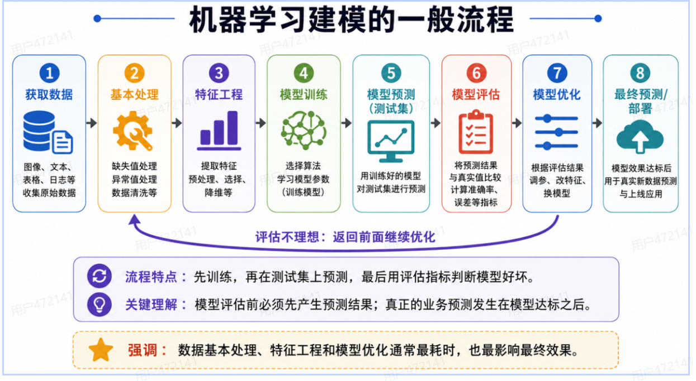

一个机器学习项目通常包含：

1. 获取数据
2. 数据基本处理
3. 特征工程
4. 模型训练
5. 模型预测
6. 模型评估
7. 模型优化
8. 模型预测和部署

### 第一步：获取数据

获取与任务相关的数据。

常见数据类型：

- 表格数据
- 图像数据
- 文本数据
- 语音数据
- 日志数据
- 传感器数据

数据来源可能包括：

- CSV、Excel 等文件
- MySQL、Oracle、Hive 等数据库
- 企业业务系统
- 日志文件
- 传感器数据
- 图片、视频
- 文本数据
- 网络公开数据
- 第三方数据平台

### 第二步：数据基本处理

真实数据经常存在：

- 缺失值
- 异常值
- 重复值
- 错误格式
- 不一致单位

例如：

- 年龄为空
- 薪资为负数
- 同一客户重复出现
- 日期格式不一致

数据基本处理的目标是：**让数据可靠、同一、可使用**

### 第三步：特征工程

特征工程负责：**把原始数据变成模型更容易学习的特征**

重点强调：

> 数据基本处理和特征工程通常是整个建模流程中最耗时、最耗精力的部分。

数据决定模型上限，特征工程决定模型能不能接近这个上限。

### 第四步：模型训练

模型训练的本质，就是让算法从训练数据中学习规律。

根据任务选择算法。

回归任务可以选择：

- 线性回归
- 决策树回归
- 随机森林回归

分类任务可以选择：

- 逻辑回归
- KNN
- 决策树

无监督任务可以选择：

- K-means聚类

训练阶段：

算法根据 `X_train` 和 `y_train` ，学习模型参数

### 第五步：模型预测 (测试集)

#### 为什么训练之后要先预测

模型训练完成后，我们还不知道模型到底学的好不好

所以要拿模型没有 **参与训练的数据** 进行预测。

即：

1. `X_test`
2. 训练好的数据
3. `predict()`
4. `y_pred`

代码：

```python
y_pred = model.predict(X_test)
```

#### 此时的预测不是最终业务预测

这里预测的是：测试集

主要目的是：为了后面评估模型效果

例如：

真实答案：

```
猫
狗
猫
猫
狗
```

模型预测：

```
猫
狗
狗
猫
狗
```

只有先产生预测结果，后面才能判断模型到底预测得准不准。

#### 为什么模型预测必须在模型评估之前

因为：

1. 没有预测结果
2. 就无法与真实答案比较
3. 也就无法计算评估指标

因此逻辑一定是：

1. 模型训练
2. 测试集预测
3. 得到 `y_pred`
4. 模型评估

> 评估之前必须先预测，因为评估就是比较“预测结果”和“真实结果”

### 第六步：模型评估

模型评估就是来判断模型预测得到底好不好。

根据任务使用不同指标。

回归：

- MAE：平均绝对误差
- MSE：均方误差
- RMSE：均方根误差

分类：

- 准确率 ( Accuracy )
- 精确率 ( Precision )
- 召回率 ( Recall )
- F1 分数 : $\displaystyle \frac{2 \times \text{Precision} \times \text{Recall}}{(Precision \times Recall)}$

聚类：

- SSE ( Sum of Squared Errors )
- 轮廓系数
- Calinski-Harabasz Score

评估效果不好时，不是简单结束，而是返回前面重新检查：

- 数据
- 特征
- 算法
- 超参数

### 第七步：模型优化

如果模型评估结果很好：

1. 模型达标
2. 可以考虑实际使用

如果效果不好：

1. 模型效果不好
2. 不能直接上线
3. 需要继续优化

#### 模型为什么可能效果不好

原因可能来自多个地方

#### 数据问题

例如：

- 数据量太少
- 数据质量差
- 数据分布不合理
- 异常值过多

#### 特征问题

例如：

1. 选择的特征没有意义
2. 重要特征没有加入
3. 特征尺度差异过大

#### 模型问题

例如：

1. 算法不合适
2. 参数设置不合理
3. 模型太简单
4. 模型过拟合
5. 模型欠拟合

#### 常见优化方式

可以从以下方向优化：

1. 增加数据
2. 重新清晰数据
3. 重新选择特征
4. 增加 / 删除特征
5. 调整模型参数
6. 更换算法
7. 重新训练
8. 重新预测
9. 重新评估

所以机器学习并不是：**训练一次完事**

而更像：

1. 训练
2. 预测
3. 评估
4. 不好
5. 优化
6. 重新训练
7. 重新预测
8. 重新评估

这是一个不断迭代的过程。

#### 一个重要概念：调参

很多算法中都有一些提前设置的参数。

例如 KNN：

```python
KNeighborsClassifier(n_neighbors=5)
```

这里的：`n_neighbors` 就是参数。

K-means：

```python
KMeans(n_clusters=5)
```

其中：`n_clusters` 决定最终聚成多少个簇

通过不断调整这些参数，可以寻找效果更好的模型。

#### 总结

模型优化不是只改模型，也可能需要重新处理数据、重新设计特征。

### 第八步：上线预测和部署

当模型经过评估和优化，并达到业务要求以后，就可以进入最终使用阶段。

这里才是真正意义上的 **使用模型解决现实问题** 。

#### 最终预测

例如已经训练好了一个房价预测模型。

用户输入：

```
面积：120 ㎡
房龄：3 年
楼层：15 层
距离地铁：500 m
```

模型输出：

```
预测房价：218 万元
```

这就是最终预测。

#### 测试集预测和最终预测的区别

| 对比 | 测试集预测 | 最终预测 |
|---|---|---|
| 数据 | `X_test` | 真正的新数据 |
| 是否知道答案 | 知道 | 通常不知道 |
| 主要目的 | 模型评估 | 解决实际问题 |
| 所处阶段 | 模型评估之前 | 模型评估通过之后 |

例如：

##### 测试阶段

```
测试房屋
真实价格：200 万

模型预测：
198 万

-> 可以计算误差
```

##### 实际应用阶段

```
新房屋
真实价格：未知

模型预测：
235 万

-> 给用户提供预测结果
```

所以：测试集预测是为了“检查模型”，最终预测是为了“使用模型”。

#### 模型部署

如果模型只存在开发人员电脑中：

```python
model.predict()
```

普通用户是无法使用的。

所以企业通常还需要把模型部署到服务器上。

例如：

1. 用户
2. 网页 / App
3. 发送数据
4. 服务器
5. 机器学习模型
6. 预测结果
7. 返回用户

例如银行贷款系统：

1. 用户输入个人信息
2. 后台调用模型
3. 风险预测
4. 低风险 / 中风险 / 高风险

## 特征工程

### 什么是特征工程

特征工程英文：`Feature Engineering`

定义：利用专业背景知识和数据处理技巧，把原始数据加工成更适合机器学习算法的特征，是模型获得更好的效果。

- 数据和特征决定机器学习效果的上限
- 模型和算法负责逼近这个上限

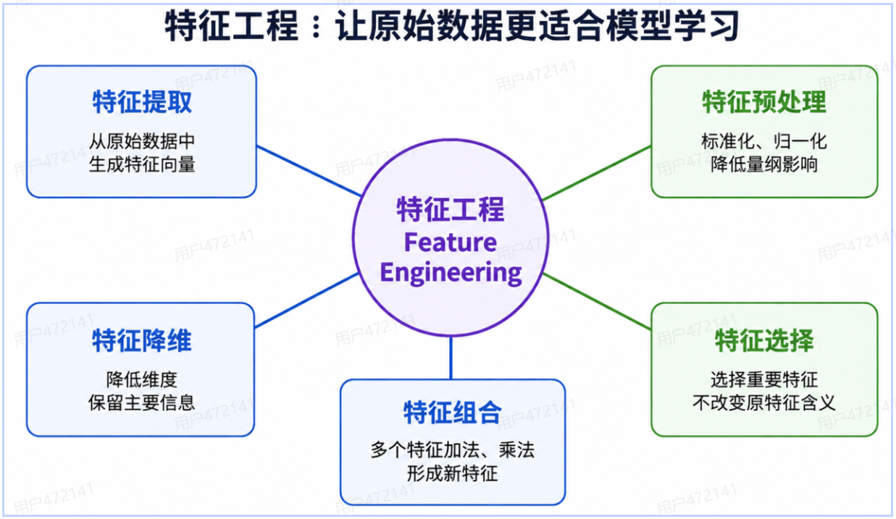

### 特征提取

特征提取英文：`Feature Extraction`

作用：

- 从原始数据中提取与任务相关的信息
- 形成特征向量

例如文本：

```
“这家酒店服务很好”
```

机器不能直接理解文字，需要转换成：

```
词频向量
TF-IDF 向量
词向量
```

图像可以提取：

```
颜色
边缘
纹理
形状
```

### 特征预处理

特征预处理英文：`Feature Preprocessing`

作用：降低不同特征量纲和范围带来的影响

例如：

| 特征 | 范围 |
|---|---|
| 年龄 | 18 ~ 60 |
| 年收入 | 30000 ~ 1000000 |

如果直接训练：年收入数值远大于年龄

模型可能过度关注年收入

常见处理：

- 标准化
- 归一化

### 特征降维

特征降维英文：`Feature Decomposition`

作用：

- 把高维数据变成低维数据
- 同时尽量保留主要信息

例如：

1. 原始 100 个特征
2. 降维后 10 个特征

特征降维通常会改变原始数据分布

### 特征选择

特征选择英文：`Feature Selection`

作用：从已有特征中选择重要特征

例如原来有：

1. 面积
2. 楼层
3. 朝向
4. 装修颜色
5. 房主姓名
6. 小区位置

预测房价时，可以去掉：

- 房主姓名

因为它通常对房价没有预测价值。

特征选择不会生成新的低维特征，而是保留原始特征的一个子集。

### 特征组合

特征组合英文：`Feature Crosses`

作用：把多个特征组合成新的特征

例如：房屋面积 * 地段等级

可能比单独使用：面积、地段，更容易表示某种交互关系

常见的组合方式：

- 加法
- 乘法
- 除法
- 分组统计
- 业务规则组合

### 五种特征工程方法对比

| 方法 | 核心作用 |
|---|---|
| 特征提取 | 从原始数据生成特征向量 |
| 特征预处理 | 统一不同特征的尺度和格式 |
| 特征降维 | 用较少的新特征保留主要信息 |
| 特征选择 | 从原特征中选择重要子集 |
| 特征组合 | 将多个特征组合成新特征 |

## 拟合、欠拟合、过拟合与泛化

### 什么是拟合

拟合英文：`Fitting`

拟合表示：模型对训练样本分布和规律的模拟程度。

模型通过训练不断调整参数，是预测结果接近真实标签。

### 什么是欠拟合

欠拟合英文：`Under-fitting`

表现：

- 训练集效果差
- 测试集效果也差

原因：

- 模型过于简单，学到的特征太少
- 训练不足

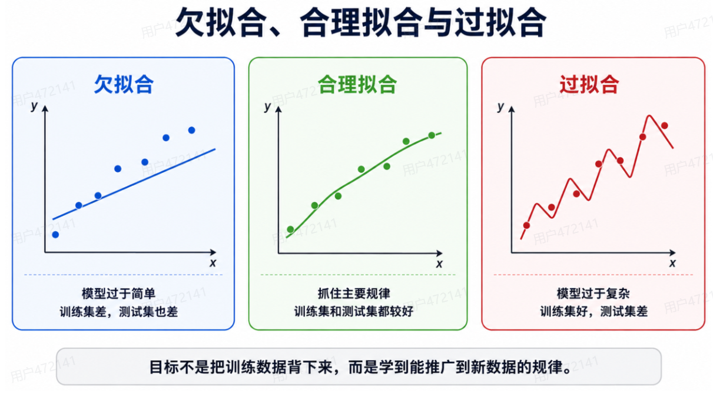

例如真实关系很复杂，却只是用一条简单直线：模型没有能力表达数据规律

### 什么是过拟合、

过拟合英文：`Over-fitting`

表现：

- 训练集效果非常好
- 测试集效果明显变差

原因可能包括：

- 模型过于复杂
- 训练数据太少
- 数据中存在噪声
- 模型把偶然特征当成规律

过拟合的本质：模型记住了训练数据的细节，却没有学到能够推广的新规律。

### 使用天鹅例子理解

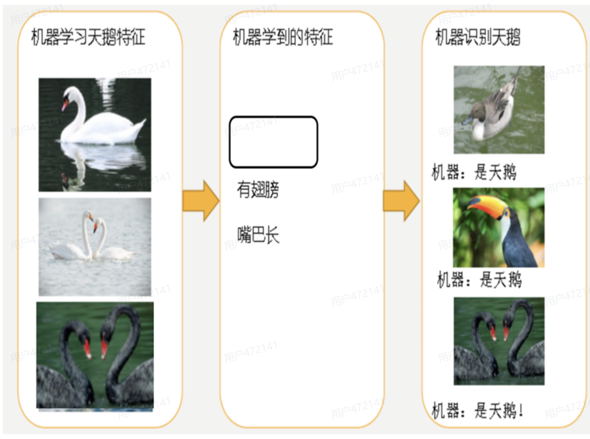

机器学习到的天鹅特征太少了，导致区分标准太粗糙，不能准确识别处天鹅。

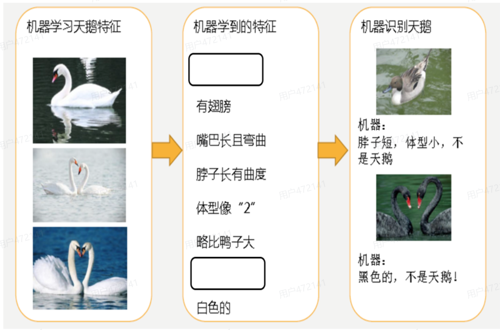

机器已基本能区分天鹅和其他动物了，很不巧已有天鹅图片全是白天鹅的。黑色的天鹅不能识别。

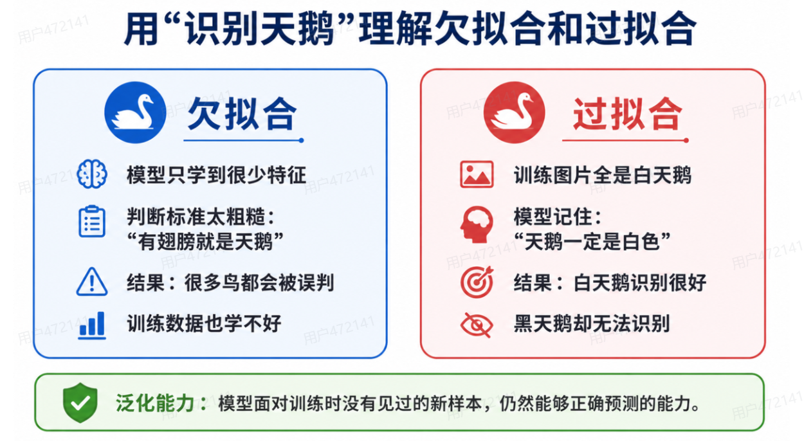

#### 欠拟合

模型只学到：

- 有翅膀
- 会游泳

判断标准太粗糙

结果：鸭子、鹅等也可能被识别成天鹅。

#### 过拟合

训练集中只有白天鹅。

模型记住：天鹅一定是白色

结果：

- 白天鹅识别很好
- 黑天鹅却无法识别

### 什么是泛化能力

泛化英文：`Generalization` 

它表示：模型在没有参与训练的新数据上的表现能力。

一个好魔性不是只会做训练题，二是可以解决新题。

1. 训练集效果好 + 测试集效果好
2. 泛化能力较好

### 奥卡姆剃刀原则

核心思想是：**当两个模型的泛化误差相近时，倾向于选择较简单的模型**

原因：

- 简单模型更容易解释
- 计算成本较低
- 更不容易记住无意义噪声
- 部署和维护更方便

注意：不是模型越简单越好

如果模型过于简单，也会欠拟合

真正的目标是：在表达能力和泛化能力之间取得平衡

### 改善欠拟合合过拟合

#### 欠拟合的改善思路

- 增加有效热症
- 使用表达能力更强的模型
- 增加训练时间
- 调整模型参数

#### 过拟合的改善思路

- 正则化
- 异常值检测
- 特征降维
- 增加训练数据
- 减少无效特征
- 降低模型复杂度

## scikit-learn 开发环境

scikit-learn 是基于 Python 的机器学习库

主要特点：

- 简单高效的数据挖掘和数据分析工具
- 可以在多种环境中重复使用
- 建立在 NumPy、SciPy 和 Matplotlib 之上
- 开源、可商业使用

安装：

进入 conda 环境

```bash
conda install scikit-learn

# 或

pip install scikit-learn
```