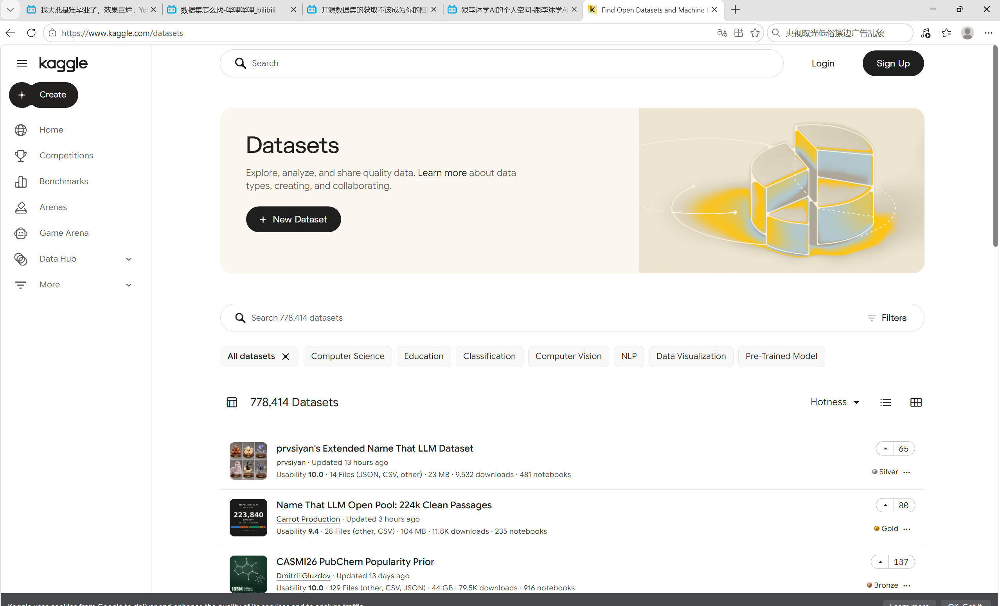
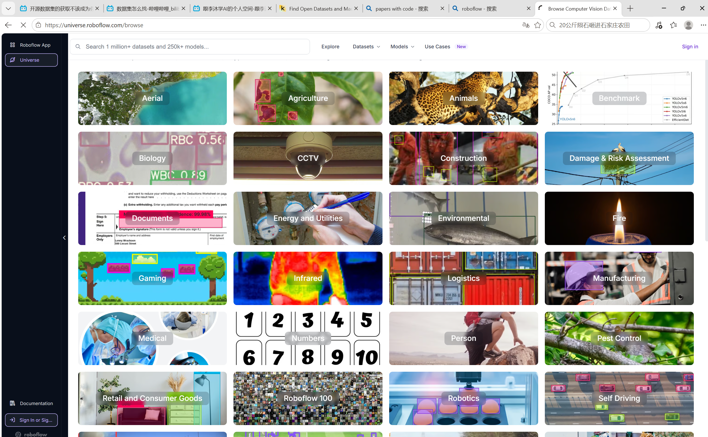
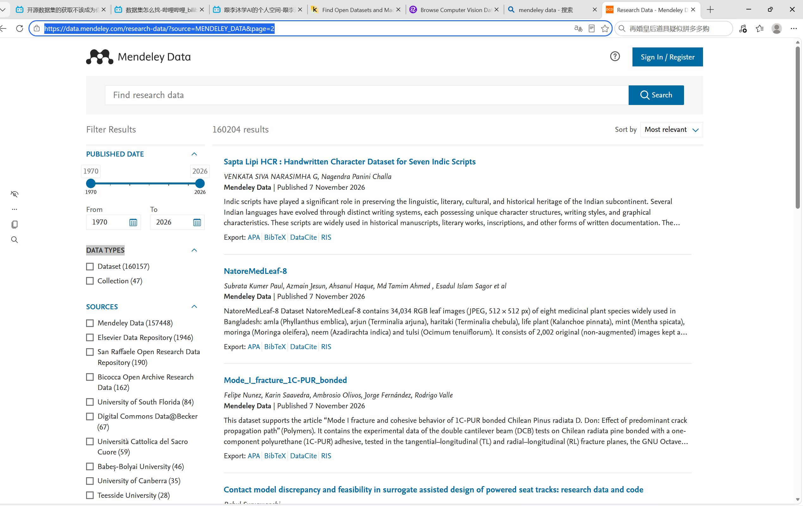

# 公开数据集

## Kaggle 比赛平台

Kaggle (https://www.kaggle.com/) 是一个为开发商和数据科学家提供举办数据科学竞赛、托管数据库编写和分享代码的在线平台。

## Roboflow

Roboflow (https://universe.roboflow.com/)号称有着世界上最大的计算机视觉开源数据集与API，包含十一万数据集，一亿张图像以及一万多个预训练模型，

可以看到其提供的板块均与计算机视觉有关，且数据集均由图像组成

Roboflow 提供将原始图像转化为自定义训练的计算机视觉模型并将其部署应用的全部工具，你可以在这里实现标注、转换、预处理、增强等功能，也是YOLOv5官方推荐的网站

## mendeley data

mendeley data (https://data.mendeleydata) 是一个免费且安全的基于云的公共存储库，可以在其中存储数据，无论何时何地都可以轻松共享、访问和引用。

## Google dataset search

google dataset search 是 Google 浏览器的数据集搜索功能，只需搜索关键字，就能在网络上发现托管在数千个存储区中的数据集，使数据集能供用户普遍访问并发挥作用