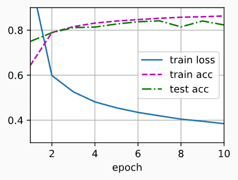

> 该内容为《动手学深度学习》的笔记

# 多层感知机的从零开始实现

我们在多层感知机中描述了多层感知机（MLP），现在让我们尝试自己实现一个多层感知机。为了与之前 softmax 回归获得的结果进行比较，我们将继续使用 Fashion-MNIST 图像分类数据集。

```python
import torch
from torch import nn
from d2l import torch as d2l

if __name__ == '__main__':
    """ 数据导入 """
    batch_size = 256
    train_iter, test_iter = d2l.load_data_fashion_mnist(batch_size)
```

## 初始化模型参数

回想一下，Fashion-MNIST 中的每个图像由 $28 \times 28 = 784$ 个灰度像素值组成。所有图像共分为 10 个类别。忽略像素之间的空间结构，我们可以将每个图像视为具有 784 个输入特征 和 10 个类的简单分类数据集。首先，我们将实现一个具有单隐藏层的多层感知机，它包括 256 个隐藏单元。注意，我们可以将这两个变量都视为超参数。通常，我们选择 2 的若干次幂作为层的宽度。因为内存在硬件中的分配和寻址方式，这么做往往可以在计算上更高效。

我们用几个张量来表示我们的参数。注意，对于每一层我们都要记录一个权重矩阵和一个偏置向量。跟以前一样，我们要为损失关于这些参数的梯度分配内存。

```python
num_inputs , num_outputs, num_hiddens = 784, 10, 256

    # 创建可训练的权重矩阵 W1，nn.parameter：把普通张量包装成模型可学习参数
    # 第一层：输入784，输出256
    W1 = nn.Parameter(
        # randn:从标准正态分布N(0,1)采样，生成形状[num_inputs, num_hiddens]的张量
        # 直接用randn生成的值方差是 1，数值太大，所以乘以 0.01 缩小权重
        torch.randn(
            num_inputs,
            num_hiddens,
            requires_grad=True
        ) * 0.01
    )
    b1 = nn.Parameter(
        torch.zeros(
            num_hiddens,
            requires_grad=True
        )
    )
    # 第二层：输入256，输出10
    W2 = nn.Parameter(
        torch.randn(
            num_hiddens,
            num_outputs,
            requires_grad=True
        ) * 0.01
    )
    b2 = nn.Parameter(
        torch.zeros(
            num_outputs,
            requires_grad=True
        )
    )
    # 把所有可训练参数放到列表，后面训练时传给优化器
    params = [W1, b1, W2, b2]
```

## 激活函数

为了确保我们对模型的细节了如指掌，我们将实现ReLU激活函数，而不是直接调用内置的relu函数。

```python
# relu(x) = max(x, 0)
def relu(X):
    # 创建形状为 X 的全零矩阵
    a = torch.zeros_like(X)
    return torch.max(X, a)
```

## 模型

因为我们忽略了空间结构，所以我们使用 `reshape` 将每个二维图像转换为一个长度为 `num_inputs` 的向量。只需几行代码就可以实现我们的模型。

```python
# relu(x) = max(x, 0)
def relu(X):
    # 创建形状为 X 的全零矩阵
    a = torch.zeros_like(X)
    return torch.max(X, a)

def net(X):
    X = X.reshape(-1, num_inputs)
    # 第一层 H = XW1 + b1
    H = relu(torch.matmul(X, W1) + b1)
    # 第二层 outputs = HW2 + b2
    return torch.matmul(H, W2) + b2
```

## 损失函数

由于我们已经从零实现过softmax函数，因此在这里我们直接使用高级 API 中的内置函数来计算softmax和交叉熵损失。回想一下我们之前在softmax简洁实现中对这些复杂问题的讨论。我们鼓励感兴趣的读者查看损失函数的源代码，以加深对实现细节的了解。

```python
loss = nn.CrossEntropyLoss(reduction='none')
```

## 训练

幸运的是，多层感知机的训练过程与softmax回归的训练过程完全相同，可以直接调用d2l包的train_ch3函数，将迭代周期数设置为 10 ，并将学习率设置为 0.1。

```python
num_epochs = 10
lr = 0.1
updater = torch.optim.SGD(params, lr)
d2l.train_ch3(net, train_iter, test_iter, loss, num_epochs, updater)
```



为了对学习到的模型进行评估，我们将在一些测试数据上应用这个模型。

```python
d2l.predict_ch3(net, test_iter)
d2l.plt.show()
```

## 小结

- 手动实现一个简单的多层感知机是很容易的。然而如果有大量的层，从零开始实现多层感知机机会变得很麻烦(例如，要命名和记录模型的参数)

> 以下是我实现的代码

```python
import torch
from torch import nn
from d2l import torch as d2l

batch_size = 256
num_inputs , num_outputs, num_hiddens = 784, 10, 256

# 创建可训练的权重矩阵 W1，nn.parameter：把普通张量包装成模型可学习参数
# 第一层：输入784，输出256
W1 = nn.Parameter(
    # randn:从标准正态分布N(0,1)采样，生成形状[num_inputs, num_hiddens]的张量
    # 直接用randn生成的值方差是 1，数值太大，所以乘以 0.01 缩小权重
    torch.randn(
        num_inputs,
        num_hiddens,
        requires_grad=True
    ) * 0.01
)
b1 = nn.Parameter(
    torch.zeros(
        num_hiddens,
        requires_grad=True
    )
)
# 第二层：输入256，输出10
W2 = nn.Parameter(
    torch.randn(
        num_hiddens,
        num_outputs,
        requires_grad=True
    ) * 0.01
)
b2 = nn.Parameter(
    torch.zeros(
        num_outputs,
        requires_grad=True
    )
)
# 把所有可训练参数放到列表，后面训练时传给优化器
params = [W1, b1, W2, b2]

# relu(x) = max(x, 0)
def relu(X):
    # 创建形状为 X 的全零矩阵
    a = torch.zeros_like(X)
    return torch.max(X, a)

def net(X):
    X = X.reshape(-1, num_inputs)
    # 第一层 H = XW1 + b1
    H = relu(torch.matmul(X, W1) + b1)
    # 第二层 outputs = HW2 + b2
    return torch.matmul(H, W2) + b2

loss = nn.CrossEntropyLoss(reduction='none')

if __name__ == '__main__':
    """ 数据导入 """
    train_iter, test_iter = d2l.load_data_fashion_mnist(batch_size)

    num_epochs = 10
    lr = 0.1
    updater = torch.optim.SGD(params, lr)
    d2l.train_ch3(net, train_iter, test_iter, loss, num_epochs, updater)
    d2l.plt.show()

    d2l.predict_ch3(net, test_iter)
    d2l.plt.show()
```