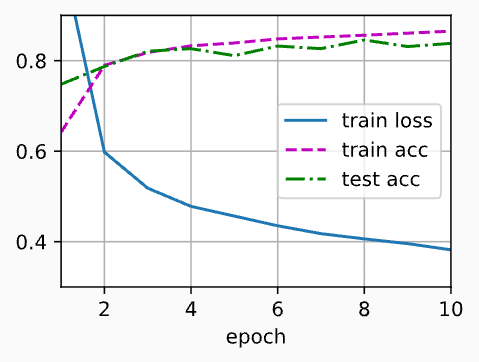

> 该内容为《动手学深度学习》的笔记

# 多层感知机的简洁实现

本节将介绍通过高级 API 更简洁地实现多层感知机。

```python
import torch
from torch import nn
from d2l import torch as d2l
```

## 模型

与softmax回归的简洁实现相比，唯一的区别是我们添加了 2 个全连接层(之前我们只添加了 1 个全连接层)。第一层是隐藏层，它包含256个隐藏单元，并使用ReLU激活函数。第二层是输出层。

```python
net = nn.Sequential(
    nn.Flatten(), # 展平层：(batch,1,28,28)->(batch,784)
    nn.Linear(784, 256), # 第一层线性层
    nn.ReLU(), # 内置ReLU激活
    nn.Linear(256, 10) # 输出层
)

def init_weights(m):
    if type(m) == nn.Linear:
        # 正态初始化，标准差0.01
        # nn.init.normal_(tensor, mean=0.0, std=0.01)
        nn.init.normal_(m.weight, std=0.01)
        nn.init.zeros_(m.bias) # 偏置初始化为 0

# 遍历网络里所有层，对每一层执行init_weights函数，用来初始化权重
net.apply(init_weights)
```

训练过程的实现与我们实现softmax回归时完全相同，这种模块化设计是我们能够将与模型架构有关的内容独立出来。

```python
batch_size, lr, num_epochs = 256, 0.1, 10
    loss = nn.CrossEntropyLoss(reduction='none')
    trainer = torch.optim.SGD(net.parameters(), lr=lr)

    train_iter, test_iter = d2l.load_data_fashion_mnist(batch_size)
    d2l.train_ch3(net, train_iter, test_iter, loss, num_epochs, trainer)
    d2l.plt.show()
```



## 小结

- 我们可以使用高级 API 更简洁地实现多层感知机
- 对于相同地分类问题，多层感知机的实现与softmax回归的实现相同，知识多层感知机的实现里增加了带有激活函数的隐藏层

> 以下是我实现的代码

```python
import torch
from torch import nn
from d2l import torch as d2l

net = nn.Sequential(
    nn.Flatten(), # 展平层：(batch,1,28,28)->(batch,784)
    nn.Linear(784, 256), # 第一层线性层
    nn.ReLU(), # 内置ReLU激活
    nn.Linear(256, 10) # 输出层
)

def init_weights(m):
    if type(m) == nn.Linear:
        # 正态初始化，标准差0.01
        # nn.init.normal_(tensor, mean=0.0, std=0.01)
        nn.init.normal_(m.weight, std=0.01)
        nn.init.zeros_(m.bias) # 偏置初始化为 0

if __name__ == '__main__':
    # 遍历网络里所有层，对每一层执行init_weights函数，用来初始化权重
    net.apply(init_weights)

    batch_size, lr, num_epochs = 256, 0.1, 10
    loss = nn.CrossEntropyLoss(reduction='none')
    trainer = torch.optim.SGD(net.parameters(), lr=lr)

    train_iter, test_iter = d2l.load_data_fashion_mnist(batch_size)
    d2l.train_ch3(net, train_iter, test_iter, loss, num_epochs, trainer)
    d2l.plt.show()
```