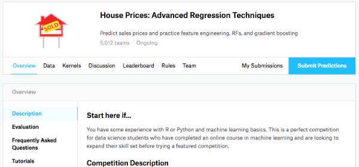
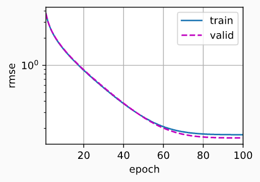
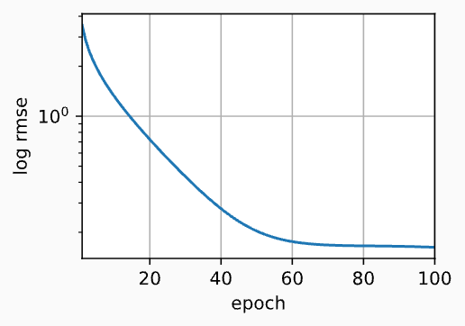
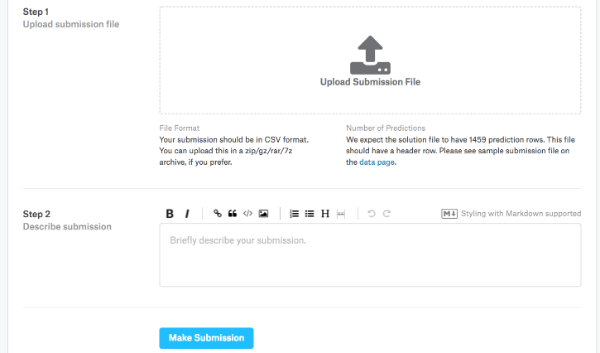

> 该内容为《动手学深度学习》的笔记

# 实战 Kaggle 比赛：预测房价

前几节我们学习了一些训练深度网络的基本工具和网络正则化的技术 (如 权重衰减、暂退法等)。本节我们将通过 Kaggle 比赛，将所学知识付诸实践。Kaggle 的房价预测比赛是一个很好的起点。此数据集由 Bart de Cock 于2011年收集，涵盖了 2006-2010 年期间亚利桑那州埃姆斯市的房价。这个数据集是相当通用的，不会需要使用复杂模型架构。它比哈里森和鲁宾菲尔德的波士顿房价数据集要大得多，也有更多的特征。

本节我们将详细介绍数据预处理、模型设计和超参数选择。通过亲身实践，你将获得一手经验，这些经验将有益数据科学家的职业成长。

## 下载和缓存数据集

在整本书中，我们将下载不同的数据集，并训练和测试模型。这里我们实现几个函数来方便下载数据。首先，我们先建立字典 `DATA_HUB` ，它可以将数据集名称的字符串映射到数据集相关的二元组上，这个二元组包含数据集的 `URL` 和验证文件完整性的 `sha-1` 密钥。所有类似的数据集都托管在地址为 `DATA_URL` 的站点上。

```python
import hashlib
import os
import tarfile
import zipfile
import requests

DATA_HUB = dict()
DATA_URL = 'http://d2l-data.s3-accelerate.amazonaws.com/'
```

下面的 `download` 函数用来下载数据集，将数据集缓存在本地目录 (默认情况下为 `../data` ) 中，并返回下载文件的名称。如果缓存目录中已经存在此数据集文件，并且其 `sha-1` 与存储在 `DATA_HUB` 中的相匹配，我们将使用缓存的文件，以避免重复的下载。

```python
def download(name, cache_dir=os.path.join('..', 'data')):
    """ 下载一个DATA_HUB 中的文件，返回本地文件名 """
    # 断言：检查数据集名字是否在注册表 DATA_HUB 里
    assert name in DATA_HUB, f"{name} 不存在于 {DATA_HUB}"  # assert 条件, 报错文本
    # 取出该数据集：下载链接 + 预期 sha1 哈希值
    url, sha1_hash = DATA_HUB[name]
    # 创建缓存目录，exist_ok=True：目录已经存在也不报错
    os.makedirs(cache_dir, exist_ok=True)
    # 拿到文件名：url 按 '/' 分割，取最后一段 (比如timemachine.txt)
    fname = os.path.join(cache_dir, url.split('/')[-1])
    # 缓存逻辑：如果本地已经有了这个文件
    if os.path.exists(fname):
        # 新建 sha1 计算器
        sha1 = hashlib.sha1()
        # 二进制只读打开文件
        with open(fname, 'rb') as f:
            while True:
                # 每次读 1MB(1024*1024)，防止大文件一次性占满内存
                data = f.read(1048576)
                if not data:
                    # 读到空，文件读完，退出循环
                    break
                # 把读到的片段喂给 sha1 计算
                sha1.update(data)
        # 比对算出的 sha1 和 DATA_HUB 里预先存好的哈希
        if sha1.hexdigest() == sha1_hash:
            # 哈希一致 -> 文件完好，直接返回本地路径，不用重下
            return fname # 命中缓存
    # 走到这里：文件不存在 或 文件损坏 (哈希对不上)，需要下载
    print(f'正在从{url}下载{fname}...')
    # stream=True：流式下载 (边下边拿，适合大文件)；verify=True 校验https证书
    r = requests.get(url, stream=True, verify=True)
    # 二进制写入模式
    with open(fname, 'wb') as f:
        # 把下载下来的全部内容写入本地文件
        f.write(r.content)
    return fname
```

我们还需要实现两个实用函数：一个将下载并解压缩一个zip或tar文件，另一个是将本书中使用的所有数据集从DATA_HUB下载到缓存目录中。

```python
def download_extract(name, folder=None):
    """ 下载并解压 zip/tar 文件 """
    # 调用刚才的 download 函数：先下载压缩包，拿到本地压缩包路径
    fname = download(name)
    # 获取压缩包所在的文件夹路径
    base_dir = os.path.dirname(fname)
    # 拆分 不带后缀的文件名 和 后缀扩展名
    data_dir, ext = os.path.splitext(fname)
    # 根据后缀选择解压工具
    if ext == '.zip':
        # zip 包用 zipfilr 库打开
        fp = zipfile.ZipFile(fname, 'r')
    elif ext in ('.tar', '.gz'):
        # tar / tar.gz 用 tarfile 库打开
        fp = tarfile.open(fname, 'r')
    else:
        # 不是这两种压缩包，直接断言报错
        assert False, '只有 zip/tar 文件可以被解压缩'
    # 全部解压到压缩包所在目录 base_dir
    fp.extractall(base_dir)
    # 返回解压之后数据目录路径
    return os.path.join(base_dir, folder) if folder else data_dir

def download_all():
    """ 下载DATA_HUB中的所有文件 """
    # 遍历DATA_HUB字典里每一个数据集名称key
    for name in DATA_HUB:
        # 调用download，下载、哈希校验、缓存
        download(name)
```

## Kaggle

Kaggle 是一个当今流行举办机器学习比赛的平台，每场比赛都以至少一个数据集为中心。许多比赛有赞助方，他们为获胜的解决方案提供奖金。该平台帮助用户通过论坛和共享代码进行互动，促进协作和竞争。虽然排行榜的追逐往往令人失去理智：有些研究人员短视地专注于预处理步骤，而不是考虑基础性问题。但一个客观的平台有巨大的价值：该平台促进了竞争方法之间地直接定量比较，以及代码共享。这便于每个人都可以学习哪些方法起作用，那些没有起作用。如果我们想参加 Kaggle 比赛，首先需要注册一个账户


在房价预测比赛页面的 “Data” 选项卡可以找到数据集。我们可以通过下面的网址提交预测，并查看排名：

https://www.kaggle.com/c/house-prices-advanced-regression-techniques



## 访问和读取数据集

注意，竞赛数据分为训练集和测试集。每条记录都包括房屋的属性值和属性，如街道类型、施工年份、屋顶类型、地下室状况等。这些特征由各种数据类型组成。例如，建筑年份由整数表示，屋顶类型由离散类别表示，其他特征由浮点数表示。这就是现实让事情变得复杂的地方：例如，一些数据完全丢失了，缺失值被简单地标记为 “NA”。每套房子的价格只出现训练集中 (毕竟这是一场比赛)。我们将希望划分训练集以创建验证集，但是在将预测结果上传到 Kaggle 之后，我们只能在官方测试集中评估我们的模型在上图中，“Data”选项卡由下载数据的链接。

在开始之前，我们将使用 `pandas` 读入并处理数据。因此，在继续操作之前，我们需要确保已安装 `pandas`。

```python
import numpy as np
import pandas as pd
import torch
from torch import nn
from d2l import torch as d2l
```

为方便起见，我们可以使用上面定义的脚本下载并缓存 Kaggle 房屋数据集。

```python
DATA_HUB['kaggle_house_train'] = (
    DATA_URL + 'kaggle_house_pred_train.csv',
    '585e9cc93e70b39160e7921475f9bcd7d31219ce'
)

DATA_HUB['kaggle_house_test'] = (
    DATA_URL + 'kaggle_house_pred_test.csv',
    'fa19780a7b011d9b009e8bff8e99922a8ee2eb90'
)
```

我们使用 `pandas` 分别加载包含训练数据和测试数据的两个 CSV 文件。

```python
train_data = pd.read_csv(download('kaggle_house_train'))
test_data = pd.read_csv(download('kaggle_house_test'))
```

训练数据集包括 1460 个样本，每个样本 80 个特征和 1 个标签，而测试数据集包含 1459 个样本，每个样本 80 个特征。

```python
print(train_data.shape)
print(test_data.shape)
```

```ini
(1460, 81)
(1459, 80)
```

让我们看看前四行数据的前四个特征、最后两个特征，以及相应标签 (房价)

```python
print(train_data.iloc[0:4, [0, 1, 2, 3, -3, -2, -1]])
```

```ini
   Id  MSSubClass MSZoning  LotFrontage SaleType SaleCondition  SalePrice
0   1          60       RL         65.0       WD        Normal     208500
1   2          20       RL         80.0       WD        Normal     181500
2   3          60       RL         68.0       WD        Normal     223500
3   4          70       RL         60.0       WD       Abnorml     140000
```

我们可以看到，在每个样本中，第一个特征是 ID，这有助于模型识别每个训练样本。虽然这很方便，但它不携带任何用于预测的信息。因此，在将数据提供给模型之前，我们将其从数据集中删除。

```python
all_features = pd.concat((train_data.iloc[:, 1:-1], test_data.iloc[:, 1:]))
```

## 数据预处理

如上所述，我们有各种各样的数据类型。在开始建模之前，我们需要对数据进行预处理。首先，我们将所有缺失值替换为相应特征的平均值。然后，为了将所有特征放在共同的尺度上，我们通过将特征重新缩放到零均值和单位方差来标准化数据：

$$
\displaystyle x \leftarrow \frac{x - \mu}{\sigma}
$$

其中 $\mu$ 和 $\sigma$ 分别表示均值和标准差。现在，这些特征具有零均值和单位方差，即 $E[\frac{x - \mu}{\sigma}] = \frac{\mu - \mu}{\sigma} = 0$ 和 $E[(x - \mu)^2] = (\sigma^2 + \mu^2) - 2\mu^2 + \mu^2 = \sigma^2$ 。直观的说，我们标准化数据有两个原因：首先，它方便优化。其次，因为我们不知道哪些特征是相关的，所以我们不想让惩罚分配给一个特征的系数比分配给其他任何特征的系数更大。

```python
# 若无法获得测试数据，则可根据训练数据计算均值和标准差
# 筛选出数值类型的列名，排除字符串/类别 object 列
numeric_features = all_features.dtypes[all_features.dtypes != 'object'].index
# 对每列数值特征做 Z-score 标准化 ：(x - 均值) / 标准差
all_features[numeric_features] = all_features[numeric_features].apply(
    lambda x: (x - x.mean()) / (x.std())
)
# 在标准化数据之后，所有均值消失，因此我们可以将缺失值设置为 0
all_features[numeric_features] = all_features[numeric_features].fillna(0)
```

接下来，我们处理离散值。这句话诸如“MSZoning”之类的特征。我们用独热编码替换它们，方法与前面将多类别标签转换为向量的方式相同。例如，“MSZoning”包含值“RL”和“Rm”。我们将创建两个新的指示器特征“MSZoning_RL”和“MSZoning_RM”，其值为 0 或 1。根据独热编码，如果“MSZoning”的原始值为“RL”，则：“MSZoning_RL”为 1，“MSZoning_RM”为 0。`pandas` 软件包会自动为我们实现这一点。

```python
# “Dummy_na=True”将“na”(缺失值)视为有效的特征值，并为其创建指示符特征
all_features = pd.get_dummies(all_features, dummy_na=True).astype('float32')
print(all_features.shape)
```

```ini
(2919, 330)
```

可以看到此转换会将特征的总数量从 79 个增加到了331个。最后，通过 values 属性，我们可以从 pandas 格式中提取 NumPy 格式，并将其转换为张量表示用于训练。

```python
# 获取训练集样本的数量(行数)
n_train = train_data.shape[0]

# .values 取出pandas 的 numpy 数组 / 或使用 to_numpy([dtype=np.float32, copy=False, na_value=0.0])
# 切出训练集和测试集
train_features = torch.tensor(all_features[:n_train].to_numpy(), dtype=torch.float32)
test_features = torch.tensor(all_features[n_train:].to_numpy(), dtype=torch.float32)

# `train_data.SalePrice` 是房价标签（一维序列）等价于 train_data['SalePrice']
# `.reshape(-1,1)`：把一维 `(N,)` 变成二维 `(N,1)`
train_labels = torch.tensor(
    train_data['SalePrice'].to_numpy().reshape(-1, 1), dtype=torch.float32
)
```

## 训练

首先，我们训练一个带有损失平方的线性模型。显然线性模型很难让我们在竞赛中获胜，但线性模型提供了一种及安全性检查，以查看数据中是否存在有意义的信息。如果我们在这里不能做得比随机猜测更好，那么我们很可能存在数据处理错误。如果一切顺利，线性模型将作为 **基线 (baseline)** 模型，让我们直观地知道最好的模型有超出简单的模型多少。

```python
loss = nn.MSELoss()
in_features = train_features.shape[1]
def get_net():
    net = nn.Sequential(
        nn.Linear(in_features, 1),
    )
    return net
```

房价就像股票价格一样，我们关心的是相对数量，而不是绝对数量。因此，我们更关心相对误差 $\frac{y - \hat{y}}{y}$ ，而不是绝对误差 $y - \hat{y}$ 。例如，我们在俄亥俄州农村地区估计一栋房子的价格时，假设我们的预测偏差了10万美元，然而那里一栋典型的房子的价格是12.5万美元，那么模型可能做的很糟糕。另一方面，如果我们在加州豪宅区的预测出现同样的10万美元的偏差，(在那里，房价的中位数超过400万美元) 这可能是一个不错的预测。

解决这个问题的一种方法是用价格预测的对数来衡量差异。事实上，这也是比赛中官方用来评价提交质量的误差指标。即将 $\delta \space \text{for} \mid \log y - \log \hat{y} \mid \leq \delta$ 转换为 $e^{-\delta} \leq \frac{\hat{y}}{y} \leq e^{\delta}$ 。这使得预测价格的对数与真实标签价格的对数之间出现以下均方根误差：

$$
\displaystyle \sqrt{\frac{1}{n} \sum^n_{i = 1} (\log y_i - \log \hat{y}_i)^2}
$$

```python
def log_rmse(net, features, labels):
    # 为了在取对数时进一步稳定该值，将小于 1 的值设置为 1
    # clamp(input, min=None, max=None):输入张量，下限 min，小于它的都变成 min，上限 max，同min
    # clipped_preds:被截断(限制上下限的)模型预测值。clipped predictions
    clipped_preds = torch.clamp(net(features), 1, float('inf'))

    # 用对MSE开方来评估模型质量
    rmse = torch.sqrt(loss(torch.log(clipped_preds),
                           torch.log(labels)))

    return rmse.item() # 取出 标量 tensor 的python 原生浮点数
```

与前面的部分不同，我们的训练函数将借助 Adam 优化器(我们将在后面章节更详细地描述它)。Adam 优化器的主要吸引力在于它对初始学习率不那么敏感。

```python
def train(
        net,
        train_features,
        train_labels,
        test_features,
        test_labels,
        num_epochs,
        learning_rate,
        weight_decay,   # 权重衰减
        batch_size
):
    train_ls, test_ls = [], []
    train_iter = d2l.load_array((train_features, train_labels), batch_size=batch_size)
    # 这里使用的是Adam优化算法
    optimizer = torch.optim.Adam(
        net.parameters(),  # 神经网路的参数
        lr=learning_rate,  # 学习率
        weight_decay=weight_decay  # 权重衰减
    )
    for epoch in range(num_epochs): # training num_epochs 次
        for X, y in train_iter:  # 从 train_data 中随机取一个 batch_size
            optimizer.zero_grad()  # 梯度归零
            l = loss(net(X), y)  # 计算loss
            l.backward()  # 反向传播算梯度
            optimizer.step()  # 更新 梯度
        # 记录每轮 网络net 在训练集上的 rmse 评价
        train_ls.append(log_rmse(net, train_features, train_labels))
        # 如果有测试集，也记录网络 net 在测试集上的 rmse 评价
        if test_labels is not None:
            test_ls.append(log_rmse(net, test_features, test_labels))
    return train_ls, test_ls
```

## K折交叉验证

本书在讨论模型选择的部分中介绍了 K折交叉验证 ，它有助于模型选择和超参数调整。我们首先需要定义一个函数，在 K折交叉验证过程中返回第 $i$ 折的数据。具体地说，它选择第 $i$ 个切片作为验证数据，其余部分作为训练数据。注意，这并不是处理数据的最有效方法，如果我们的数据集大得多，会有其他解决方法。

```python
def get_k_fold_data(k, i, X, y):
    assert k > 1, "k 必须大于 1"
    assert 0 <= i < k, f"i 必须在 [0, {k}) 之间，收到 {i}"
    fold_size = X.shape[0] // k
    X_train, y_train = None, None
    for j in range(k):
        idx = slice(j * fold_size, (j + 1) * fold_size)
        X_part, y_part = X[idx, :], y[idx]
        # 第 j 折是验证折 i
        if j == i:
            X_valid, y_valid = X_part, y_part
        # 第 1 次遇见训练折
        elif X_train is None:
            X_train, y_train = X_part, y_part
        # 否则 拼接 训练折
        else:
            X_train = torch.cat([X_train, X_part], 0)
            y_train = torch.cat([y_train, y_part], 0)
    return X_train, y_train, X_valid, y_valid
```

当我们在 K 折交叉验证中训练 K 次后，返回训练和验证误差的平均值。

```python
def k_fold(
        k,
        X_train,
        y_train,
        num_epochs,
        learning_rate,
        weight_decay,
        batch_size
):
    # 累计损失
    train_l_sum, valid_l_sum = 0, 0
    for i in range(k):
        # 获取第i折数据
        data = get_k_fold_data(k, i, X_train, y_train)
        # 每折新建网络
        net = get_net()
        # 第i折训练，返回两个长度 num_epochs 的列表，train和test的rmse
        train_ls, valid_ls = train(
            net,
            *data,
            num_epochs,
            learning_rate,
            weight_decay,
            batch_size
        )
        # 只取第i折训练最后一轮 rmse
        train_l_sum += train_ls[-1]
        valid_l_sum += valid_ls[-1]

        # 只画第1折的曲线
        if i == 0:
            d2l.plot(
                list(range(1, num_epochs + 1)),
                [train_ls, valid_ls],
                xlabel='epoch',
                ylabel='rmse',
                xlim=[1, num_epochs],
                legend=['train', 'valid'],
                yscale='log'
            )
        # 每折打印一行
        print(f'折{i + 1}，训练 log rmse{float(train_ls[-1]):f}, '
              f'验证 log rmse{float(valid_ls[-1]):f}')
    # 返回平均训练误差，平均验证误差
    return train_l_sum / k, valid_l_sum / k
```

## 模型选择

在本例中，我们选择了一组未调优的超参数，并将其留给读者来改进模型。找到一则调优的超参数可能需要时间，这取决于一个人优化了多少变量。有了足够大的数据集和合理设置的超参数，K 折交叉验证往往对多次测试具有相当的稳定性。然而，如果我们尝试了不合理的超参数，我们可能会发现验证效果不在代表真正的误差。

```python
k, num_epochs, lr, weight_decay, batch_size = 5, 100, 5, 0, 64
train_l, valid_l = k_fold(
    k,
    train_features,
    train_labels,
    num_epochs,
    lr,
    weight_decay,
    batch_size
)
print(f'{k}-折验证: 平均训练log rmse: {float(train_l):f}, '
      f'平均验证log rmse: {float(valid_l):f}')
```

```ini
折1，训练 log rmse0.169991, 验证 log rmse0.156869
折2，训练 log rmse0.162332, 验证 log rmse0.191138
折3，训练 log rmse0.164064, 验证 log rmse0.168944
折4，训练 log rmse0.167878, 验证 log rmse0.154673
折5，训练 log rmse0.163854, 验证 log rmse0.183064
5-折验证: 平均训练log rmse: 0.165624, 平均验证log rmse: 0.170938
```



请注意，有时一组超参数的训练误差可能非常低，但 K折交叉验证的误差要高得多，这表明模型过拟合了。在整个训练过程中，我们希望监控训练误差和验证误差这两个数字。较少的过拟合可能表明现有数据可以支撑一个更强大的模型，较大的过拟合可能意味着我们可以通过正则化技术来获益。

## 提交 Kaggle 预测

既然我们知道应该选择什么样的超参数，我们不妨使用所有数据对其进行训练 (而不是仅使用交叉验证中使用的 $1 - 1 / K$ 的数据)。然后，我们通过这种方式获得的模型可以应用于测试集。将预测保存在 CSV 文件中可以简化将结果上传到 Kaggle 的过程。

```python
def train_and_pred(
        train_features,
        test_features,
        train_labels,
        test_data,
        num_epochs,
        learning_rate,
        weight_decay,
        batch_size
):
    net = get_net()
    train_ls, _ = train(
        net,
        train_features,
        train_labels,
        None,
        None,
        num_epochs,
        learning_rate,
        weight_decay,
        batch_size
    )
    d2l.plot(
        np.arange(1, num_epochs + 1),
        [train_ls],
        xlabel='epoch',
        ylabel='log rmse',
        xlim=[1, num_epochs],
        yscale='log'
    )
    d2l.plt.show()
    print(f'训练 log rmse: {float(train_ls[-1]):f}')
    # 将网络应用于测试集
    preds = net(test_features).detach().numpy()
    # 将其重新格式化以导出 Kaggle
    test_data['SalePrice'] = pd.Series(preds.reshape(1, -1)[0])
    submission = pd.concat([test_data['Id'], test_data['SalePrice']], axis=1)
    submission.to_csv('submission.csv', index=False)
```

如果测试集上的预测与 K 倍交叉验证过程中的预测相似，那就是时候把它们上传到 Kaggle 了。下面的代码将生成一个名为 submission.csv 的文件。

```python
train_and_pred(train_features, test_features, train_labels, test_data,
               num_epochs, lr, weight_decay, batch_size)
```

```ini
训练log rmse：0.162354
```



接下来，如下图所示，我们可以提交预测到Kaggle上，并查看在测试集上的预测与实际房价 (标签) 的比较情况。步骤非常简单：

1. 登录 Kaggle 网站，访问房价预测竞赛页面
2. 点击“Submit Predictions”或“Late Submission”按钮 (在攥写本文时，该按钮位于右侧)
3. 点击页面底部虚线框中的“Upload Submission File”按钮，选择要上传的预测文件。
4. 点击页面底部的“Make Submission”按钮，即可查看结果。



## 小结

- 真实数据通常混合了不同的数据类型，需要进行预处理
- 常用的预处理方法：将实值数据重新缩放为零均值和单位方法；用均值替换缺失值。
- 将类别特征转化为指标特征，可以使我们把这个特征当作一个独热向量来对待。
- 我们可以使用 K 折交叉验证来选择模型并调整超参数
- 对数对于相对误差很有用。