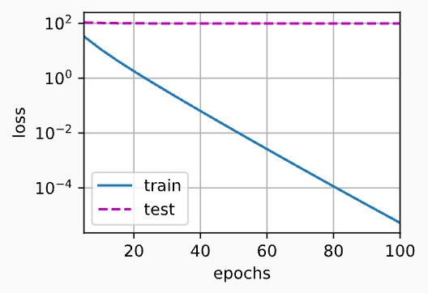
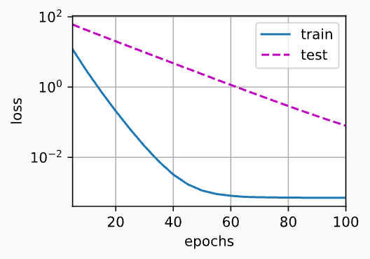
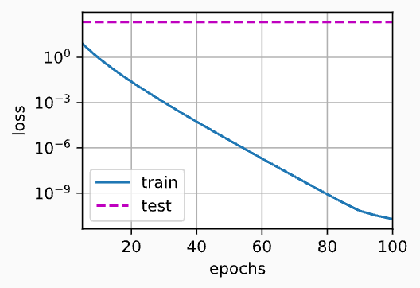
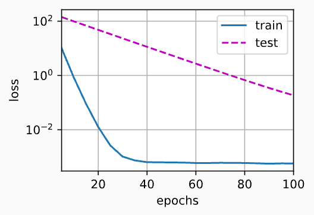

> 该内容为《动手学深度学习》的笔记

# 权重衰减

前一节我们描述了过拟合的问题，本节我们将介绍一些正则化模型的技术。我们总是可以通过去收集更多的训练数据来缓解过拟合。但这可能成本很高，耗时颇多，或者完全超出我们的控制，因而在短期内不可能做到。假设我们已经拥有尽可能多的高质量数据，我们便可以将重点放在正则化技术上。

回想一下，在多项式回归的例子中，我们可以通过调整拟合多项式的阶数来限制模型的容量。实际上，限制特征的数量是缓解过拟合的一种常用技术。然而，简单的丢弃特征对这项工作来说可能过于生硬。我们继续思考多项式回归的例子，考虑高维输入可能发生的情况。多项式对多变量数据的自然扩张称为 **单项式(monomials)** ，也可以是变量幂的乘积。单项式的阶数是幂的和。例如，$x^2_1x^2$ 和 $x_3x^2_5$ 都是3次单项式。

注意，随着阶数 $d$ 的增长，带有阶数 $d$ 的项数迅速增加。给定 $k$ 个变量，阶数为 $d$ 的项的个数为 $\binom{k - 1 + d}{k - 1}$ ，即 $C_{k-1+d}^{k-1}=\frac{(k-1+d)!}{d!(k-1)!}$ 。因此即使是阶数上的微小变化，比如从2到3，也会显著增加我们模型的复杂性。仅仅通过简单的限制特征数量(在多项式回归中体现为限制阶数)，可能仍然使模型在过简单和过复杂中徘徊，我们需要一个更细粒度的工具来调整函数的复杂性，使其达到一个合适的平衡位置。

## 范数与权重衰减

在线性代数中，我们已经描述了 $L_2$ 范数和 $L_1$ 范数，它们是更为一般的 $L_p$ 范数的特殊情况。

在训练参数化机器学习模型时，**权重衰减(weight decay)** 是广泛使用的正则化的技术之一，它通常被称为 **$L_2$ 正则化** 。这项技术通过函数与零的距离来衡量函数的复杂度，因为在所有函数 $f$ 中，函数 $f = 0$ （所有输入都得到值0）在某种意义上是最简单的。但是我们应该如何精确地测量一个函数和零之间的距离呢？没有一个正确的答案。事实上，函数分析和巴纳赫空间理论的研究，都在致力于回答这个问题。

一种简单的方法通过线性函数 $f(\mathbf{x}) = \mathbf{w}^ \mathsf{T} \mathbf{x}$ 中权重向量的某个范数来度量其复杂性，例如 $\|\mathbf{w}\|^2$ 。要保证权重向量比较小，最常用方法是将其范数作为惩罚项加到最小化损失的问题中。将原来的训练目标 **最小化训练标签上的预测损失** ，调整为 **最小化预测损失和惩罚项之和** 。现在，如果我们的权重向量增大的太大，我们学习算法可能会更集中于最小化权重范数 $\|\mathbf{w}\|^2$ 。这正是我们想要的。让我们回顾一下线性回归例子。我们呢的损失由下式给出：

$$
\displaystyle L(\mathbf{w}, \mathbf{b}) = \frac{1}{n} \sum^n_{i = 1} \frac{1}{2}(\mathbf{w}^\mathsf{T}\mathbf{x})^{(i)} + \mathbf{b} - y^{(i)}
$$

回想一下，$\mathbf{x}^{(i)}$ 是样本 $i$ 的特征，$y^{(i)}$ 是样本 $i$ 的标签，$(\mathbf{w,b})$ 是权重和偏置参数。为了惩罚权重向量的大小，我们必须以某种方式在损失函数中添加 $\|\mathbf{w}\|^2$ ，但是模型应该如何平衡这个新的额外惩罚的损失？实际上，我们通过 **正则化常数($\lambda$)** 来描述这种权衡，这是一个非负超参数，我们使用验证数据拟合：

$$
\displaystyle L(\mathbf{w,b}) + \frac{\lambda}{2} \|\mathbf{w}\|^2
$$

对于 $\lambda = 0$ ，我们恢复了原来的损失函数。对于 $\lambda > 0$ ，我们限制 $\|\mathbf{w}\|^2$ 的大小。这里我们仍然除以 $2$ ：当我们取一个二次函数的导数时，$2$ 和 $\frac{1}{2}$ 会抵消，以确保更新表达式看起来即漂亮又简单。为什么在这里我们使用平方范数而不是标准范数（即欧几里得距离）？我们这样做是为了便于计算。通过平方 $L_2$ 范数，我们去掉平方根，留下权重向量每个分量的平方和。这使得惩罚的导数很容易计算：导数的和等于和的导数。

此外，为什么我们首先使用 $L_2$ 范数，而不是 $L_1$ 范数。事实上，这个选择在整个统计领域中都是有效的和受欢迎的。$L_2$ 正则化线性模型构成经典的 **$岭回归(ridge regression)$** , $L_1$ 正则化线性回归是统计学中类似的基本模型，通常被称为 **套索回归(lasso regression)** 。使用 $L_2$ 范数的一个原因是它对权重向量的大分量施加了巨大的惩罚。这使得我们的学习算法偏向于在大量特征上均匀分布权重的模型。在实践中，这可能使它们对单个变量中的观测误差更稳定。相比之下，$L_1$ 惩罚会导致模型将权重集中在一小部分特征上，而将其他权重清除为零。这称为 **特征选择(feature selection)** ，这可能是其他场景下需要的。

$L_2$ 正则化回归的小批量随机梯度下降更新如下式：

$$
\displaystyle \mathbf{w} \leftarrow (1 - \eta \lambda)\mathbf{w} - \frac{\eta}{|\mathcal{B}|} \sum_{i \in \mathcal{B}} \mathbf{x}^{(i)} \big(\mathbf{w}^\mathsf{T} \mathbf{x}^{(i)} + b - y^{(i)}\big)
$$

根据之前章节所讲的，我们根据估计值于观测值之间的差异来更新 $\mathbf{w}$ 。然而，我们同时也在试图将 $\mathbf{w}$ 的大小缩小到零。这就是为什么这种方法有时被称为 **权重衰减** 。我们仅考虑惩罚项，优化算法在训练的每一步 **衰减** 权重。与特征选择相比，权重衰减为我们提供了一种连续的机制来调整函数的复杂度。较小的 $\lambda$ 值对应较少约束的 $\mathbf{w}$ ，而较大的 $\lambda$ 值对 $\mathbf{w}$ 的约束更大。

是否对应的偏置 $b^2$ 进行惩罚在不同的实践中会有所不同，在神经网络中的不同层中也会有所不同。通常，网络输出层的偏置项不会被正则化。

## 高维线性回归

我们通过一个简单的例子来演示权重衰减。

```python
import torch
from torch import nn
from d2l import torch as d2l
```

首先，我们像以前一样生成一些数据，生成公式如下：

$$
\displaystyle y = 0.05 + \sum^d_{i = 1} 0.01x_i + \epsilon \text{ where } \epsilon \sim \mathcal{N}(0, 0.01^2)
$$

我们选择标签是关于输入的线性函数。标签同时被均值为 0 ，标准差为 0.01 高斯噪声破坏。为了使过拟合的效果更加明显，我们可以将问题的维数增加到 $d = 200$ ，并使用一个只包含 20 个样本的小训练集 。

```python
n_train, n_test, num_input, batch_size = 20, 100, 200, 5
true_w, true_b = torch.ones((num_input, 1)) * 0.01, 0.05
train_data = d2l.synthetic_data(true_w, true_b, n_train)
train_iter = d2l.load_array(train_data, batch_size)
test_data = d2l.synthetic_data(true_w, true_b, n_test)
test_iter = d2l.load_array(test_data, batch_size)
```

## 从零开始实现

下面我们将从头开始实现权重衰减，只需要将 $L_2$ 的平方惩罚添加到原始目标函数中。

### 初始化模型参数

首先，我们将定义一个函数来随机初始化模型参数。

```python
def init_params():
    w = torch.normal(0, 1, size=(num_input, 1), requires_grad=True)
    b = torch.zeros(1, requires_grad=True)
    return [w, b]
```

### 定义 $L_2$ 范数惩罚

实现这一惩罚最方便的方法就是对所有项求平方后并将它们求和

```python
def l2_penalty(w):
    return torch.sum(w.pow(2)) / 2
```

### 定义训练代码实现

下面的代码将模型拟合训练数据集，并在测试数据集上进行评估。从线性回归以来，线性网络和平方损失没有变化，所以我们通过 `d2l.linreg` 和 `d2l.squared_loss` 导入它们。唯一变化使损失现在包括了惩罚项。

```python
def train(lambd):
    w, b = init_params()
    net, loss = lambda X:d2l.linreg(X, w, b), d2l.squared_loss
    num_epochs, lr =100, 0.003
    animator = d2l.Animator(
        xlabel='epochs',
        ylabel='loss',
        yscale='log',
        xlim=[5, num_epochs],
        legend=['train', 'test']
    )

    for epoch in range(num_epochs):
        for X, y in train_iter:
            # 增加了L2范数惩罚项
            # 广播机制使L2_penalty(w) 成为一个长度为 batch_size 的向量
            l = loss(net(X), y) + lambd * l2_penalty(w)
            l.sum().backward()
            d2l.sgd([w, b], lr, batch_size)
        if (epoch + 1) % 5 == 0:
            animator.add(
                epoch + 1,
                (
                    d2l.evaluate_loss(net, train_iter, loss),
                    d2l.evaluate_loss(net, test_iter, loss)
                )
            )
    # torch.norm(w) ：计算张量 w 的范数，默认是 L2 范数
    print('w的L2范数是：', torch.norm(w).item())
    d2l.plt.show()
```

### 忽略正则化直接训练

我们现在用 `lambd = 0` 禁用权重衰减后运行这个代码。注意，这里训练误差有了减少，但测试误差没有减少，这意味着出现了严重的过拟合。

```python
train(lambd=0)
```

```ini
w的L2范数是： 13.022261619567871
```



### 使用权重衰减

下面我们使用权重衰减来运行代码。注意，在这里训练误差增大，但测试误差减小。这正是我们期望从正则化中得到的效果。

```python
train(lambd=3)
```

```ini
w的L2范数是： 0.3349898159503937
```



### 简洁实现

由于权重衰减在神经网络优化中很常用，深度学习框架为了便于我们使用权重衰减，将权重衰减集成到优化算法中，以便与任何损失函数结合使用。此外，这种集成还有计算上的好处，允许在不增加任何额外的计算开销的情况下像算法中添加权重衰减。由于更新的权重衰减部分仅依赖于每个参数的当前值，因此优化器必须至少接触每个参数一次。

在下面的代码中，我们在实例化优化器时直接通过 `weight_decay` 指定 `weight decay` 超参数。默认情况下，PyTorch 同时衰减权重和偏移。这里我们只为权重设置了 `weight_decay` ，所以偏执参数 $b$ 不会衰减。

```python
def train_concise(wd):
    # 单层线性模型 y = Xw + b
    net = nn.Sequential(nn.Linear(num_input, 1))
    
    # 参数初始化，所有参数原地标准正态N(0,1)
    for param in net.parameters():
        param.detach().normal_()
    
    # MSE损失，reduction=‘none’：不自动求和/平均，返回每个样本损失
    loss = nn.MSELoss(reduction='none')
    
    num_epochs, lr = 100, 0.003
    # 偏置参数没有衰减
    # 核心：分组参数，单独设置weight_decay
    trainer = torch.optim.SGD(
        [
            # 权重w：启用权重衰减 wd（L2正则）
            {
                'params': net[0].weight,
                'weight_decay':wd
            },
            # 偏置b：不设置weight_decay，默认wd=0,偏置不做L2惩罚
            {
                'params': net[0].bias,
            }
        ],
        lr=lr
    )
    animator = d2l.Animator(
        xlabel='epochs',
        ylabel='loss',
        yscale='log',
        xlim=[5, num_epochs],
        legend=['train', 'test']
    )
    for epoch in range(num_epochs):
        for X, y in train_iter:
            trainer.zero_grad() # 梯度清零
            l = loss(net(X), y) # 计算每个样本的损失
            l.mean().backward() # 求平均损失，反向传播求梯度
            trainer.step() # SGD更新参数（内置L2衰减）
        # 每5个epoch记录损失图
        if (epoch + 1) % 5 == 0:
            animator.add(
                epoch + 1,
                (
                    d2l.evaluate_loss(net, train_iter, loss),
                    d2l.evaluate_loss(net, test_iter, loss)
                )
            )
    # 输出权重w的L2范数，wd越大，范数越小
    print('w的L2范数：', net[0].weight.norm().item())
    d2l.plt.show()
```

这些图看起来和我们从零开始实现全忠衰减时的图相同，然而，它们运行得更快，更容易实现。对于更复杂得问题，这一好处将变得更加明显。

```python
train_concise(0)
```

```ini
w的L2范数： 12.96099853515625
```



```python
train_concise(3)
```

```ini
w的L2范数： 0.4026120901107788
```



到目前为止，我们只接触到一个简单线性函数得概念。此外有什么构成一个简单的非线性函数可能是一个更复杂的问题。例如，**再生核希尔伯特空间(RKHS)** 允许在非线性环境中应用为线性函数引入的工具。不幸的是，基于RKHS的算法往往难以应用到大型、高维的数据。在本书中，我们将默认使用简单的启发式方法，即在深层网络的所有层上应用权重衰减。

## 小结

- 正则化是处理过拟合的常用方法：在训练集的损失函数中加入惩罚项，以降低学习到的模型的复杂度。
- 保持模型简单的一个特别的选择是使用 $L_2$ 惩罚的权重衰减。这会导致学习算法更新步骤中的权重衰减。权重衰减功能在深度学习框架的优化器中提供。
- 在同一训练代码实现中，不同的参数集可以又不同的更新行为。

以下为我实现的代码：

```python
import torch
from torch import nn
from d2l import torch as d2l

n_train, n_test, num_input, batch_size = 20, 100, 200, 5
true_w, true_b = torch.ones((num_input, 1)) * 0.01, 0.05
train_data = d2l.synthetic_data(true_w, true_b, n_train)
train_iter = d2l.load_array(train_data, batch_size)
test_data = d2l.synthetic_data(true_w, true_b, n_test)
test_iter = d2l.load_array(test_data, batch_size)

def init_params():
    w = torch.normal(0, 1, size=(num_input, 1), requires_grad=True)
    b = torch.zeros(1, requires_grad=True)
    return [w, b]

def l2_penalty(w):
    return torch.sum(w.pow(2)) / 2

def train(lambd):
    w, b = init_params()
    net, loss = lambda X:d2l.linreg(X, w, b), d2l.squared_loss
    num_epochs, lr =100, 0.003
    animator = d2l.Animator(
        xlabel='epochs',
        ylabel='loss',
        yscale='log',
        xlim=[5, num_epochs],
        legend=['train', 'test']
    )

    for epoch in range(num_epochs):
        for X, y in train_iter:
            # 增加了L2范数惩罚项
            # 广播机制使L2_penalty(w) 成为一个长度为 batch_size 的向量
            l = loss(net(X), y) + lambd * l2_penalty(w)
            l.sum().backward()
            d2l.sgd([w, b], lr, batch_size)
        if (epoch + 1) % 5 == 0:
            animator.add(
                epoch + 1,
                (
                    d2l.evaluate_loss(net, train_iter, loss),
                    d2l.evaluate_loss(net, test_iter, loss)
                )
            )
    # torch.norm(w) ：计算张量 w 的范数，默认是 L2 范数
    print('w的L2范数是：', torch.norm(w).item())
    d2l.plt.show()

# train(lambd=3)

def train_concise(wd):
    # 单层线性模型 y = Xw + b
    net = nn.Sequential(nn.Linear(num_input, 1))

    # 参数初始化，所有参数原地标准正态N(0,1)
    for param in net.parameters():
        param.detach().normal_()

    # MSE损失，reduction=‘none’：不自动求和/平均，返回每个样本损失
    loss = nn.MSELoss(reduction='none')

    num_epochs, lr = 100, 0.003
    # 偏置参数没有衰减
    # 核心：分组参数，单独设置weight_decay
    trainer = torch.optim.SGD(
        [
            # 权重w：启用权重衰减 wd（L2正则）
            {
                'params': net[0].weight,
                'weight_decay':wd
            },
            # 偏置b：不设置weight_decay，默认wd=0,偏置不做L2惩罚
            {
                'params': net[0].bias,
            }
        ],
        lr=lr
    )
    animator = d2l.Animator(
        xlabel='epochs',
        ylabel='loss',
        yscale='log',
        xlim=[5, num_epochs],
        legend=['train', 'test']
    )
    for epoch in range(num_epochs):
        for X, y in train_iter:
            trainer.zero_grad() # 梯度清零
            l = loss(net(X), y) # 计算每个样本的损失
            l.mean().backward() # 求平均损失，反向传播求梯度
            trainer.step() # SGD更新参数（内置L2衰减）
        # 每5个epoch记录损失图
        if (epoch + 1) % 5 == 0:
            animator.add(
                epoch + 1,
                (
                    d2l.evaluate_loss(net, train_iter, loss),
                    d2l.evaluate_loss(net, test_iter, loss)
                )
            )
    # 输出权重w的L2范数，wd越大，范数越小
    print('w的L2范数：', net[0].weight.norm().item())
    d2l.plt.show()

train_concise(3)
```