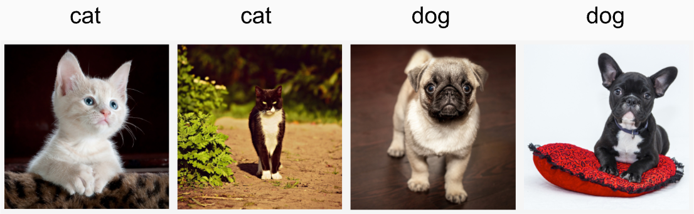
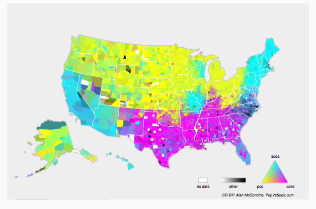

> 该内容为《动手学深度学习》的笔记

# 环境和分布偏移

前面我们学习了许多机器学习的实际应用，将模型拟合各种数据集。然而，我们从来没有想过数据最初从哪里来？以及我们计划最终如何处理模型的输出？通常情况下，开发人员会拥有一些数据且基于开发模型，而不关注这些基本问题。

许多失败的机器学习部署（即实际应用）都可以追究到这种方式。有时，根据测试集的精度衡量，模型表现得非常出色。但是当数据分布突然改变时，模型在部署中会出现灾难性的失败。更隐蔽的是，有时模型的部署本身就是扰乱数据分布的催化剂。举一个有点荒谬却可能真实存在的例子。假设我们训练了一个贷款申请人违约风险模型，用来预测谁将偿还贷款或违约。这个模型发现申请人的鞋子与违约风险相关(穿牛津鞋申请人会偿还，穿运动鞋申请人会违约)。此后，这个模型可能倾向于所有人穿着牛津鞋的申请人发放贷款，并拒绝所有穿着运动鞋的申请人。

这种情况可能会带来灾难性的后果。首先，一旦模型开始根据鞋类做出决定，顾客就会理解并改变它们的行为。不久，所有的申请者都会穿牛津鞋，而信用度却没有相应的提高。总而言之，机器学习的许多应用中都存在类似的问题：通过将基于模型的决策引入环境，我们可能会破坏模型。

虽然我们不可能在一节中讨论全部的问题，但我们希望揭示一些常见的问题，并激发批判性思考，以便及早发现这些情况，减轻灾难性的损害。有些解决方案很简单（要求“正确”的数据），有些在技术上很困难（实施强化学习系统），话有一些解决方案要求我们完全跳出统计预测，解决一些棘手的、与算法伦理应用有关的哲学问题。

## 分布偏移的类型

在不同分布便宜中，协变量偏移可能是最为广泛研究的。这里我们假设：最然输入的分布可能随时间而改变，但标签函数(即条件分布 $P(y|\mathbf{x})$) 没有改变。统计学家称之为 **协变量偏移(covariate shift)** ，因为这个问题是由协变量(特征)分布的变化而产生的。虽然有时我们可以在不引用因果关系的情况下对分布偏移进行推断，但在我们认为 $\mathbf{x}$ 导致 $y$ 的情况下，协变量偏移是一种自然假设。

考虑一下区分猫和狗的问题：训练数据包括下图的图像。

在测试时，我们被要求对下图中的图像进行分类。

训练集由真实照片组成，而测试集只包含卡通图片。假设在一个与测试集的特征有着本质不同的数据集上进行训练，如果没有方法来适应新的领域，可能会有麻烦。

### 标签偏移

**标签偏移(label shift)** 描述了与协变量偏移相反的问题。这里我们假设标签边缘概率 $P(y)$ 可以改变，但是类别条件分布 $P(\mathbf{x}|y)$ 在不同的领域之间保持不变。当我们认为 $y$ 导致 $\mathbf{x}$ 时，标签偏移是一个合理的假设。例如，预测患者的疾病，我们可能根据症状来判断，即使疾病的相对流行率随着时间的推移而变化。标签偏移在这里是恰当的假设，因为疾病会引起症状。在另一些情况下，标签偏移和协变量偏移假设可以同时成立。例如，当标签是确定的，即使 $y$ 导致 $\mathbf{x}$ ，协变量偏移假设也会得到满足。有趣的是，在这些情况下，使用基于标签偏移假设的方法通常是有利的。这是因为这些方法倾向于包含看起来像标签(通常是低维)的对像，而不是像输入(通常是高维的)对像。

### 概念偏移

我们也可能会遇到 **概念偏移(concept shift)** ：当标签的定义发生变化时，就会出现这种问题。这听起来很奇怪——一只猫就是一只猫，不是吗？然而，其他类别会随着不同时间的用法而发生变化。精神疾病的诊断标准、所谓的时髦、以及工作头衔等等，都是概念偏移的日常映射。事实证明，加入我们环游美国，根据所在的地理位置改变我们的数据来源，我们会发现关于 “软饮” 名称的分布发生了相当大的概念偏移，如下图：

如果我们要建立一个机器翻译系统，$P(y | \mathbf{x})$ 的分布可能会因我们的位置不同而得到不同的翻译。这个问题可能很难被发现。所以，我们最好可以利用在时间或空间上逐渐发生偏移的知识。

## 分布偏移示例

在深入研究形式体系和算法之前，我们可以讨论一些协变量偏移或概念偏移可能并不明显的具体情况。

### 医学诊断

假设我们想设计一个检测癌症的算法，从健康人和病人那里收集数据，然后训练算法。它工作得很好，有很高的精度，然后我们得出了已经准备好在医疗诊断上取得成功的结论。请先别着急。

收集训练数据的分布和在实际中遇到的数据分布可能有很大的不同。这件事在一个不幸的初创公司身上发生过，我们中的一些作者几年前和他们合作过。他们正在研究一种血液检测方法，主要针对一种影响老年男性的疾病，并希望利用他们从病人身上采集的血液样本进行研究。然而，从健康男性身上获取血样比从系统中已有病人身上获取要困难得多。作为补偿，这家初创公司向一所大学校园内的学生征集献血，作为开发测试的健康对照样本。然后这家初创公司问我们是否可以帮助他们建立一个用于检测疾病的分类器。

正如我们向他们解释的那样，用近乎完美的精度来区分健康和患病人群确实很容易。然而，这可能是因为受试者的年龄、激素水平、体力活动、饮食、饮酒以及其他许多与疾病无关的因素上存在差异。这对检测疾病的分类器可能并不适用。这些抽样可能会遇到极端的协变量偏移。此外，这种情况不太可能通过常规方法加以纠正。简言之，他们浪费了一大笔钱。

### 自动驾驶汽车

对于一家想利用机器学习来开发自动驾驶汽车的公司，一个关键部件是 “路沿检测器” 。由于真实的注释数据获取成本很高，他们想出了一个 “聪明” 的想法：将游戏渲染引擎中的合成数据用作额外的训练数据。这对从渲染引擎中抽取的 “测试数据” 非常有效，但应用在一辆真正的汽车里真是一场灾难。正如事实证明的那样，路沿被渲染成一种非常简单的纹理。更重要的是，所有的路沿都被渲染成了相同的纹理，路沿检测器很快就学习到了这个 “特征” 。

当美军第一次试图在森林中探测坦克时，也发生了类似的事情。他们在没有坦克的情况下拍摄了森林的航拍照片，然后把坦克开进森林，拍摄了另一组照片。使用这两组数据训练的分类器似乎工作得很好。不幸的是，分类器仅仅学会了如何区分有阴影的树和没有阴影的树：第一组照片是在清晨拍摄的，而第二组是在中午拍摄的。

### 非平稳分布

当分布变化缓慢并且模型没有得到充分更新时，就会出现更微妙的情况：**非平稳分布(nonstationary distribution)** 。以下是一些典型例子：

- 训练一个计算广告模型，但却没有经常更新（例如，一个2009年训练的模型不知道一个叫iPad的不知名新设备刚刚上市）
- 建立一个垃圾邮件过滤器，它能很好地检测到所有垃圾邮件。但是，垃圾邮件发送者们变得聪明起来，制造出新的信息，制造出新的信息，看起来不像我们以前见过的任何垃圾邮件
- 建立一个产品推荐系统，他在整个冬天都有效，但圣诞节过后很久还会继续推荐圣诞帽。

### 更多轶事

- 建立一个人脸检测器，他在所有基准测试中都能很好地工作，但是他在测试数据上失败了：有问题的是例子是人脸充满了整个图像地特写镜头(训练集中没有这样的数据) 。
- 为美国市场建立一个网络搜索引擎，并希望将其部署到英国。
- 通过在一个大的数据集来训练图像分类器，其中每一个大类的数量在数据集近乎是平均的，比如1000个类别，每个类别由1000个图像表示。但是将该系统部署到真实世界中，照片的实际标签分布显然是不均匀的。

## 分布偏移纠正

正如我们所讨论的，在许多情况下训练和测试分布 $P(\mathbf{x}, y)$ 是不同的。在一些情况下，我们很幸运，不管协变量、标签或概念如何发生偏移，模型都能正常工作。在另一些情况下，我们可以通过运用策略来应对这种偏移，从而做的更好。本节的其余部分将着重应对这种偏移的技术细节。

### 经验风险与实际风险

首先我们反思一下在模型训练期间到底发生了什么？训练数据 $\{(\mathbf{x}_1, y_1), \cdots, (\mathbf{x}_n, y_n)\}$ 的特征和相关的标签经过迭代，在每一个小批量之后更新模型 $f$ 的参数。为了简单起见，我们不考虑正则化，因此极大地降低了训练损失：

$$
\displaystyle \mathop{\mathrm{minimize}}\limits_{f} \frac{1}{n}\sum_{i=1}^{n} l(f(x_i), y_i)
$$

其中 $l$ 是损失函数，用来度量：给定标签 $y_i$ ，预测 $f(\mathbf{x}_i)$ 的“糟糕程度”。统计学家称上式中的这一项为经验风险。**经验风险(empirical risk)** 是为了近似 **真实风险(true risk)** ，整个训练数据上的平均损失，即从其真实分布 $p(\mathbf{x}, y)$ 中抽取的所有数据的总体损失的期望值：

$$
\displaystyle E_{p(\mathbf{x}, y)} \big[l(f(\mathbf{x}), y)\big] = \iint l(f(\mathbf{x}), y) \, p(\mathbf{x}, y) \, d\mathbf{x} dy
$$

然而在实践中，我们通常无法获得总体数据。因此，**经验风险最小化** 即在 上上式中最小化经验风险，是一种使用的机器学习策略，希望能近似最小化真实风险。

### 协变量偏移纠正

假设对于带标签的数据 $(\mathbf{x}_i, y_i)$ ，我们要评估 $P(y | \mathbf{x})$ 。然而观测值 $\mathbf{x}_i$ 是从某些 **源分布$q(\mathbf{x})$** 中得出的，而不是从**目标分布 $P(\mathbf{x})$** 中得出的。幸运的是，依赖性假设意味着条件分布保持不变，即：$p(y | \mathbf{x}) = q(y | \mathbf{x})$ 如果源分布 $q(\mathbf{x})$ 是“错误的，我们可以通过在真实风险的计算中，使用以下简单的恒等式来进行纠正：

$$
\displaystyle \iint l(f(\mathbf{x}), y) p(y | \mathbf{x}) p(\mathbf{x}) d\mathbf{x}dy = \iint l(f(\mathbf{x}), y) q(y|\mathbf{x})q(\mathbf{x}) \frac{p(\mathbf{x})}{q(\mathbf{x})} d\mathbf{x}dy
$$

换句话说，我们需要根据数据来自正确分布与来自错误分布的概率之比，来重新衡量每个数据样本的权重：

$$
\displaystyle \beta_i \mathop{\text{=}}\limits^{\text{def}} \frac{p(\mathbf{x}_i)}{q(\mathbf{x}_i)}
$$

将权重 $\beta_i$ 代入到每个数据样本 $(\mathbf{x}_i, y_i)$ 中，我们可以使用“加权经验风险最小化” 来训练模型：

$$

$$