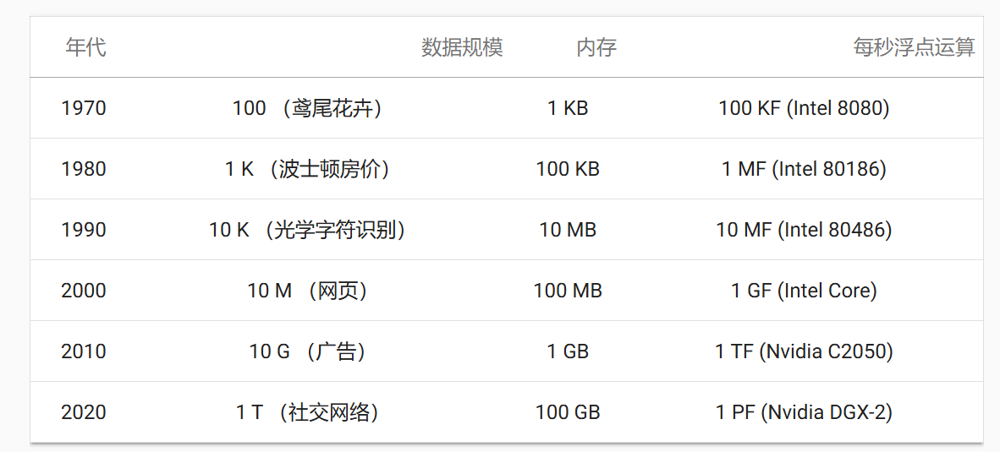
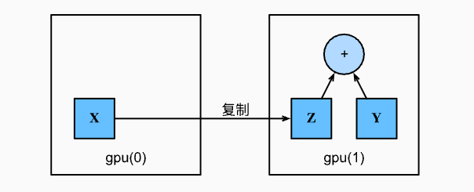

> 该内容为《动手学深度学习》的笔记

# GPU

在下表中，我们回顾了过去20年计算能力的快速增长。简而言之，自2000年以来，GPU性能每十年增长000倍



本节，我们将讨论如何利用这种计算性能进行研究。首先是如何使用单个GPU，然后是如何使用多个GPU和多个服务器 (具有多个GPU)

我们先看看如何使用单个 NVIDIA GPU 进行计算。首先，确保至少安装了一个 NVIDIA GPU 。然后，下载 NVIDIA 驱动和 CUDA 并按照提示设置适当的路径。当这些准备工作完成，就可以使用 `nvidia-smi` 命令来查看显卡信息。

```python
!nvidia-smi  # !nvidia-smi 是jupyter notebook 中将指令 nvidia-smi 交给 shell 执行
```

```ini
Thu Nov 12 16:12:06 2026       
+-----------------------------------------------------------------------------------------+
| NVIDIA-SMI 620.70.03              KMD Version: 621.14        CUDA UMD Version: 13.5     |
+-----------------------------------------+------------------------+----------------------+
| GPU  Name                 Persistence-M | Bus-Id          Disp.A | Volatile Uncorr. ECC |
| Fan  Temp   Perf          Pwr:Usage/Cap |           Memory-Usage | GPU-Util  Compute M. |
|                                         |                        |               MIG M. |
|=========================================+========================+======================|
|   0  NVIDIA GeForce RTX 4050 ...    On  |   00000000:01:00.0  On |                  N/A |
| N/A   43C    P4              7W /  125W |    1985MiB /   6141MiB |     29%      Default |
|                                         |                        |                  N/A |
+-----------------------------------------+------------------------+----------------------+

+-----------------------------------------------------------------------------------------+
| Processes:                                                                              |
|  GPU   GI   CI              PID   Type   Process name                        GPU Memory |
|        ID   ID                                                               Usage      |
|=========================================================================================|
|    0   N/A  N/A              27      G   /Xwayland                             N/A      |
+-----------------------------------------------------------------------------------------+
```

在Pytorch中，每个数组都有一个设备 (device)，我们通常将其称为环境 (context) 。默认情况下，所有变量和相关的计算都分配个CPU。有时环境可能是GPU。当我们跨多个服务器部署作业时，事情会变得更加棘手。通过智能地将数组分配给环境，我们可以最大限度地减少在设备之间传输数据的时间。例如，当在带有GPU的服务器上训练神经网络时，我们通常希望模型的参数在GPU上。

要运行此部分中的程序，至少需要两个GPU。注意，对于大多数桌面结算及来说，这可能是奢侈的，但在云中很容易获得。例如可以使用 AWS EC2 的多GPU实例。本书的其他章节大都不需要多个GPU，而本节只是为了展示数据如何在不同的设备之间传递。

## 计算设备

我们可以指定用于存储和计算你的设备，如CPU和GPU。默认情况下，张量是在内存中创建的，然后使用CPU计算它。

在Pytorch中，CPU和GPU可以用 `torch.device('cpu')` 和 `torch.device('cuda')` 表示。应该注意的是，cpu 设备意味着所有物理 CPU 和 内存，这意味着Pytorch的计算将尝试使用所有CPU核心。然而，gpu设备只代表一个卡和相应的显存。如果有多个GPU，我们使用 `torch.device(f'cuda:{i}')` 来表示第 `i` 块GPU (`i` 从 0 开始)。另外，`cuda:0` 和 `cuda` 是等价的。

```python
import torch
from torch import nn

torch.device('cpu'), torch.device('cuda'), torch.device('cuda:1')
```

```ini
(device(type='cpu'), device(type='cuda'), device(type='cuda', index=1))
```

我们可以查询可用 gpu 的数量

```python
torch.cuda.device_count()
```

```ini
2
```

现在我们定义了两个方便的函数，这两个函数允许我们在不存在所需所有 GPU 的情况下运行代码。

```python
def try_gpu(i=0):  #@save
    """如果存在，则返回gpu(i)，否则返回cpu()"""
    if torch.cuda.device_count() >= i + 1:
        return torch.device(f'cuda:{i}')
    return torch.device('cpu')

def try_all_gpus():  #@save
    """返回所有可用的GPU，如果没有GPU，则返回[cpu(),]"""
    devices = [torch.device(f'cuda:{i}')
             for i in range(torch.cuda.device_count())]
    return devices if devices else [torch.device('cpu')]

try_gpu(), try_gpu(10), try_all_gpus()
```

```ini
(device(type='cuda', index=0),
 device(type='cpu'),
 [device(type='cuda', index=0), device(type='cuda', index=1)])
```

## 张量与GPU

我们可以查询张量所在的设备。默认情况下，张量是在 CPU 上创建的。

```python
x = torch.tensor([1, 2, 3])
x.device
```

```ini
device(type='cpu')
```

需要注意的是，无论何时我们要对多个想进行操作，它们都必须在同一个设备上。例如，如果我们对两个张量求和，我们需要确保两个张量都位于同一个设备上，否则框架将不知道在哪里存储结果，甚至不知道在哪里执行计算。

### 存储在GPU上

有几种方法可以在GPU上存储张量。例如，我们可以在创建张量时指定存储设备。接下来，我们在第一个gpu上创建张量变量 `X`。在GPU上创建的张量只消耗这个GPU的显存。我们可以使用 `nvidia-smi` 命令查看显存使用情况。一般来说，我们需要确保不创建超过GPU显存限制的数据。

```python
X = torch.ones(2, 3, device=try_gpu())
X
```

```ini
tensor([[1., 1., 1.],
        [1., 1., 1.]], device='cuda:0')
```

假设我们至少有两个GPU，下面的代码将在第二个GPU上创建一个随即张量。

```python
Y = torch.rand(2, 3, device=try_gpu(1))
Y
```

```ini
tensor([[0.4860, 0.1285, 0.0440],
        [0.9743, 0.4159, 0.9979]], device='cuda:1')
```

### 复制

如果我们要计算 `X + Y` ，我们需要决定在哪里执行这个操作。例如，下图中，我们可以将 `X` 传输到第二个GPU并在那里执行操作。不要简单地 `X` 加上 `Y`，因为这会导致异常，运行时引擎不知道该怎么做：它在同一设备上找不到数据会导致失败。由于 `Y` 位于第二个 GPU 上，所以我们需要将 `X` 移到那里，然后才能执行相加运算。



```python
Z = X.cuda(1)
print(X)
print(Z)
```

```ini
tensor([[1., 1., 1.],
        [1., 1., 1.]], device='cuda:0')
tensor([[1., 1., 1.],
        [1., 1., 1.]], device='cuda:1')
```

现在数据在同一个GPU上 (Z和Y都在)，我们可以将它们相加。

```python
Y + Z
```

```ini
tensor([[1.4860, 1.1285, 1.0440],
        [1.9743, 1.4159, 1.9979]], device='cuda:1')
```

假设变量 `Z` 已经存在于第二个GPU上。如果我们还是调用 `Z.cuda(1)` 会发生什么？它将返回 `Z` ，而不会复制并分配新内存。

```python
Z.cuda(1) is Z
```

```ini
True
```

### 旁注

人们使用 GPU 来进行机器学习，因为单个GPU相对运行速度快。但是在设备 (CPU、GPU 和 其他机器) 之间传输数据比计算慢得多。这也使得并行化变得更加困难，因为我们必须等待数据被发送 (或这接收)，然后才能继续进行更多地操作。这就是为什么拷贝操作要格外小心。根据经验，多个小操作比一个大操作糟糕得多。此外，一次执行几个操作比代码中散步地许多单个操作要好得多。如果一个设备必须等待另一个设备才能执行其他操作，那么这样的操作可能会阻塞。这有点像排队订购咖啡，而不像通过电话预先订购：当客人到店的时候，咖啡已经准备好了。

最后，当我们打印张量或将张量转换为NumPy格式时，如果数据不在内存中，框架会首先将其复制到内存中，这会导致额外的传输开销。更糟糕的是，它现在受制于全局解释器锁，使得一切都得等待Python完成。

## 神经网络与GPU

类似地，神经网络模型可以指定设备。下面的代码将模型参数放在GPU上。

```python
net = nn.Sequential(nn.Linear(3, 1))
net = net.to(device=try_gpu())
```

在接下来的几章中，我们将看到更多关于如何在GPU上运行模型的例子，因为它们将变得更加计算密集。

当输入为GPU上的张量时，模型将在同一GPU上计算结果。

```python
net(X)
```

```ini
tensor([[-0.4275],
        [-0.4275]], device='cuda:0', grad_fn=<AddmmBackward0>)
```

让我们确认模型参数存储在同一GPU上。

```python
net[0].weight.data.device
```

```ini
device(type='cuda', index=0)
```

总之，只要所有的数据和参数都在同一个设备上，我们就可以有效地学习模型。在下面地章节中，我们将看到几个这样的例子。

## 小结

- 我们可以指定用于存储和计算的设备，例如CPU和GPU。默认情况下，数据在主内存中创建，然后使用CPU进行计算。
- 深度学习框架要求计算的所有输入数据都在同一设备上，无论是CPU还是GPU。
- 不经意地移动数据可能会显著降低性能。一个典型的错误如下：计算GPU上每个小批量的损失，并在命令行中将其报告给用户 (或将其记录在NumPy ndarray 中) 时，将触发全局解释器锁，从而使所有GPU阻塞。最好是为GPU内部的日志分配内存，并且只移动较大的日志。