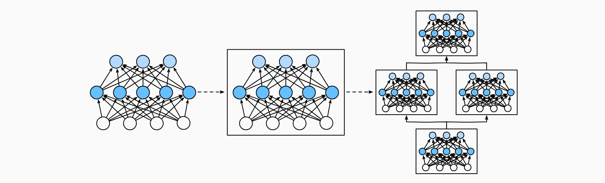

> 该内容为《动手学深度学习》的笔记

# 层和块

之前首次介绍神经网络时，我们关注的是具有单一输出的线性模型。在这里，整个模型中有一个输出。注意，单个神经网络具有一些特征：

1. 接收一些输入
2. 生成相应的标量输出
3. 具有一组相关 **参数 (parameters)** ，更新这些参数可以优化某目标函数。

然后，当考虑具有多个输出的网络时，我们利用矢量化算法来描述整层神经元。像单个神经元一样，层具有：

1. 接受一组输入
2. 生成相应的输出
3. 有一组可调整参数描述。

当我们使用 softmax 回归时，一个单层本身就是模型。然而，即使我们随后引入了多层感知机，我们仍然可以认为该模型保留了上面所说的基本架构。

对于多层感知机而言，整个模型及其组成层都是这种架构。整个模型接受原始输入 (特征)，生成输出 (预测)，并包含一些参数 (所有组成层的参数集合)。同样，每个单独的层接收输入 (有前一层提供)，生成输出 (到下一层的输入)，并且具有一组可调参数，这些参数根据从下一层反向传播的信号进行更新。

事实证明，研究讨论“比单个层大”但“比整个模型小”的组件更有价值。例如，在计算机视觉中广泛流行的 ResNet-152 架构就有数百层，这些层是由 **层组 (groups of layers)** 的重复模式组成。这个 ResNet架构 赢得了2015年 ImageNet 和 COCO 计算机视觉比赛 的识别和检测任务。目前 ResNet架构 仍然是许多视觉任务的首选架构。在其他的领域，如自然语言处理和语音，层组以各种重复模式排列的类似架构现在也是普遍存在。

为了实现这些复杂的网络，我们引入了神经网络 **块** 的概念。**块 (block)** 可以描述单个层、由多个层组成的组件或整个模型本身。使用块进行抽象的一个好处是可以将一些块组合成更大的组件，这一过程通常是递归的，如下图所示。通过定义代码来按需生成任意复杂度的块，我们可以通过简洁的代码实现复杂的神经网络。



从编程的角度来看，块由 **类 (class)** 表示。它的任何子类都必须定义一个将其输入转换为输出的前向传播函数，并且必须存储任何必须的参数。注意，有些块不需要任何参数。最后，为了计算梯度，块必须具有反向传播函数。在定义我们自己的块时，由于自动微分提供了一些后端实现，我们只需考虑前向传播函数和必须的参数。

在构造自定义块之前，我们先回顾以下多层感知机的代码。下面的代码生成一个网络，其中包含一个具有 256 个单元和 ReLU激活函数 的全连接隐藏层，然后是一个具有 10 个隐藏单元且不带激活函数的全连接输出层。

```python
import torch
from torch import nn
from torch.nn import functional as F

net = nn.Sequential(
    nn.Linear(20, 256),
    nn.ReLU(),
    nn.Linear(256, 10)
)

X = torch.rand(2, 20)

print(net(X))
```

```ini
tensor([[-0.1222,  0.1169,  0.1307, -0.0742,  0.0390,  0.1381,  0.2358,  0.1726,
          0.0371,  0.0239],
        [-0.2341,  0.0603,  0.0965,  0.0447,  0.0408,  0.0829,  0.3314,  0.1916,
         -0.0146, -0.0929]], grad_fn=<AddmmBackward0>)
```

在这个例子中，我们通过实例化 `nn.Sequential` 来构建我们的模型，层的执行顺序是作为参数传递的。简而言之，`nn.Sequential` 定义了一种特殊的 `Module` ，即在 PyTorch 中表示一个块的类，它维护了一个由 `Module` 组成的有序列表。注意，两个全连接层都是 `Linear` 类的实例，`Linear` 类本身就是 `Module` 的子类。另外，到目前为止，我们一直在通过 `net(X)` 调用我们的模型来获得模型的输出。这实际上是 `net.__call__(X)` 的简写。这个前向传播函数非常简单：他将列表中的每个块连接在一起，将每个块的输出作为下一块的输入。

## 自定义块

要想直观地了解块是如何工作的，最简单的方法就是自己实现一个。在实现我们自定义块之前，我们简要总结一下每个块必须提供的基本功能。

1. 将输入数据作为其前向传播函数的参数
2. 通过前向传播函数来生成输出。请注意，输出的形状可能与输入的形状不同。例如，我们上面模型中的第一个全连接的层接收一个 20 维的输入，但是返回一个维度维 256 的输出
3. 计算其输出关于输入的梯度，可通过其反向传播函数进行访问。通常这是自动发生的
4. 存储和访问前向传播计算所需的参数
5. 根据需要初始化模型参数

在下面的代码片段中，我们从零开始编写一个块。它包含一个多层感知机，其具有 256 个隐藏单元的隐藏层和一个 10 维输出层。注意，下面的 MLP类 继承了表示块的类。我们的实现只需要提供我们自己的构造函数 (Python 中的 `__init__` 函数) 和前向传播函数。

```python
class MLP(nn.Module):
    # 用模型参数声明层。这里，我们声明两个全连接的层
    def __init__(self):
        # 调用 MLP 的父类 Module 的构造函数来执行必要的初始化
        # 这样，在类实例化时也可以指定其他函数参数。例如模型参数 params (稍后介绍)
        super.__init__()
        self.hidden = nn.Linear(20, 256)
        self.out = nn.Linear(256, 10)

    # 定义模型的前向传播，即如何根据输入 X 返回所需的模型输出
    def forward(self, X):
        # 注意，这里我们使用 ReLU 的函数版本，其在 nn.functional 模块中定义
        return self.out(F.relu(self.hidden(X)))
```

我们首先看一下前向传播函数，它以 `X` 作为输入，计算带有激活函数的隐藏表示，并输出其未规范化的输出值。在这个 `MLP` 实现中，两个层都是实例变量。要了解这为什么是合理的，可以想象实例化两个多层感知机 (`net1` 和 `net2`)，并根据不同的数据对它们进行训练。当然，我们希望它们学到两种不同的模型。

接着我们实例化多层感知机的层，然后在每次调用前向传播函数时调用这些层。注意一些关键细节：首先，我们定制的 `__init__` 函数通过 `super().__init__()` 调用父类的 `__init__` 函数，省去了重复编写模版代码的痛苦。然后，我们实例化两个全连接层，分别为 `self.hidden` 和 `self.out` 。注意，除非我们实现一个新的运算符，否则我们不必担心反向传播函数或参数初始化，系统将自动生成这些。

我们来试一下这个函数：

```python
class MLP(nn.Module):
    # 用模型参数声明层。这里，我们声明两个全连接的层
    def __init__(self):
        # 调用 MLP 的父类 Module 的构造函数来执行必要的初始化
        # 这样，在类实例化时也可以指定其他函数参数。例如模型参数 params (稍后介绍)
        super().__init__()
        self.hidden = nn.Linear(20, 256)
        self.out = nn.Linear(256, 10)

    # 定义模型的前向传播，即如何根据输入 X 返回所需的模型输出
    def forward(self, X):
        # 注意，这里我们使用 ReLU 的函数版本，其在 nn.functional 模块中定义
        return self.out(F.relu(self.hidden(X)))

net = MLP()
print(net(X))
```

```ini
tensor([[-0.1369, -0.1075, -0.0735, -0.2520, -0.0343,  0.0792, -0.0801,  0.4368,
         -0.0179,  0.0763],
        [-0.1344, -0.0735, -0.0927, -0.1406, -0.0102,  0.2396,  0.0090,  0.3050,
         -0.0217,  0.0248]], grad_fn=<AddmmBackward0>)
```

块的一个主要优点是他的多功能性。我们可以子类化块以创建层 (如全连接层的类)、整个模型 (如上面的 MLP 类) 或具有中等复杂度的各种组件。我们在接下来的章节中充分利用了这种多功能性，比如在处理卷积神经网络。

## 顺序块

现在我们可以更仔细地看看 `Sequential` 类是如何工作的，回想一下 `Sequential` 的设计是为了把其他模块串起来。为了构建我们自己的简化的 `MySequential`，我们只需要定义两个关键函数：

1. 一种将块逐个追加到列表中的函数
2. 一种前向传播函数，用于将输入按追加块的顺序传递给块组合成的“链条”

下面的 `MySequential` 类提供了与默认 `Sequential` 类相同的功能。

```python
class MySequential(nn.Module):
    def __init__(self, *args):
        super().__init__()
        for idx, module in enumerate(args):
            # 这里，module 是 Module 子类的一个实例。我们把它保存在 'Module' 类的成员
            # 变量 _modules 中，_module 的类型是 OrderedDict
            self._modules[str(idx)] = module

    def forward(self, X):
        # OrderedDict 保证了安装成员添加的顺序遍历它们
        for block in self._modules.values():
            X = block(X)

        return X
```

`__init__` 函数将每个模块逐个添加到有序字典 `_modules` 中。读者可能会好奇为什么每个 `Module` 都有一个 `_modules` 属性？以及为什么我们使用它而不是自己定义一个Python列表？简而言之，`_modules` 的主要优点是：在模块的参数初始化过程中，系统知道在 `_modules` 字典中查找需要初始化参数的子块。

当 `MySequential` 的前向传播函数被调用时，每个添加的块都按照它们被添加的顺序执行。现在可以使用我们的 `MySequential` 类重新实现多层感知机。

```python
class MySequential(nn.Module):
    def __init__(self, *args):
        super().__init__()
        for idx, module in enumerate(args):
            # 这里，module 是 Module 子类的一个实例。我们把它保存在 'Module' 类的成员
            # 变量 _modules 中，_module 的类型是 OrderedDict
            self._modules[str(idx)] = module

    def forward(self, X):
        # OrderedDict 保证了安装成员添加的顺序遍历它们
        for block in self._modules.values():
            X = block(X)

        return X

net = MySequential(nn.Linear(20, 256), nn.ReLU(), nn.Linear(256, 10))

print(net(X))
```

```ini
tensor([[ 0.0874, -0.0098,  0.2763,  0.0845, -0.1802, -0.0309,  0.0287,  0.1398,
          0.0664, -0.1449],
        [ 0.1130,  0.0577,  0.3976,  0.1118, -0.2624, -0.0117,  0.1043,  0.3478,
          0.0578, -0.2053]], grad_fn=<AddmmBackward0>)
```

请注意，`MySequential` 的用法与之前为 `Sequential` 类编写的代码相同。

## 在前向传播函数中执行代码

`Sequential` 类使模型构造变得简单，允许我们组合新的架构，而不必定义自己的类。然而，并不是所有的架构都是简单的顺序架构。当需要更强的灵活性时，我们需要定义自己的块。例如，我们可能希望在前向传播函数中执行 Python 的控制流。此外，我们可能希望执行任意的数学运算，而不是简单地依赖预定义的神经网络层。

到目前为止，我们网络中的所有操作都对网络的激活值及网络的参数起作用。然而，有时我们可能希望合并既不是上一层的结果也不是可更新参数的项，我们称之为 **常数参数(constant parameter)**。例如，我们需要一个计算函数 $f(\mathbf{x},\mathbf{w}) = c \cdot \mathbf{w}^\top \mathbf{x}$ 的层，其中 $\mathbf{x}$ 是输入，$\mathbf{w}$ 是参数，$c$ 是某个在优化过程中没有更新的指定常量。因此我们实现了一个 `FixedHiddenMLP` 类，如下所示：

```python
class FixedHiddenMLP(nn.Module):
    def __init__(self):
        super().__init__()
        # 不计算梯度的随机权重参数。因此其在训练期间保持不变
        self.rand_weight = torch.rand((20, 20), requires_grad=False)
        self.linear = nn.Linear(20, 20)

    def forward(self, X):
        X = self.linear(X)
        # 使用创建的常量参数以及 relu 和 mm 函数
        X = F.relu(torch.mm(X, self.rand_weight) + 1)
        # 复用全连接层。这相当于两个全连接层共享参数
        X = self.linear(X)
        # 控制流
        while X.abs().sum() > 1:
            X /= 2
        return X.sum()
```

在这个 `FixedHiddenMLP` 模型中，我们实现了一个隐藏层，其权重 (`self.rand_weight`) 在实例化时被随机初始化，之后为常量。这个权重不是一个模型参数，因此它永远不会被反向传播更新。然后，神经网络将这个固定层的输出通过一个全连接层。

注意，在返回输出之前，模型做了一些不寻常的事情：它运行了一个 `while` 循环，在 $L_1$ 范数大于 $1$ 的条件下，将输出向量除以 $2$ ，直到它满足条件为止。最后，模型返回了 $X$ 中所有项的和。注意，此操作可能不会常用于在任何实际任务中，我们只展示如何将任意代码继承到神经网络计算的流程中。

```python
net = FixedHiddenMLP()
print(net(X))
```

```ini
tensor(0.2704, grad_fn=<SumBackward0>)
```

我们可以混合搭配各种组合块的方法。在下面的例子中，我们以一些想到的方法嵌套块。

```python
class NestMLP(nn.Module):
    def __init__(self):
        super().__init__()
        self.net = nn.Sequential(
            nn.Linear(20, 64), nn.ReLU(),
            nn.Linear(64, 32), nn.ReLU(),
        )

        self.linear = nn.Linear(32, 16)

    def forward(self, X):
        return self.linear(self.net(X))

chimera = nn.Sequential(
    NestMLP(),
    nn.Linear(16, 20),
    FixedHiddenMLP()
)
print(chimera(X))
```

```ini
tensor(0.1748, grad_fn=<SumBackward0>)
```

## 效率

读者可能会开始担心操作效率的问题。毕竟，我们在一个高性能的深度学习库中进行了大量的字典查找、代码执行和许多其他的 Python 代码。Python 的问题 **全局解释器锁** 是众所周知的。在深度学习环境中，我们担心速度极快的 GPU 可能要等到 CPU 运行 Python 代码后才能与性能另一个作业。

## 小结

- 一个块可以由许多层组成；一个块可以由许多块组成
- 块可以包含代码
- 块负责大量的内部处理，包括参数初始化和反向传播
- 层和块的顺序连接由 `Sequential` 块处理


## 我的代码

```python
import torch
from torch import nn
from torch.nn import functional as F

X = torch.rand(2, 20)

# net = nn.Sequential(
#     nn.Linear(20, 256),
#     nn.ReLU(),
#     nn.Linear(256, 10)
# )
#
#
# print(net(X))

class MLP(nn.Module):
    # 用模型参数声明层。这里，我们声明两个全连接的层
    def __init__(self):
        # 调用 MLP 的父类 Module 的构造函数来执行必要的初始化
        # 这样，在类实例化时也可以指定其他函数参数。例如模型参数 params (稍后介绍)
        super().__init__()
        self.hidden = nn.Linear(20, 256)
        self.out = nn.Linear(256, 10)

    # 定义模型的前向传播，即如何根据输入 X 返回所需的模型输出
    def forward(self, X):
        # 注意，这里我们使用 ReLU 的函数版本，其在 nn.functional 模块中定义
        return self.out(F.relu(self.hidden(X)))

# net = MLP()
# print(net(X))

class MySequential(nn.Module):
    def __init__(self, *args):
        super().__init__()
        for idx, module in enumerate(args):
            # 这里，module 是 Module 子类的一个实例。我们把它保存在 'Module' 类的成员
            # 变量 _modules 中，_module 的类型是 OrderedDict
            self._modules[str(idx)] = module

    def forward(self, X):
        # OrderedDict 保证了安装成员添加的顺序遍历它们
        for block in self._modules.values():
            X = block(X)

        return X

# net = MySequential(nn.Linear(20, 256), nn.ReLU(), nn.Linear(256, 10))

# print(net(X))

class FixedHiddenMLP(nn.Module):
    def __init__(self):
        super().__init__()
        # 不计算梯度的随机权重参数。因此其在训练期间保持不变
        self.rand_weight = torch.rand((20, 20), requires_grad=False)
        self.linear = nn.Linear(20, 20)

    def forward(self, X):
        X = self.linear(X)
        # 使用创建的常量参数以及 relu 和 mm 函数
        X = F.relu(torch.mm(X, self.rand_weight) + 1)
        # 复用全连接层。这相当于两个全连接层共享参数
        X = self.linear(X)
        # 控制流
        while X.abs().sum() > 1:
            X /= 2
        return X.sum()

# net = FixedHiddenMLP()
# print(net(X))

class NestMLP(nn.Module):
    def __init__(self):
        super().__init__()
        self.net = nn.Sequential(
            nn.Linear(20, 64), nn.ReLU(),
            nn.Linear(64, 32), nn.ReLU(),
        )

        self.linear = nn.Linear(32, 16)

    def forward(self, X):
        return self.linear(self.net(X))

chimera = nn.Sequential(
    NestMLP(),
    nn.Linear(16, 20),
    FixedHiddenMLP()
)
print(chimera(X))
```