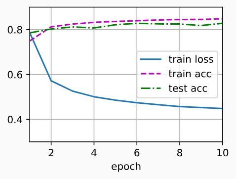

> 该内容为《动手学深度学习》的笔记

# softmax回归的简洁实现

我们发现通过深度学习框架的高级 API 能够使实现线性回归变得更加容易。同样，通过深度学习框架的高级 API 也能更方便地实现 softmax 回归模型。本节将继续使用 Fashion-MNIST 数据集，并保持批量大小为 256。

```python
import torch
from torch import nn
from d2l import torch as d2l

batch_size = 256
train_iter, test_iter = d2l.load_data_fashion_mnist(batch_size)
```

## 初始化模型参数

softmax回归地输出层是一个全连接层。因此，为了实现我们的模型，我们只需在 `Sequential` 中添加一个带有 10 个输出的全连接层。同样，在这里 `Sequential` 并不是必要的，但它是实现深度模型的基础。我们仍然以均值 0 和标准差 0.01 随机初始化权重。

```python
# 网络定义
# PyTorch 不会隐式地调整输入的形状。因此，
# 我们在线性层钱定义了展平层(flatten)，来调整网络输入的形状
net = nn.Sequential(
    nn.Flatten(), # 展平层，把多为输入压成一维，只保留 batch 维度不动（batch_size, 784）
    nn.Linear(784, 10) # 全连接层,输入784个特征，输出10个类别
)

# 权重初始化函数
def init_weights(m):
    if type(m) == nn.Linear: # 只对全连接层做初始化，Flatten 层跳过（无参数）
        nn.init.normal_(m.weight, std=0.01) # 权重从均值0，标准差0.01正态分布采样，偏置默认初始化为0

# 对网络里每一层应用初始化函数
net.apply(init_weights) # net.apply(func)：遍历网络所有层，每层实例 m 传给 func
```

## 重新审视softmax的实现

我们计算了模型的输出，然后将此输出送入交叉熵损失。从数学上讲，这是一件完全合理的事情。然而，从计算角度来看，指数可能会造成数值稳定性问题。

回想一下，softmax 函数 $\hat{y_j} = \frac{\exp (o_j)}{\sum_k \exp(o_k)}$ ，其中 $\hat{y_j}$ 是预测的概率分布。$o_j$ 是未规范化的预测 $\mathbf{o}$ 的第 $j$ 个元素。如果 $o_k$ 中的一些数值非常大，那么 $\exp(o_k)$ 可能大于数据类型容许的最大数字，即 **上溢(overflow)** 。这将使分母或分子变为 **inf(无穷大)** ，最后得到的是 0、inf 或 nan (不是数字) 的 $\hat{y_j}$ 。在这些情况下，我们无法得到一个明确定义的交叉熵值。

解决这个问题的一个技巧是：在继续 softmax 计算之前，先从所有 $o_k$ 中减去 $\max(o_k)$ 。这里可以看到每个 $o_k$ 按常数进行的的移动不会改变 softmax 的返回值：

$$
\begin{align*}
    \displaystyle \hat{y_j} 
    &= \frac{\exp(o_j - \max(o_k)) \exp(\max(o_k))}{\sum_k \exp(o_k - \max(o_k))\exp(\max(o_k))} \\
    &= \frac{\exp(o_j - \max(o_k))}{\sum_k \exp(o_k - \max(o_k))}
\end{align*}
$$

在减法和规范化步骤之后，可能有些 $o_j - \max(o_k)$ 具有较大的负值。由于精度受限，$\exp(o_j - \max(o_k))$ 将有接近零的值，即 **下溢(underflow)** 。这些值可能会四舍五入为零，使 $\hat{y_j}$ 为零，并且使得 $\log(\hat{y_j})$ 的值为 $- \inf$ 。反向传播几步后，我们可能会发现自己面对一屏幕可怕的 nan 结果。

尽管我们要计算指数函数，但我们最终在计算交叉熵损失时会取他们的对数。通过将 softmax 和交叉熵结合在一起，可以避免反向传播过程中可能会困扰我们的数值稳定性问题。如下面的等式所示，我们避免计算 $\exp(o_j - \max(o_k))$ ，而可以直接使用 $o_j - \max(o_k)$ ，因为 $\log (\exp(·))$ 被抵消了。

$$
\begin{align*}
    \displaystyle \log(\hat{y_j}) 
    &= \log(\frac{\exp(o_j - \max(o_k))}{\sum_k \exp(o_k - \max(o_k))}) \\
    &= \log(\exp(o_j - \max(o_k))) - \log(\sum_k \exp(o_k - \max(o_k))) \\
    &= o_j - \max(o_k) - \log(\sum_k \exp(o_k - \max(o_k)))
\end{align*}
$$

我们也希望保留传统 softmax 函数，以备我们需要评估通过模型输出的概率。但是，我们没有将 softmax 概率传递到损失函数中，而是在交叉熵损失函数中传递未规范化的预测，并同时计算 softmax 及其对数，这是一种类似 "LogSumExp技巧" 的聪明方式。

```python
loss = nn.CrossEntropyLoss(reduction='none')
```

> `reduction` 控制损失怎么聚合：
> - `reduction='none'`：**不做任何求和/平均**，返回每个样本单独的loss，形状和标签 y 一样
> - `reduction='mean'`（默认）：所有样本 loss 求均值
> - `reduction='sum'`：所有样本的loss全部加和

## 优化算法

在这里，我们使用学习率为 0.1 的小批量随机梯度下降作为优化算法。这与我们在线性回归例子中的相同，这说明了优化器的普适性。

```python
trainer = torch.optim.SGD(net.parameters(), lr=0.1)
```

## 训练

接下来我们调用从零开始softmax回归中定义的训练函数来训练模型

```python
num_epochs = 10
d2l.train_ch3(net, train_iter, test_iter, loss, num_epochs, trainer)
```



和以前一样，这个算法使结果收敛到一个相当高的精度，而且这次的代码比之前更精简了。

## 小结

- 使用深度学习框架的高级 API ，我们可以更简洁地实现 softmax 回归
- 从计算的角度来看，实现 softmax 回归比较复杂。在许多情况下，深度学习框架在这些著名的技巧之外采取了额外的预防措施，来确保数值的稳定性。这使我们避免了在实践中从零开始编写模型时可能遇到的陷阱。

