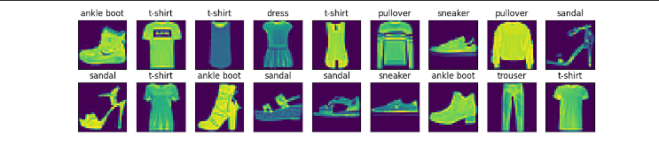

> 该内容为《动手学深度学习》的笔记

# 图像分类数据集

MNIST数据集是图像分类中广泛使用的数据集之一，但作为基准数据集过于简单。我们将使用类似但更复杂的 **Fashion-MNIST** 数据集。

```python
import torch
import torchvision
from torch.utils import data
from torchvision import transforms
from d2l import torch as d2l
```

# 读取数据集

我们可以通过框架中的内置函数将 **Fashion-MNIST** 数据集下载并读取到内存中。

```python
# ToTensor()：PIL图像 / numpy数组 -> PyTorch张量
# 1. 把 uint8（0~255）转为 32 位浮点数(torch.float32)
# 2. 自动除以255,像素值缩放到[0,1]
# 3. 维度转换：(H, W, C) -> (C, H, W) C:通道数，H：高，W：宽
trans = transforms.ToTensor()
mnist_train = torchvision.datasets.FashionMNIST(
    root="../data", # 存放路径
    train=True,
    transform=trans, # 对每张图片自动执行 ToTensor 变换
    download=True
)
mnist_test = torchvision.datasets.FashionMNIST(
    root="../data",
    train=False,
    transform=trans,
    download=True
)
```

Fashion-MNIST 有 10 个类别的图像组成，每个类别由 **训练数据集(train dataset)** 中的 6000 张图像和 **测试数据集(test dataset)** 中的 1000 张图像组成。因此，训练集和测试集分别包含 60000 和 10000 张图像。测试数据集不会用于训练，只用于评估模型性能。

```python
print(len(mnist_train), len(mnist_test))
```

```ini
60000 10000
```

每个输入图像的高度和宽度均为28 像素。数据集由灰度图像组成，其通道数为 1。为了简洁起见，本书将高度 $h$ 像素、宽度 $w$ 像素图像的形状记为 $h \times w$ 或 $(h, w)$。

```python
print(mnist_train[0][0].shape)
```

```ini
torch.Size([1, 28, 28])
```

Fashion-MNIST 中包含的 10 个类别，分别为 t-shirt(T恤)、trouser(裤子)、pullover(套衫)、dress(连衣裙)、coat(外套)、sandal(凉鞋)、shirt(衬衫)、sneaker(运动鞋)、bag(包) 和 ankle boot(短靴)。以下函数用于在数字标签索引及其文本名称之间进行转换。

```python
# labels是张量或数字列表
def get_fashion_mnist_labels(labels):
    """ 返回 Fashion-MNIST 数据集的文本标签 """
    text_labels = [
        't-shirt', 'trouser', 'pullover', 'dress',
        'coat', 'sandal', 'shirt', 'sneaker',
        'bag', 'ankle boot'
    ]
    return [text_labels[int(i)] for i in labels]
```

我们现在可以创建一个函数来可视化这些样本。

```python
# imgs:图片列表（PIL图像或torch张量图片），num_rows:子图行数，num_cols:子图列数，titles:每个子图标题列表，scale:控制整张图放大倍数
def show_images(imgs, num_rows, num_cols, titles=None, scale=1.5):
    """ 绘制图像列表 """
    # 设置画布大小：宽度 = 列数 * scale, 高度 = 行数 * scale
    figsize = (num_cols * scale, num_rows * scale)
    # 创建 num_rows * num_cols 的子图画布，_ 接收fig对像（这里不用，占位符），axes 子图二维数组
    _, axes = d2l.plt.subplots(num_rows, num_cols, figsize=figsize)
    # 把二维axes数组摊平成一维，方便循环遍历
    axes = axes.flatten()
    # 把子图和图片zip配对打包，循环
    for i, (ax, img) in enumerate(zip(axes, imgs)):
        # 如果是PyTorch张量，转numpy再绘图
        if torch.is_tensor(img):
            # 图片张量
            ax.imshow(img.numpy())
        # PIL图片直接imshow
        else:
            # PIL 图片
            ax.imshow(img)
        # 隐藏 x、y 坐标轴刻度（图片不需要坐标）
        ax.axes.get_xaxis().set_visible(False)
        ax.axes.get_yaxis().set_visible(False)
        # 如果传入标题列表，给每个子图加上标题
        if titles:
            ax.set_title(titles[i])
    # 返回子图对象，后续可以继续修改图片
    return axes
```

以下是训练数据集中前几个样本的图像及其相应的标签。

```python
# 包装数据集，每个批次取出18张图片
X, y = next(iter(data.DataLoader(mnist_train, batch_size=18)))
# X.reshape(18, 28, 28)：去除通道维，原来的 (18, 1, 28, 28) 变为 (18, 28, 28),因为show_images绘图时灰度图不需要单独的channel维度。
# 2 行 9 列
# get_fashion_mnist_labels(y)：把数字标签转为英文类别名，作为每张图标题
show_images(X.reshape(18, 28, 28), 2, 9, titles=get_fashion_mnist_labels(y))
# 弹出画布，展示图片
d2l.plt.show()
```



## 读取小批量

为了使我们在读取训练集和测试集时更容易，我们使用内置的数据迭代器，而不是从零开始创建。回顾一下，在每次迭代中，数据加载器每次都会读取一小批量数据，大小为 `batch_size` 。通过内置数据迭代器，我们可以随机打乱了所有样本，从而无偏见地读取小批量。

```python
batch_size = 256

def get_dataloader_workers():
    """ 使用 4 个进程来读取数据 """
    # Linux系统可以多进程并行，Windows多进程并行容易报错
    if platform.system() == 'Linux':
        return 4
    else:
        return 0

train_iter = data.DataLoader(
    mnist_train,
    batch_size,
    shuffle=True,
    # 子进程数量，用来并行加载数据
    num_workers=get_dataloader_workers()
)
```

> `num_workers=get_dataloader_workers()`：子进程数量，用来并行加载数据（读磁盘图片，和模型 GPU 计算并行，加快读取速度）
> - d2l 里这个函数逻辑：取 CPU 核心数，Windows下默认返回 0（Windows 多进程容易报错）
> - `num_workers=0`：只用主进程加载数据

我们看一下读取训练数据所需的时间。

```python
timer = d2l.Timer()
for X, y in train_iter:
    continue
print(f'{timer.stop():.2f} sec')
```

```ini
3.51 sec
```

## 整合所有组件

现在我们定义 `load_data_fashion_mnist` 函数，用于获取和读取Fasion-MNIST 数据集。这个函数返回训练集和验证集的数据迭代器。此外，这个函数还接受一个可选参数 `resize` ，用来将图像大小调整为另一种形状。

```python
def load_data_fashion_mnist(batch_size, resize=None):
    """ 下载 Fashion-MNIST 数据集，然后将其加载到内存中 """
    # 初始化变换列表：把PIL图片转为张量，像素值[0, 1]
    trans = [transforms.ToTensor()]
    # 如果传入 resize ，先缩放图片，再转Tensor
    if resize:
        trans.insert(0, transforms.Resize(resize)) # 不需要管，pycharm的静态检查问题
    # Compose()把变换列表里所有预处理操作打包成 **** 单个可执行的变换函数
    trans = transforms.Compose(trans)
    mnist_train = torchvision.datasets.FashionMNIST(
        root='../data',
        train=True,
        transform=trans, # 变换操作
        download=True
    )
    mnist_test = torchvision.datasets.FashionMNIST(
        root='../data',
        train=False,
        transform=trans,
        download=True
    )
    return (
        data.DataLoader(
            mnist_train,
            batch_size,
            shuffle=True,
            num_workers=get_dataloader_workers()
        ),
        data.DataLoader(
            mnist_test,
            batch_size,
            shuffle=False,
            num_workers=get_dataloader_workers()
        )
    )
```

下面，我们通过指定 `resize` 参数来测试 `load_data_fashion_mnist` 函数的图像大小调整功能。

```python
# 一个批次 32 张图片，图片缩放成 64 * 64
train_iter, test_iter = load_data_fashion_mnist(32, resize=64)
for X, y in train_iter:
    print(X.shape, X.dtype, y.shape, y.dtype)
    break
```

```ini
torch.Size([32, 1, 64, 64]) torch.float32 torch.Size([32]) torch.int64
```

我们现在已经准备好使用 Fashion-MNIST 数据集，便于下面的章节调用来评估各种分类算法。

## 小结

- Fashion-MNIST 是一个服装分类数据集，由 10 个类别的图像组成。我们将在后续章节中使用此数据集来评估各种分类算法。
- 我们将高度 $h$ 像素，宽度 $w$ 像素图像的形状记为 $h \times w$ 或 $(h, w)$
- $(N, C, H, W)$ ：（数量，通道，高度，宽度），其中灰度图通道为 1，RGB图 通道为 3。
- 数据迭代器是获得更高性能的关键组件。依靠实现良好的数据迭代器，利用高性能计算来避免减慢训练过程。