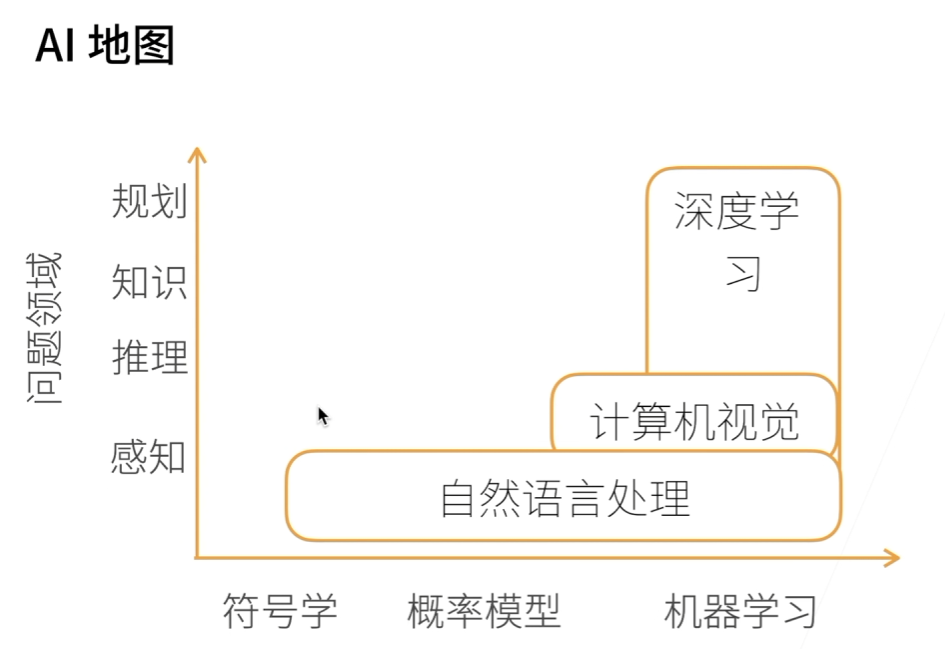
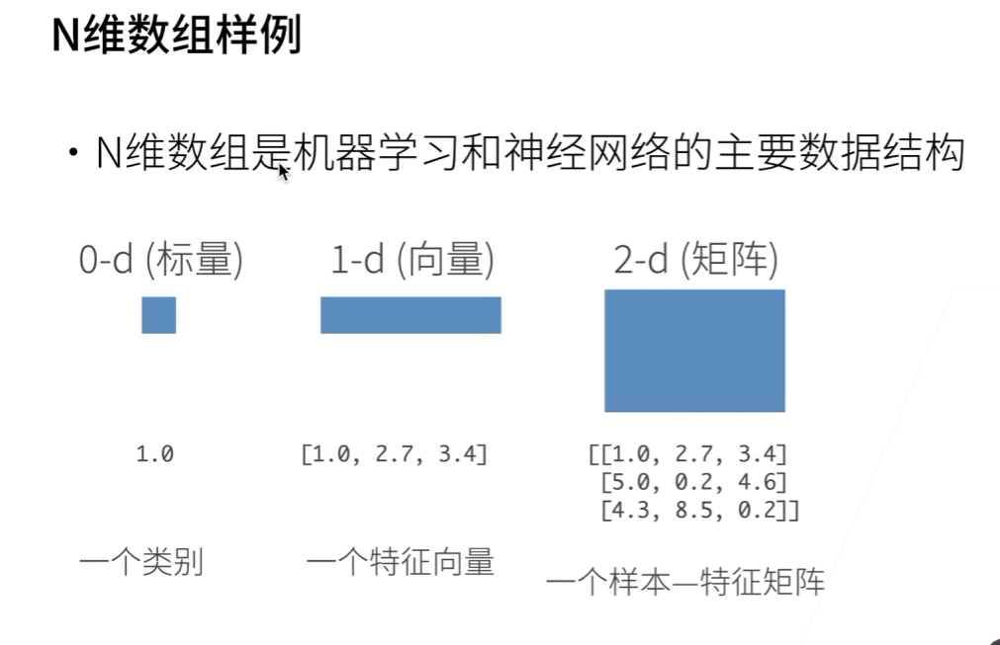
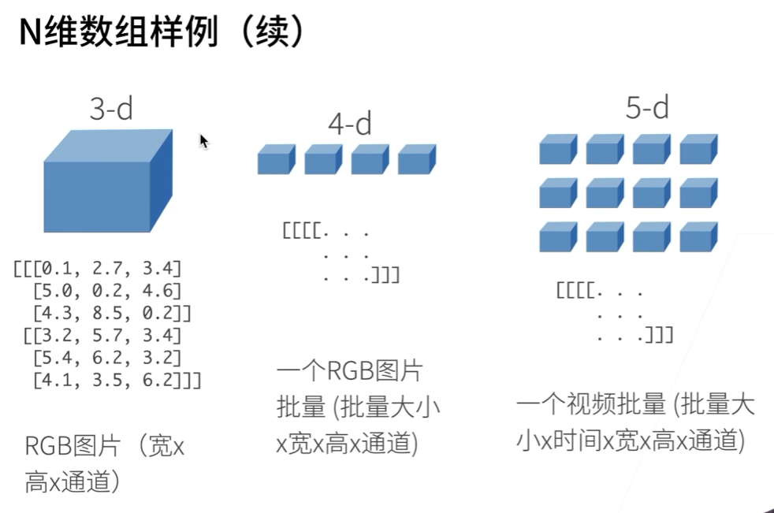
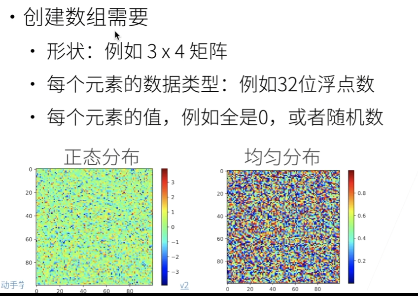
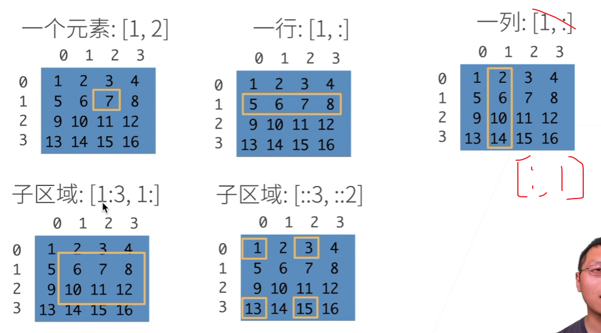

> 该内容是根据《动手学深度学习》的视频课随笔

# 深度学习介绍



感知：人能在几秒内处理的都属于感知

在计算机视觉方面，深度学习大致有如下几个方向：

- 图片分类
- 物体检测和分割
- 样式迁移
- 人脸合成
- 文字生成图片
- 文字生成
- 无人驾驶

# 数据操作





**创建数组**

创建数组需要：
- 形状：例如 $3 \times 4$ 矩阵
- 每个元素的数据类型：例如 32 位浮点数
- 每个元素的值，例如全是 0，或者随机数



**访问元素**



## 数据操作实现

张量表示一个数值组成的数组，这个数组可能有多个维度

`torch.arange(12)` 生成0 ~ 11的序列张量
`x.shape` 查看张量x的形状
`x.numel` 查看张量x的总数
`x.reshape(3,4)` 将张量x的形状变为 [3, 4]
`x.zeros((2, 3, 4))` 生成形状[2, 3, 4]全零的张量
`x.ones((2, 3, 4))` 生成形状[2, 3, 4]全1的张量
`torch.tensor(list))`  将列表list变为张量

按元素运算
`x + y`
`x - y`
`x * y`
`x / y`
`x ** y`
`torch.exp(x)`

连结张量
`torch.cat((X,Y), dim=0)` 将X，Y按dim维合并起来，dim维形状必须一致

按元素判断相等
`X == Y`

求和
`X.sum()`

广播机制
```python
a = torch.arange(3).reshape((3,1))
b = torch.arange(2).reshape((1,2))

print(a)
print(b)
print(a + b)
```

```ini
tensor([[0],
        [1],
        [2]])
tensor([[0, 1]])W
tensor([[0, 1],
        [1, 2],
        [2, 3]])
```

**数据访问**
`X[1]`
`X[1:3]`

**写值**
`X[1,2] = 9`
`X[0:2, :] = 12`

**一些操作可能导致为新结果分配新内存**
```python
before = id(Y)
Y = Y + X
id(Y) = before
```

```ini
False
```

**原地操作**
```python
Z = torch.zeros_like(Y)
print('id(Z):', id(Z))
Z[:] = X + Y
print('id(Z):', id(Z))
```

```ini
id(Z): 140146615319872
id(Z): 140146615319872
```

> PS： `Y += X` 是原地运算

**转换为NumPy张量**
```python
A = X.numpy() # numpy.ndarray
B = torch.tensor(A) # torch.Tensor
```

```python
a = torch.tensor([3.5])
a.item() # 将只含单个标量的张量a的数值拿出来转换成numpy
```

