# 连接远程服务器

## 购买云上服务器

可以买AutoDL、阿里云等等的云服务器

购买后可以在控制台看到这样的实例，里面有ssh 登陆指令和密码


## 安装FileZilla

### 打开网址 https://filezilla-project.org/ 下载 filezilla 安装包


### 运行安装包


安装完毕

## 使用 ssh 连接远程服务器


### 使用 Windows ssh协议连接

**在cmd中运行**

```bash
ssh root@1.2.3.4              # 默认 22 端口
ssh -p 2222 root@1.2.3.4      # 云服务器常改端口
```

> Windows 默认是没有 ssh 协议的，需要在系统设置的可选功能中，安装ssh
> 
> 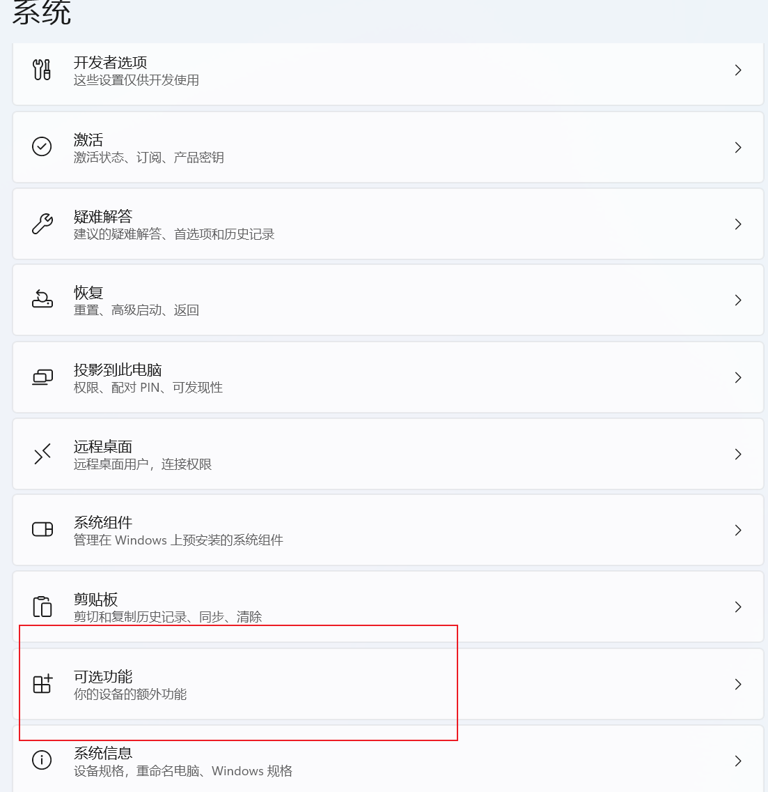
>
> 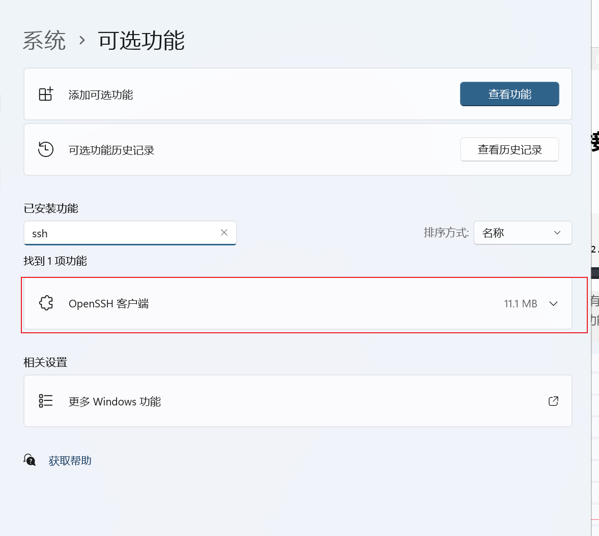

#### 看GPU占用

```bash
nvidia-smi                            # 看 GPU 占用
watch -n 2 nvidia-smi                 # 每 2 秒刷新
```

#### 访问服务器上的 Jupyter

服务器上没开公网端口时，用 **端口转发**，把服务器的 8888 映射到你本地的 8888：

```bash
ssh -L 8888:127.0.0.1:8888 -p 2222 root@1.2.3.4
# 保持这个窗口别关，然后本地浏览器打开：
# http://127.0.0.1:8888
```

```bash
# 服务器上启动 Jupyter（关键是绑到 127.0.0.1）
jupyter notebook --ip=127.0.0.1 --port=8888 --no-browser
```

### 使用最省事的方式：VS Code Remote (推荐)

1. 装 Remote - SSH 插件(推荐 Remote Development,包含有Remote - SSH)

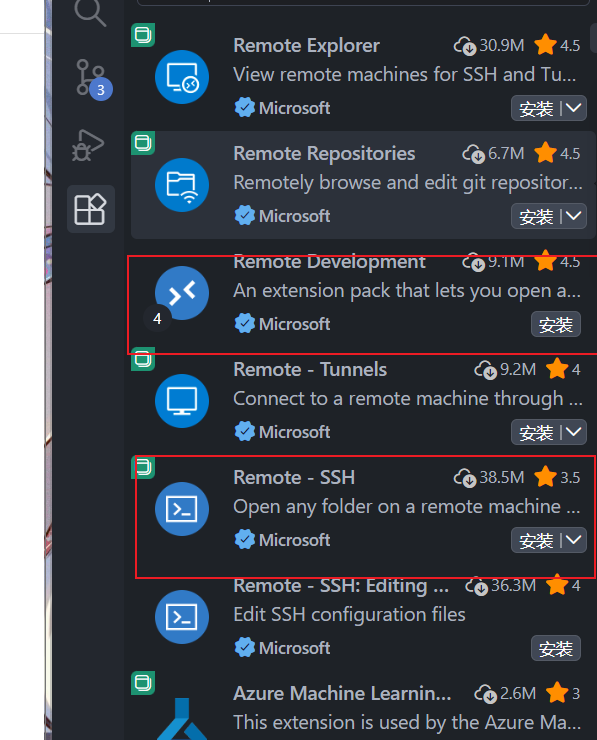

2. 配置SSH设置

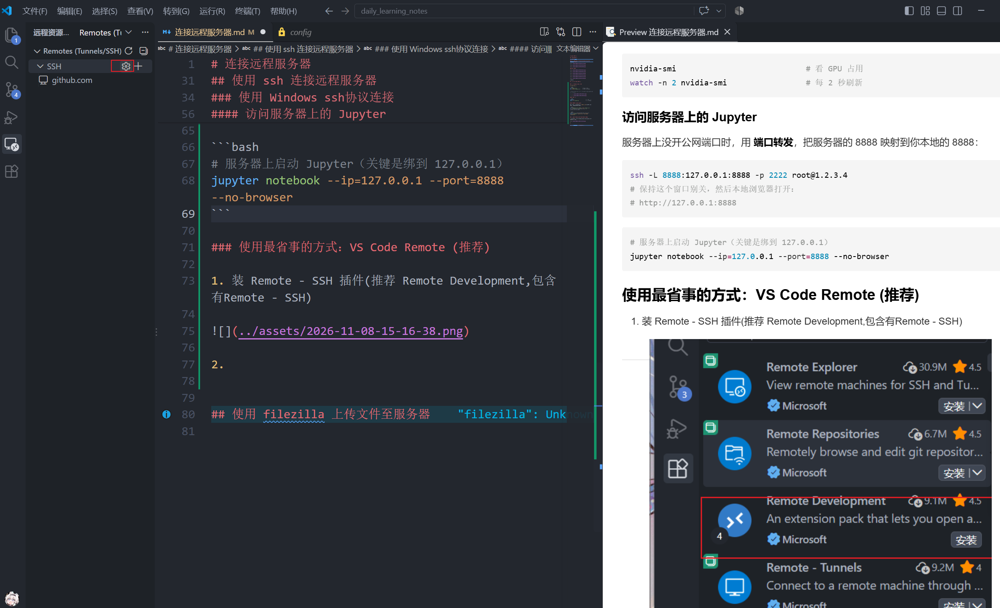

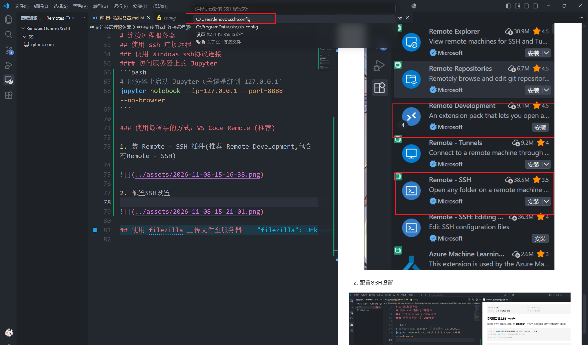

按照下面的格式编写你的服务器的ssh配置

```
Host 连接名称
    HostName 服务器IP地址
    Port 端口号
    User 用户名
```

3. 建立一个cmd进行连接

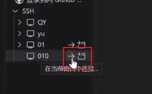

选择服务器的系统

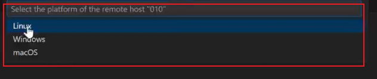

输入yes选择连接并输入密码

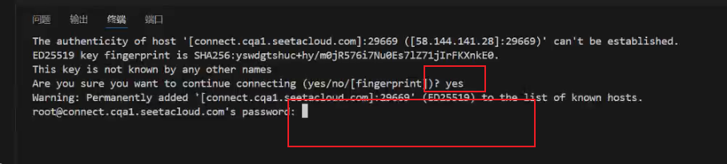

连接完成

## 使用 filezilla 上传文件至服务器

打开Filezilla，配置ssh连接

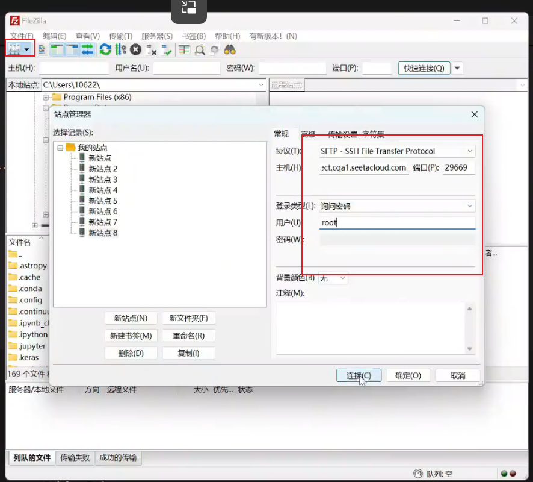

输入密码

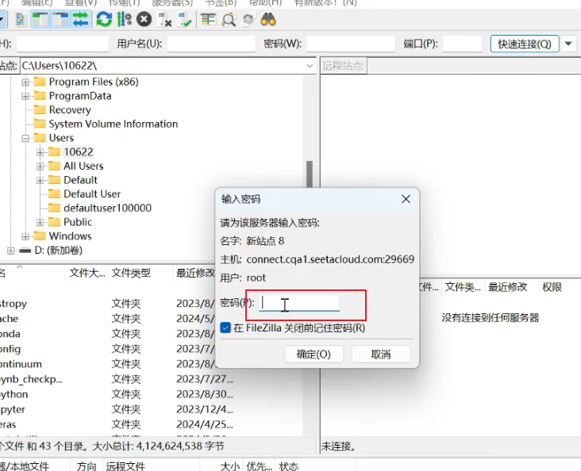

然后就可以将我们准备好的压缩包直接拖进远程服务器的文件夹就行

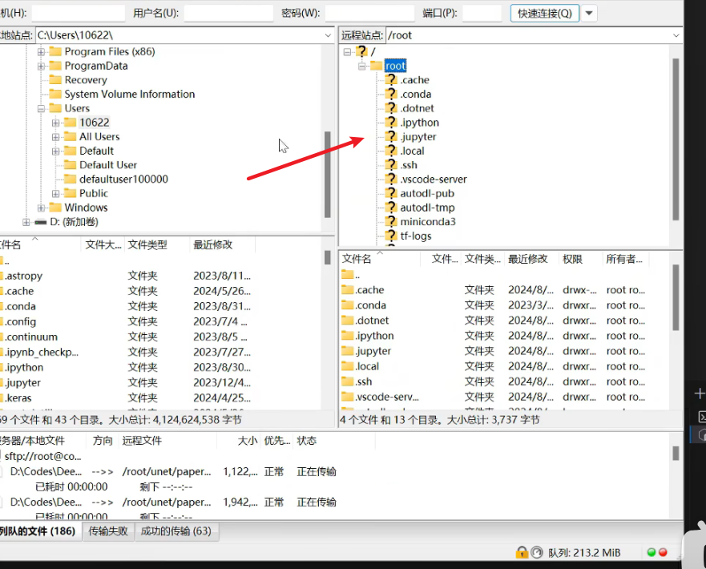

进度条跑完就传送完成

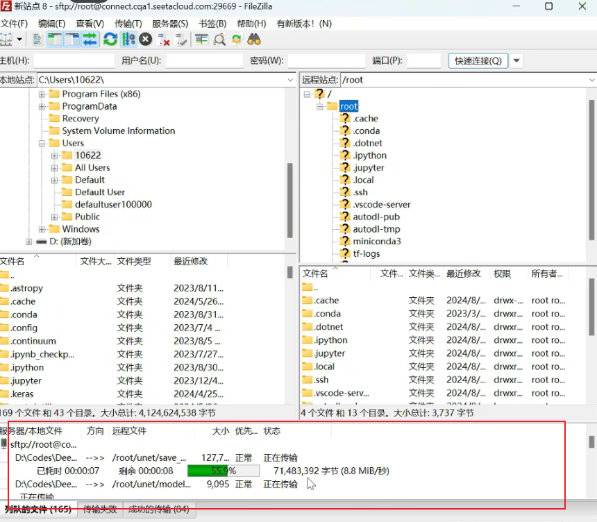