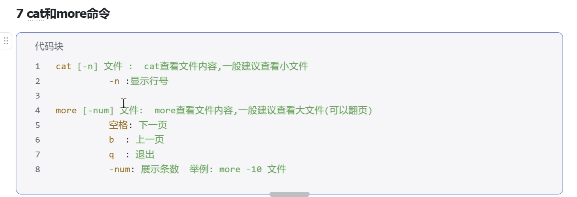

# Linux 命令系统笔记

## 第一章、学习地图与环境准备

### 1.1、全貌

- Linux 命令
  - 文件和数据
    - 目录：`ls cd pwd mkdir rm cp mv`
    - 查看：`cat less head tail`
    - 编辑：`vim` 与 `nano`
    - 处理：`grep sed awk sort uniq cut`
  - 权限和用户
    - `chmod chown umask sudo useradd`
  - 系统和进程
    - `ps top kill systemctl journalctl`
    - `df du mount free`
  - 网络
    - `ip ss ping curl wget nc tcpdump`
  - 自动化
    - 管道、重定向、cron、shell 脚本

### 1.2、练习环境 (三选一)

```bash
# ① Windows 上最方便：安装 WSL2（管理员 PowerShell）
wsl --install                 # 默认装 Ubuntu，重启后设置用户名密码

# ② Docker 起一个临时环境
docker run -it --rm ubuntu:24.04 bash

# ③ 云服务器 / 虚拟机（最接近生产）
ssh user@192.168.1.10         # 远程登录
```

> 练习时**不要用 root 乱试 `rm -rf`**，建议先用普通用户 + `sudo`。

### 1.3、命令的通用结构

```bash
命令  [选项]  [参数]
# ↑      ↑       ↑
# 做什么  怎么改   对谁做

ls -l /var/log
#  ↑  ↑   ↑
#  |  |   操作对象
#  |  选项：long 格式
#  命令
```

| 部分 | 说明 | 例子 |
|---|---|---|
| 命令 | 可执行程序 | `ls`、`grep` |
| 短选项 | 单横线，可合并 | `-l -a -h` -> `-lah` |
| 长选项 | 双横线，可读性好 | `--human-readable` |
| 参数 | 操作对象 | 路径、文件、PID |

### 1.4、获得帮助 (比被命令重要)

```bash
man ls            # 最权威的手册，q 退出，/ 搜索
ls --help         # 快速看选项
help cd           # 内建命令（cd 没有 man 页）用 help
apropos keyword   # 按关键词搜命令：apropos "list directory"
type ls           # 看命令是别名、内建还是外部程序
```

```bash
type ls
# → ls is aliased to `ls --color=auto`
type cd
# → cd is a shell builtin
```

## 第二章、基础认知：路径、命令结构、帮助

### 2.1、目录结构 (FHS 标准)

| 路径 | 作用 |
|---|---|
| `/` | 根目录 |
| `/bin` `/sbin` | 基础命令 (多数已软链到 `/user/bin`) |
| `/etc` | 配置文件 |
| `/home` | 普通用户家目录 |
| `/root` | root 家目录 |
| `/var` | 可变数据：日志 `/var/log` 、缓存、数据库 |
| `/tmp` | 临时文件、重启可能清空 |
| `/opt` | 第三方软件 |
| `/user` | 系统程序与库 |
| `/dev` | 设备文件 |
| `/proc` | 内核与进程的虚拟文件系统 |
| `/mnt` `/media` | 挂载点 |

### 2.2、路径

```bash
pwd                    # 显示当前目录
cd /etc                # 进入绝对路径
cd logs                # 进入相对路径（当前目录下的 logs）
cd ..                  # 上一级
cd ../..               # 上两级
cd ~                   # 回家目录
cd -                   # 回到上一次所在目录（很实用）
```

| 写法 | 含义 |
|---|---|
| `/etc/hosts` | 绝对路径，从根开始 |
| `logs/app.log` | 相对路径 |
| `./run.sh` | 当前目录下的run.sh |
| `~/.bashrc` | 家目录下 |
| `-` | 上一个目录 (仅 `cd` 支持) |

### 2.3、查看隐藏文件

```bash
ls -a                  # 显示以 . 开头的隐藏文件
ls -A                  # 同上但不显示 . 和 ..
```

## 第三章、文件与目录操作

### 3.1、查看

```bash
ls                     # 简单列出
ls -l                  # 长格式：权限、属主、大小、时间
ls -lh                 # -h 人类可读（KB/MB/GB）
ls -lah                # 全部文件 + 长格式 + 可读大小
ls -lt                 # 按修改时间排序（新的在前）
ls -ltr                # 按时间倒序（旧的在前，看日志常用）
ls -R                  # 递归列出
ls -ld /var/log        # 只显示目录本身，不展开内容
```

```bash
ls -lh /var/log/syslog
# → -rw-r----- 1 syslog adm 1.2M Nov  5 09:12 /var/log/syslog
#    ↑权限      ↑属主 ↑组  ↑大小
```

### 3.2、创建

```bash
mkdir dir1                       # 建目录
mkdir -p a/b/c                   # 递归创建，父目录不存在也自动建
mkdir -p /data/{logs,conf,backup} # 一次建多个（花括号展开）

touch file.txt                   # 建空文件；文件已存在则更新时间戳
touch -t 202601011200 f.txt      # 指定时间戳
```

### 3.3、复制、移动、删除

```bash
cp a.txt b.txt                   # 复制文件
cp -r src/ dst/                  # 递归复制目录
cp -a src/ dst/                  # 归档模式：保留权限、时间、链接（备份首选）
cp -u a.txt b.txt                # 只在源更新时才复制
cp *.log /backup/                # 通配符复制

mv a.txt b.txt                   # 重命名
mv a.txt /tmp/                   # 移动
mv -i a.txt b.txt                # 覆盖前询问

rm a.txt                         # 删除文件
rm -r dir/                       # 递归删目录
rm -rf dir/                      # 强制递归（危险！）
rm -i *.log                      # 每个都问一次
rmdir empty_dir                  # 只能删空目录
```

> `rm` **没有回收站**，删了就没了。生产上建议 `alias rm='rm -i` (给 `rm -i`起别名 `rm`)，或先 `mv` 到回收目录。

### 3.4、链接

```bash
ln -s /opt/app/v1 /opt/app/current   # 软链接（类似快捷方式）
ln  /data/a.txt /data/b.txt          # 硬链接（同一 inode 的另一个名字）
```

```bash
ls -l /opt/app/current
# → lrwxrwxrwx ... current -> /opt/app/v1
#   ↑ l 表示 link
```

|  | 软链接 | 硬链接 |
|---|---|---|
| 跨分区 | 支持 | 不支持 |
| 指向目录 | 支持 | 不支持 (普通用户) |
| 源删除后 | 失效 | 仍可访问 |
| inode | 新建 | 共用 |

### 3.5、文件信息 

```bash
stat a.txt            # 详细元信息：inode、权限、三个时间戳
file a.txt            # 判断文件类型（不靠后缀）
du -h a.txt           # 占用磁盘大小
du -sh dir/           # 目录总大小
```

```bash
stat a.txt
# →   File: a.txt
#     Size: 1024        Blocks: 8     IO Block: 4096  regular file
#     ...
#     Access: (0644/-rw-r--r--)  Uid: ( 1000/  alice)   Gid: ( 1000/  alice)
#     Access: 2026-11-05 09:00:00
#     Modify: 2026-11-04 18:20:00     ← 内容最后修改
#     Change: 2026-11-04 18:30:00     ← 元信息最后修改
```

| 时间戳 | 含义 |
|---|---|
| Access (atime) | 最后读 |
| Modify (mtime) | 最后改内容 |
| Change (ctime) | 最后改元信息 (权限、属主) |

## 第四章、文件内容

### 查看文件内容



```bash
cat a.txt                 # 全部输出（小文件）
cat -n a.txt              # 带行号
cat a.txt b.txt > c.txt   # 拼接

less big.log              # 分页查看（大文件首选）
#   空格 翻页 / b 上一页 / g 开头 / G 结尾 / / 搜索 / n 下一个 / q 退出
#   F 进入实时跟踪（等价 tail -f），Ctrl+C 退出跟踪

head -n 20 a.txt          # 前 20 行（默认 10）
tail -n 20 a.txt          # 后 20 行
tail -f app.log           # 实时跟踪（文件被轮转后会失效）
tail -F app.log           # 实时跟踪，文件重建也能跟上
tail -n +100 a.txt        # 从第 100 行开始输出
```

#### 分页查看：more 与 less

| 命令 | 定位 | 说明 |
|---|---|---|
| cat | 全部输出 | 小文件、拼接、配合管道 |
| more | 只能向前翻 | 老式分页器，POSIX 标准，精简系统保底 |
| less | 前后翻 + 搜索 + 跟踪 | 日常首选，`man` 的默认分页器 |
| head / tail | 头/尾若干行 | `tail -f` 跟踪日志 |

```bash
more app.log            # 空格下一屏，Enter 下一行，/ 搜索，q 退出
                        # 多数实现不能往回翻，也不能反向搜索

less app.log            # 空格翻页，b 上一页，g 开头，G 结尾
                        # / 向下搜，? 向上搜，n/N 跳转匹配，q 退出
less -N app.log         # 显示行号
less -S app.log         # 长行不折行，左右滚动
less -R app.log         # 保留颜色（看彩色日志必加）
less +F app.log         # 打开即跟踪（等价 tail -f），Ctrl+C 退出跟踪
```

`less` 里还能按 `&error` 只显示匹配行（再按 `&` 回车恢复全量），比 `grep | less` 更灵活。

```bash
# 常见组合：看日志最后 100 行并持续跟踪
tail -n 100 -f /var/log/nginx/access.log

# 看日志里最新的错误
grep -i "error" /var/log/app.log | tail -n 50
```

> `cat` 大文件会刷屏，用 `less`；`tail -f` 是排查线上问题的第一命令。

### 文本编辑器：vim 与 nano

#### 先分清：vi、vim、vim-tiny

| 命令 | 实际是什么 | 说明 |
|---|---|---|
| `vi` | 通常是 `vim` 或 `vim.tiny` 的软链 | POSIX 标准，几乎必然存在 |
| `vim` | 完整版 Vim | 支持语法高亮、插件、分屏 |
| `vim.tiny` | 精简版 | 很多功能没有 (如 `+python`、部分插件) |
| `nano` | 极简编辑器 | 屏幕底部有快捷键提示，新手友好 |

```bash
vi --version | head -3        # 看 vi 到底是什么
vim --version | head -3       # 看是否有完整 vim
which vi vim nano             # 分别在哪
```

```bash
# 没装 vim 就装一个
sudo apt install vim          # Debian / Ubuntu
sudo dnf install vim-enhanced # RHEL / CentOS
apk add vim                   # Alpine
```

#### 为什么 vim 难：它是“模式化” 编辑器

普通编辑器：打字就是输入。vim 里 **默认不是输入状态**，按键是命令。

```text
         ┌──────────────┐
         │  Normal 普通 │  ← 启动后就在这里，按键=命令
         └──────┬───────┘
      i a o │   │ :        v V Ctrl+v
            ↓   ↓            ↓
     ┌──────────┐  ┌──────────────┐  ┌────────────┐
     │ Insert   │  │ Command 命令 │  │ Visual 可视 │
     │ 输入模式 │  │  :w :q :%s   │  │  选中文本   │
     └────┬─────┘  └──────┬───────┘  └─────┬──────┘
          │ Esc           │ Enter          │ Esc
          └───────────────┴────────────────┘
                    回到 Normal
```

| 模式 | 进入方式 | 能做什么 |
|---|---|---|
| Normal | 启动即是 / 按 `Esc` | 移动、删除、复制、跳转 |
| Insert | `i` `a` `o` `I` `A` `O` | 像普通编辑器一样打字 |
| Command | `:` `/` `?` | 保存、退出、替换、设置 |
| Visual | `v` `V` `Ctrl + v` | 选中 一段 / 一行 / 一块 在操作 |
| Replace | `R` | 覆盖输入 |

> **唯一的自救动作**：不知道在哪，就 **按几下** `Esc`。

#### 最小生存集 (记住这 10 个就够改配置)

```bash
vim /etc/nginx/nginx.conf     # 打开文件
```

```bash
i                 " 进入插入模式，开始打字
Esc               " 回到普通模式（最重要）
:w                " 保存
:q                " 退出（没改动才能退）
:wq               " 保存并退出
:q!               " 不保存，强制退出（改坏了用它）
dd                " 删除当前行
u                 " 撤销
/error            " 向下搜索 error
G                 " 跳到文件末尾；gg 跳到开头
```

一段完整操作：

```bash
vim app.conf      " 打开
/port             " 搜索 port，按 n 跳到下一个
i                 " 进入插入模式，改端口
Esc               " 改完回普通模式
:wq               " 保存退出
```

#### 打开文件的几种方式

```bash
vim file.txt              # 打开
vim +100 file.txt         # 打开并跳到第 100 行
vim +/ERROR app.log       # 打开并跳到第一个 ERROR
vim -R file.txt           # 只读打开（防止误改）
view file.txt             # 同上
vim file1 file2           # 一次打开多个，:n 切下一个
vim -p a.txt b.txt        # 用标签页打开（gt 切换）
```

#### 移动 (普通模式)

```bash
h j k l        " 左 下 上 右（也可以用方向键，但慢）
w              " 下一个单词开头
b              " 上一个单词开头
e              " 单词结尾
0              " 行首（数字零）
^              " 行首第一个非空字符
$              " 行尾
gg             " 文件开头
G              " 文件末尾
:100           " 跳到第 100 行
50G            " 跳到第 50 行
Ctrl+f         " 向下翻页
Ctrl+b         " 向上翻页
Ctrl+d         " 向下半页
Ctrl+u         " 向上半页
%              " 跳到匹配的括号
{  }           " 上/下一个空行（段落）
```

#### 编辑 (普通模式)

```bash
x              " 删除光标处一个字符
dd             " 删除整行
5dd            " 删除 5 行
dw             " 删除一个单词
D              " 删除到行尾
yy             " 复制整行
5yy            " 复制 5 行
p              " 粘贴到光标后
P              " 粘贴到光标前
u              " 撤销
Ctrl+r         " 重做
.              " 重复上一次操作（超好用）
r              " 替换一个字符
cw             " 改写一个单词
cc             " 改写整行
>>  <<         " 增加/减少缩进
gg=G           " 全文自动缩进（改完代码用）
```

> 数字前缀可以组合：`3dd` 删3行、`5j` 下移 5 行、`2yy` 复制 2 行

#### 搜索与替换

```bash
/pattern       " 向下搜索
?pattern       " 向上搜索
n              " 下一个
N              " 上一个
*              " 搜索光标所在的单词
:noh           " 取消高亮（搜索后残留高亮时用）
```

```bash
:s/old/new/            " 替换当前行第一个
:s/old/new/g           " 替换当前行全部
:%s/old/new/g          " 替换全文（最常用）
:%s/old/new/gc         " 全文替换，每个都问 y/n/a
:10,20s/old/new/g      " 只替换 10–20 行
:%s#/usr/local#/opt#g  " 用 # 代替 /，路径替换时更清爽
```

> 正则语法和 `sed` 基本一致，`\(` `\)` 分组、`&` 表示整个匹配。

#### 可视模式与块编辑

```bash
v          " 字符可视：按字符选中
V          " 行可视：整行整行选
Ctrl+v     " 块可视：矩形区域（批量注释神器）
```

批量给多行加 `#` 注释：

```bash
Ctrl+v      " 进入块选择
jjj         " 向下选 3 行（选中每行第 1 列）
I           " 进入插入（只对块的第一行生效）
#           " 输入 #
Esc         " 按 Esc，其余行会自动补上 #（可能有 1 秒延迟）
```

选中后可直接 `d` 删除、`y` 复制、`=` 缩进、`>` 右移。

#### 多文件、分屏、标签页

```bash
:sp file       " 水平分屏打开
:vsp file      " 垂直分屏
Ctrl+w w       " 在窗口间切换
Ctrl+w h/j/k/l " 按方向切换
Ctrl+w =       " 所有窗口等宽
:q             " 关闭当前窗口

:ls            " 列出所有打开的文件（缓冲区）
:bn  :bp       " 下一个 / 上一个
:bd            " 关闭当前缓冲区

:tabnew file   " 新建标签页
gt  gT         " 下一个 / 上一个标签页
:tabc          " 关闭标签页
```

#### 宏与寄存器 (进阶但极实用)

```bash
qa             " 开始录制到寄存器 a
...            " 做一遍操作（例如 0i# Esc j）
q              " 结束录制
@a             " 执行一次
10@a           " 执行 10 次
@@             " 重复上一次
```

```bash
"ayy           " 把当前行复制到寄存器 a
"ap            " 从寄存器 a 粘贴
:reg           " 查看所有寄存器
```

#### `.vimrc` 常用配置

```bash
" ~/.vimrc —— 每行都有注释
set number             " 显示行号
set relativenumber     " 显示相对行号（配合 5j 跳转）
set tabstop=4          " Tab 显示为 4 个空格宽
set shiftwidth=4       " 自动缩进 4 格
set expandtab          " 把 Tab 转成空格（写 Python 必开）
set autoindent         " 新行继承上一行缩进
set hlsearch           " 搜索高亮
set incsearch          " 边输入边搜索
set ignorecase         " 搜索忽略大小写
set smartcase          " 但含大写时区分大小写
set cursorline         " 高亮当前行
set mouse=a            " 允许鼠标
syntax on              " 语法高亮
```

```bash
source ~/.vimrc        # 改完立即生效（或在 vim 里 :source %）
```

#### 六个救命技巧

```bash
:w !sudo tee %        " 忘了用 sudo 打开只读文件时，用它提权保存
:e!                   " 丢弃修改，重新从磁盘加载
:set paste            " 粘贴前打开，避免自动缩进把格式搞乱
:set nopaste          " 粘贴完关掉
:%!sort               " 把全文交给 sort 处理（任何 shell 命令都能这么用）
:g/^$/d               " 删除所有空行（g 对匹配行执行命令）
```

| 坑 | 现象 | 解决 |
|---|---|---|
| 按了 `Ctrl + S` | 终端像卡死 | `Ctrl + Q` 恢复 (这是终端流控，不是 vim 问题) |
| 不知道在哪个模式 | 打字变成乱删 | 连按 `Esc` |
| 粘贴后缩进乱 | 每行越来越往右 | `:set paste` |
| 保存提示只读 | `E45: 'readonly' option is set` | `:w !sudo tee %` |
| 改坏了想退出 | --- | `:q!` 丢弃 |
| 误按 `Ctrl + Z` | 退回 shell | `fg` 回到 vim |
| `vi` 没有颜色 | 装的是 vim-tiny | 安装完整 vim |

#### nano：不想学 vim 就用它

```bash
nano app.conf
```

| 快捷键 | 作用 |
|---|---|
| `Ctrl + 0` | 保存 (Write Out) |
| `Ctrl + X` | 退出 |
| `Ctrl + W` | 搜索 |
| `Ctrl + K` | 剪切整行 |
| `Ctrl + U` | 粘贴 |
| `Ctrl + G` | 帮助 |
| `Ctrl + \` | 查找替换 |

> 底部一直显示快捷键，不需要记模式。改一两行配置，nano 完全够用。

#### 容器里没有编辑器怎么办

```bash
# ① heredoc 直接写整个文件（注意用 'EOF' 防止变量被展开）
cat > /tmp/app.conf << 'EOF'
port=8080
debug=false
EOF

# ② 追加一行
echo "debug=true" >> /tmp/app.conf

# ③ 用 sed 原地改
sed -i 's/port=8080/port=9090/' /tmp/app.conf

# ④ 用 tee 写需要 root 的文件
echo "nameserver 8.8.8.8" | sudo tee /etc/resolv.conf
```

#### 怎么连

```bash
vimtutor        # 官方内置教程，30 分钟，强烈建议第一天就做一遍
```

学习顺序建议：

| 阶段 | 目标 |
|---|---|
| 第一天 | `vimtutor` 前 3 节：移动、插入、删除、保存退出 |
| 第一周 | 熟练 `dd yy p u / :wq`，改配置文件不慌 |
| 第二周 | 可视模式、分屏、`:set` 配置 |
| 第一个月 | 宏、寄存器、`g` 命令、自定义 `.vimrc` |

**一句话总结**：`cat` / `less` 是 “看”，`vim` / `nano` 是“改”。服务器上 `vi` 一定在，`vim` 不一定在；不想折腾就用 `nano` ，但 `vimtutor` 花 30 分钟绝对值。

## 第五章、文本处理：grep / sed / awk

### 5.1、grep：按行筛选

```bash
grep "error" app.log            # 包含 error 的行
grep -i "error" app.log         # 忽略大小写
grep -v "debug" app.log         # 反选：不含 debug 的行
grep -c "error" app.log         # 统计行数
grep -n "error" app.log         # 显示行号
grep -rn "TODO" src/            # 递归搜索目录，带行号
grep -w "cat" a.txt             # 整词匹配，不会匹配 category
grep -E "error|warn" app.log    # 扩展正则（等价 egrep）
grep -A 3 -B 1 "Exception" app.log  # 命中行后 3 行、前 1 行
grep --include="*.py" -rn "def " .  # 只搜 py 文件
```

```bash
# 实战：统计访问日志里状态码 500 的请求数
grep -c ' 500 ' access.log
# → 37
```

### 5.2、按行编辑

```bash
sed 's/old/new/' a.txt            # 每行替换第一个 old
sed 's/old/new/g' a.txt           # 全部替换
sed -i 's/old/new/g' a.txt        # 直接改文件（⚠️ 先备份）
sed -i.bak 's/old/new/g' a.txt    # 改文件并留 a.txt.bak 备份
sed -n '1,5p' a.txt               # 只打印 1-5 行（-n 抑制默认输出）
sed '/^#/d' a.conf                # 删除以 # 开头的行
sed '/^$/d' a.txt                 # 删除空行
sed '2a\new line' a.txt           # 在第 2 行后追加
```

```bash
# 实战：注释掉配置文件里所有 debug 行
sed -i '/^debug/s/^/#/' app.conf
#     ↑ 匹配以 debug 开头的行   ↑ 在该行行首插入 #
```

### 5.3、awk：按列处理

```bash
awk '{print $1}' a.txt                 # 打印第 1 列
awk '{print $1, $3}' a.txt             # 打印第 1、3 列
awk -F: '{print $1}' /etc/passwd       # 以 : 为分隔符，取第 1 列
awk -F: '{print $NF}' /etc/passwd      # $NF 表示最后一列
awk 'NR==1' a.txt                      # 只看第 1 行
awk 'NR>1' a.txt                       # 跳过表头
awk 'END{print NR}' a.txt              # 总行数
awk '$3 > 100 {print $1}' a.txt        # 第 3 列大于 100 才打印
awk '{sum+=$1} END{print sum}' a.txt   # 求第 1 列总和
```

```bash
# 实战：取 nginx 日志的 IP 和状态码
awk '{print $1, $9}' access.log | head
```

### 5.4、sort / uniq / cut / tr / wc

```bash
sort a.txt                  # 字典序
sort -n a.txt               # 按数值
sort -r a.txt               # 倒序
sort -k2 -t: -n a.txt       # 以 : 分隔，按第 2 列数值排序
sort -u a.txt               # 排序并去重

uniq a.txt                  # 去重（必须先 sort）
uniq -c a.txt               # 统计每行出现次数
sort a.txt | uniq -c | sort -rn | head   # 出现次数 TOP10

cut -d: -f1 /etc/passwd     # 以 : 分隔取第 1 段
cut -c1-8 a.txt             # 取每行前 8 个字符

tr 'a-z' 'A-Z' < a.txt      # 小写转大写
tr -d '\r' < win.txt > unix.txt   # 删除 Windows 换行里的 \r

wc -l a.txt                 # 行数
wc -w a.txt                 # 单词数
wc -c a.txt                 # 字节数
```

```bash
# 经典组合：统计访问日志 TOP10 IP
awk '{print $1}' access.log | sort | uniq -c | sort -rn | head -10
#   ↑ 取 IP        ↑ 排序   ↑ 计数    ↑ 按次数倒序  ↑ 前 10
```

> 记忆：**sort 在前，uniq 才能正确计数。**

### 5.5、xargs：把输出变成参数

```bash
find . -name "*.log" | xargs rm          # 删掉找到的所有日志
find . -name "*.log" | xargs -I {} cp {} /backup/   # {} 占位
echo "a b c" | xargs -n1 echo            # 每次只传一个参数
```

> 文件名含空格时用 `-0`: `find . -print0 | xargs -0 rm`。

## 第六章、查找 find / which / locate

### 6.1、find

```bash
find /var/log -name "*.log"              # 按名字
find . -iname "*.LOG"                    # 忽略大小写
find . -type f -name "*.py"              # 只要普通文件
find . -type d -name "test"              # 只要目录
find . -size +100M                       # 大于 100M
find . -size -1k                         # 小于 1k
find . -mtime -7                         # 7 天内修改过
find . -mtime +30 -name "*.log"          # 30 天前的日志
find . -perm 777                         # 权限恰好 777
find . -user alice                       # 属于 alice
find . -maxdepth 2 -name "*.conf"        # 只找两层
find . -name "*.tmp" -delete             # 找到并删除
find . -name "*.log" -exec gzip {} \;    # 对每个文件执行命令
```

```bash
# 实战：找出根分区大于 500M 的文件（排除其他挂载点）
find / -xdev -type f -size +500M 2>/dev/null
#      ↑ 不跨文件系统    ↑ 丢弃"权限不够"的报错
```

### 6.2、其他查找

```bash
which python3        # 命令的可执行文件在哪（走 PATH）
whereis python3      # 二进制、源码、man 页
type ll              # 是别名、内建还是外部命令
locate nginx.conf    # 查数据库，极快，但需 updatedb 更新
```

| 命令 | 找什么 | 速度 |
|---|---|---|
| `which` | PATH 里的可执行文件 | 快 |
| `whereis` | 程序 + 文档 | 快 |
| `locate` | 全盘文件名 (数据库) | 极快 |
| `find` | 实时遍历 | 慢但准 |

## 第七章、管道、重定向、通配符、快捷键

### 7.1、管道

```bash
ps aux | grep nginx          # 前一个命令的输出，作为后一个的输入
cat a.txt | wc -l            # 统计行数
ls -l | sort -k5 -n | tail -3   # 最大的 3 个文件
```

### 7.2、重定向

```bash
echo "hello" > a.txt         # 覆盖写入（文件不存在则创建）
echo "world" >> a.txt        # 追加
cmd 2> err.log               # 只重定向错误输出
cmd > out.log 2>&1           # 标准输出和错误都进同一个文件
cmd &> all.log               # 同上（bash 简写）
cmd > /dev/null 2>&1         # 丢弃所有输出（后台任务常用）
cmd < input.txt              # 从文件读输入
```

| 符号 | 含义 | 文件描述符 |
|---|---|---|
| `>` | 覆盖 stdout | 1 |
| `>>` | 追加 stdout | 1 |
| `2>` | 覆盖 stderr | 2 |
| `2>&1` | 把 stderr 指到 stdout 当前位置 | --- |
| `&>` | stdout + stderr | 1, 2 |
| `<` | 标准输入 | 0 |

> 顺序很重要：`cmd > f 2>&1 > f` 会把错误打到终端。

### 7.3、通配符 (由 shell 展开)

```bash
ls *.log            # 任意字符
ls a?.txt           # 单个字符
ls [abc].txt        # a/b/c 之一
ls {a,b}.txt        # 花括号展开：a.txt b.txt
rm -rf /tmp/tmp*    # ⚠️ 通配符很危险，先 ls 确认
```

### 7.4、快捷键

| 快捷键 | 作用 |
|---|---|
| `Ctrl + C` | 中断当前命令 |
| `Ctrl + D` | 结束输入 / 退出 shell |
| `Ctrl + Z` | 挂起到后台 (`fg` 恢复) |
| `Ctrl + L` | 清屏 |
| `Ctrl + R` | 搜索历史命令 (最实用) |
| `Ctrl + A` / `Ctrl + E` | 行首 / 行尾 |
| `Ctrl + U` / `Ctrl + K` | 删到行首 / 行尾 |
| `Ctrl + W` | 删前一个单词 |
| `!!` | 上一条命令 |
| `!$` | 上一条命令的最后一个参数 |
| `Esc + .` | 插入上条命令的参数 |

```bash
ls /etc/nginx
cd !$                 # 等价于 cd /etc/nginx
```

## 第八章、权限与属主

### 8.1、权限模型

```text
-rwxr-xr--
 ↑ ↑↑↑ ↑↑↑ ↑↑↑
 | |   |    └── 其他人：r--
 | |   └─────── 所属组：r-x
 | └─────────── 属主：rwx
 └───────────── 文件类型：- 普通文件，d 目录，l 链接
```

| 权限 | 文件 | 目录 |
|---|---|---|
| `r` | 读内容 | 列出内容 (`ls`) |
| `w` | 改内容 | 创建/删除文件 |
| `x` | 执行 | 进入目录 (`cd`) |

### 8.2、数字法

| 数字 | 权限 |
|---|---|
| 4 | r |
| 2 | w |
| 1 | x |
| 7 | rwx |
| 6 | rw- |
| 5 | t-x | 
| 4 | r-- |

```bash
chmod 644 file        # rw-r--r--   普通文件
chmod 755 script.sh   # rwxr-xr-x   可执行脚本/目录
chmod 600 id_rsa      # rw-------   私钥必须 600
chmod 700 ~/.ssh      # rwx------   目录仅自己可进
```

### 8.3、符号法

```bash
chmod u+x script.sh       # 属主加执行
chmod g-w file            # 组去掉写
chmod o=r file            # 其他人设为只读
chmod a+r file            # 所有人加读
chmod -R 755 dir/         # 递归（⚠️ 慎用）
```

| 符号 | 含义 |
|---|---|
| `u` / `g` / `o` / `a` | 属主 / 组 / 其他 / 全部 |
| `+` / `-` / `=` | 增加 / 去掉 / 设为 |

### 8.4、属主

```bash
chown alice file.txt              # 改属主
chown alice:dev file.txt          # 改属主和组
chown -R www-data:www-data /var/www   # 递归
chgrp dev file.txt                # 只改组
```

### 8.5、特殊权限

```bash
chmod 4755 /usr/bin/passwd    # setuid：执行时以属主身份运行（4）
chmod 2755 /data/shared       # setgid：目录下新文件继承组（2）
chmod 1777 /tmp               # sticky：只有属主能删自己的文件（1）
```

```bash
ls -ld /tmp
# → drwxrwxrwt ... /tmp
#            ↑ t 就是 sticky
```

### 8.6、umask

```bash
umask              # 查看：默认 022
umask 027          # 新文件 640，新目录 750
```

> 新建文件默认 `666 & ~umask`，目录默认 `777 & ~umask`。

### 8.7、sudo

```bash
sudo ls /root                 # 以 root 执行一条命令
sudo -i                       # 切到 root 的登录 shell
sudo -u www-data ls /var/www  # 以指定用户执行
sudo -l                       # 查看当前用户能执行什么
```

> 生产上禁止直接 `su -` 长期用root，应使用 `sudo` + 最小权限。

## 第九章、用户与组

```bash
whoami                     # 当前用户
id                         # 当前用户的 uid/gid/组
id alice                   # 指定用户的信息

useradd -m -s /bin/bash bob    # 建用户，-m 建家目录，-s 指定 shell
passwd bob                     # 设置密码
userdel -r bob                 # 删用户并删家目录（⚠️）
usermod -aG sudo bob           # 加入 sudo 组（-a 必须带，否则覆盖）
groups bob                     # 查看用户所属组

groupadd dev
gpasswd -a bob dev             # 把 bob 加入 dev 组

last                           # 最近登录记录
who                            # 当前登录用户
w                              # 当前用户 + 正在做什么
```

```bash
# 查看系统里有哪些用户（可登录的）
awk -F: '$3 >= 1000 && $3 < 65534 {print $1}' /etc/passwd
```

## 第十章、进程管理

### 10.1、查看进程

```bash
ps aux                    # 所有进程（BSD 风格），常用
ps -ef                    # 所有进程（System V 风格），带 PPID
ps -ef | grep nginx       # 过滤（会包含 grep 自己）
pgrep -af nginx           # 更好的写法：-a 显示命令行，-f 全命令行匹配
ps aux --sort=-%cpu | head -5   # CPU 占用前 5
ps aux --sort=-%mem | head -5   # 内存占用前 5
```

```bash
ps aux | head -3
# → USER  PID %CPU %MEM    VSZ   RSS TTY  STAT START  TIME COMMAND
#   root    1  0.0  0.1 167436 11234 ?    Ss   09:00  0:02 /sbin/init
#                     ↑ 状态
```

| 状态 | 含义 |
|---|---|
| `R` | 运行中 |
| `S` | 可中断睡眠 (等 I/O) |
| `D` | 不可中断睡眠 (等磁盘，kill -9 也杀不掉) |
| `Z` | 僵尸进程 (一推出但父进程没回收) |
| `T` | 停止 (Ctrl + Z) |
| `Ss` | 会话首进程 |

### 10.2、实时监控

```bash
top                       # 交互式：P 按 CPU 排序，M 按内存，1 看每核
top -b -n 1 | head -20    # 批处理模式，适合写脚本
htop                      # 更友好的 top（需安装）
uptime                    # 开机时长 + 负载
```

```bash
uptime
# → 10:01:34 up 20 days,  3:12,  2 users,  load average: 0.52, 0.48, 0.45
#                                                      ↑1分钟 ↑5分钟 ↑15分钟
```

> load average 与 **核数** 比较：8 核机器 load 8 属于跑满，超过就该查了

### 10.3、结束进程

```bash
kill 1234                 # 默认发 SIGTERM(15)，优雅退出
kill -9 1234              # SIGKILL，强杀（不给清理机会）
kill -1 1234              # SIGHUP，常用于让服务重载配置
kill -l                   # 列出所有信号

pkill nginx               # 按名字杀
pkill -f "python app.py"  # 按完整命令行杀
killall nginx             # 杀所有同名进程

kill -9 -1                # ⚠️ 杀所有你能杀的进程（千万别在服务器上试）
```

### 10.4、前后台

```bash
./server.sh &             # 后台启动
jobs                      # 查看当前 shell 的后台任务
fg %1                     # 把 1 号任务调回前台
bg %1                     # 让暂停的任务继续后台跑
Ctrl+Z                    # 挂起当前前台任务

nohup ./server.sh > server.log 2>&1 &   # 退出终端也不退出
disown -h %1                            # 让任务忽略 SIGHUP
```

> `nohup` + `&` 是最常用的“后台常驻”组合；更规范的做法用 `systemd` 。

### 10.5、systemd

```bash
systemctl start nginx         # 启动
systemctl stop nginx          # 停止
systemctl restart nginx       # 重启
systemctl reload nginx        # 重载配置（不中断连接，若支持）
systemctl status nginx        # 状态 + 最近日志
systemctl enable nginx        # 开机自启
systemctl disable nginx       # 取消自启
systemctl is-active nginx     # 是否运行
systemctl list-units --type=service --state=running   # 运行中的服务
systemctl daemon-reload       # 改了 unit 文件后必须执行
```

```bash
# 自己写一个 service（/etc/systemd/system/myapp.service）
[Unit]
Description=My App
After=network.target

[Service]
User=app
WorkingDirectory=/opt/app
ExecStart=/opt/app/venv/bin/python main.py
Restart=always                 # 挂了自己重启
RestartSec=3

[Install]
WantedBy=multi-user.target
```

## 第十一章、磁盘与文件系统

### 11.1、使用率

```bash
df -h                    # 各挂载点使用率（-h 人类可读）
df -hT                   # 带文件系统类型
df -i                    # inode 使用率（"磁盘没满但写不进去"的元凶）

du -sh /var/log          # 目录总大小
du -h --max-depth=1 /var | sort -h   # 一级子目录大小排序
du -sh * | sort -h       # 当前目录下谁最大
```

```bash
# 实战：找出 / 下最大的 10 个目录
du -h --max-depth=1 / 2>/dev/null | sort -h | tail -10
```

### 11.2、磁盘与分区

```bash
lsblk                    # 块设备树
lsblk -f                 # 带文件系统类型和 UUID
fdisk -l                 # 分区表（需要 root）
blkid                    # 设备 UUID
```

```bash
mount /dev/sdb1 /mnt              # 挂载
mount -o ro /dev/sdb1 /mnt        # 只读挂载
umount /mnt                       # 卸载（提示 busy 就先 lsof）
lsof +D /mnt                      # 看谁在用这个目录
```

```bash
# 开机自动挂载：/etc/fstab
UUID=xxxx-xxxx  /data  ext4  defaults  0  2
```

### 11.3、inode

```bash
df -i                     # inode 用尽时也会报 "No space left on device"
find / -xdev -type f | wc -l   # 估算文件总数
```

小文件极多的场景 (如缓存目录)，`df -h` 还有空间但 `df -i` 已满，同样写不进去

## 第十二章、网络

### 12.1、地址与路由

```bash
ip addr                   # 网卡和 IP（替代 ifconfig）
ip -br addr               # 简洁版
ip route                  # 路由表
ip route get 8.8.8.8      # 查去某个地址走哪条路由
```

### 12.2、端口与连接

```bash
ss -tlnp                  # TCP 监听端口 + 进程（替代 netstat）
ss -tan                   # 所有 TCP 连接
ss -s                     # 汇总统计
ss -tnp state established # 已建立的连接
lsof -i :8080             # 谁占了 8080
lsof -p 1234              # 某个进程打开的文件
```

```bash
ss -tlnp | grep 8080
# → LISTEN 0 128 0.0.0.0:8080 0.0.0.0:* users:(("java",pid=1234,fd=56))
```

### 12.3、连通性

```bash
ping -c 4 baidu.com       # 发 4 个包就停
ping -i 0.2 -c 10 host    # 0.2 秒间隔
traceroute baidu.com      # 路由追踪（需安装）
mtr baidu.com             # ping + traceroute 结合，持续观察

nc -zv 127.0.0.1 3306     # 探测端口是否通（-z 只扫描，-v 详细）
telnet 127.0.0.1 3306     # 老办法，很多机器没装
```

### 12.4、DNS

```bash
dig baidu.com             # 详细 DNS 查询
dig +short baidu.com      # 只返回 IP
nslookup baidu.com        # 简单查询
cat /etc/resolv.conf      # DNS 配置
```

### 12.5、下载与调试

```bash
curl -I https://example.com            # 只看响应头
curl -sS -o /dev/null -w "%{http_code}\n" https://example.com   # 只看状态码
curl -X POST -H "Content-Type: application/json" \
     -d '{"a":1}' https://api.example.com   # 发 POST JSON
curl -L https://example.com            # 跟随重定向
curl -k https://self-signed.site       # 忽略证书校验（仅调试）
curl --resolve api.test:443:127.0.0.1 https://api.test   # 强制解析到某 IP

wget https://example.com/file.tar.gz   # 下载文件
wget -c https://example.com/big.iso    # 断点续传
```

### 12.6、抓包

```bash
tcpdump -i eth0 -nn port 80            # 抓 80 端口，-nn 不解析域名和端口名
tcpdump -i any -nn host 10.0.0.5       # 指定主机
tcpdump -i eth0 -w a.pcap port 443     # 存文件，用 Wireshark 分析
```

> 生产抓包注意量，`-c 100` 限制条数，别把磁盘写满

## 第十三章、压缩与归档

```bash
tar -czvf backup.tar.gz /data          # 打包 + gzip 压缩
#   ↑c 创建 ↑z gzip ↑v 显示过程 ↑f 指定文件名
tar -xzvf backup.tar.gz -C /restore    # 解压到指定目录
tar -tzvf backup.tar.gz                # 只看内容不解压
tar -xzvf a.tar.gz etc/nginx           # 只解压某个子目录
tar -czvf b.tar.gz --exclude="*.log" /data   # 排除某些文件

gzip big.log                # 压缩，生成 big.log.gz（原文件被删）
gzip -k big.log             # 保留原文件
gzip -d big.log.gz          # 解压（等价 gunzip）
zcat big.log.gz | less      # 不解压直接看
```

```bash
zip -r site.zip site/       # 打 zip（跨平台友好）
unzip site.zip -d /tmp/     # 解压
unzip -l site.zip           # 列出内容
```

| 后缀 | 工具 | 特点 |
|---|---|---|
| `.tar.gz` | tar + gzip | Linux 最常用 |
| `.tar.xz` | tar + xz | 压缩率更高，更慢 |
| `.zip` | zip | Windows 友好 |
| `.gz` | gzip | 单文件 |

## 第十四章、包管理与服务

### 14.1、Debian / Ubuntu (apt)

```bash
apt update                    # 更新软件源索引（不升级）
apt upgrade                   # 升级已安装的包
apt install nginx             # 安装
apt remove nginx              # 卸载（保留配置）
apt purge nginx               # 卸载并删配置
apt search keyword            # 搜索
apt show nginx                # 包信息
dpkg -l | grep nginx          # 查已安装
dpkg -L nginx                 # 包安装了哪些文件
```

### 14.2、RHEL / CentOS (dnf / yum)

```bash
dnf install nginx
dnf remove nginx
dnf update
dnf search keyword
rpm -qa | grep nginx          # 查已安装
```

### 14.3、编译安装的通用流程

```bash
./configure --prefix=/opt/app   # 检查环境，生成 Makefile
make -j4                        # 编译（4 个并行任务）
sudo make install               # 安装
```

## 第十五章、定时任务与日志

### 15.1、cron

```bash
crontab -e            # 编辑当前用户的定时任务
crontab -l            # 列出
crontab -r            # 删除全部（⚠️ 无确认）
```

```bash
# 分 时 日 月 周  命令
* * * * *        /opt/app/check.sh          # 每分钟
*/5 * * * *      /opt/app/sync.sh           # 每 5 分钟
0 2 * * *        /opt/app/backup.sh         # 每天 2:00
0 3 * * 0        /opt/app/weekly.sh         # 每周日 3:00
30 8 1 * *       /opt/app/monthly.sh        # 每月 1 号 8:30
```

| 符号 | 含义 |
|---|---|
| `*` | 任意值 |
| `,` | 枚举：`1, 15` | 
| `-` | 范围：`1-5` | 
| `/` | 步长：`*/10` |

> cron 的环境变量很少 (PATH 通常只有 `user/bin:/bin`)，脚本里**用绝对路径**，或在 crontab 顶部家 `PATH=/user/local/bin:/user/bin:/bin` 。

### 15.2、系统日志

```bash
journalctl -u nginx            # 某个服务的日志
journalctl -u nginx -f         # 实时跟踪
journalctl -u nginx --since "10 min ago"
journalctl -u nginx --since today --no-pager
journalctl -p err -b           # 本次启动的所有 error
journalctl -xe                 # 最近的错误 + 解释（排障首选）
journalctl --disk-usage        # 日志占用
journalctl --vacuum-size=500M  # 只保留 500M
```

```bash
dmesg -T | tail -50            # 内核日志（-T 显示可读时间）
dmesg -T | grep -i "oom"       # 查是否被 OOM 杀过进程
```

### 15.3、应用日志位置

| 路径 | 内容 | 
|---|---|
| `/var/log/syslog` 或 `/var/log/messages` | 系统综合日志 |
| `/var/log/auth.log` 或 `/var/log/secure` | 登录认证 |
| `/var/log/nginx` | Nginx |
| `/var/log/cron` | 定时任务执行记录 |

## 第十六章、系统监控与排障

### 16.1、常用工具

```bash
free -h                   # 内存
free -h -s 2              # 每 2 秒刷新
vmstat 1 5                # 每 1 秒采样，共 5 次（看 r/b/si/so）
iostat -x 1 3             # 磁盘 I/O（%util 接近 100 就是瓶颈）
sar -u 1 5                # CPU 历史（需 sysstat）
```

```bash
free -h
# →               total        used        free      shared  buff/cache   available
#   Mem:           15Gi       3.2Gi       1.1Gi       200Mi        11Gi        11Gi
#                                                                  ↑ 真正可用的
```

> Linux 的 `free` 少不是问题，`buff/cache` 会被回收；看 **available**

### 16.2、排障四步法

```bash
# ① CPU 高：找到进程，再找到线程
top -b -n 1 | head -20
ps -eo pid,ppid,pcpu,pmem,cmd --sort=-pcpu | head
top -H -p 1234                 # 看进程内哪个线程高

# ② 内存高
free -h
ps aux --sort=-%mem | head
cat /proc/1234/status | grep -i vm

# ③ 磁盘满
df -h
df -i
du -h --max-depth=1 / | sort -h | tail

# ④ 端口/连接问题
ss -tlnp
ss -tnp state established | wc -l
ss -s
```

### 16.3、常见现象的原因

| 现象 | 可能原因 | 排查 |
|---|---|---|
| 负载高但 CPU 不高 | 大量 D 状态 (等 I/O) | `ps -eo stat,cmd`、`iostat -x` |
| 磁盘盘但 du 算不出来 | 文件被删除但进程仍打开 | `losf +L1` |
| 端口被占用 | 旧进程没退 | `ss -tlnp`、`lsof -i :port` |
| 内存不断涨 | 泄露 | `ps`、`/proc/pid/status` |
| 服务起不来 | 端口冲突 / 权限 / 配置 | `systemctl status`、`journalctl -xe` |
| 能 ping 不通端口 | 防火墙 / 服务没监听 | `ss -tlnp`、`telnet` |

```bash
# 找"已删除但仍被占用"的文件（df 与 du 不一致的原因）
lsof +L1 | head
```

## 第十七章、Shell 脚本基础

### 17.1、最小脚本

```bash
#!/bin/bash
# ↑ 第一行必须是 shebang，指定解释器
set -euo pipefail
# ↑ 三件套（强烈建议）：
#   -e 任一命令失败就退出
#   -u 使用未定义变量报错
#   pipefail 管道中任一环失败即失败

echo "Hello, $1"          # $1 是第一个参数
```

```bash
chmod +x script.sh        # 加执行权限
./script.sh world         # → Hello, world
```

### 17.2、变量与参数

```bash
#!/bin/bash
NAME="Alice"              # 等号两边不能有空格
echo "Hello, ${NAME}"     # 变量建议加花括号

echo "脚本名: $0"
echo "参数个数: $#"
echo "所有参数: $@"        # "$@" 保留每个参数的空格
echo "第一个参数: $1"
echo "上条命令退出码: $?"   # 0 成功，非 0 失败

readonly PI=3.14          # 只读变量
unset NAME                # 删除变量
```

| 变量 | 含义 |
|---|---|
| `$0` | 脚本名 |
| `$1..$9` | 位置参数 |
| `$#` | 参数个数 |
| `$@` | 所有参数 (推荐加引号) |
| `$?` | 上条命令退出码 |
| `$$` | 当前脚本 PID |

### 17.3、条件判断

```bash
if [ -f /etc/passwd ]; then
    echo "文件存在"
elif [ -d /etc ]; then
    echo "是目录"
else
    echo "都不对"
fi

# 现代写法：[[ ]] 支持正则和 && ||，不用转义
if [[ "$NAME" == "Alice" && -f /etc/passwd ]]; then
    echo ok
fi
```

| 判断 | 含义 |
|---|---|
| `-f` | 是普通文件 |
| `-d` | 是目录 |
| `-e` | 存在 |
| `-r` / `-w` / `-x` | 可读 / 可写 / 可执行 |
| `-z "$s"` | 字符串为空 |
| `-n "$s" | 字符串非空 |
| `"$a" -eq "$b"` | 数值相等 |
| `"$a" -lt "$b"` | 小于 |

### 17.4、循环

```bash
for i in {1..5}; do
    echo "第 $i 次"
done

for f in /var/log/*.log; do
    echo "处理 $f"
done

while read -r line; do
    echo "读到: $line"
done < list.txt

# 读命令输出（注意管道会开子 shell，变量改不了父 shell）
grep "error" app.log | while read -r line; do
    echo "$line"
done
```

### 17.5、函数与常用技巧

```bash
#!/bin/bash
set -euo pipefail

log() {
    # $(date) 命令替换；$* 把所有参数拼成字符串
    echo "[$(date '+%F %T')] $*"
}

retry() {
    local n=0
    until "$@"; do                 # until：条件为假时循环
        n=$((n + 1))
        if [ "$n" -ge 3 ]; then
            log "重试 3 次仍失败: $*"
            return 1
        fi
        sleep 2
    done
}

log "开始"
retry curl -sf https://example.com/health
log "结束"
```

### 17.6、调试

```bash
bash -x script.sh          # 打印每条命令
bash -n script.sh          # 只检查语法
set -x / set +x            # 脚本内局部开启/关闭
```

## 第十八章、常用一行命令合集

```bash
# 查看目录下各子目录大小，从大到小
du -h --max-depth=1 . | sort -h

# 找当前目录最大的 10 个文件
find . -type f -printf '%s %p\n' | sort -nr | head -10

# 统计访问日志 TOP10 IP
awk '{print $1}' access.log | sort | uniq -c | sort -rn | head -10

# 统计状态码分布
awk '{print $9}' access.log | sort | uniq -c | sort -rn

# 实时看 500 错误
tail -f access.log | grep " 500 "

# 批量把 Windows 换行转成 Unix
find . -name "*.sh" -exec sed -i 's/\r$//' {} +

# 批量重命名 .jpeg → .jpg
for f in *.jpeg; do mv "$f" "${f%.jpeg}.jpg"; done

# 找 7 天前的日志并压缩
find /var/log -name "*.log" -mtime +7 -exec gzip {} \;

# 查看某端口被谁占用
ss -tlnp | grep 8080

# 磁盘占用 TOP 目录
du -h --max-depth=1 / 2>/dev/null | sort -h | tail -10

# 快速生成测试文件
dd if=/dev/zero of=test.img bs=1M count=100

# 查看系统版本
cat /etc/os-release

# 查看 CPU 核数
nproc

# 查看内存总量（MB）
free -m | awk 'NR==2{print $2}'
```

## 第十九章、危险命令清单

| 命令 | 后果 | 防护 |
|---|---|---|
| `rm -rf /` | 系统报废 | 别用 root 乱试；`rm -rf` 前先 `ls` |
| `rm -rf *` | 当前目录全没 | 先 `pwd` 和 `ls` 确认 |
| `> file` | 清空文件 (无法恢复) | 用 `>>` 或先备份 |
| `chmod -R 777 /` | 权限体系崩坏 | 只对具体目录操作 |
| `dd if=... of=/dev/sda` | 覆盖磁盘 | 确认设备名 |
| `mkfs.* /dev/sdX` | 格式化 | 确认分区 |
| `:(){ :\|:& };:` | fork 炸弹，进程数指数爆炸，系统卡死 | 限制 `ulimit -u` |
| `kill -9 -1` | 杀 init | 永远别碰 PID 1 |
| `mv dir /dev/null` | 数据消失 | 别把 `/dev/null` 当目录 |
| `mysql -e "DROP DATABASE" | 删库 | 生产用只读账号 + 二次确认 |

**三条习惯**：

```bash
# ① 删除前先看清楚会删什么
ls -l /data/tmp*

# ② 重要操作前备份
cp -a app.conf app.conf.bak.$(date +%F)

# ③ 危险的 -r 命令先加 -i 或先 echo 演练
echo rm -rf /data/tmp/*
```

## 第二十章、面试高频问答

### Q1：软链接和硬链接的区别？

软链接是独立文本，存目标路径，可跨分区、可指目录，源删除后失效；硬链接与源共用 inode，不能跨分区、不能指目录，源删除后仍可访问。

### Q2：如何查看端口被哪个进程占用？

`ss -tlnp | grep 端口`，或 `lsof -i :端口`。

### Q3：如何找出大于 100M 的文件？

`find / -xdev -type f -size +100M 2>/dev/null`。

### Q4：如何实时查看日志最后 100 行？

`tail -n 100 -f app.log`；文件会轮转时用 `tail -F`。

### Q5：`df` 显示磁盘满，但 `du` 加起来很小，为什么？

有文件被删除但仍被进程打开 (`losf +L1`)，或 inode 用尽 (`df -i`)。

### Q6：755 和 644 分别是什么？

755 = 属主 rwx、组 r-x、其他 r-x，目录和脚本常用；644 = 属主 rw-、组 r--、其他 r--，普通文件常用。

### Q7：进程状态 D 和 Z 是什么？

D 是不可中断睡眠 (通常在等磁盘 I/O，`kill -9` 也杀不掉)；Z 是僵尸进程 (已退出但父进程未回收)。

### Q8：load average 怎么理解？

1/5/15 分钟的平均可运行 + 不可中断进程数；超过 CPU 核数说明有排队。高 load 低 CPU 通常是 I/O 瓶颈。

### Q9：如何让程序退出终端后继续运行？

`nohup ./app > app.log 2>&1 &`，或 `systemd` 托管，或 `tmux/screen`。

### Q10：如何排查 CPU 100%？

`top` 找进程 -> `top -H -p PID` 找线程 -> `ps -eo pid,pcpu,cmd --sort=-pcpu` -> 结合 `jstack` / `py-spy` / `perf` 看栈。

### Q11：`>` 和 `>>` 的区别？

`>` 覆盖 (文件先被清空)，`>>` 追加。

### Q12：`2>&1` 是什么意思？

把标准错误 (fd 2) 重定向到标准输出当前指向的地方。

### Q13：cron 为什么不执行？

环境变量少、脚本没用绝对路径、没有执行权限、时区不对。看 `/var/log/cron` 或 `journalctl -u cron` 。

### Q14：如何查看一个进程打开的文件？

`lsof -p PID`。

### Q15：`/proc` 是什么？

内核暴露的虚拟文件系统，`/proc/PID` 下有进程的详细信息 (status、fd、cmdline)。

## 第二十一章、速查表

### 21.1、文件

```bash
ls -lah        cd / cd - / cd ~       pwd
mkdir -p       cp -r / -a             mv / rm -rf
ln -s          touch                  stat / file
du -sh         df -h / df -i          find . -name "*.log"
```

### 21.2、文本

```bash
cat / less / head -n / tail -f
grep -rn / -i / -v / -E / -A -B -C
sed -i 's/a/b/g' / -n '1,5p' / '/x/d'
awk -F: '{print $1}' / 'NR>1' / 'END{print NR}'
sort -n / -r / -k2 / -u
uniq -c        cut -d: -f1        tr -d '\r'
wc -l          xargs -0
```

### 21.3、权限

```bash
chmod 755 / 644 / 600 / -R
chmod u+x / g-w / o=r
chown user:group / -R
umask 022
chmod 4755（setuid） 2755（setgid） 1777（sticky）
```

### 21.4、进程

```bash
ps aux / ps -ef        top / htop        uptime
pgrep -af              kill -15 / -9     pkill -f
jobs / fg / bg         nohup ... &
systemctl start/stop/restart/status/enable
journalctl -u x -f / -xe / --since
```

### 21.5、网络

```bash
ip addr / ip route
ss -tlnp / ss -tnp / ss -s
lsof -i :80
ping -c 4 / mtr / traceroute
nc -zv host port
curl -I / -X POST -d / -o / -L
dig +short / nslookup
tcpdump -i eth0 -nn port 80
```

### 21.6、磁盘

```bash
df -h / df -i          du -sh * | sort -h
lsblk -f               mount / umount
find / -xdev -size +100M
lsof +L1               （已删除但被占用）
```

### 21.7、压缩

```bash
tar -czvf a.tar.gz dir      tar -xzvf a.tar.gz -C /dst
tar -tzvf a.tar.gz          tar --exclude="*.log"
gzip -k / zcat              zip -r / unzip -d
```

### 21.8、系统信息

```bash
cat /etc/os-release     uname -a        nproc
free -h                 vmstat 1        iostat -x 1
dmesg -T                last / who / w
date / timedatectl      hostnamectl
```

## 第二十二章、学习路线

### 阶段一：能操作 (1 周)

- 在 WSL 或云服务器上装好环境
- 熟练 `cd / ls / cp / mv / rm / mkdir / cat / less`
- 理解绝对路径与相对路径
- 会用 `man`、`--help`、`grep --help` 查看文档

### 阶段二：能处理数据 (1 周)

- `grep` 五组常用选项
- `sed` 替换、删除行
- `awk` 按列取数、求和
- `sort | uniq -c | sort -rn | head` 这条链
- `find` + `xargs` 批量处理

### 阶段三：能管服务器 (2 周)

- 权限 755/644、`chown`、`umask`
- `ps` / `top` / `kill` / `systemctl`
- `df` / `du` / `mount`
- `ss` / `lsof` / `curl`
- 写一个 `systemd` 服务

### 阶段四：能排障 (持续)

- 用四步法定位 CPU / 内存 / 磁盘 / 网络问题
- 读懂 `journalctl -xe`
- 用 `strace` / `tcpdump` 做深度排查
- 写一个带 `set -euo pipefail` 的运维脚本
- 配置 cron 定时备份并验证

## 资源

| 类型 | 名称 |
|---|---|
| 书 | 《鸟哥的 Linux 私房菜》 |
| 书 | 《Linux 命令行大全》 |
| 命令查询 | `tldr` (比 man 更实用的示例) |
| 练习 | `explainshell.com`、`overthewire.org` Bandit |
| 进阶 | 《性能之巅》(Brendan Gregg) |