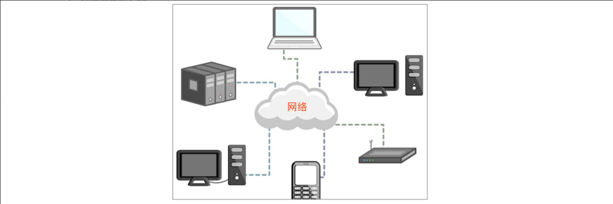
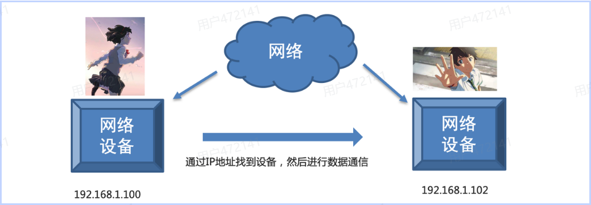
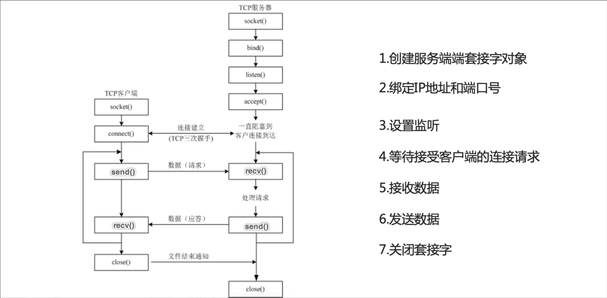
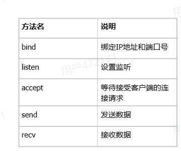
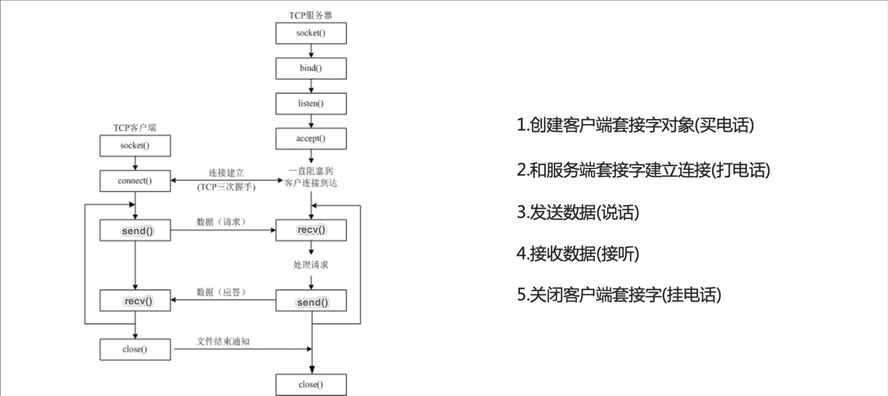
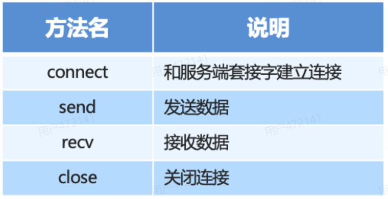

# 网络编程

Python 网络编程的生态是分层递进的：从最底层直接操作套接字的 `socket`，到帮你管理并发的 `socketserver` 和 `selectors`，再到面向高并发的 `asyncio`，最后是处理具体协议（HTTP/WebSocket）的库和框架。

## 一、网络的概念

网络就是将具有独立功能的多台计算机通过通信线路和通信设备连接起来，在网络管理软件及网络通信协议下，实现资源共享和信息传递的虚拟平台。



> 在网络编程中，“网络”的概念可以概括为：**跨越不同物理主机，实现两个（或多个独立进程之间数据交换的抽象层）**

### 1、网络编程的核心本质：进程间通信(IPC)

在单台电脑上，两个程序交换数据叫“本地进程间通信”(比如通过管道、共享内存)。

**网络编程，本质上就是“跨主机的进程间通信”**。

程序员眼中的网络，就是一根“无限长的虚拟内存总线”，让运行在北京服务器上的程序A，能够像读取本地内存一样，向运行在上海服务器上的程序B发送一段字节流。

### 2、程序员视角的四大基础概念

在写网络代码时，我们天天打交道的概念是这几个：

- **IP地址(定位主机)**：相当于现实中的“门牌号”。编程中，IP 决定了数据包要发送到哪一台物理机器上。
- **端口号(Port，定位进程)**：一台服务器上跑着微信、QQ、网页服务、IP只能找到这台服务器，**端口号**才能精准找到具体是哪个程序在收发数据。(例如：HTTP 服务通常监听 80 或 443 端口)
- **Socket(套接字)**：这是网络编程**最核心的抽象**。你可以把它理解为 “插座” 或 “文件句柄” 。程序员通过调用 `socket()` 函数，拿到一个可以像读写文件一样去读写网络数据的对象。
- **协议(Protocol，通信规则)**：底层通常是 TCP 或 UDP
  - **TCP**：像打电话，面向连接、可靠、保证顺序(常用于网页、文件传输)
  - **UDP**：像寄明信片，无连接、不可靠、速度快(常用于视频直播、游戏)

### 3、网络编程的基本模型：客户端/服务器(C/S模型)

在网络编程中，网络被抽象成了“服务器端(Server)”和“客户端(Client)” 两端，这叫 C/S 架构(或者 B/S 架构，即浏览器/服务器)


- **服务器(Server)**：永远在监听某个端口，等待别人来连接。(编程流程：`socket()` -> `bind()` 绑定IP端口 -> `listen()`监听 -> `accept()` 阻塞等待连接 -> `read()`/`write()` 读写数据)
- **客户端(Client)**：主动发起连接去敲服务器的门。(编程流程：`socket()` -> `connect()` 连接服务器 -> `send()`/`recv()` 读写数据)

### 4、数据的本质：字节流(Byte Stream)

在网络编程中，网络里没有“对象”，没有“字符串”，没有“图片”，**只有一连串的 0 和 1 (字节流)**。
程序员眼中的网络，就是一个 **传送字节的管道**。 发送方要把结构体、JSON、图片序列化成字节流(打包)，通过网络发送出去；接收方收到字节流后，在反序列化成程序能懂得数据(解包)。这就引出了网络编程中极难得几个坑：**粘包、半包、拆包、字节序(大端小端)问题。**

### 5、程序员眼中的“网络分层”

虽然教科书有 OSI 七层模型，但程序员主要关注的是 **应用层** 和 **传输层**：

- **应用层**：程序员自己写代码的层级(定义自己的JSON格式、通信指令)
- **传输层**：调用操作系统提供的 TCP/UDP 接口(Socket API)
- **网络层及以下**：完全由操作系统内核和硬件搞定，程序员不直接干预。

### 6、对比

- **传统概念里的网络**：是 **基础设施**(一条信息高速公路)
- **网络编程中的网络**：是 **一条软件管道(Socket)** 。程序员的工作，就是打开这根管子，把自家的数据塞进去，或者从管子里把别人的数据捞出来。

## 二、IP地址

IP 地址就是互联网世界中，每一台设备的“门牌号”或“身份证号”。

### 1、IP地址的作用



通过计算机的 IP 地址来实现，IP 地址是分配给网络设备上网使用的数字标签，它能够标识网络中唯一的一台设备。

### 2、IP地址的基础结构

目前最常用的是 **IPv4 地址**。

- **长相**：它是由 32 位二进制数组成的，为了人类好记，通常写成 **点分十进制** 的形式，比如：`192.168.1.1`
- **组成**：它包含两部分信息(就像门牌号包含“那个小区”和“几号楼几零几”)
  - **网络号(Network ID)**：代表你所在的局域网(比如某个小区)
  - **主机号(Host ID)**：代表你这个设备(比如小区里的某户人家)
  - 怎么区分两者？靠 **子网掩码(Subnet Mask)** 来划分，比如常见的 `255.255.255.0`

> 补充：IPv6
> IPv4 只有约 43 亿个地址，早就分完了。所以现在在推行 IPv6(128位)，长相类似 `2001:0db8:85a3::8a2e:0370:7334`，他的数量多到“可以给地球上的每一粒沙子分配一个IP”

### 3、IP地址的分类(按使用场景分)

这是日常最容易混淆的地方，必须区分 **公网 IP** 和 **私网 IP** 。

- **公网 IP(Public IP)**：全球唯一，就像真实的家庭住址。只要你的设备连上互联网和世界各地的服务器通信，靠的就是公网 IP。
- **私网 IP(Private IP/ 局域网 IP)**：只在局部网络(如你家里的路由器、公司内网)内有效。
  - 常见的私网 IP 段：`192.168.x.x`、`10.x.x.x`、`172.16.x.x`到`172.31.x.x`。
  - 比喻：就像公司内部的“工位号(如A区12号)”，出了公司大门(公网)没人认识。你家的手机、电脑、智能家电，分配到的几乎都是私网 IP。他们通过家里的路由器 (NAT技术) 共享一个公网 IP 上网。

### 4、网络编程中必知的几个 “特殊” IP

如果你写代码，一定会遇到下面这几个特别的 IP：

- `127.0.0.1`：**本机回环地址**
  - 含义：代表“我自己的主机”
  - 作用：哪怕你的电脑没插网线、没连 Wi-Fi，你 ping `127.0.0.1` 也一定能通。程序员本地测试自己的代码时，经常把服务器绑定在这个地址上，数据根本不经过网卡，直接在内核里转一圈就回来了。
- `0.0.0.0`
  - 含义：代表“本机所有的IP地址”
  - 作用：在写服务器代码时，如果让服务器监听 `0.0.0.0:8080`，意味着无论客户端时通过 `127.0.0.1`（本机）还是通过 `192.168.1.5`（局域网 IP），都能连上你的服务。
- `255.255.255.255`：广播地址，发给这个地址的数据，局域网里的所有设备都能收到。
- 在每个网段中：
  - 第一个 IP 是 **网络地址（Network Address）**，不能用
  - 最后一个 IP 是 **广播地址（Broadcast Address）**，不能用
  - IP地址 = 网络号+主机号
  - **对于一个标准的网段，可用主机数 = 总 IP 数 - 2（减去网络地址和广播地址）**。所以在配 IP 的时候，千万别给设备配上 **主机位全 0(网络地址)** 或者 **主机位全 1(广播地址)**，否则网络是不通的

### 5、IP 与 端口(Port)的关系（网络编程核心）

在上一节提到，网络编程是 “进程间通信”。IP 地址只解决了“**找哪台电脑**”的问题，但一台电脑上同时开着微信、浏览器、游戏。

- **IP 地址 + 端口号 = Socket(套接字)**
- **比喻**：IP地址是“某某小区3号楼”，而端口号(比如HTTP是80，HTTPS是443)就是“3号楼里的几零几室”
- 只有IP和端口拼在一起(例如`192.168.1.1:8080`)，数据才能准确送到对应电脑上对应的软件里。

### 6、IP是动态分配的吗？

- **静态 IP**：固定不变的 IP。通常用于服务器(比如百度的服务器 IP 是固定的)，或者公司里的网络打印机。
- **动态 IP**：每次联网时，由 DHCP 协议自动临时分配的IP。你家里的手机、电脑连 Wi-Fi 时拿到的就是动态 IP，重启路由器后可能就变了。

### 7、总结

在网络编程中，**IP 地址是用来在广阔的互联网中，精准定位到某一台物理主机的“网络层”逻辑地址**。它配合 MAC 地址（物理硬件地址，相当于设备的指纹）进行底层传输，配合端口号（Port）找到具体的应用程序，最终完成了全世界电脑的互联互通。

## 三、端口号

### 1、为什么需要端口号？

一台电脑(一个IP)上，同时运行着浏览器、微信、QQ、游戏、后台服务等几十个程序。当网络上发来一个数据包，操作系统怎么知道这个数据包是该交给浏览器，还是交给微信？

**端口号就是用来解决这个问题的。**它用来标识一台主机上的 **具体进程(应用程序)**。

### 2、端口号的范围与结构

- 范围：`0~65535`
- 本质：它是一个 16 位的无符号整数(2的16次方减1)。这也是为什么端口号最大只有65535
- 独立存在：TCP协议和UDP协议的端口号是 **相互独立**的。也就是说，TCP 的 80 端口和 UDP 的 80 端口可以同时被不同的程序使用，互不冲突。

### 3、端口号的三大分类（按用途划分）

这 65535 个端口并不是随便用的，国际组织（IANA）把它们分成了三段：

- **周知端口(Well-known Prots)** ：`0~1023`
  - **特点**：这些端口被系统保留，专门给 **服务器端** 的知名服务使用。普通用户程序如果没有权限（非root/管理员），是绑定不了这些端口的。
  - **常见的例子**：
    - **80**：HTTP（网页服务）
    - **443**：HTTPS（加密网页服务）
    - **22**：SSH（远程登录）
    - **21**：FTP（文件传输）
    - **53**：DNS（域名解析）
- **注册端口(Registered Ports)**：`1024~49151`
  - **特点**：这些端口没有系统限制，主要分配给用户安装的普通应用程序（尤其是各种数据库、中间件、游戏服务器）
  - **常见例子**：
    - **3306**：MySQL数据库
    - **6379**：Redis数据库
    - **8080**：Tomcat服务器（或者用作备用网页端口）
    - **1521**：Oracle数据库
- **动态/私有端口(Dvnamic/Private Ports)**：`49152~65535`
  - **特点**：这些端口通常 **不固定分配给某个程序**，而是由操作系统 **临时随机** 分配。
  - **谁来用？客户端！**：当你用浏览器访问百度时，你的电脑作为客户端，操作系统会随机给你分配一个比如 `54321` 的端口，用来和百度的 `443` 端口通信。通信结束后，这个端口就被回收了。

### 4、结合网络编程看端口(非常关键！)

写代码时，客户端和服务器端对端口的使用逻辑时完全不同的：

- **服务器端（Server）：必须固定端口**。
  - 比如你写一个聊天室服务器，你必须把它绑定在 `8080` 端口。这叫 “监听(Listen)”。如果服务器端口变来变去，客户端就找不到你了。
- **客户端（Client）：不需要指定端口（通常由操作系统随机分配）**
  - 当你写客户端代码去连接服务器时，你只需要填服务器的 IP 和端口（例如`192.168.1.10:8888`）。你自己的电脑用哪个端口发出去，操作系统会自动帮你搞定。

### 5、一个常见误区

**不同电脑上的端口可以重复吗？**
**完全可以。**你电脑上的微信使用了 `8080` 端口，地球另一端别人的电脑上的程序也完全可以使用 `8080` 端口，你们不会冲突。因为 **IP地址决定了是哪台电脑，端口号决定了是那个程序。**只要 IP+端口 这个组合在全球网络中或者局域网内不冲突即可。

### 总结一下

- **IP** 负责在浩瀚的互联网中找到 **哪一台机器**。
- **端口** 负责在那台机器上找到 **哪一个软件**。
- 没有端口，你的电脑收到数据包就会 “一脸懵逼”，不知道给谁处理。这也是为什么你做网络安全（防火墙配置）时，不仅要限制 IP，还要限制端口（比如只允许外部访问你的 80 端口，关闭 3306 端口以防数据库泄露）。

## 四、传输层协议（TCP/UDP）

在网络编程和通信中，**TCP（传输控制协议）** 和 **UDP（用户数据报协议）** 是传输层的两员大将。之前了解的 IP 地址负责找到机器，端口号负责找到软件，而 **TCP 和 UDP 则决定了数据到底以什么样的规则在管道里传输**。

### 1、TCP 协议（Transmission Control Protocol）

TCP 的核心思想是：**绝对可靠，绝不丢包，顺序不乱**

#### 核心特征

- **面向连接**：通信前必须先建立连接 (著名的 **三次握手**)
- **可靠传输**：数据不丢失、不重复、按顺序到达。如果丢包了，TCP会自动重传。
- **面向字节流**：TCP 把数据看作是一连串没有边界的 “水流”。这也导致了网络编程中非常头疼的 **“粘包/半包”问题**（程序员需要自己写代码切分数据）
- **全双工**：双方可以同时向对方发送数据。

#### 三大核心机制（为什么它可靠？）

- **三次握手（建立连接）**：客户端：“我要连你(SYN)”；服务器端：“好的，你连吧(SYN+ACK)”；客户端：“收到，我开始发了(ACK)”。必须三次，为了确认双方都有收发能力。
- **四次挥手(断开连接)**：应为 TCP 是全双工的，双方都要确认自己的数据发完了，所以要分四次告别。
- **确认与重传(ACK)**：发送发发了一段数据，接收方必须返回一个ACK确认。如果发送方等了一段时间没收到 ACK，就认为丢包了，立刻重发。

#### 优缺点

- **优点**：极度安全、可靠，数据完整
- **缺点**：慢。建立连接慢，传输过程要确认也慢，网络拥堵时还会触发 “拥塞控制” 降速。

### 2、UDP 协议(User Datagram Protocol)

UDP 的核心思想是：**我尽力了，快就行，其他的我不管**。

#### 核心特性

- **无连接**：不需要三次握手，想法数据直接往网络上仍，拿起来就发。
- **不可靠传输**：不保证数据到达，不保证顺序，也不管是否重复。发出去就不管了，没有确认和重传机制。
- **面向报文**：UDP 是一包一包发的，有明确的边界（不会像 TCP 那样粘包）。程序发一次数据，接收方就收一包，界限分明。
- **支持一对一、一对多（广播/多播）**

#### 优缺点

- **优点：极快**、开销小、实时性强。没有握手和确认的延迟，网络卡的时候也不会像 TCP 那样死等重传
- **缺点**：容易丢包，数据顺序可能错乱，需要应用层（程序员自己写代码）去处理这些容错问题。

### 3、TCP与UDP对比

| 对比维度 | **TCP** | **UDP** |
|---|---|---|
| **连接性** | 面向连接（必须握手） | 无连接（直接发） |
| **可靠性** | 可靠（无丢失、无差错、有序） | 不可靠（尽力交付） |
| **传输速度** | 慢 | 快 |
| **数据边界** | 面向字节流（有粘包问题） | 面向数据包（无粘包问题） |
| **头部开销** | 大（至少 20 字节） | 小（仅 8 字节） |
| **使用场景** | 要求数据绝对不能错的场景 | 要求速度极快，能容忍少量丢包的场景 |

### 4、应用场景

#### 选 TCP 的场景：

只要你的数据 **绝对不能丢** ，错一个字都不行，必须选 TCP

- **网页浏览（HTTP/HTTPS）**：网页上的文字、图片少一块就乱了
- **文件传输（FTP）**：下载电影，少一个字节文件就损坏打不开。
- **发送邮件（SMTP/POP3）**：邮件内容不能有缺失。
- **数据库连接**：金融交易数据，绝对不允许出错。

#### 选 UDP 的场景

只要你的数据要求 **极低延迟**，且能容忍偶尔丢一两帧（丢了一点也不影响整体体验），选 UDP

- **视频直播/语音通话(VoIP)**：卡顿 0.5 秒比丢失一帧画面更让人抓狂，丢一阵画面人眼根本看不出来，但如果用 TCP 等重传，画面就会卡死。
- **网络游戏（如王者荣耀、吃鸡）**：玩家的文职信息必须实时更新，如果延迟 1 秒等重传，你早就被击杀了。丢一帧位置信息没关系，下一秒的新位置马上就到了。
- **DNS域名解析**：你搜索一个网址，就发一小段文本，通常几毫秒就发完了，如果丢了顶多重新查一次，用 TCP 握手反而太慢了。
- **广播/多播**：比如局域网内寻找设备。

### 5、进阶补充（网络编程视角）

1. **QUIC协议（新时代的产物）**：由于 TCP 太慢，UDP 又不靠谱，Google开发了QUIC协议（现在 HTTP/3）的底层。它 **基于UDP**，但是再 UDP 之上用代码实现了 TCP 的可靠机制。既保留了 UDP 的快，又实现了 TCP 的稳。
2. **粘包问题**：只有 TCP 会有粘包问题，因为它是 “流水”。UDP 是 “包裹”，接收方一次收一个完整的包裹，绝不对把两个包裹粘在一起（但可能会丢包裹）。
3. **代码体现**：在 Socket 编程中，创建 TCP 就像建了一座桥，发数据是 `write()` ，收数据是 `read()`；创建 UDP 就像写信，发数据是 `sendto()`（必须指定地址），收数据是 `recvfrom()` （可以拿到对方的地址）。

## 五、编码转换

在网络编程中，我们常说：“网络里没有文字、图片、对象，只有 0 和 1 的字节流。”编码转换，说白了就是 **把人类能看懂的 “字符/数据”，变成计算机能传输的“字节”**，或者反过来。

### 1、通俗比喻：发电报与翻译

假设你要给国外的笔友寄一封信：

- **字符（Character）**：你用中文写的“你好”
- **编码（Encode）**：邮局把它翻译成国际通用的摩斯密码（转换为标准格式）。
- **传输（网络）**：信件在途中变成了滴滴答答的点播（字节流）
- **解码（Decode）**：必有收到电波，把它翻译回英文“Hello”

如果你的必有用 “英文解密规则” 去解你的 “中文密码”，接出来的就是一堆乱码。**编码转换，就是确保双方使用同一本“密码本”**。

### 2、核心概念：字符集与编码

要搞懂编码转换，必须分清两个词：**字符集（Charset）** 和 **编码（Encoding）**。

- **字符集（字典）**：给世界上所有的文字、符号编个号。
  - 比如规定：`65` 代表字母 `A` ，`20320` 代表汉字 `你`
  - 常见的有：**Unicode（万国码）**，它收录了世界上几乎所有的字符。
- **编码(存储/传输规则)**：把字典里的编号，转换成计算机能存的 0 和 1。
  - 常见的有：**UTF-8、GBK、ASCII**
  - 打个比方：`Unicode` 是 “新华字典”，`UTF-8` 是“怎么把这些字写在纸上（使用铅笔写还是毛笔写，占几个格子）”。

### 3、三大主流编码格式

1. **ASCII（美国信息交换标准代码）**
   - **能力**：最古老，只能存128个字符（英文字母、数字、标点）
   - **特点**：1个英文字母占 **1个字母(8位)**。遇到中文直接抓瞎。
2. **GBK（国际扩展码）**
   - **能力**：中国自己发明的，包含了中文和日韩文字。
   - **特点**：1 个英文字母占 1 个字节，1 个汉字占 **2 个字节**。
   - **痛点**：在国外电脑上打开经常乱码
3. **UTF-8（万国码的 8 位编码）**
   - **能力：目前全球互联网的绝对霸主**。包含了地球上所有语言。
   - **特点**：变长编码。1 个 英文字母占 1 个字节，1 个常用汉字通常占 **3 个字节**（生僻字占 4 个）
   - **优势**：全世界通用，支持所有语言的混合显示。

### 4、网络编程中为甚恶魔总遇到“乱码”？

```python
# 发送端（Python 为例）
data = "你好"
bytes_data = data.encode("utf-8") # 【编码】变成字节流：b'\xe4\xbd\xa0\xe5\xa5\xbd'
# 接着通过 TCP/UDP 发送这几个字节
```

接收端收到这几个字节后，必须进行 **解码转换**：

```python
# 接收端
raw_bytes = b'\xe4\xbd\xa0\xe5\xa5\xbd'
text = raw_bytes.decode("utf-8") # 【解码】变成："你好"
```

**如果接收端手滑，写成了 `raw_bytes.decode('gbk')`，或者浏览器默认用 GBK 去解析 UTF-8 的网页，就会出现我们最讨厌的“乱码”（比如：`浣犲ソ`）。**
**乱码的本质：编码和解码使用了不同的规则。**

### 5、网络编程中其他重要的“编码转换”

除了文本（UTF-8），在网络编程中，程序员还要处理以下数据的“编码转换”（通常叫 **序列化**）：

1. **数据序列化转换（对象转字节）**
   - 你要通过网络发送一个“用户对象（包含姓名、年龄、头像）”。你不能直接发内存里的对象。
   - 你需要转换成 **JSON字符串** (`{"name": “张三”, "age": 18}`)，在转换成字节流发送。
2. **Base64编码**
   - 图片、音频在网络中本来也是二进制字节。但有时候在HTTP协议或JSON里，不能直接传二进制
   - 这时候就用 Base64，把二进制数据“编码”成一串纯英文字母和数字。接收方再 Base64 解码还原成图片。
3. **URL编码(百分号编码)**
   - 在浏览器网址里，你不能直接输入中文空格等。系统会把它们转换成 `%E4%BD%A0%E5%A5%BD` 这种格式发给服务器。
4. **数据格式转换（如大端小端）**:
   - 如果一个数字 `255`，在内存里可能存为 `00 00 00 FF`（大端）或 `FF 00 00 00`（小端）。网络传输时，双方必须约定好网络字节序（通常是大端），这里涉及底层字节的转换。

### 总结

- Encode（编码）：把人类可读的字符、高级语言的复杂对象，编程无意义的二进制字节流，扔进 TCP/UDP 的管道里。
- Decode（解码）：从管道里捞出字节流，按照约定的“密码本”，翻译成人类能看懂的文字或程序能处理的数据。
- 发之前先编码，收之后先解码，双方密码本（字符集）必须一致。

## 基石：socket模块（TCP/UDP）

`socket` 是绝大多数网络通信的底层基础，它提供了对 BSD 套接字接口的访问。理解它有助于理解上层所有协议的工作原理。

### 核心概念 `AF_INET` 与 `SOCK_STREAM`/`SOCK_DGRAM`

创建套接字时，需要制定地址簇和套接字类型：

- `AF_INET`：IPv4地址簇(`AF_INET6`对应IPv6)
- `SOCK_STREAM`：对应 **TCP**，面向连接、可靠、有序的字节流。
- `SOCK_DGRAM`：对应 **UDP**，无连接、不可靠、保留消息边界的数据报。

### TCP 服务端与客户端





TCP 服务端的标准流程是 `socket()` -> `bind()` -> `listen()` -> `accept()` -> `recv()/send()` -> `close()`

```python
import socket

# TCP Server
with socket.socket(socket.AF_INET, socket.SOCK_STREAM) as server:
    server.setsockopt(socket.SOL_SOCKET, socket.SO_REUSEADDR, 1)  # 关键：允许快速重启
    server.bind(("127.0.0.1", 8080))
    server.listen(5)
    conn, addr = server.accept()
    with conn:
        data = conn.recv(4096)
        conn.sendall(b"Echo: " + data)
```

`SO_REUSEADDR` 是一个常见且重要的选项，可以避免服务重启时出现 `Address already in use` 错误

TCP 客户端则更直接：`connect()` -> `sendall()` -> `recv()`





```python
# TCP Client
with socket.socket(socket.AF_INET, socket.SOCK_STREAM) as sock:
    sock.settimeout(5.0)
    sock.connect(("127.0.0.1", 8080))
    sock.sendall(b"Hello")
    response = sock.recv(4096)
```

### UDP 服务端和客户端

UDP 没有 `listen()` 和 `accept()` ，收发数据使用 `sendto()` / `recvfrom()` 。

```python
# UDP Server
with socket.socket(socket.AF_INET, socket.SOCK_DGRAM) as server:
    server.bind(("127.0.0.1", 8081))
    data, addr = server.recvfrom(4096)
    server.sendto(b"Ack: " + data, addr)

# UDP Client
with socket.socket(socket.AF_INET, socket.SOCK_DGRAM) as sock:
    sock.sendto(b"Hello", ("127.0.0.1", 8081))
    response, _ = sock.recvfrom(4096)
```

### TCP vs UDP 速查

|  | TCP(`SOCK_STREAM`) | UDP(`SOCK_DGRAM`) |
|---|---|---|
| 连接 | 面向连接(`connect`/`accept`) | 无连接 |
| 可靠性 | 可靠、有序、有重传 | 不可靠、可能丢包/乱序 |
| 消息边界 | **无**(字节流，需自行处理粘包) | **有**(每次`recvfrom`是一条消息) |
| 典型用途 | HTTP、WebSocket、文件传输 | DNS、视频流、游戏、广播 |

## 并发模型：从多线程到I/O多路复用

原始 `socket` 默认是 **阻塞** 的：`accept()` 会卡住等待连接，`recv()` 会卡住等待数据。要让服务器同时处理多个客户端，用几种递进的策略。

### 多线程：每个连接一个线程

最直观的做法，在 `accept()` 后位每个连接启动一个线程：

```python
import threading

def handle_client(conn, addr):
    with conn:
        while data := conn.recv(4096):
            conn.sendall(b"Echo: " + data)

while True:
    conn, addr = server.accept()
    threading.Thread(target=handle_client, args=(conn, addr), daemon=True).start()
```

简单有效，但线程数量随连接数线性增长，成百上千连接时线程切换和内存开销会显著上升。

#### `socketserver`:标准库的服务器框架

`socketserver` 把 “监听 -> 接收 -> 分派给处理器” 的样本代码封装了起来。你只需继承 `BaseRequestHandler` ，实现 `handle()` 方法。

```python
import socketserver

class EchoHandler(socketserver.BaseRequestHandler):
    def handle(self):
        data = self.request.recv(1024)
        self.request.sendall(data)

# 单线程版本（一次处理一个连接）
with socketserver.TCPServer(("localhost", 8888), EchoHandler) as server:
    server.serve_forever()

# 多线程版本
with socketserver.ThreadingTCPServer(("localhost", 8888), EchoHandler) as server:
    server.serve_forever()
```

只需要把 `TCPServer` 换成 `ThreadingTCPServer` ，就获得了并发能力，无需手写线程管理。`ForkingTCPServer` 则使用多进程 (Unix)

#### `selectors`：单线程I/O多路复用

**I/O多路复用**的核心思想是：用一个线程同时监视多个套接字，当某个套接字就绪(可读/可写)时才去处理它。`selectors` 模块提供了跨平台的高层封装，自动在底层选择 `select`/`poll`/`epoll`/`kqueue`。

```python
import selectors, socket

sel = selectors.DefaultSelector()

def accept(sock):
    conn, addr = sock.accept()
    conn.setblocking(False)
    sel.register(conn, selectors.EVENT_READ, data=handle)

def handle(conn):
    data = conn.recv(4096)
    if data:
        conn.sendall(b"Echo: " + data)
    else:
        sel.unregister(conn)
        conn.close()

server = socket.socket()
server.bind(("localhost", 9000))
server.listen()
server.setblocking(False)
sel.register(server, selectors.EVENT_READ, data=accept)

while True:
    for key, mask in sel.select():
        key.data(key.fileobj)      # 回调：accept 或 handle
```

这种方式单线程即可管理数百上千连接，没有线程开销，是 `asyncio` 之前高性能服务器的经典写法。代价是代码从 “线性流程” 变成了 “事件回调” ，可读性会下降。

### 并发模型对比

| 模型 | 并发能力 | 代码复杂度 | 适用场景 |
|---|---|---|---|
| 阻塞 + 多线程 | 中（受线程数限制） | 低 | 连接数不多、逻辑简单 |
| `socketserver` | 中 | 很低 | 快速搭建标准服务器 |
| `selectors`多路复用 | 高 | 较高（回调风格） | 需要极高性能、可控的事件循环 |
| `asyncio` | 高 | 中(`async/await`风格) | 现代异步应用首选 |

## 现代方式：`asyncio`网络编程

`asyncio` 是 Python 标准库的异步I/O框架，底层本质上也是事件循环 + I/O 多路复用，但通过 `async` / `await` 语法，让异步代码 **写起来像同步代码** ，避免了回调地狱。

### Streams：高层异步原语

`asyncio` 提供了 **Streams API**，用 `StreamReader` 和 `StreamWriter` 封装了底层的协议和传输。

#### TCP 服务端：

```python
import asyncio

async def handle(reader, writer):
    data = await reader.read(4096)
    writer.write(b"Echo: " + data)
    await writer.drain()
    writer.close()
    await writer.wait_closed()

async def main():
    server = await asyncio.start_server(handle, "127.0.0.1", 8888)
    async with server:
        await server.serve_forever()

asyncio.run(main())
```

#### TCP 客户端

```python
async def tcp_client():
    reader, writer = await asyncio.open_connection("127.0.0.1", 8888)
    writer.write(b"Hello")
    await writer.drain()
    data = await reader.read(4096)
    print(data)
    writer.close()
    await writer.wait_closed()

asyncio.run(tcp_client())
```

`await writer.drain()` 用于处理背压(backpressure)，确保数据不会无限制地堆积在缓冲区。

#### 底层协议与传输

`asyncio` 还提供了更底层的 `Protocol` / `Transport` 抽象，适合需要精细控制或实现自定义协议的场景，但日常开发中 Streams 通常已经足够。

## 处理HTTP：客户端与服务器

### HTTP客户端：`requests`/`httpx`/`aiohttp`

直接用 `socket` 拼 HTTP 请求当然可以，但几乎不会有人这么做。Python 生态中有三个主流 HTTP 客户端：

| 库 | 同步/异步 | 核心定位 | 选型建议 |
|---|---|---|---|
| `requests` | 仅同步 | 简单直观的行业标准 | 脚本、爬虫、简单接口调用 |
| `httpx` | **同步 + 异步** | "现代版 requests"，API几乎兼容 | 新项目首选，需要同时支持两种模式 |
| `aiohttp` | 仅异步 | 原生 `asyncio` 的高并发客户端/服务器端 | 已有 `asyncio` 栈的高并发场景 |

`requests`示例：

```python
import requests
response = requests.get("https://api.github.com/user", timeout=5)
print(response.status_code, response.json())
```

`httpx` 异步示例：

```python
import httpx, asyncio

async def main():
    async with httpx.AsyncClient() as client:
        response = await client.get("https://api.github.com/user")
        print(response.json())

asyncio.run(main())
```

`httpx` 的设计目标是 “做一个同时支持同步和异步的 `requests`”，熟悉 `requests` 的人上手成本几乎为零。在并发场景下，`asyncio.gather` 可以轻松并行发起大量请求。

> 如果 `requests` 已经满足需求且没有性能问题，不必为了 “异步” 而迁移。异步的收益只在 I/O 密集且高并发时才显著。

### HTTP服务器：`http.server`(标准库)

标准库的 `http.server` 适合快速搭建简单的 HTTP 服务，或用于测试/原型。

```python
from http.server import HTTPServer, BaseHTTPRequestHandler
import json

class Handler(BaseHTTPRequestHandler):
    def do_GET(self):
        self.send_response(200)
        self.send_header("Content-Type", "application/json")
        self.end_headers()
        self.wfile.write(json.dumps({"message": "ok"}).encode())

    def do_POST(self):
        length = int(self.headers["Content-Length"])
        body = self.rfile.read(length)
        # 处理 body ...

HTTPServer(("0.0.0.0", 8000), Handler).serve_forever()
```

继承 `BaseHTTPRequestHandler` 并实现 `do_GET` / `do_POST` 等方法即可。
`SimpleHTTPRequestHandler` 则直接提供了一个文件服务器。

**但 `http.server` 不适合生产环境**：它是单线程阻塞的，没有并发能力，也没有安全防护和性能优化。

### Web 框架：Flask / FastAPI

生产级 HTTP 服务通常使用 Web 框架。一个关键的底层区别是 **WSGI vs ASGI**:

|  | **WSGI** (如 Flask) | **ASGI** (如 FastAPI) |
|---|---|---|
| 模型 | 同步、阻塞 | 异步、非阻塞 |
| 并发 | 依赖多线程/多进程 | 原生支持异步并发 |
| 高并发表现 | 在极端负载下可能不稳定 | 表现更稳定 |
| 典型代表 | Flask、Djange | FastAPI、Starlette |

Flask 提供小巧的核心(路由、模板、JSON)，上手快，适合原型和负载不高的微服务；FastAPI 基于ASGI，内置数据校验和自动 API 文档，在高吞吐场景下是更现代的选择。

## WebSocket：双向实时通信

HTTP 是请求-响应模式，服务器不能主动推送。**WebSocket** 在单个 TCP 连接上提供全双工通信，适合聊天、实时通知、协同编辑等场景。

Python 生态中最常用的库是 `websockets` ，它基于 `asyncio` ，专注于正确性、简洁性和性能。

```python
import asyncio, websockets

# 服务端
async def echo(websocket):
    async for message in websocket:
        await websocket.send(f"Echo: {message}")

async def main():
    async with websockets.serve(echo, "localhost", 8765):
        await asyncio.Future()  # 永久运行

asyncio.run(main())

# 客户端
async def client():
    async with websockets.connect("ws://localhost:8765") as ws:
        await ws.send("Hello")
        print(await ws.recv())

asyncio.run(client())
```

## 选型指南

| 你的需求 | 推荐方案 |
|---|---|
| 理解网络原理、实现自定义协议 | `socket`(TCP/UDP) |
| 快速搭建一个标准 TCP/UDP 服务器 | `socketserver` (`ThreadingTCPServer`) |
| 单线程管理大量连接、精细控制事件循环 | `selectors` |
| 现代异步 TCP/UDP 服务 | `asyncio` Streams |
| 简单脚本调 API、爬虫 | `requests` |
| 新项目，需要同步/异步灵活切换 | `httpx` |
| 已有 asyncio 栈的高并发 HTTP 客户端 | `aiohttp` |
| 临时测试用的 HTTP 服务器 | `http.server` |
| 生产级同步 Web 服务 | Flask / Django(WSGI) |
| 生产级异步/高并发 API | FastAPI (ASGI) |
| 实时双向通信 | `websockets` |

**核心原则**：不要从底层 `socket` 开始手写 HTTP 或 WebSocket 协议。用正确的库处理正确的层级 -- `socket` 用于学习和自定义协议，`asyncio` 用于 异步I/O，`httpx` / `requests` 用于 HTTP 客户端，Web框架用于服务器。

