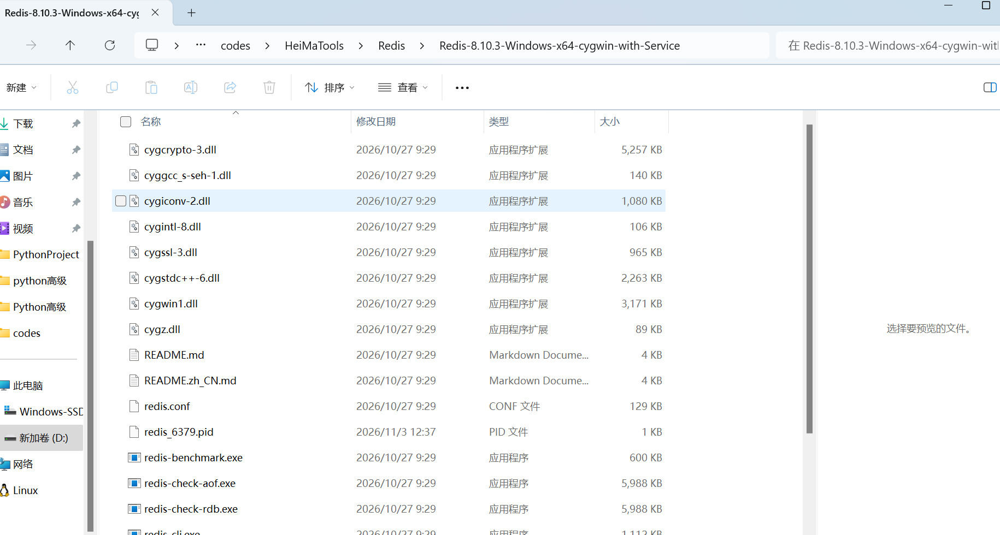
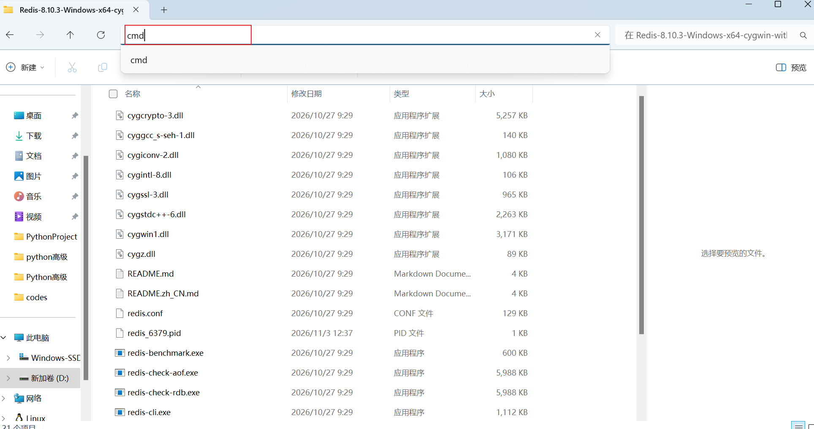

# Redis 安装

1. 下载 Redis 免安装文件

打开 `https://github.com/redis-windows/redis-windows/releases` Redis github仓库，下载文件压缩包，并解压



2. 在redis文件夹下打开cmd，试运行，**默认端口 6379**



输入 `redis-server.exe redis.conf` 前台启动 Redis 服务进程，关闭这个cmd就停止了

D:\codes\HeiMaTools\Redis\Redis-8.10.3-Windows-x64-cygwin-with-Service

3. (可选) 装成 Windows 服务，开机自启

```bash
RedisService.exe install -c redis.conf --port 6379 --dir D:\codes\HeiMaTools\Redis\data
net start Redis
```

4. 测试 Redis 是否正常工作

cmd:

```bash
# 连接 Redis 客户端
D:\binzi\software\reidis3.0.504>redis-cli

# 在 Redis 客户端中测试
127.0.0.1:6379> ping
PONG
127.0.0.1:6379> set test "Hello Redis"
OK
127.0.0.1:6379> get test
"Hello Redis"
127.0.0.1:6379> exit
```
