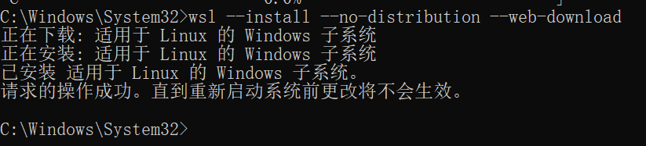
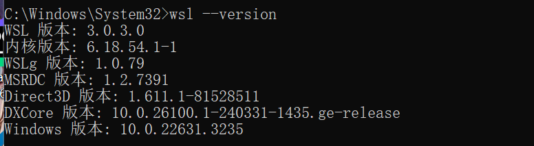
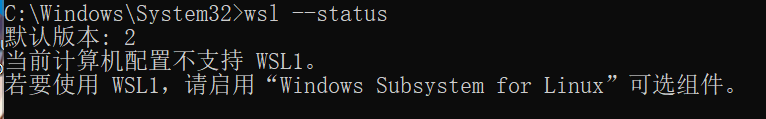
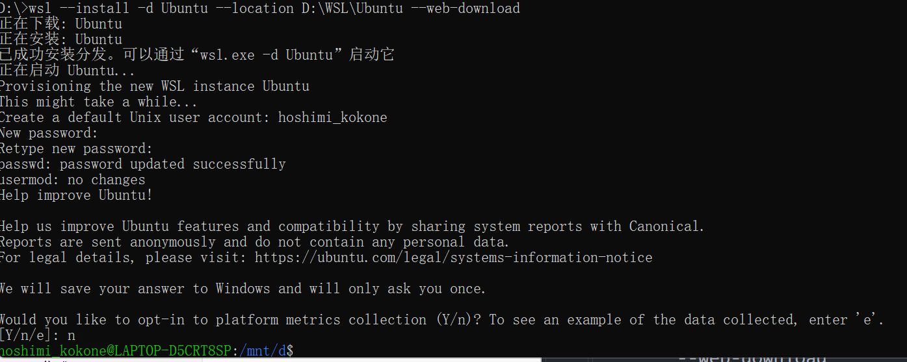
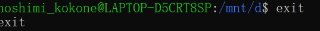
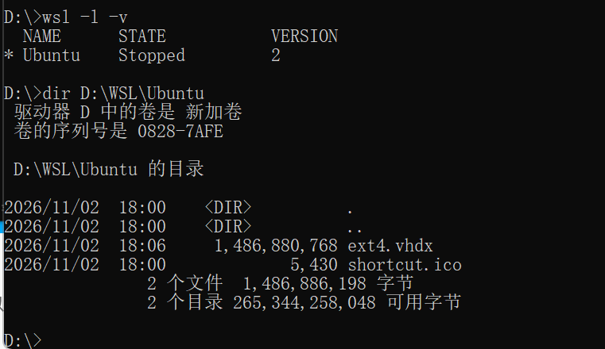
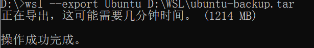

## 检查虚拟化
打开任务管理器，点击CPU，查看虚拟化已启动。若未启动，需进入 bios 启动虚拟化

## 安装

### 第 1 步：先只安装 WSL 运行时，不安装发行版

用 **管理员身份** 打开终端，然后执行：

```bash
wsl --install --no-distribution --web-download
```



安装成功，重启电脑

### 第 2 步：重启后，回来跑这二条确认

```bach
wsl --version
wsl --status
```





### 安装 Ubuntu

```
# 创建 D:\WSL 文件夹
mkdir D:\WSL

# 下载 Ubuntu 并用 WSL2 导入到 D 盘，执行完成后，Ubuntu 会自动启动，让你设置 Linux 用户名和密码
wsl --install -d Ubuntu --location D:\WSL\Ubuntu --web-download
```

输入 Ubuntu 的用户名和密码



输入 `exit` 退出



验证

```bash
wsl -l -v
dir D:\WSL\Ubuntu
```



### 最后三件收尾事

1. **把 swap 文件也指向 D 盘** (默认还在 C 盘的 Temp 里，最大能吃到内存的 25%)
新建 `C:\Users\lenovo\.wslconfig`:

```ini
[wsl2]
swapFile=D:\\WSL\\swap.vhdx
```

然后执行 `wsl --shutdown` 生效


2. **做一次备份**

```bash
wsl --export Ubuntu D:\WSL\ubuntu-backup.tar
```



以后环境弄坏、或者换电脑，`wsl --import` 就能还原。这一步只要几分钟，是最值得做的一步。

3. **初始化一下开发环境** (可选)
进 Ubuntu 后：

```bash
sudo apt update && sudo apt upgrade -y
sudo apt install -y build-essential git curl wget unzip
```

## 日常会用到的几条命令

| 需求 | 命令 |
|---|---|
| 进入 Ubuntu | `wsl` 或 `wsl -d Ubuntu` |
| 关闭所有 WSL | `wsl --shutdown` |
| 在 Ubuntu 里打开当前目录的资源管理器 | `explorer.exe .` |
| 从 Windows 访问 Linux 文件 | 资源管理器地址栏输入 `\\wsl.localhost\Ubuntu\home\hoshimi_kokone` |
| 看发行版和版本 | `wsl -l -v` | 


## 如果 wsl 里删除东西的内存空间不会回到 Windows，解决方案？

```bash
wsl --shutdown
wsl --export Ubuntu D:\WSL\backup.tar
wsl --unregister Ubuntu
wsl --import Ubuntu D:\WSL\Ubuntu D:\WSL\backup.tar --version 2
```

导入时会按实际占用重建 vhdx，所以能清理得很干净。缺点是耗时，并且需要临时空间。